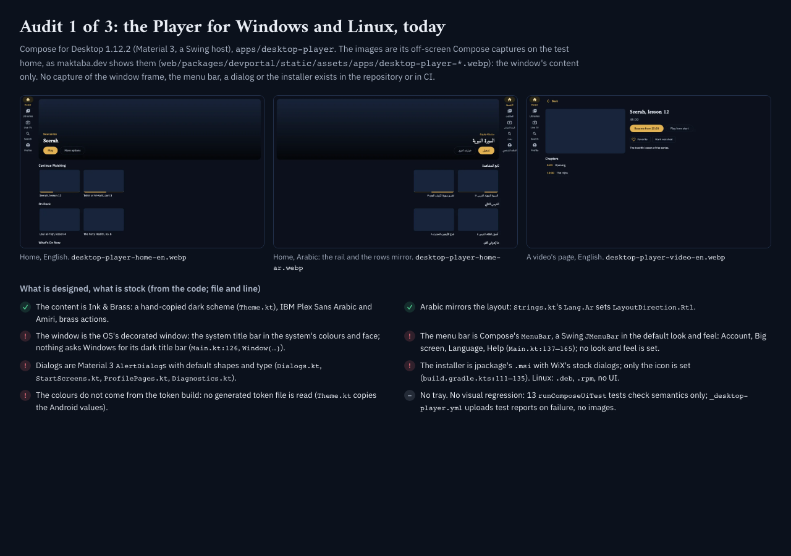
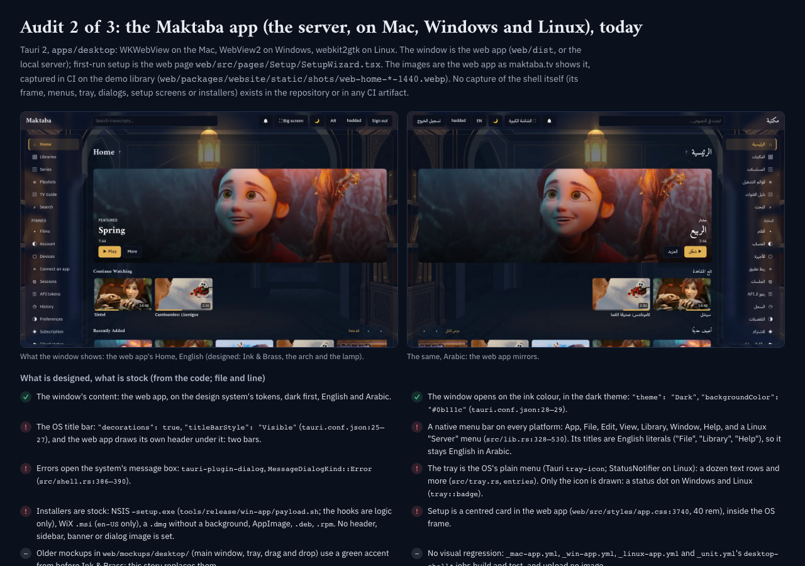
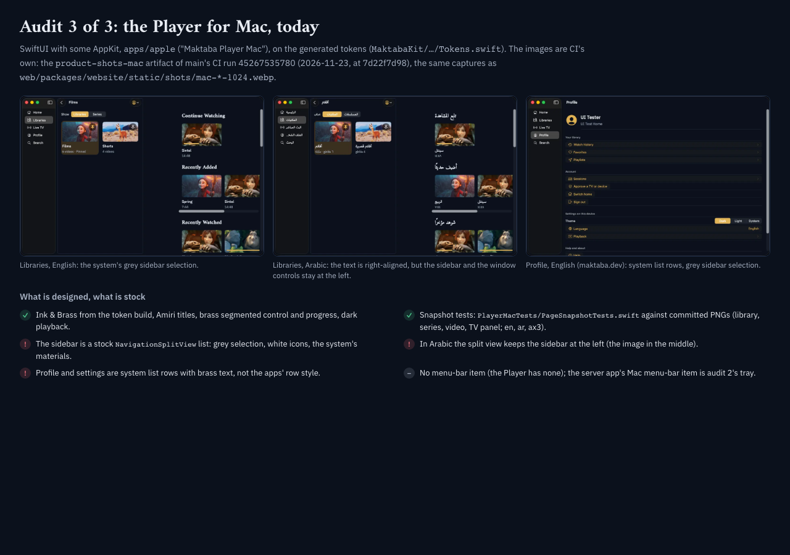

# Maktaba on the desktop: the design

The written spec of story 13.9 ([`specs/epics/13-desktop/story-13-09-desktop-design.md`](../../../specs/epics/13-desktop/story-13-09-desktop-design.md)):
how Maktaba's desktop apps stop looking like stock operating-system UI and look like one
designed Maktaba product, in English and Arabic, while keeping what people expect of Windows,
Linux and the Mac. The owner approved this design on 2026-11-24 ("Decisions" and "Review", below); the build
stories 13.10–13.18 build it, each in its own pull request.

## What is here

| Path | What it is |
|---|---|
| `README.md` | this spec: the audit, the direction, tokens, components, the approach per app, the quality bar, the decisions, the review record |
| `desktop.css` | the shared look of every mockup, on the real tokens (`web/packages/website/design/site-tokens.css`, generated from `web/design-system/tokens/`) and the real fonts (`web/packages/website/static/fonts/`) |
| `mockups/*.html` | one file per surface; each holds both languages (`?lang=ar` draws the Arabic) |
| `mockups/art/` | stand-in art drawn by `make_art.py` (space, desert, reef, sky, mountains, a library's arches); see "Demo media" |
| `mockups/kit.js` | the icons, the shared copy, the window controls of each platform, the Player's shell and the arch |
| `mockups/audit-*.html`, `audit.css` | the audit sheets: today's reference images, side by side, with what is stock |
| `mockups/png/` | the renders: `<mockup>.<lang>.png`, 39 PNGs, each under 1 MB, full colour |
| `render.mjs` | renders and checks them (story T01) |

```sh
# Playwright 1.64.1 from web/packages/website (npm ci there), or any node_modules holding it
NODE_PATH=web/packages/website/node_modules node docs/design/desktop/render.mjs
RENDER_ONLY=tray,dialog NODE_PATH=… node docs/design/desktop/render.mjs   # just those
SCALE=2 NODE_PATH=… node docs/design/desktop/render.mjs                   # @2x, for high-DPI review (not committed)
node docs/design/desktop/render.mjs --check                                # the committed PNGs only
```

The renders run headless Chromium on HTML: no app is launched and no Mac UI test runs.

## Audit: what each desktop surface is built with, and what looks stock

From the code at `e1f8313a5` and the images that exist. **No capture of any desktop window
frame, menu bar, tray, dialog or installer exists, in the repository or in CI.** The
references that do exist are the Compose Player's content (maktaba.dev,
`web/packages/devportal/static/assets/apps/desktop-player-*.webp`), the web app the server's
window shows (`web/packages/website/static/shots/web-*`), and the Mac Player (CI's
`product-shots-mac` artifact of main's run 45267535780, the same images as
`static/shots/mac-*`; and `apps/apple/PlayerMacTests/Snapshots/`).

| Audit sheet | |
|---|---|
|  | **1. The Player for Windows and Linux** (`apps/desktop-player`) |
|  | **2. The Maktaba app, the server** (`apps/desktop`, on all three) |
|  | **3. The Player for Mac** (`apps/apple`) |

**1. Player for Windows and Linux.** Compose for Desktop 1.12.2 (`org.jetbrains.compose`),
Material 3 1.9.0 in a Swing host; JavaFX 21 `MediaView` plays video. Window 1280 × 800
(`Main.kt:123`); F11 is full screen at 1.75×.
- Designed: the content (Ink & Brass from `Theme.kt`, Plex Sans Arabic and Amiri, brass
  actions); Arabic mirrors (`Strings.kt`, `Lang.Ar` → `LayoutDirection.Rtl`).
- Stock: the OS's decorated window and title bar (`Window(…)`, `Main.kt:126`; nothing asks
  Windows for its dark title bar); Compose's `MenuBar`, a Swing `JMenuBar` in the default look
  and feel (Account, Big screen, Language, Help, `Main.kt:137–165`); Material's default
  `AlertDialog` in `Dialogs.kt`, `StartScreens.kt`, `ProfilePages.kt`, `Diagnostics.kt`;
  jpackage's `.msi` with WiX's stock dialogs, only the icon set (`build.gradle.kts:111–135`).
- The colours are copied by hand from Android's theme; the token build's `Tokens.kt` is not read.
- No tray. No image test: 13 `runComposeUiTest` tests check semantics; `_desktop-player.yml`
  uploads reports on failure, no images.

**2. The Maktaba app (the server).** Tauri 2 (`apps/desktop/src-tauri/Cargo.toml`,
`tray-icon`): WKWebView, WebView2, webkit2gtk. The window is the web app (`web/dist`, or the
local server), 1280 × 800, minimum 960 × 600, dark, `#0b111c` before the first frame
(`tauri.conf.json:14–29`). First-run setup is the web page `web/src/pages/Setup/SetupWizard.tsx`
(its steps include welcome, what will run, storage, the admin account, library folders,
models, Plex and install), drawn as a 40 rem card (`web/src/styles/app.css:3740`). The shell's own words (tray, dialogs) are in
`src/lang.rs`, English or Arabic by the system language.
- Designed: everything inside the window.
- Stock: the OS title bar (`decorations: true`, `titleBarStyle: Visible`) above the web app's
  own header; a native menu bar (Maktaba, File, Edit, View, Library, Window, Help, and a
  Linux-only Server menu, `src/lib.rs:328–530`) whose titles are English literals; errors in
  the system's message box (`tauri-plugin-dialog`, `src/shell.rs:386–390`); the tray as the
  OS's plain menu, a dozen text rows and more (`src/tray.rs`, `entries`), with only the icon
  drawn (`tray::badge`'s status dot, Windows and Linux); installers with no branding: NSIS
  `-setup.exe` (`tools/release/win-app/payload.sh`; `installer-hooks.nsh` is logic only), WiX
  `.msi` in `en-US` only, a `.dmg` with no background (`tauri-build.sh` sets `CI=true`, which
  skips the Finder layout), AppImage, `.deb`, `.rpm`.
- Superseded: `web/mockups/desktop/` (main window, tray, drag and drop), drawn with a green
  accent from before Ink & Brass.
- No image test of the shell: `_mac-app.yml`, `_win-app.yml`, `_linux-app.yml` and
  `_unit.yml`'s `desktop-shell*` jobs upload none.

**3. The Player for Mac.** SwiftUI and AppKit (`apps/apple/project.yml`, "Maktaba Player
Mac"), `.defaultSize(1200, 780)`, on the generated `Tokens.swift`.
- Designed: Ink & Brass, Amiri titles, brass segmented control and progress, dark playback;
  page snapshot tests (`PlayerMacTests/PageSnapshotTests.swift`, en, ar, ax3).
- Stock: the `NavigationSplitView` sidebar's grey selection and white icons; system list rows
  in Profile; in Arabic the sidebar and the window controls stay at the left (CI's
  `mac-library-ar.png`).
- Its installer is the App Store's; it has no menu-bar item.

## Demo media

Demo media in these mockups, and in every visual reference the build stories make, shows no
women or girls: no posters, thumbnails, frames, avatars, cartoon characters or names. It is
documentaries (nature, science, space), historical material and children's programmes fit
for a conservative Muslim household. Until the replacement demo library lands
(`tests/fixtures/demo-library/`), the mockups use drawn stand-ins (`mockups/art/`, made by
`make_art.py`) and the demo library's two children's animations with only animals in them
(Big Buck Bunny; Caminandes: Llamigos and Gran Dillama). The audit sheets show only the parts
of today's captures with no demo art (the Mac sidebars, Profile, the Compose Player's empty
cards), and none of the web app's. The build stories' references use the new demo library
once it has landed.

## Direction

**A household's own library at night, carried into the window itself.** maktaba.tv's part B
(ink and brass, Maktaba Display, the arch) and the apps' Ink & Brass are already one look
inside the windows; the desktop work extends it to the frame, the menus, the tray and the
installers, so nothing on screen looks like it came from a different product.

- **One chrome.** The title bar and the navigation rail are one surface, the chrome colour
  (Mica's tint on Windows 11). The page sits in a panel with one rounded start corner, as
  WinUI's navigation view does; no second header under the title bar.
- **Brass means something.** The one primary action, the current place, focus, progress.
  Never decoration.
- **Two faces.** Maktaba Display for page and window titles, Maktaba Text for everything else,
  Arabic one step larger and looser.
- **One decoration.** The arch from the app icon, on the setup's and the installer's brand pane.
- **Platform where people expect it.** Window controls, Snap Layouts, the Mac's menu bar and
  traffic lights, keyboard conventions, panels that draw their own tray menus.

## Tokens: the `desktop` group

In `web/design-system/tokens/tokens.json` (`color.desktop`, since 13.15) beside Epic 17's
groups: `build-tokens.mjs` emits it to the site's CSS and to the desktop Player's `Tokens.kt`
(dark), and `make test-tokens` checks the contrast table below. Most are aliases; three are new
values (the shadow stays in each surface's CSS).

| Key | Dark | Alias of | For |
|---|---|---|---|
| `desktop.window` | `#0B111C` | `semantic.bg` | the window's ground, the page panel |
| `desktop.chrome` | `#0E1624` | `site.surface.hero` | title bar and rail; Mica's tint |
| `desktop.pane` | `#0F1725` | `semantic.nav` | side panes, dialog footers, tiles |
| `desktop.subtle` | `#131D2E` | `semantic.subtle` | fields, segmented controls |
| `desktop.raised` | `#18243A` | `semantic.raised` | menus, flyouts, dialogs |
| `desktop.hover` | `#1C2940` | new | a row or button under the pointer |
| `desktop.line` | `#22304A` | `semantic.border` | hairlines (separate only) |
| `desktop.control` | `#6B7A94` | `site.line.control` | a control's edge |
| `desktop.chosen` | `#3A3020` | `semantic.chosen` | the chosen row, the current chapter |
| `desktop.close-hover` | `#C42B1C` | new | Windows' close button under the pointer |
| `desktop.shadow` | 0 16 40 / 45%, 0 2 6 / 35% | new | menus, flyouts, dialogs |

Brass, its soft fill, the text on brass, focus, and the status colours are the existing
`brand.*` and `semantic.*` tokens. The light theme follows the system later (13.10's scope
says how); every mockup here is the dark default.

**Contrast** (WCAG 2.2; text 4.5:1, large text and UI parts 3:1), on every surface each
colour is drawn on:

| Foreground | window | chrome | pane | subtle | raised | hover | chosen |
|---|---|---|---|---|---|---|---|
| fg `#E8ECF3` | 15.95 | 15.29 | 15.15 | 14.26 | 13.11 | 12.30 | 10.92 |
| muted `#A9B3C4` | 8.94 | 8.57 | 8.49 | 7.99 | 7.34 | 6.89 | 6.12 |
| brass `#E3B252` (text, marks) | 9.68 | 9.28 | 9.20 | 8.65 | 7.95 | 7.47 | 6.63 |
| focus `#E9BE63` (ring) | 10.81 | 10.36 | 10.27 | 9.66 | 8.88 | 8.34 | 7.40 |
| control edge `#6B7A94` | 4.35 | 4.17 | 4.14 | 3.89 | 3.58 | 3.36 | (not drawn) |
| ok `#4CC38A` | 8.53 | 8.18 | 8.11 | 7.63 | 7.01 | 6.58 | 5.84 |
| error `#F0707F` | 6.60 | 6.32 | 6.27 | 5.90 | 5.42 | 5.09 | 4.51 |

Text on brass (`#1A1408` on `#E3B252`) is 9.37; white on the close red is 5.66. A control's
edge is never drawn on the chosen fill (2.98).

## Type

| Step | Latin | Arabic | Face, weight | Used for |
|---|---|---|---|---|
| hero | 48 / 56 | 52 / 76 | Display 700 | a video's title over its art |
| h1 | 34 / 42 | 37 / 54 | Display 700 | a page's title, the setup's step |
| h2 | 24 / 32 | 26 / 40 | Display 700 | the status window's state, settings' title |
| h3 | 18 / 26 | 19 / 30 | Text 600 | sections, dialog titles |
| lead | 16 / 24 | 17 / 28 | Text 400 | the line under a title |
| body | 14 / 22 | 15 / 26 | Text 400 | text, controls |
| small | 13 / 20 | 14 / 22 | Text 400 | meta, notes |
| caption | 12 / 16 | 13 / 20 | Text 600 | rail labels, group heads, badges |

Desktop text is a step smaller than maktaba.tv's (a window is read closer than a page). Arabic
is never letter-spaced; numbers in Arabic copy are Arabic-Indic, as the apps already write
them. Code and paths use the system monospace, always left to right.

## Components

Every size is a token; every target is at least 32 × 32 px with a pointer and 44 × 44 px in
big-screen mode. Focus is a 2 px brass ring, 2 px out, on every focusable thing.

- **Title bar (Windows).** 44 px, chrome colour (Mica). App icon and name at the start; the
  search field in the middle (Ctrl K); the big-screen and help buttons, the home switcher, then
  Windows' three caption buttons (46 px wide, the system's glyphs, close turns `#C42B1C`). The
  whole bar but its controls drags the window; double-click maximises; hovering maximise shows
  Snap Layouts. In Arabic the bar mirrors and the caption buttons sit at the start, as Windows
  draws a mirrored window.
- **Header bar (Linux).** 46 px, the same contents; GNOME's round close button at the end by
  default, the buttons and their order read from `gtk-decoration-layout` (KDE: minimise,
  maximise, close). Mirrors in Arabic.
- **Title bar (Mac).** The system's: traffic lights at the top start (the right in an Arabic
  app), the unified toolbar, the sidebar's vibrancy. Only what the app draws changes.
- **Rail.** 92 px, on the chrome; an icon in a 52 × 30 pill above its label; the current one
  brass on a soft brass pill and 600 weight; Profile at the bottom. The order of the apps'
  five sections (Home, Libraries, Live TV, Search, Profile). Labels wrap to two lines, never
  truncate.
- **Side list** (settings, Profile, the Mac sidebar). 40 px rows (32 on the Mac), icon,
  label, an end value; the chosen row on `chosen` with a 3 px brass edge at the start.
- **Buttons.** Primary: brass fill, ink text, 600; one per view. Quiet: transparent with a
  control edge. Ghost: no edge. Danger: error-coloured edge and text, for "Stop server and
  quit". Heights 36 and 44 (`lg`). Labels never truncate.
- **Fields, switches, segmented controls, chips, checkboxes, radios.** As `foundations`:
  fields on `subtle` with a hairline, brass edge when focused; switches brass when on, the
  knob at the end (the left in Arabic); segmented controls with a brass chosen segment; chips
  with a soft brass fill when on.
- **Cards.** 16:9 art with a 10 px radius, a hairline inside, the duration at the top end, a
  brass progress line at the foot, a brass check at the top start when watched; under it the
  title (600) and one muted line. Hover and focus: a brass ring and the play button.
- **Menus and flyouts.** `raised`, a 1 px `#2B3B5A` edge, 10 px radius, the shadow; 34 px
  items with an icon, a label and the shortcut at the end; a soft group head; hairline
  separators. The tray flyout adds the status head, three numbers, the update row and the two
  ways to quit as full-width buttons.
- **Dialogs.** Their own small window (or a modal over the window with a scrim): an icon tile
  (brass for a question, error-coloured for a failure), an h3 title, one plain sentence of
  what happened and what Maktaba can do, the programs' own error in a monospace box, and a
  footer with the way to the logs at the start, then the quiet and the primary button. Close
  only in the title bar. Enter is the primary button; Esc closes.
- **Setup and installer frame.** The setup's steps group into the five the step list shows
  (welcome; what will run, with storage; the admin account; library folders, with models and
  Plex; getting ready). A brand pane at the start (the wordmark, the step list, the
  arch glowing from below), the page at the end, a footer with the language switch or the
  fine print at the start and Back / Next at the end. The step list: a numbered ring, brass
  filled for the current step, a brass check for a done one.
- **Status tiles.** Pane, hairline, 12 px radius: an icon, the part's name, a status dot at
  the end (ok, running, idle, warn, error), a large value, one muted line, and a progress bar
  when something is under way.
- **The player's controls.** Over a gradient: the title and chapter at the top with the
  caption buttons; at the foot the timeline (chapters as gaps, buffered in a lighter grey, a
  brass knob and a preview of the frame and the chapter on hover), then play/pause in a white
  circle, back and forward 10 s, next, the time, volume; at the end subtitles, audio, quality,
  picture in picture, full screen. A menu opens above its button.

## Arabic and RTL

- Everything mirrors through logical properties only: layout, rail, panes, caption buttons
  (Windows and GNOME draw them at the start of a mirrored window; the Mac moves the traffic
  lights), the knob of a switch, the order of buttons.
- **Never mirrored:** media. The timeline fills left to right and the transport keeps its
  order (play, back 10, forward 10, next, time), as Apple's and Google's players do; play and
  media icons, the app icon, the arch, check marks and logos.
- **Mirrored icons:** back, onward, chevrons, the external-link arrow, sign out.
- A card's watched line and other progress bars mirror (they fill from the right in Arabic),
  as the Mac Player's do today; only a media timeline keeps left to right.
- Latin inside Arabic (a machine name, a path, a version, a shortcut) is isolated (`<bdi>`, an
  LTR run), so punctuation lands on the right side. Times and counts are written in
  Arabic-Indic digits and each one isolated, so "٦:٢٠ / ١٤:٤٨" reads in order.
- Installers in Arabic: NSIS's Arabic language file is right to left; WiX gets an `ar-SA`
  culture with right-to-left controls.

## How each app gets there

| App | Surface | Approach | Effort | Risk |
|---|---|---|---|---|
| Server app (Tauri) | frame, Windows | `decorations: false`; the title bar drawn by the web app (`data-tauri-drag-region`); our own caption buttons; Snap Layouts kept by answering `WM_NCHITTEST` with `HTMAXBUTTON` over the maximise button (a small Rust hook on the window procedure); Mica through `windowEffects` with `transparent: true` on Windows 11, the flat chrome colour on 10 | M | M: Snap Layouts and resize edges need the hook; tested on 10 and 11, 100–200% |
| | frame, Linux | `decorations: false`, a header bar in the web app with the buttons from `gtk-decoration-layout`, resizing by `start_resize_dragging` | M | M: compositors differ (GNOME Wayland, KDE, X11); rounded corners need a transparent window on webkit2gtk |
| | frame, Mac | `titleBarStyle: "Overlay"`, `hiddenTitle`: the traffic lights stay, the web app draws under them | S | L |
| | menu bar | Windows and Linux: none; its items move into the title bar's menu and stay as keyboard shortcuts. Mac: the native app menu, localized from `lang.rs` | S | L: `menu_contract.rs` keeps the ids |
| | setup, status | the web app's pages, restyled; setup and status open as their own 960 × 640 windows | M | L |
| | dialogs | a themed, ownerless window for the shell's errors and questions (`/dialog`), always on top, Enter and Esc; the system box kept only when the WebView cannot start | S | L |
| | tray | Windows and Mac: left click opens a frameless flyout window placed from the tray icon's rectangle, hidden on blur; right click keeps the native menu, reordered and localized (also the keyboard and screen-reader way). Linux: the panel draws the menu; only its words, order and icons change; activating the icon opens the status window where the panel allows | M | M: placement on every taskbar side and monitor, DPI |
| | installers | NSIS through Tauri's custom template (`bundle.windows.nsis.template`): two pages, welcome and progress, with the brand pane as a bitmap made by this render pipeline per language (the faces cannot load in NSIS; titles are drawn into the bitmap), the rest in Segoe UI on the ink colours (`SetCtlColors`); Arabic RTL. `.msi`: dialog and banner bitmaps, text styles in the light-on-ink colours, an `ar-SA` culture. `.dmg`: a background with the arch and the drag arrow, set up without Finder scripting | M | M: NSIS UI code; the dmg layout must not need a GUI session in CI |
| Player (Compose) | frame | Jewel's decorated window (`org.jetbrains.jewel:jewel-int-ui-decorated-window`) on the JetBrains Runtime, which keeps native resizing, snapping and Snap Layouts while Compose draws the title bar; jpackage bundles that runtime | M | M: the runtime changes (JavaFX video tested on it); the fallback is an undecorated window with Compose's draggable area, which loses Snap Layouts |
| | menu bar | removed: Account → the home switcher, Big screen → the title bar button and F11, Language → Settings, Help → the help button | S | L |
| | theme | colours and type from the token build (`native.mjs` gains the desktop Player's Kotlin file), not copied | S | L |
| | dialogs | one Maktaba dialog composable replacing Material's defaults | S | L |
| | video | libmpv (LGPL build) through JNA in place of JavaFX's media stack: MKV, HEVC, AC-3, 5.1 and more play as they are; the Player reports what it decodes to the home, as Android's #1521 did; story 13.18 | L | M: drawing mpv's frames under Compose's controls; bundling per OS; licences |
| | installer | jpackage `--resource-dir`: the WiX bitmaps, text styles and the Arabic culture | S | M: jpackage's WiX template version |
| Mac Player (SwiftUI) | sidebar, rows | brass selection (`listRowBackground`, tinted symbols); Profile and settings in the apps' row style | S | L |
| | Arabic | the in-app language writes `AppleLanguages` and offers a relaunch, so AppKit lays the split view and the traffic lights out right to left | S | L: one relaunch on switching |
| Server app, Mac | menu-bar item | as the Windows tray: a panel on click, the native menu on right click | S | L |

All of 13.10–13.18 together is about eight medium stories and one large one. The order that
removes the most stock first: 13.10 (frame), 13.12 (tray), 13.11 (dialogs), 13.15 (Player
chrome, on the JetBrains Runtime), 13.18 (libmpv, on 13.15's runtime), then 13.13, 13.14,
13.16; 13.17 (the references) runs beside the first one, so each build story lands with its
capture.

## Quality bar

**Visual references** (story 13.17), compared in CI and listed in a pull request's
`Reference images:` section like maktaba.tv's (`tools/ci/reference_images.py` gains their
folders):
- The server app's pages (setup, status, dialog, flyout, title bar): Playwright on the web
  build, in the amd64 Playwright image, at each window size, en and ar, 1× and 2× (as the
  website's references are made).
- The Compose Player: `captureToImage()` in the existing `runComposeUiTest` tests, on Linux CI
  with the bundled fonts, compared to committed PNGs per screen, en and ar.
- The Mac Player: the existing `PageSnapshotTests`, plus the sidebar and Profile in Arabic.
- The native parts no browser can draw (the real frame with Mica, the tray flyout in place,
  the installers): a Windows job launches the built app and installer and captures them
  (`PrintWindow`), uploaded as an artifact and reviewed by a person beside the mockups; Linux
  the same under a headless GNOME session. These are compared by eye, not pixel by pixel
  (ClearType and the wallpaper vary).
- Each build story's pull request shows its capture beside its mockup; the lead records each
  difference as fixed or accepted (`docs/design/desktop/review-NN.md`).
- Every reference is taken on the demo library and follows "Demo media" above; a reference
  that shows a woman or a girl is not accepted.

**Accessibility.** WCAG 2.2 AA: the contrast table above; every control reachable by
keyboard in reading order (mirrored in Arabic); F6 cycles title bar, rail and page; the focus
ring on everything; Esc closes menus, flyouts and dialogs; every icon button named. Screen
readers: Narrator and NVDA on Windows (WebView2 exposes the pages' ARIA; the Compose Player's
semantics through the Java Access Bridge, checked by hand once per release), Orca on Linux,
VoiceOver on the Mac. The tray's native menu stays reachable from the keyboard (Win+B) as the
accessible way in. `forced-colors` and Windows contrast themes give the system colours to text,
edges and focus; reduced motion keeps only colour changes; text scaling to 200% reflows.

**High DPI.** Everything drawn as vectors or text; per-monitor DPI awareness (WebView2 and the
JetBrains Runtime both are); the installer bitmaps at 100, 150 and 200% where the format allows
(NSIS draws one bitmap per control: the template picks the file by the system's DPI); each mockup reviewed at 2× (`SCALE=2`).

**RTL.** Every reference in Arabic too; the rules above; no physical CSS property in the
desktop styles (T03).

## Decisions (approved 2026-11-24)

- **D1 Windows frame:** our own title bar, with Snap Layouts kept. Approved.
- **D2 Tray:** a designed panel on left click, the native menu on right click. Approved.
- **D3 Installers:** the branded two-page NSIS for the server app, themed `.msi`s, and the
  designed `.dmg` background. Approved.
- **D4 Player runtime and video:** the Player stays on Kotlin and Compose, moves to the
  JetBrains Runtime for its decorated window, **and replaces JavaFX's media stack with
  libmpv** (through JNA), so it plays MKV, HEVC, AC-3 and 5.1 itself instead of the home
  converting them (story 13.18). Rust, Java and .NET were weighed; Kotlin keeps the `:client`
  module shared with the Android apps.
- **D5 Mac in Arabic:** switching the Mac Player's language relaunches it, after a prompt in
  English and Arabic, so the sidebar and the traffic lights move to the right. Approved.

## Review

| Part | Date | Reviewer | At | Outcome | Open |
|---|---|---|---|---|---|
| The design (#1556) | 2026-11-24 | the owner | `bead7a18c` (renders) | approved, with D1–D5 as above; D4 adds libmpv (13.18) | build stories 13.10–13.18 |

## As built: the installers (13.14)

The art is drawn from `installer-art/art.html` by `installer-art.mjs` (Playwright, on the real
tokens, faces and the arch) into the files each tool reads; `installer-art/preview.png` shows
every piece at 1x. Where the build differs from the mockups (`installer-welcome`,
`installer-progress`, `installer-msi`), and why:

| Surface | Difference | Why |
|---|---|---|
| `-setup.exe` | NSIS's own window size (about 500 × 390 at 100%), the pages laid out to scale in it, not 720 × 460 | MUI's dialog resource; resizing it at run time would move every system control |
| | the words in Segoe UI; the titles and the wordmark in Maktaba Display, as bitmaps (100, 150, 200%) | NSIS cannot load the faces |
| | Windows' own buttons (Cancel, Install), not brass | NSIS buttons are system push buttons |
| | the check boxes drawn classic, their words in the page's colours | a themed check box ignores its text colour, which would be black on ink |
| | no "Start Maktaba when I sign in" on the welcome page; an "Installs in" caption over the folder | the app's setup decides the sign-in start (`run_entry.rs`), and the installer never did; the folder field needs a name for screen readers |
| | three steps (the app; the server and its tools; the Start menu and shortcuts), ✓ ● ○ glyphs, no percentage | the steps the installer really takes; the sign-in task is setup's |
| | "Open Maktaba when it's done" at the page's foot, not in the button strip | the strip is NSIS's outer window |
| | the reinstall page (only over an earlier install) and the uninstaller stay MUI's, their header in the chrome colour | radio buttons and the uninstaller's pages keep Windows' look |
| Player `.msi` | no version note on the dialog bitmap; Windows' buttons and button strip | WiX draws no version there; Windows Installer draws its buttons |
| | Arabic through an embedded language transform (WiX's Arabic words, mirrored dialogs, mirrored bitmaps) | jpackage builds one language; compose empties jpackage's resource folder, so the theming is applied to the built `.msi` |
| server `.msi` (tauri; not released) | the bitmaps and text styles, an `ar-SA` build in WiX's Arabic, its dialogs not mirrored | tauri's WiX takes the words but no per-control layout |
| `.dmg` (no mockup) | the app stands in the arch, a brass arrow to Applications, the two names on a shelf whose tone reads black and white names at 4.5:1 | Finder draws the names black or white by the Mac's appearance |

Windows' and Finder's own drawing is checked by CI's builds (win-app, Desktop Player, mac-app's
bundle-size job), not by a capture; 13.17's Windows capture job is where the pages are seen.
