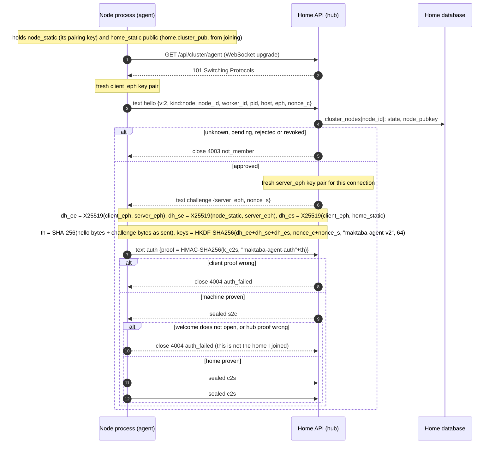
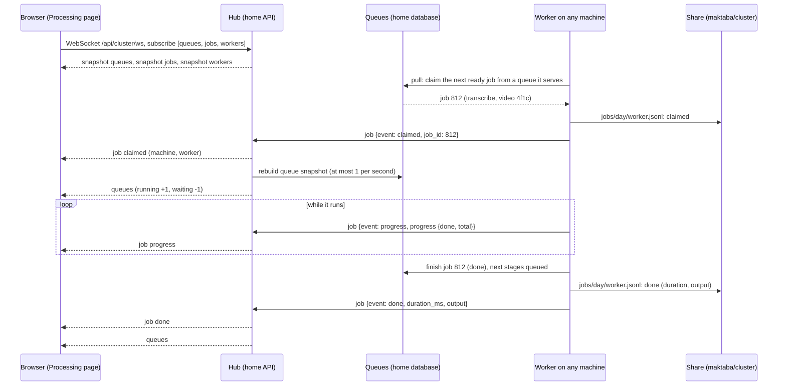
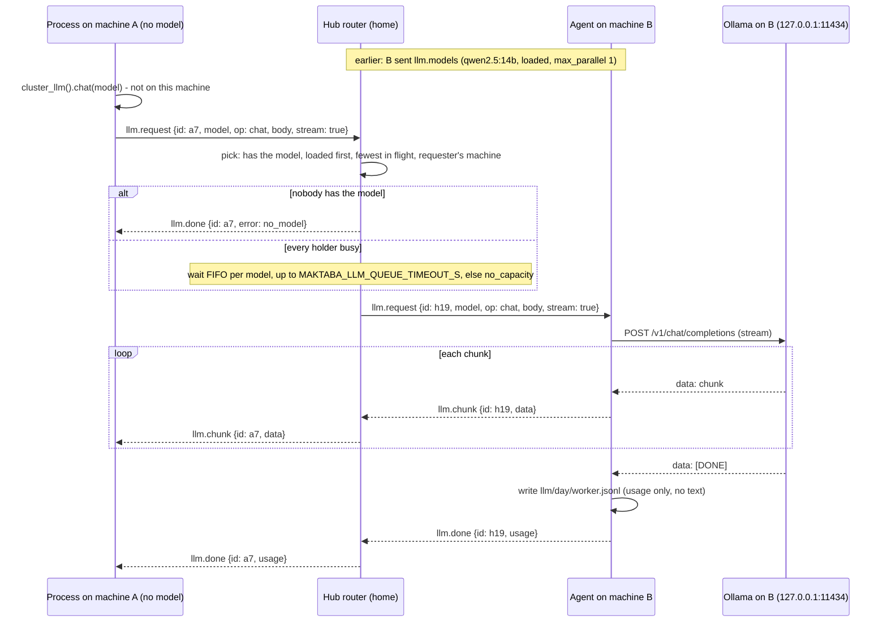
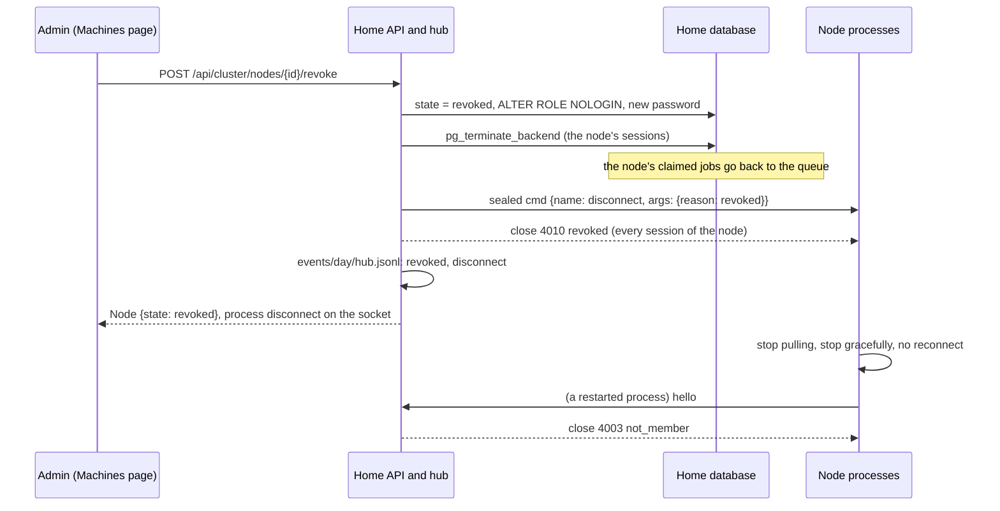

# Design — The cluster channel (Epic 31, phase 2)

Phase 1 requirements: [README.md](README.md). Phase 1 design (built, merged):
[design.md](design.md). Phase 2 plan: [plan-agent.md](plan-agent.md). User documentation:
[docs/cluster](../../../docs/cluster/README.md).

**Status.** Authoritative for phase 2. Consolidated on 2026-10-19 from the amendments made on
2026-10-18/19 as the owner refined the requirements; what the consolidation clarified or
added is listed in [Appendix A](#appendix-a--consolidation-notes), and what still needs an
owner decision in [§13](#13-open-points-for-the-owner).

Phase 1 made machines join one home and share its database. Phase 2 makes the home and its
machines work and look like **one cluster**: every Maktaba process holds a live,
authenticated, encrypted channel to a hub on the home, over which flow real-time
**metrics**, **logs**, **job events**, **commands** and **LLM work**; every machine saves
what it collects to **files on the shared video storage**, where every other machine can
read them; and the Processing page watches the whole cluster live through the hub.

The database keeps the catalog and the queues, and — "keep a database, but it will be like
a cache" (owner) — a bounded, disposable cache of the channel that only the hub writes, so
recent history reads fast (§7.9). Logs, metrics and LLM traffic never travel through the
database; the files on the share are their record.

## 0. Requirements and trace

The owner's phase 2 requirements, in the order they were given (2026-10-18/19; 10 refines 2):

| # | Requirement | Satisfied by |
|---|---|---|
| 1 | Metrics over a socket for every worker; LLMs running on any machine usable by all; "all should be like a cluster" | §4 every process runs an agent on one channel to the hub; §5 `metrics` frame; §8 LLM runtimes, router and doors; §6 hub |
| 2 | "Build it solid"; "no database" — logs, metrics, LLM traffic never through the database | §4 mutually authenticated, forward-secret, encrypted, versioned protocol with strict counters; §10 failure behaviour; §9 settings from the environment; §2 the three planes; §7.9 the database only as the hub's cache |
| 3 | Real-time streams | §5 metrics every 2 s, logs within 250 ms, job events as they happen; §6.4 browser WebSocket |
| 4 | Saved to files by node IP | §7.3 the IP folder; §7.4 layout |
| 5 | All saved on the videos share under a `maktaba` folder, viewable from all nodes, each finding the right path for its OS | §7.1 share root; §7.2 per-OS path through each machine's path map |
| 6 | Collected by all and viewable by all (each machine writes its own files; everyone reads) | §7.5 one writer per file; §7.8 readers (CLI on any machine, REST on the home) |
| 7 | Same for queue metrics, job metrics, library — all | §5.3 `job` frame; §7.4 `jobs/`, `queues/`, `library/`; §6.4 topics `jobs`, `queues`, `library` |
| 8 | The Processing page talks to a central hub on the main node over a WebSocket; all jobs on all machines talk to that hub | §6.4 `/api/cluster/ws`; §6.5 Processing page; §5.3 every job reports to the hub |
| 9 | Not stages: the work is split into queues on the main node and each machine's workers pull jobs from those queues | §3 queues and pulling |
| 10 | "Keep a database, but it will be like a cache" | §7.9 the database cache: `health_samples` and two cache tables, written only by the hub, bounded, refilled from the files |

## 1. Words used here

| Word | Meaning |
|---|---|
| **home** | The main machine: it runs the API (and the hub inside it), the database (catalog and queues) and its own workers. |
| **machine** (node) | Another computer that joined the home (phase 1) and runs workers. |
| **process** | One running `maktaba-pipeline run` (a worker process), on the home or on a machine. Several may run on one machine. |
| **agent** | The part of every process that holds its channel to the hub. |
| **hub** | The part of the home's API that accepts agents, keeps the live state of the cluster, serves browsers, routes LLM requests and writes the home's own files. |
| **session** | One authenticated agent connection; identified by the id the hub gives it in `welcome`. |
| **queue** | The jobs waiting for one stage of the processing graph (probe, extract, transcribe, …). The code and the database name a queue by its stage, so some fields keep the word `stages`. |
| **cluster key** | The home's long-term X25519 key pair (`home-cluster.key`, local to the home). Its public half is in every machine's node config, so a machine can tell its home from an impostor (§4.2). |
| **share** | The network storage that holds the videos (the NAS). |
| **share root** | The top of the share as the database writes paths (§7.1). |
| **cluster directory** | `<share root>/maktaba/cluster`, where every machine writes its files. |
| **IP folder** | A machine's own folder in the cluster directory, named by its IP address (§7.3). |

## 2. Shape

```
                       ┌──────────────────────────── HOME ─────────────────────────────┐
 browser ── WebSocket /api/cluster/ws ──►│ API ┌─ hub ─────────────────────────────┐      │
 (Processing,  (SSE /ws/queues, /ws/jobs │     │ live state · fan-out · commands   │      │
  Machines)     as fallback)             │     │ LLM router · revocation           │      │
                                         │     └──▲───────────────────▲────────────┘      │
 OpenAI client ── /api/cluster/llm/v1 ──►│        │ agent channel      │ agent channel     │
                                         │  home workers (agents)     │                   │
                                         │  Postgres: QUEUES, catalog, cache ◄─ pull ───┐ │
                                         └────────────────────────────┼─────────────────┼─┘
                                                                      │                 │
 MACHINE (macOS / Linux / Windows) ── workers (agents) ── WebSocket /api/cluster/agent  │
                                         └── pull jobs (SQL, own role) ─────────────────┘

 every process (home and machines) ──► NAS share: <share root>/maktaba/cluster/<ip>/…
 every machine reads every folder through its own path to the share
```

Three planes, each with one job:

| Plane | Carries | Where |
|---|---|---|
| **Database** | the catalog and the queues (phase 1: jobs, claims, the worker registry, machines and their switches) **+ a cache of the channel** (§7.9) | Postgres on the home |
| **Channel** (this phase) | live metrics, logs, job events, commands, LLM requests and answers | one WebSocket per process to the hub, sealed frames |
| **Files** (this phase) | the record: logs, metrics, job events, LLM usage, hub events, queue and library snapshots | JSON Lines on the share, one IP folder per machine |

The files are the record. The database keeps a cache of the channel for fast reading:
written only by the hub, bounded, and disposable — emptying it loses nothing the files do not
hold (§7.9). The channel is the real-time view; the files keep being written when the home is
down.

## 3. Queues and pulling

All the work is split into **queues**, and the queues live on the home, in its database.
There is one queue per stage of the processing graph.

Every worker on every machine **pulls**: it takes the next ready job from a queue it serves
(the queue engine's claim, plan 06-11), runs it, records the result, and takes the next.
Nothing decides centrally which machine runs which job, and nothing is sent to a machine to
run: a job is run by whichever worker pulls it first. Global limits (pools such as NAS
readers) stay in the queue engine and hold across all machines.

Which queues a worker pulls from, the worker works out itself, exactly as in phase 1
([design.md §5](design.md#5-which-stages-a-worker-claims)): a queue is left out when it is
not in the worker's `--stages` (or is in `--exclude-stages`), when the database has a newer
version of the stage than the worker's code, when the stage cannot run on this machine
(platform, missing extras), when it runs on the home only, when the machine's storage is
not reachable, when the admin switched it off for this machine, or when the machine is
draining. The admin's switches and drain stay where phase 1 keeps them
(`cluster_node_stages`, `cluster_nodes.drain`).

What this phase adds is speed and sight:

- **Changes apply at once.** When an admin changes a switch or drain on the Machines page,
  the hub sends `reload_stages` (§5.4) to that machine's processes and they re-evaluate
  immediately. The 30-second re-evaluation of phase 1 stays, for when the channel is down.
- **Every pulled job reports to the hub** (`job` frames, §5.3) for its whole life, so the
  hub — and through it the Processing page — sees every queue's jobs live, on whichever
  machine they run.

## 4. The agent channel

### 4.1 Transport

- Endpoint: `GET /api/cluster/agent`, a WebSocket on the API's public port (8080 by
  default): one port to open, and it passes the same proxies as the web app. The route is
  public in the HTTP sense (on the auth allowlist); authentication is inside the protocol.
- Who connects: every pipeline process, home and machine alike.
  - A **machine's** process dials the home URL in its node config (`home.url`, phase 1 §7).
  - A **home** process dials `MAKTABA_API_URL` (default `http://127.0.0.1:8080`).
- Before authentication the frames are WebSocket **text** frames holding JSON. From
  `welcome` on, every frame is a WebSocket **binary** frame holding one sealed frame (§4.4).
  A text frame after authentication is a protocol error.

### 4.2 Handshake — a machine's process (v2: mutual, forward secret)

Both sides prove who they are and every connection has fresh keys (a Noise-style
pattern of three Diffie-Hellman results):

- the **machine** proves it holds the X25519 key it paired with (phase 1:
  `cluster_nodes.node_pubkey`);
- the **home** proves it holds its long-term **cluster key**: an X25519 key pair the API
  keeps in `~/.maktaba/cluster/home-cluster.key` (local disk, mode 0600, never the share;
  `MAKTABA_HOME_CLUSTER_KEY` names another path), whose public half reaches every machine
  inside its sealed pairing credentials (phase 1 payload: `home.cluster_pub`) and is kept in
  the node config. A device in the middle can pose as neither side;
- both send a fresh ephemeral key, so recording traffic and later stealing a long-term key
  does not decrypt it (forward secrecy).

1. C→S text `hello` (its exact bytes are kept for the transcript):
   `{"t":"hello","v":2,"kind":"node","node_id":"<uuid>","worker_id":"node-1a2b3c4d-4242","pid":4242,"host":"studio-linux","eph":"<b64, 32-byte X25519 public>","nonce":"<b64, 16 bytes>"}`
   (optional informational `ip`, `os`, `version`).
2. The hub looks up the node; unless it is `approved` it closes with `4003 not_member`
   (same answer for unknown, pending, rejected, revoked). Otherwise S→C text `challenge`:
   `{"t":"challenge","server_eph":"<b64, 32 bytes>","nonce":"<b64, 16 bytes>"}`.
3. Both sides derive (each from its own private halves):
   ```
   dh_ee = X25519(client_eph,  server_eph)        forward secrecy
   dh_se = X25519(node_static, server_eph)        the machine is who it says
   dh_es = X25519(client_eph,  home_static)       the home is who it says
   th    = SHA-256(hello_bytes ‖ challenge_bytes) the transcript, as sent
   okm   = HKDF-SHA256(ikm = dh_ee ‖ dh_se ‖ dh_es, salt = client_nonce ‖ server_nonce,
                       info = "maktaba-agent-v2", L = 64)
   k_c2s = okm[0:32]      k_s2c = okm[32:64]
   ```
   Any all-zero DH result (a low-order key) is refused by both sides.
4. C→S text `auth`: `{"t":"auth","proof":"<b64 HMAC-SHA256(k_c2s, "maktaba-agent-auth" ‖ th)>"}`;
   the hub compares in constant time, else `4004 auth_failed`.
5. S→C sealed `welcome` (first sealed frame, counter 0) with
   `"proof":"<b64 HMAC-SHA256(k_s2c, "maktaba-agent-server" ‖ th)>"`, `session` and
   `settings`. The process checks the proof (a wrong or undecryptable welcome closes the
   connection and is reported as "this is not the home I joined"). From here every frame
   both ways is sealed.

A node config without `home.cluster_pub` (joined before v2) cannot connect: the agent logs
"re-join this machine" and the worker keeps pulling from the queues without the channel.

The whole handshake must finish within 10 s of the upgrade (`4008 timeout`).

### 4.3 Handshake — a home process

A process on the home has no pairing key; it shares the **home agent key** with the API:
32 random bytes in `~/.maktaba/cluster/home-agent.key` (local, 0600; `MAKTABA_HOME_AGENT_KEY`
names another path). Same steps with `kind: "home"`, no `node_id`, and
`ikm = home_key ‖ dh_ee` (both sides hold the key: mutual; `dh_ee` gives forward secrecy).
Transcript, HKDF (`info = "maktaba-agent-v2"`), proofs and sealing are identical.

Vectors for both variants: `shared/testdata/cluster/agent_vectors.json`.

### 4.4 Sealed frames

```
nonce     = 00 00 00 00 ‖ counter as uint64 big-endian                      12 bytes
sealed    = ChaCha20-Poly1305(key = k_dir, nonce, plaintext = UTF-8 JSON, aad = empty)
          = ciphertext (same length as the plaintext) ‖ tag (16 bytes)
WebSocket binary payload = sealed                                    (the nonce is not sent)
```

`k_dir` is `k_c2s` for frames from the process, `k_s2c` for frames from the hub. Each
direction keeps its own counter, starting at 0 with its first sealed frame and increasing by
one per frame. The receiver opens a frame only with the counter it expects; a gap, a repeat
or a failed tag closes the connection with `4011 seal_error`. The plaintext is one JSON
object with a string field `t` naming the frame type.

**Interop vectors**: `shared/testdata/cluster/agent_vectors.json` holds fixed static and
ephemeral keys, nonces, the exact `hello` and `challenge` bytes, the transcript hash, the
three DH results, the derived keys, both proofs and three sealed frames (a node session,
starting with the `welcome` that carries the hub's proof), plus the home-key variant. The Go
and the Python tests both check against it. Any change to a constant of §4.2–§4.4 changes the
vectors and is a new protocol version (§4.7).

### 4.5 Liveness and reconnecting

- Either side sends a sealed `ping` every 15 s; the other answers `pong`. 45 s without any
  frame closes the connection (`4008 timeout`).
- The agent reconnects after any close it does not treat as final (§4.6): first after 1 s,
  doubling to at most 30 s, with ±20 % jitter; the delay resets once a session has lasted
  60 s. The worker keeps pulling jobs the whole time — the channel never gates work.

### 4.6 Close codes

| Code | Name | Sent by | Meaning | The agent then |
|---|---|---|---|---|
| 1000 | `normal` | either | the process or the hub stops cleanly | reconnects if it is still running |
| 1001 | `going_away` | hub | the API is restarting | reconnects with backoff |
| 4000 | `protocol_error` | either | malformed JSON, an unexpected frame, text after `welcome` | reconnects with backoff |
| 4001 | `unsupported_version` | hub | `hello.v` is not served (version 1 never is); the close reason lists the versions served, e.g. `unsupported_version 2` | retries at the longest delay; logs it once an hour |
| 4003 | `not_member` | hub | the machine is unknown, pending, rejected or revoked | retries at the longest delay and checks its membership through the database at once (the node heartbeat); never stops for good on this close alone |
| 4004 | `auth_failed` | either | hub: wrong client proof (wrong pairing key or home agent key); agent: a `welcome` that does not open or carries a wrong hub proof; either: an all-zero DH result | retries at the longest delay; when the hub failed to prove itself, logs "this is not the home I joined" |
| 4008 | `timeout` | either | handshake over 10 s, or 45 s of silence | reconnects |
| 4009 | `replaced` | hub | a newer session with the same `worker_id` authenticated | retries at the longest delay; logs an error (two processes share a worker id) |
| 4010 | `revoked` | hub | the admin revoked this machine | retries at the longest delay and checks its membership through the database at once; the worker stops for good (exit 77) only on the sealed `cmd disconnect {reason: "revoked"}` that precedes this close, or when the database says revoked / removed or refuses its login |
| 4011 | `seal_error` | either | after `welcome`: a tag failed, or a counter gap or repeat (a `welcome` that does not open is `4004`) | reconnects (new keys) |
| 4012 | `too_large` | either | a frame over the size limit (§4.7) | reconnects |
| 4013 | `rate_limited` | hub | too many handshakes from this address | retries at the longest delay |
| 4014 | `disconnect` | hub | an admin's `disconnect` command | reconnects with backoff |
| 1013 | `try_again_later` | hub | the agent did not keep up: its outgoing queue to the hub overflowed | reconnects with backoff |

The close reason (at most 123 bytes) carries the name and an optional short detail.

**Close codes are hints, not authority.** A WebSocket close frame is not authenticated:
`4003` is sent before any proof, and even after `welcome` a close frame travels outside the
sealed stream, so anyone who can answer as the home on the LAN could send one. A process
therefore stops for good (exit code 77, which services do not restart) only on an
authenticated signal: the sealed `cmd disconnect {reason: "revoked"}` (the hub sends it
before closing `4010`), or the database — the node heartbeat finding the machine revoked,
rejected or removed, or its database login refused (phase 1). On a bare `4003` or `4010` the
agent waits the longest delay and runs the heartbeat's membership check at once: approved,
it keeps working; revoked, that path stops it.

A machine whose node config has no `home.cluster_pub` (joined before version 2) does not try
to connect at all: it logs "re-join this machine" once an hour and keeps working.

### 4.7 Versioning and limits

- `hello.v` is the protocol version, now **`2`**. Version 2 is defined by its labels —
  `maktaba-agent-v2` (HKDF info), `maktaba-agent-auth` (the process's proof),
  `maktaba-agent-server` (the hub's proof) — by the transcript rule (SHA-256 over the exact
  `hello` and `challenge` bytes as sent), by the layouts of §4.2–§4.4 and by the vectors.
- Version 1 (the first draft: a static machine key against a fresh hub key, the hub not
  proven, no forward secrecy) is not served: a `hello` with `v: 1` is closed with `4001`.
- A new version brings new labels and new vectors. The hub may serve several versions at
  once; the agent sends its highest, and on `4001` retries with the highest version both
  serve, if any.
- Within version 2 only additive changes are allowed: new optional fields and new frame
  types. Receivers ignore unknown fields, unknown `settings` keys and unknown frame types
  (an ignored frame still advances the counter). The transcript covers the bytes as sent,
  so optional `hello` fields need no canonical form.
- A sealed frame is at most 4 MiB. A `logs` frame holds at most 1 000 records; a record
  over 64 KiB has its `fields` cut and `"truncated": true` added.
- The hub accepts at most 30 handshakes a minute from one address (`4013`).

## 5. Frames

### 5.1 Catalogue

All frames are sealed JSON objects with `t` naming the type.

| `t` | Direction | When | Content |
|---|---|---|---|
| `welcome` | S→C | once, first sealed frame | `proof` (the hub's, §4.2), `session`, `settings` {`log_level`, `metrics_every`, `share_root`, `retention_days`, `file_mb`, `ip` (the IP folder to write under, §7.3)} |
| `metrics` | C→S | every `metrics_every` s (2), and a last one at a graceful stop | §5.2, including `health` |
| `logs` | C→S | batched, within 250 ms | `records` [{`ts`, `level`, `event`, `logger`, `fields`}] at or above the session's level |
| `job` | C→S | as it happens | §5.3 — every job this process runs |
| `dropped` | C→S | after a reconnect | `logs` (count of log records dropped while disconnected), `since`, `until` |
| `llm.models` | C→S | after `welcome`, then on change | `runtimes` [{`provider`, `base_url`, `models` [{`name`, `size`, `family`, `quant`, `loaded`}], `max_parallel`}] |
| `llm.request` | both | C→S: a process asks the cluster; S→C: the hub hands it to the machine that runs it | `id`, `model`, `op` (`chat` \| `generate` \| `embed`), `body`, `stream` |
| `llm.chunk` | both | while streaming | `id`, `data` |
| `llm.done` | both | once per request, always | `id`, `usage` {`prompt_tokens`, `completion_tokens`, `ms`}, `error`? {`code`, `detail`}; codes `no_model`, `no_capacity`, `machine_gone`, `runtime_error`, `cancelled`, `too_large`, `no_channel` (local only) |
| `llm.cancel` | both | the requester gave up | `id`; the runner stops and still sends `llm.done` (`cancelled`) |
| `cmd` | S→C | an admin or the hub acts | `id`, `name` (`drain` \| `undrain` \| `reload_stages` \| `log_level` \| `disconnect`), `args` |
| `cmd.result` | C→S | after each `cmd` | `id`, `ok`, `detail` |
| `ping` / `pong` | both | every 15 s | `ts` (the `pong` echoes the `ping`'s `ts`) |

Timestamps are RFC 3339 in UTC. Sizes are bytes; rates are per second.

### 5.2 `metrics`

```json
{"t": "metrics", "ts": "2026-10-19T08:00:02Z",
 "system":   {"cpu_pct": 41.5, "load1": 3.2, "mem_total": 68719476736, "mem_available": 30064771072,
              "swap_used": 0, "disks": [{"path": "/", "total": 0, "free": 0}],
              "net": {"rx_bps": 1200000, "tx_bps": 80000}},
 "gpu":      {"nvidia": [{"name": "RTX 4070", "util_pct": 87, "mem_used": 0, "mem_total": 0, "temp_c": 66}],
              "apple": {"active_gb": 0, "cache_gb": 0, "peak_gb": 0}},
 "process":  {"rss": 0, "cpu_pct": 0, "threads": 0, "uptime_s": 0},
 "pipeline": {"role": "node", "stages": ["probe", "extract"], "stages_off": {"index": "home_only"},
              "jobs": [{"job_id": 812, "stage": "extract", "subject": "video:4f1c…", "since": "…",
                        "progress": {"step": "decode", "done": 30, "total": 100}}],
              "claims_per_min": 4, "stt": {"audio_sec_per_s": 0, "files_in_flight": 0}},
 "llm":      {"in_flight": 0, "tokens_per_s": 0},
 "files":    {"ip": "192.168.50.31", "dir": "/mnt/nas/maktaba/cluster/192.168.50.31",
              "on_share": true, "reason": null, "dropped": 0},
 "health":   {"nas.open_ms_p50": 4.1, "nas.open_ms_p95": 38.0, "nas.timeouts": 3,
              "cpu.pct": 41.5, "mem.free_pct": 43.7, "mem.available_gb": 28.0,
              "stt.audio_sec:stt-1": 51234.0, "stt.files_in_flight:stt-1": 2}}
```

`pipeline.stages` are the queues this process pulls from now and `stages_off` why the
others are left out (the reasons of phase 1 §5); `pipeline.jobs` are the jobs it is
running, so a hub that has just (re)connected knows them within one period. `rx_bps` and
`tx_bps` are bytes per second. `files` reports where the process writes its files (§7)
and how many records it could not write.

`health` is a flat map of the process's health numbers under the metric names
`health_samples` uses today (plan 06-11 §6.6): the NAS probe (`nas.open_ms_p50`,
`nas.open_ms_p95`, `nas.timeouts`), `cpu.pct`, `mem.free_pct`, `mem.available_gb`, the
network probes (about once a minute) and the metrics stages register (for example
`stt.audio_sec:<slot>`, the transcription slot's audio seconds). Counters are cumulative
since the process started; the rest are gauges. `nas.reads_busy` is not sent: the hub counts
it. A worker sends a last `metrics` frame when it stops gracefully, so its counters are
complete. The hub writes these numbers to the `health_samples` cache (§7.9).

### 5.3 `job`

One frame per event of every job the process runs:

```json
{"t": "job", "event": "progress", "job_id": 812, "stage": "transcribe",
 "subject_kind": "video", "subject_id": "4f1c…", "title": "…", "attempt": 1,
 "started_at": "…", "ts": "…", "duration_ms": null,
 "progress": {"step": "decode", "done": 1830, "total": 5400},
 "outcome": null, "output": null}
```

| `event` | Sent when | Fields that matter |
|---|---|---|
| `claimed` | the worker pulled the job | `stage`, `subject_*`, `title`, `attempt`, `started_at` |
| `progress` | the job moved (at most once a second per job) | `progress` {`step`, `done`, `total`} |
| `done` | it finished | `duration_ms`, `output` (stage-specific: `audio_sec`, `segments`, `bytes`, …) |
| `failed` | it failed | `duration_ms`, `outcome` {`kind` (the error cause), `retryable`, `error` (short message)} |
| `skipped` | the stage had nothing to do | `outcome.kind` (why) |
| `paused` | the job stopped because its queue was paused | — |
| `deferred` | the job went back to wait (back-pressure, retry later) | `outcome.kind` (why) |

The database stays the truth about a job (state, attempts, the queue engine's own
`job_events`); the frame is the live report.

### 5.4 `cmd`

| `name` | `args` | Effect on the process |
|---|---|---|
| `drain` / `undrain` | — | this process stops / resumes pulling new jobs, until it restarts. (Draining a whole machine is the Machines page's Drain, stored in the database, phase 1.) |
| `reload_stages` | — | re-evaluate now which queues to pull from (§3); the hub sends it when a switch or drain changes |
| `log_level` | `level`: `debug` \| `info` \| `warning` \| `error` | the level of the records it ships **and** writes to its log file |
| `disconnect` | `reason` | close the session; with `reason: "revoked"` the worker stops gracefully and does not reconnect |

Every `cmd` is answered with `cmd.result`; an unknown name gets `ok: false`. Commands are a
fixed list; nothing else can be run through the channel.

### 5.5 Back-pressure

The agent never blocks the worker. While disconnected it keeps at most 10 000 log records
(dropping the oldest, counted and reported in `dropped` on reconnect) and only the latest
metrics; job events of that time are not resent (the files have them, and the first
`metrics` frame carries the running jobs). The hub's per-browser queues drop the oldest
frames for a slow viewer and say so (§6.4).

## 6. The hub

The hub runs inside the home's API process. It is the real-time centre of the cluster:
processes push to it, it holds the live state, and browsers subscribe to it.

### 6.1 Live state (memory only)

Per session: identity (kind, node id and name, worker id, pid, host, IP, OS, version),
connected since, the latest metrics, the running jobs with their progress, the last 1 000
log records, the LLM runtimes it reported. A process that disconnected stays listed as
*gone* for 5 minutes. Cluster-wide: the latest queue snapshot (built from the database by
the same code that feeds the Processing page today), the latest library snapshot, the LLM
router's queues and requests in flight. The live state is memory only and rebuilds within one
metrics period after a hub restart; history does not start blank, since the database cache
survives a normal restart (§7.9).

### 6.2 Sessions and revocation

- At most one session per `worker_id`: a newer authenticated session replaces the older
  one (`4009 replaced`).
- **Revocation** (phase 1: `POST /api/cluster/nodes/{id}/revoke`): the hub sends
  `cmd disconnect {reason: "revoked"}` to every session of that machine, closes them with
  `4010 revoked`, writes `revoked` to its events file, and refuses new sessions
  (`4003 not_member`). The database side is phase 1's (login disabled, password rotated,
  sessions terminated, claimed jobs back to the queue).
- Every connect, disconnect, refused handshake, command and command result is written to
  the hub's events file (§7.4) and pushed to the `processes` topic.

### 6.3 Commands

An admin sends a command to one session from the Machines page (over the browser socket or
`POST /api/cluster/processes/{session}/cmd`); the hub forwards it as `cmd`, waits up to
10 s for `cmd.result` and returns it. The hub itself sends `reload_stages` to every session
of a machine when an admin changes that machine's switches or drain (`PUT
/api/cluster/nodes/{id}`), and to every session when the stage registry changes.

### 6.4 Browsers: one WebSocket

**Endpoint**: `GET /api/cluster/ws`, a WebSocket for signed-in users, authenticated like
the rest of the API (session cookie, bearer token, personal access token); an
unauthenticated upgrade is refused with 401. The `Origin` header must be one of the API's
allowed origins. JSON text messages both ways.

Browser → hub:

```json
{"op": "subscribe",   "topics": ["queues", "jobs", "workers"]}
{"op": "unsubscribe", "topics": ["jobs"]}
{"op": "cmd", "id": "c-1", "session": "<session>", "name": "log_level", "args": {"level": "debug"}}
{"op": "ping"}
```

Hub → browser: `{type, topic?, data}` — `topic` on snapshots, times inside `data` (this is
the envelope the hub and the web app were built with; it differs from the SSE streams'
`{type, at, payload}`):

```json
{"type": "snapshot", "topic": "queues", "data": {}}
{"type": "queues",   "data": {}}
{"type": "job",      "data": {}}
{"type": "cmd.result", "data": {"id": "c-1", "ok": true, "detail": ""}}
{"type": "dropped",  "data": {"topic": "metrics", "count": 40}}
{"type": "error",    "data": {"code": "forbidden", "topic": "logs:*:debug"}}
{"type": "pong"}
```

| Topic | Snapshot on subscribe | Live messages | Who |
|---|---|---|---|
| `queues` | the queue snapshot (as `GET /api/queues` returns it) | `queues` when it changes, at most once a second | signed-in |
| `jobs` | the last 200 job events from every machine (the running jobs and their progress are the latest event per job) | `job` for every job event from every machine | signed-in |
| `workers` | the worker registry with each worker's machine and session | `workers` on change | signed-in |
| `library` | the latest library snapshot | `library` every 5 minutes | signed-in |
| `metrics` | the latest metrics of every process | `metrics` per process frame | admin |
| `llm` | runtimes and models per machine, the router's queues, requests in flight | `llm` on change | admin |
| `processes` | connected processes and those gone in the last 5 minutes | `process` (connect, disconnect, auth refused, revoked) | admin |
| `logs:<who>:<level>` | the last 500 matching records | `log` | admin |

In `logs:<who>:<level>`, `<who>` is an IP, a node id, a session id or `*`, and `<level>`
one of `debug`, `info`, `warning`, `error` (records at or above it), e.g.
`logs:192.168.50.31:warning`. The signed-in topics follow the same visibility rules as
the existing Processing endpoints (`/api/queues`, `/ws/jobs`); `cmd` needs an admin.

A slow browser never slows the hub: its queue holds at most 1 000 messages; when full, the
hub keeps only the latest `queues`, `workers` and `library` message, drops the oldest
`metrics` and `log` messages, and sends `dropped` with the count.

### 6.5 The Processing page

The Processing page (`/queue`) talks to the hub: it opens `/api/cluster/ws`, subscribes to
`queues`, `jobs` and `workers`, and renders the queue lanes, the running jobs with their
live progress on every machine, the activity feed and the workers strip (each worker named
with its machine, phase 1 R5.2) from it. It reconnects with backoff (1 s doubling to 30 s)
and re-subscribes, which brings fresh snapshots.

**Fallback.** When the WebSocket cannot be opened (or closes before its first message)
twice in a row, the page uses the existing SSE streams as today (`/ws/queues`: the queue
snapshot every 2 s; `/ws/jobs`: job lifecycle) and tries the WebSocket again every
60 seconds. In fallback the page still shows every queue; per-job progress is as coarse as
the snapshot.

### 6.6 The Machines page

The Machines page (`/admin/machines`, phase 1) uses the same socket for its live views:
per machine its processes, their metrics (CPU, memory, GPU, disks, network), the jobs they
run, a log tail with a level picker, the LLM runtimes and models (with a box to try a
model, admin-only like the `llm` topic); and per process the commands of §5.4. History comes
from the files (§6.7).

### 6.7 REST

| Method | Path | Who | Answer |
|---|---|---|---|
| GET | `/api/cluster/agent` | public (protocol auth) | the agent WebSocket (§4) |
| GET | `/api/cluster/ws` | signed-in | the browser WebSocket (§6.4) |
| GET | `/api/cluster/processes` | admin | the live processes (the `processes` snapshot, with the database cache's counters, §7.9) |
| POST | `/api/cluster/processes/{session}/cmd` | admin | `{name, args}` → `{id, ok, detail}`; 404 unknown session; 504 no answer in 10 s |
| GET | `/api/cluster/files` | admin | the IP folders, with their processes (from `processes/*.json`) and the days present per kind |
| GET | `/api/cluster/files/{ip}/{kind}?date=YYYY-MM-DD&worker_id=&level=&q=&stage=&event=&before=&limit=` | admin | JSON, the day's records of that kind merged by `ts`: `{records, next_before}` for `logs`, `jobs`, `llm`, `events` (newest first, page with `before`); `{samples: [{ts, worker_id, metrics}], thinned}` for `metrics`; `{samples}` for `queues` and `library`; a node's `events` include the hub's records about it; `kind` is `logs` \| `metrics` \| `jobs` \| `llm` \| `events` \| `queues` \| `library`; `metrics` and `logs` come from the database cache when it covers the range, else from the files (header `X-Maktaba-Source: cache\|files`, §7.9) |
| GET, POST | `/api/cluster/llm/v1/…` | admin or personal access token (others 403) | §8.3 |

`{ip}`, `{kind}` and `date` are checked against strict patterns, and the resolved path must
stay inside the cluster directory.

## 7. Files on the share

Every machine **collects its own** logs, metrics, job events and LLM usage and saves them
**on the share with the videos**, under a `maktaba` folder; every machine can read
everyone's files through its own path to the share.

### 7.1 The share root

The share root is a path in **database form** (as `libraries.root_path` is written). The hub
resolves it and sends it to every process in `welcome.settings.share_root`:

1. `MAKTABA_SHARE_ROOT` on the home, when set;
2. otherwise the deepest directory common to every library root;
3. when the libraries share nothing but the filesystem root, the root of the library with
   the most videos.

A process that has not yet heard from the hub (or starts while the home's API is down)
computes the same rule from the library roots in the database, so it can write from its
first second; when the hub's value arrives and differs, the hub's wins.

Example: libraries at `/Volumes/Originals/Channels` and `/Volumes/Originals/Courses` give the
share root `/Volumes/Originals` and the cluster directory `/Volumes/Originals/maktaba/cluster`.

The `maktaba` folder holds no media; the scanner and the watcher skip `<share root>/maktaba/`.

### 7.2 Each machine's path to it

Each process translates the cluster directory to its own local path with its path map
(phase 1 §6): a machine uses its stored map; a home worker its `--path-map`; the home's API
its own `MAKTABA_PATH_MAP` (new in this phase, same format as `--path-map`:
`db_prefix=local_prefix;…`).

| Machine | Path map (example) | Cluster directory there |
|---|---|---|
| Mac (home) | none — paths are already local | `/Volumes/Originals/maktaba/cluster` |
| Linux | `/Volumes/Originals/=/mnt/nas/` | `/mnt/nas/maktaba/cluster` |
| Windows, drive letter | `/Volumes/Originals/=Y:/` | `Y:\maktaba\cluster` |
| Windows, UNC | `/Volumes/Originals/=//nas/originals/` | `\\nas\originals\maktaba\cluster` |

`MAKTABA_CLUSTER_DIR` (a local path) overrides the result on any machine.

When the share is not reachable (the share root's local path is missing, or the IP folder
cannot be created), the process writes to `~/.maktaba/cluster/<ip>/…` on its own disk and
reports `files: {on_share: false, reason}` in its metrics. It checks again every
5 minutes and moves back to the share when it can; what was written locally stays there.

### 7.3 The IP folder

A machine's folder is named by its IP address: the local address of a UDP socket aimed at
the home's API host (no packet is sent). When that is a loopback address (a process on the
home), it is the machine's first non-loopback private IPv4 address. IPv6 addresses are
written with `:` replaced by `-`. `MAKTABA_CLUSTER_IP` overrides the rule (for containers,
whose own address is not the machine's).

The process reports its folder in `hello.ip`; the hub files the session under it when it is a
valid address and answers with the folder it chose in `welcome.settings.ip` — for a process on
the home, the home's own IP folder (the one its `hub.jsonl` files use), so the home's
processes and the hub never split across two folders on a machine with several private
addresses. A welcomed process writes under `welcome.settings.ip`; before its first `welcome`
(or while the home is down) it uses the rule above.

A machine whose address changes starts a new folder; every `processes/*.json` names its
node, so readers can still group folders by machine.

### 7.4 Layout

```
<share root>/maktaba/cluster/
  192.168.50.31/                              # one folder per machine
    processes/<worker_id>.json                # who this process is (§7.6)
    logs/2026-10-19/<worker_id>.jsonl         # its log records
    metrics/2026-10-19/<worker_id>.jsonl      # one line per metrics frame
    jobs/2026-10-19/<worker_id>.jsonl         # every job event it had, claimed … done / failed
    llm/2026-10-19/<worker_id>.jsonl          # LLM requests it ran: usage only
  192.168.50.20/                              # the home
    processes/…  logs/…  metrics/…  jobs/…  llm/…   # the home's own workers, as above
    events/2026-10-19/hub.jsonl               # hub only: connect, disconnect, refused, commands, revocations
    queues/2026-10-19/hub.jsonl               # hub only: queue snapshot every 10 s
    library/2026-10-19/hub.jsonl              # hub only: library snapshot every 5 min
```

Day folders are UTC dates, so every machine starts a new day at the same moment.

Queue and library numbers are the cluster's, not one machine's: the hub takes them from the
queues it already watches and from the catalog, and writes them under the home's IP folder.
Job events are each machine's own.

### 7.5 One writer per file

Several processes run on one machine, and appends from two processes to one file are not
safe on NFS or SMB, so **every file has exactly one writer**: each process writes only its
own `<worker_id>` files, and the hub only its `hub.jsonl` files. Writing rules:

- Files are opened for append; each batch is written as whole lines ending in `\n`.
- Writes are buffered and flushed at least every 2 s, from a background task with a bounded
  buffer: the worker never waits for the share. Records that do not fit are counted
  (`files.dropped`), not written.
- `processes/<worker_id>.json` is written at start, refreshed every 60 s (`last_seen`) and
  at a clean stop (`stopped_at`), each time to a temporary file renamed over the old one.
- Progress events go to the jobs file at most once every 10 s per job (every other job
  event is written).
- Readers skip a last line that does not parse (a write in progress).

### 7.6 Record shapes

| File | One line (or file) holds |
|---|---|
| `processes/<worker_id>.json` | `worker_id`, `kind` (`home` \| `node`), `node_id`, `node_name`, `host`, `os`, `arch`, `pid`, `version`, `ip`, `started_at`, `last_seen`, `stopped_at` |
| `logs` | `ts`, `level`, `event`, `logger`, `fields` |
| `metrics` | the `metrics` frame without `t` |
| `jobs` | the `job` frame without `t` |
| `llm` | `ts`, `id`, `model`, `op`, `from` (the requesting process or `api:<user>`), `prompt_tokens`, `completion_tokens`, `ms`, `error` — never prompt or output text |
| `events` | `ts`, `event` (`connect` \| `disconnect` \| `auth_refused` \| `cmd` \| `cmd_result` \| `revoked`), `session`, `kind`, `node_id`, `worker_id`, `ip`, `code`, `detail` |
| `queues` | `ts`, `stages` [{`stage`, `waiting`, `ready`, `running`, `paused`, `failed`, `done_per_min`, `oldest_wait_s`}], `pools` [{`pool`, `busy`, `size`}], `flows`, and `snapshot` (the queue snapshot as `GET /api/queues` returns it, which the web's charts read) |
| `library` | `ts`, `libraries` [{`library_id`, `name`, `videos`, `hours`, `bytes`, `transcribed_videos`, `transcribed_hours`, `series`, `seasons`, `tagged`, `indexed`}], `totals` |

### 7.7 Retention and caps

- Kept for `MAKTABA_CLUSTER_RETENTION_DAYS` days (default 14). Each process removes its own
  expired day files at start and once a day; the hub, once an hour, removes expired day
  folders in every IP folder and `processes/*.json` whose `last_seen` is older than the
  retention (processes that will not come back: worker ids are new at every start).
- Each file is capped at `MAKTABA_CLUSTER_FILE_MB` MB (default 256); past it, records are
  counted (`files.dropped`), not written, until the next day.
- The hub sends both values in `welcome.settings`; a machine's own environment overrides
  them for its processes.

### 7.8 Reading the files

Anyone who can open the share can read the files; two readers come with Maktaba:

- **On any machine**, `maktaba-pipeline cluster …` reads the files directly through that
  machine's path to the share (it works while the home is down):

  ```
  maktaba-pipeline cluster where                  # the share root, this machine's cluster directory, on share or not and why
  maktaba-pipeline cluster ls                     # IP folders, their processes, the days present
  maktaba-pipeline cluster logs|metrics|jobs|llm|events|queues|library
          [--ip IP] [--date YYYY-MM-DD] [--level LEVEL] [--follow] [--dir PATH]
  ```

  A day's per-process files are merged by `ts`. `--follow` keeps reading as lines arrive;
  `--dir` reads another cluster directory (a local fallback, a copy).
- **On the home**, the REST endpoints of §6.7 serve the same records to the web app.

The files are the record; the home's database holds only a bounded, disposable cache of
recent metrics and logs for fast reading (§7.9).

### 7.9 The database cache

Owner (2026-10-19): "Keep a database, but it will be like a cache." The files on the share
stay the record. The home's database keeps a **cache** of the channel so that recent history
reads fast. Three rules: only the **hub** writes it; it is **bounded**; it is **disposable** —
emptying it loses nothing the files do not hold.

**(a) `health_samples` — the metrics cache for today's readers.** The hub writes each
process's `health` (§5.2) to `health_samples` at most every 10 s per process: `at` is the
hub's clock, `host` the process's host, one row per metric; plus `nas.reads_busy`, which the
hub counts itself (jobs of the `nas_read` pool that are claimed or running, as workers
counted it). The readers are unchanged: the transcription report's live speed and time left
(`stt.audio_sec:<slot>`), the Processing page's health strip and sparklines
(`GET /api/queues/health`), a queue's rate chart, and the 10-minute rollups. The API's own
`backlog.ready` sample stays as it is. **Workers no longer write `health_samples`**: the
migration takes `INSERT`, `UPDATE` and `DELETE` on it from `maktaba_worker`, and the home's
own workers stop by code. The 48-hour fold of raw rows into 10-minute rollups, and the
pruning of old rollups, therefore move from the workers' pruner (`engine/prune.py`, which
every worker runs today) to the hub. A worker without an agent (`MAKTABA_CLUSTER_AGENT=0`)
records no health numbers.

**(b) Two cache tables**, both `UNLOGGED` (fast, not written to the write-ahead log, emptied
by a database crash — acceptable for a cache):

| Table | Holds |
|---|---|
| `cluster_metrics_cache` | one `metrics` frame per process per 10 s |
| `cluster_log_cache` | every log record the hub receives |

They keep `MAKTABA_CLUSTER_CACHE_HOURS` hours (default 24; `0` disables them) and are
pruned every 10 minutes. `maktaba_worker` has no rights on them (the migration revokes what
the default privileges would grant).

**(c) Coverage.** The hub never claims a range it does not hold. At start it refills from the
files: the whole window when the tables are empty (a new install, or a crash emptied the
`UNLOGGED` tables), otherwise the gap since its newest row. Backfill is idempotent (reading a
range twice adds nothing) and symlink-safe (it never follows a link out of the cluster
directory).

**(d) Readers.** `GET /api/cluster/files/{ip}/{metrics|logs}` answers from the cache when the
range is covered, else from the files, with the header `X-Maktaba-Source: cache` or `files`;
the answer is the same either way. The other kinds are always read from the files.

**(e) Failure.** The cache never blocks the hub, the channel or the files. When the database
is slow or down, batches are dropped and counted (`cache` in the `processes` snapshot:
written, dropped, oldest and newest row); readers fall back to the files.

**Migration** `0104_cluster_cache` (with its SQLite sibling and MANIFEST row, as the migration
rules require). PR 57 uses slots 0104–0115 on its own branch; whichever merges second
renumbers. Built by track C1 (package `api/internal/cluster/cache`).

## 8. LLMs across the cluster

### 8.1 Runtimes

Each agent finds the LLM runtimes on its own machine:

- **Ollama** at `MAKTABA_OLLAMA_URL` (default `http://127.0.0.1:11434`): models from
  `/api/tags`, loaded ones from `/api/ps`.
- **OpenAI-compatible servers** listed in `MAKTABA_LLM_ENDPOINTS` (comma-separated base
  URLs, e.g. LM Studio `http://127.0.0.1:1234/v1`, vLLM, llama.cpp server): models from
  `/v1/models`.

It checks again every 30 s and sends `llm.models` when something changed. Each runtime runs
at most `MAKTABA_LLM_MAX_PARALLEL` requests at once (default 1). Runtimes stay bound to
localhost: the agent is their only way in.

When several processes on one machine report the same runtime, the hub counts it once:
runtimes are keyed by (machine, provider, base URL), and a request for it goes to one live
session of that machine.

### 8.2 The router (on the hub)

A request names a model. The router picks a machine that has it — loaded first, then the
fewest requests in flight relative to `max_parallel`, then the requester's own machine. When
every holder is busy the request waits in a fair FIFO queue per model and fails with
`no_capacity` after `MAKTABA_LLM_QUEUE_TIMEOUT_S` (default 300 s); it fails at once with
`no_model` when no machine has the model. A machine that disconnects mid-request fails that
request with `machine_gone`; a runtime error fails it with `runtime_error`. When the
requester goes away the hub sends `llm.cancel` to the machine running it. The router's state
lives in memory.

### 8.3 Doors in

- **Pipeline code**: `maktaba_pipeline.llm.cluster_llm()` → `chat()` / `generate()` /
  `embed()`, with streaming. It uses the local runtime directly when this machine has the
  model; otherwise it sends `llm.request` over its agent channel (and fails with
  `no_channel` while the channel is down).
- **Anything OpenAI-compatible**: the home serves
  `GET /api/cluster/llm/v1/models`, `POST /api/cluster/llm/v1/chat/completions` and
  `POST /api/cluster/llm/v1/embeddings`, streaming as SSE in the OpenAI wire format.
  **Admins and personal access tokens only** (owner decision, 2026-10-19): an admin's session
  or the admin token, or any `Authorization: Bearer pat_…` personal access token; an
  ordinary signed-in user's session gets 403. Point a tool at
  `http://<home>:8080/api/cluster/llm/v1`. `models` lists every model on any machine, with
  the machines that hold it.

### 8.4 What travels

`body` is the OpenAI request body (`chat` → `/v1/chat/completions`, `generate` →
`/v1/completions`, `embed` → `/v1/embeddings`); the agent sends it to the runtime's
OpenAI-compatible endpoint (Ollama serves one under `/v1`) with the runtime's model name.
When streaming, each `llm.chunk.data` is one OpenAI stream chunk (the JSON of one `data:`
line); otherwise one `llm.chunk` carries the whole response. The hub passes bodies and
chunks through without reading or storing them. Errors use the codes above in `llm.done`
and, at the OpenAI door, an OpenAI-shaped error with the same code (`no_model` → 404,
`no_capacity` → 503, `machine_gone` and `runtime_error` → 502).

### 8.5 Usage records

The process that ran a request writes one line to its `llm` file (§7.6): model, operation,
who asked, token counts, time and error. Prompts and outputs are never written to disk or
logged, by the agent or the hub.

## 9. Settings (not in the database)

Phase 2 settings come from the environment (or the API's config file); the hub hands the
per-process ones to each process in `welcome.settings`, and `cmd log_level` changes the log
level live.

| Variable | Read by | Default | Meaning |
|---|---|---|---|
| `MAKTABA_SHARE_ROOT` | home API | worked out (§7.1) | the share root, database form |
| `MAKTABA_PATH_MAP` | home API | none | the API's own path map, `db_prefix=local_prefix;…` |
| `MAKTABA_CLUSTER_DIR` | API, any process | `<share root>/maktaba/cluster` through the path map | a local path for the cluster directory |
| `MAKTABA_CLUSTER_IP` | API, any process | the rule of §7.3 | the IP folder's name |
| `MAKTABA_CLUSTER_RETENTION_DAYS` | home API (sent), any process (override) | `14` | days of files kept |
| `MAKTABA_CLUSTER_FILE_MB` | home API (sent), any process (override) | `256` | cap per file |
| `MAKTABA_CLUSTER_LOG_LEVEL` | home API (sent) | `info` | each session's starting log level |
| `MAKTABA_HOME_CLUSTER_KEY` | home API | `~/.maktaba/cluster/home-cluster.key` | the home's long-term cluster key pair (its public half is in every machine's node config) |
| `MAKTABA_HOME_AGENT_KEY` | home API, home workers | `~/.maktaba/cluster/home-agent.key` | the home agent key file |
| `MAKTABA_API_URL` | home workers | `http://127.0.0.1:8080` | where a home process finds the hub |
| `MAKTABA_CLUSTER_AGENT` | any process | `1` | `0` runs the worker without an agent (tests, debugging); it then sends no metrics, so no health numbers are recorded for it (§7.9) |
| `MAKTABA_CLUSTER_CACHE_HOURS` | home API | `24` | hours kept in the database cache tables; `0` disables them (§7.9) |
| `MAKTABA_OLLAMA_URL` | any process | `http://127.0.0.1:11434` | the local Ollama |
| `MAKTABA_LLM_ENDPOINTS` | any process | empty | comma-separated OpenAI-compatible base URLs |
| `MAKTABA_LLM_MAX_PARALLEL` | any process | `1` | requests at once per runtime |
| `MAKTABA_LLM_QUEUE_TIMEOUT_S` | home API | `300` | how long a request may wait for a free runtime |

## 10. Failure behaviour

| What happens | What the cluster does |
|---|---|
| The home's API stops or is unreachable | Workers keep pulling jobs (the queues are in the database) and keep writing their files. Agents buffer logs (10 000, oldest dropped and counted), keep only the latest metrics, reconnect with backoff up to 30 s. LLM requests that need another machine fail with `no_channel`; local ones work. |
| The whole home is down (database too) | Workers cannot pull, as in phase 1; they wait and retry. Files keep being written. |
| The hub restarts | Agents reconnect and resend `llm.models`; the live state is whole again within one metrics period. Browsers reconnect, re-subscribe and get fresh snapshots. History is still there: the cache survives a normal restart, and the hub refills the gap since its newest row from the files. |
| The database is slow or down (the cache) | The cache never blocks: its batches are dropped and counted (`cache` in the `processes` snapshot); history readers use the files. |
| A database crash empties the `UNLOGGED` cache tables | At its next start the hub refills the whole window from the files. |
| The share is not reachable | Each process writes to its local fallback and says so in its metrics; it moves back when the share returns (§7.2). The live view is not affected. |
| The share is full or read-only | Writes fail closed: counted, logged once a minute; workers and the live view go on. |
| A file reaches its cap | Further records of that day are counted, not written. |
| A browser is slow | Its own queue drops frames (§6.4); the hub and other browsers are not affected. |
| A machine with a model leaves mid-request | The request fails with `machine_gone`. |
| A runtime stops | In-flight requests fail with `runtime_error`; the next check (30 s) removes its models. |
| Machines' clocks differ | Records carry each machine's own UTC time; readers merge by it, so skew shows only as reordering. |
| A machine is revoked | §6.2: sessions closed at once, no reconnect, the worker stops. |
| Versions differ | The hub refuses an unknown protocol version, version 1 included (`4001`); the worker goes on working without a channel. |
| A machine joined before version 2 (no `home.cluster_pub` in its node config) | It does not connect; it logs "re-join this machine" and keeps pulling jobs. Re-joining it (revoke, remove, join again) brings the channel. |
| The home's cluster key changed (reinstalled home, lost key file, another home at that address) or something in the middle answers | Machines refuse the `welcome` ("this is not the home I joined", `4004`) and keep pulling jobs without a channel. Restoring the key file brings them back; otherwise every machine re-joins. |

## 11. Security

- **Mutual authentication.** A machine's process proves it holds its pairing key (phase 1);
  the hub proves it holds the home's **cluster key**, whose public half each machine received
  sealed in its pairing credentials (`home.cluster_pub`). A home process and the hub prove to
  each other that they hold the home agent key. Neither side sends anything sealed to a peer
  that has not proven itself: the process waits for the hub's proof in `welcome`. A device in
  the middle of the LAN can pose as neither side — a machine refuses it ("this is not the
  home I joined") and the hub refuses it (`4004`).
- **Forward secrecy.** Both sides use a fresh ephemeral key per connection (`dh_ee`, and for
  home processes `home_key ‖ dh_ee`), so traffic recorded today stays private even if a
  long-term key is stolen later.
- **Transcript binding.** Both proofs cover the SHA-256 of the exact `hello` and `challenge`
  bytes, so nothing in them (the version, an ephemeral key, a nonce, the node id) can be
  changed in flight without a proof failing.
- **What a stolen long-term key allows.** A machine's pairing key lets the thief pose as that
  machine until it is revoked. The home's cluster key lets the thief pose as the home to every
  machine; there is no rotation in this phase other than re-joining every machine with a new
  key. Both keys live on local disks only (mode 0600), never on the share; back up the home's
  cluster key with the same care as the database, since losing it means re-joining every
  machine. No long-term key decrypts past traffic.
- **Revocation** closes a machine's sessions at once and refuses new ones.
- **Every frame** is encrypted and authenticated with a strict per-direction counter; any
  failure closes the connection.
- **Limits.** 30 handshakes a minute per address, a 10 s handshake deadline, 4 MiB frames,
  a fixed command list.
- **Browsers.** `/api/cluster/ws` uses the API's own authentication and checks `Origin`;
  the metrics, LLM, processes and logs topics and every command need an admin.
- **LLM door.** Admins and personal access tokens only (others 403); the `llm` topic and the
  try box are admin-only; runtimes stay on localhost; prompts and outputs are never written
  or logged.
- **Files on the share** can be read by anyone who can read the share — that is the point
  (requirements 5 and 6). They hold logs (titles, paths, errors), metrics, job events and
  usage counts; never credentials, keys, prompts or outputs. The share's own permissions are
  the boundary. Log records pass the same redaction as today's logs.
- **The database cache** holds what the files hold (log records included) and is written
  only by the hub; `maktaba_worker` can neither write `health_samples` nor touch the cache
  tables. Backfill never follows a link out of the cluster directory.
- **REST file reads** validate `{ip}`, `{kind}` and `date` and keep every path inside the
  cluster directory.

## 12. Sequences

### 12.1 A machine's process connects and authenticates



A home process follows the same steps with `kind: "home"` and no node lookup; its keys come
from `home_key ‖ dh_ee` (§4.3).

### 12.2 A job's life, as the hub and a browser see it



### 12.3 An LLM request from a machine without the model



The hub gives each forwarded request its own id and maps it back to the requester's.

### 12.4 A revocation



## 13. Open points for the owner

Items marked *resolved* were decided after the consolidation and are built as described.
The others are not decided by this document; the plan builds what is above and leaves them as
they are today.

1. **Resolved — the hub is authenticated to machines.** Handshake version 2 (§4.2: the
   home's cluster key, ephemeral keys on both sides, a transcript hash, a proof each way)
   gives mutual authentication and forward secrecy. Machines joined before it must re-join.
   TLS on the API (the phase 1 follow-up) remains open for the browser and REST traffic.
2. **Resolved — the database as a cache** (owner, 2026-10-19: "Keep a database, but it
   will be like a cache"): `health_samples` stays, written by the hub from `metrics` frames,
   plus two bounded cache tables refilled from the files (§7.9).
3. **No SSE fallback for the Machines page's live views.** The first draft had
   `/api/cluster/stream` (SSE); the WebSocket replaced it, and only the Processing page keeps
   a fallback (the existing streams). Bring back an SSE mirror of the hub for blocked
   networks?
4. **Resolved — who may use the LLM door** (owner, 2026-10-19): admins and personal access
   tokens; ordinary signed-in users get 403 (§8.3).
5. **Day folders in UTC** (chosen so machines agree): an admin in UTC+3 sees a day start at
   03:00 local time. Keep UTC, or use the home's time zone?
6. **Local fallback files** are not copied to the share when it returns. Copy them?
7. **The Logs page** (Admin > Logs, `/api/admin/logs/stream`) keeps its current source (the
   API's ring buffer and the pipeline's `/logs/recent`). Move it onto the hub's `logs`
   topic?

## Appendix A — Consolidation notes

What this rewrite settled where the amended draft was unclear or contradicted itself, and
what it added because an implementer needs it. Every decided detail of the draft (handshake,
cryptography, frames, files, the hub, queues and pulling, LLMs, settings) is kept.

**Owner decisions after the consolidation (2026-10-19):**

- The database becomes a cache of the channel (requirement 10, §7.9): workers send `health`
  in `metrics` frames and the hub writes `health_samples` and two `UNLOGGED` cache tables,
  refilled from the files. This supersedes a same-day decision to stop writing
  `health_samples` and serve the health views from the hub's memory.
- The LLM door is for admins and personal access tokens only (§8.3).

**Contradictions resolved (the later amendment wins):**

- Browsers: the first draft fanned out over SSE (`/api/cluster/stream`); the later amendment
  put browsers on the WebSocket `/api/cluster/ws`. The SSE fallback is the existing
  `/ws/queues` and `/ws/jobs` streams, for the Processing page (see §13.3).
- The home agent key: the draft put it both in the cluster directory and in
  `~/.maktaba/cluster`, "never on the share"; it is local (§4.3), since the cluster directory
  is on the share.
- The `logs` frame carries its records under `records`, as the interop vectors do (the draft
  showed a bare list).
- "Disk full on the home" became "the share is full": the files are on the share.
- **Handshake version 2** (written by the lead after this review): version 1 proved the
  machine to the hub but not the hub to the machine, and a static machine key against a fresh
  hub key gave no forward secrecy (the draft claimed it did). Version 2 (§4.2–§4.3) adds the
  home's cluster key (`home-cluster.key`, `MAKTABA_HOME_CLUSTER_KEY`, sent to machines as
  `home.cluster_pub` in the phase 1 sealed payload), ephemeral keys on both sides, three DH
  results, a transcript hash over the exact `hello` and `challenge` bytes, the process's proof
  in `auth` and the hub's in `welcome`. New vectors replace the old ones; version 1 is not
  served; machines joined before version 2 re-join.
- The draft cited "phase 1 §6" for the API's `MAKTABA_PATH_MAP`; phase 1 has no such setting,
  so it is new here. (Workers' `--path-map` reads `MAKTABA_WORKER_PATH_MAP`.)
- The queue snapshot cadence: live to browsers when it changes, at most once a second; to
  the file every 10 s (one commit message said 2 s, the text 10 s).

**Added for implementers (beyond the handshake above, no cryptographic change):**

- `hello` gains optional `ip`, `os`, `version`; `welcome.settings` gains `share_root`,
  `retention_days`, `file_mb`.
- Close codes, the handshake deadline, reconnect timing, frame and record limits, the
  handshake rate limit, the versioning rule (§4.5–§4.7).
- `llm.cancel`; OpenAI bodies and chunks passed through unchanged; error codes and their
  HTTP mapping; one count per runtime per machine (§8).
- `cmd drain` acts on one process until it restarts; machine drain stays the database
  setting. `log_level` applies to shipped and written records alike.
- Topic access (signed-in vs admin), the browser message envelope (`{type, topic?, data}`, as built),
  `Origin` checking, slow-browser rules (§6.4).
- `GET /api/cluster/processes`; `cluster ls`, `cluster where`, `--dir`, and the `jobs`,
  `queues`, `library` kinds in the CLI (§7.8).
- The share root is resolved by the hub and sent to processes; processes compute it
  themselves until then (§7.1). The scanner skips `maktaba/`.
- UTC day folders; `processes/*.json` refreshed every 60 s and cleaned after the retention;
  progress written to the jobs file at most every 10 s per job; the local fallback re-checked
  every 5 minutes (§7).
- Settings `MAKTABA_API_URL` (the name the streaming service already uses for the API),
  `MAKTABA_HOME_AGENT_KEY`, `MAKTABA_CLUSTER_IP`, `MAKTABA_CLUSTER_AGENT` (§9).
