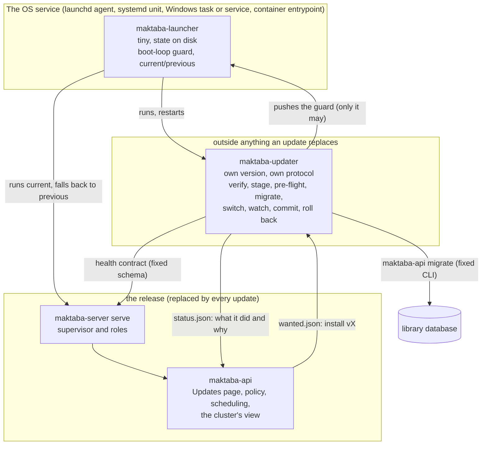
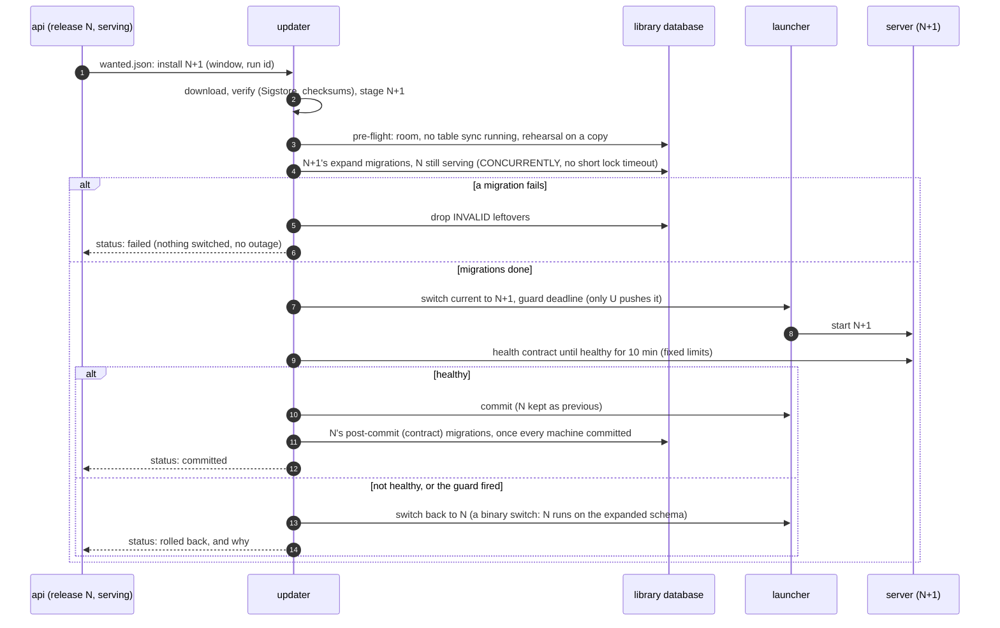
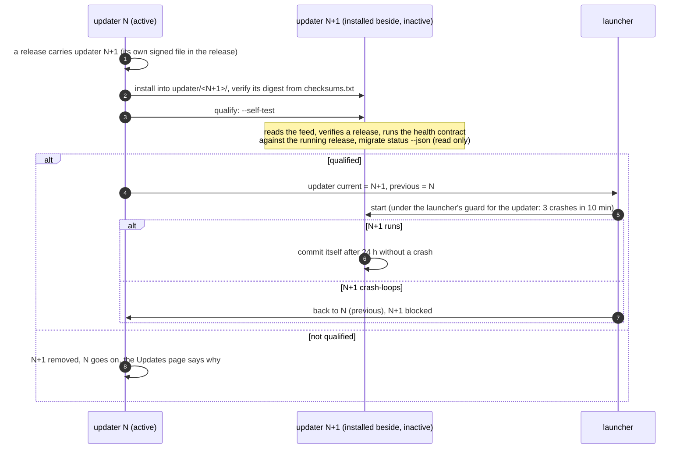
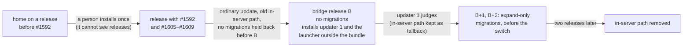

# Design: a separate updater, and additive-only migrations

Story [35.17](story-35-17-separate-updater.md). Status: **proposed, for approval** (2026-11-24).
Nothing here is built.

Sources:
- `docs/research/update-process.md` (#1601) §6. Its issue
  IDs (A1, P3, E8, …) are used below.
- [design.md](design.md) §5.3 step 9 and §5.6: the update as Epic 35 first designed it, with the
  old release migrating before the switch and a rollback of binaries only.
- [install-kinds.md](install-kinds.md): how each kind of install takes a release today.

It builds on the fixes that close the incident class:
- #1598 (Down scripts first);
- #1605 (no automatic restore: a failed update stops and asks);
- #1607 (P4, P5, P10);
- #1608 (no automatic install from a stale list);
- #1609 (the machines' copies paused and plain index builds while offline);
- the signed release feed.

## 1. The problem in one paragraph

From the moment it starts, the release being installed decides whether it is healthy and how to
undo itself. Its database step runs the migrations, its watch judges it, and its rollback undoes
it. So:
- A fix to the update path protects only the updates *to* a release that already has it. #1538 was
  released, yet on 2026-11-24 the home's update to v0.3.157 ran v0.3.157's own, older rules.
- A release whose own update code is broken cannot be stopped by the release before it.

Every updater studied keeps an old, trusted judge apart from the release it installs: Chrome, Android
and ChromeOS, systemd's boot assessment, Mender, balena, Home Assistant and TrueNAS. Maktaba does not
(A1, I4, K1). On the desktop apps even the launcher ships inside the bundle being replaced (P1).

The migrations also run *after* the switch, with the library stopped (A3). So every update that
migrates is an outage, and a migration that fails leaves the library down while the way back runs.

## 2. Goals and non-goals

**Goals**
1. No release judges itself. A separate program decides commit or rollback, with code that does
   not change with each release.
2. A rollback is a switch of binaries. The database never has to go back.
3. A migration that fails is not an outage. The release before keeps serving.
4. The judge survives a broken release on every install kind, the desktop apps included.
5. The owner's home moves over without an outage and without a person at the keyboard.

**Non-goals**
- Changing how releases are signed or verified (C3 found no gap). The judge reuses
  `shared/go/releaseverify` as it is.
- Staged rollout across homes and fleet reporting (B8, H2): the release feed's own stories.
- Filesystem clones for the rehearsal and the safety point (research §6.1 item 7): a later story.
  This design works with today's dump.

## 3. The shape



**Who decides what**, today and after:

| Decision | Today | After |
|---|---|---|
| Find releases, choose one, the window, pin, skip | the release's api | the release's api (policy stays with the product) |
| Download, verify, stage | the old release's server | the updater |
| Rehearse the migrations, pre-flight (room, copies) | the old release's server | the updater |
| Run the migrations | the **new** release's server, after the switch, library stopped | the updater, **before** the switch, old release serving |
| Switch | the old release's server | the updater |
| Judge health, commit or roll back | the **new** release's watch | the updater, by a fixed contract |
| Push the launcher's deadline | the **new** release | the updater only |
| Undo the database | the **new** release (keep, Down scripts, else stop and ask) | nothing to undo (additive only); for releases before the change, the updater runs the Down scripts, else stops and asks |

## 4. `maktaba-updater`

### 4.1 What it is

- **A Go binary of its own,** in `cmd/maktaba-updater`. It has its own `updater_version` and
  `updater_protocol`, and only a few dependencies:
  - `shared/go/releaseverify`;
  - `shared/go/layout`;
  - a Postgres client;
  - `shared/log`.
- **Its code moves out of the release, not new code.** It comes from:
  - `internal/updater`: the machine's prepare, apply, watch and rollback; `layout.go`; `runtime.go`;
    `appbundle.go`'s server half;
  - `internal/dbsafe`;
  - the database step of `serve_appbundle.go`.

  Budget: under 8,000 lines with tests, against about 33,000 for the update logic today (A5).
- **It runs as a child of the launcher,** beside the server. When idle it sleeps on a file watch and
  costs a few MB.
- **It lives outside the app bundle and outside `bin/releases/`.** It keeps its own
  `current`/`previous` pointers:

| Install kind | Where the updater lives |
|---|---|
| Mac app | `~/Library/Application Support/Maktaba/updater/<v>/` |
| Windows app | `%LOCALAPPDATA%\Maktaba\updater\<v>\` |
| Linux app, headless | `$XDG_DATA_HOME/maktaba/updater/<v>/` |
| Layout (deb/rpm, self-managed, Windows service) | `<install>/updater/<v>/` |
| Docker and NAS | `/data/updater/<v>/` on the volume |

- **The launcher moves out of the bundle too** (P1). On the desktop apps the OS service starts the
  launcher from that data folder, not from `Maktaba.app`. Swapping `/Applications/Maktaba.app` then
  replaces neither the judge nor the boot-loop guard.

### 4.2 The contract between the updater and a release

The contract is small and versioned by `updater_protocol`. A release's `release.json` names the
lowest protocol it needs (`requires_updater_protocol`). An updater refuses a release that asks for
more than it speaks, and the Updates page says which updater version that release needs.

1. **What the release wants installed:** `updates/wanted.json`, written by the api.
   - Fields: `{version, run_id, trigger, window_end, by}`.
   - The api writes only this file. It never switches, migrates or rolls back.
2. **What the updater did:** `updates/status.json`, written by the updater and read by the api.
   - Fields: `{run_id, version, state, step, code, detail, since, steps[]}`.
   - Its codes are today's journal codes, so the Updates page and its Arabic carry over.
3. **Health:** `maktaba-server health --contract 1` prints one JSON document. Its schema is fixed
   for protocol 1:

```json
{
  "contract": 1,
  "version": "0.4.12",
  "roles": [{"role": "api", "state": "running"}],
  "ready": true,
  "probes": [{"name": "db_read", "ok": true}, {"name": "search", "ok": true},
             {"name": "playback_start", "ok": true}]
}
```

   - A release that does not answer within 10 s, answers another version, or answers `ready: false`
     is not healthy.
   - The probes cover what "every role runs" misses (F1): a read of each table the release's
     migrations added, a search, and the start of a playback.
4. **Migrations:** `maktaba-api migrate up | status | drop-invalid | down-to <n>`, with the flags it
   has today.
   - Exit codes: 0 done; 1 failed; 3 the database is ahead.
   - `status --json` lists the slots applied and pending.
   - The updater always runs the migrate binary **of the release being installed**. Only that
     binary knows its own migrations.

A protocol change is itself an update of the updater (§4.5). It is rare by design: the contract
holds a version, roles, a ready flag and probes, and nothing else.

### 4.3 An update, step by step



**The updater's limits are fixed, not pushed by the release.**
- The release must answer its health contract within 5 minutes of its start. Its database is
  already migrated, so nothing in its start is slow (F2).
- It must stay healthy for 10 minutes.
- The watch's whole bound is 30 minutes.
- The updater pushes the launcher's deadline 15 minutes ahead every minute while it watches.
  Nothing else may push it: the guard file belongs to the updater's user and run id.
- With #1607's cap, a guard can never wait past its `latest`.
- The boot-loop counters move to disk (P7).

### 4.4 Rollback with the updater's own code

- **A release that adopted additive-only migrations (§5):** rollback is the binary switch. Release N
  runs on N+1's expanded schema. `make compat-prev` proves it in CI.
- **A release before that:** the updater runs the failed release's Down scripts (the #1598 rule,
  moved into the updater). When they cannot take the database back, it stops and asks (#1605): the
  record is `held`, and the recovery page offers the backup and a newer release. It never restores
  by itself.
- **A launcher guard that fires** (the release hung, crashed three times, or never confirmed):
  - The launcher switches back.
  - The updater, which is still alive, sees the switch back and settles the run.
  - The database is untouched, as above.
  - Neither the launcher nor the old release's start puts anything back (P3 is gone).

### 4.5 The updater updates itself, last and rarely

This is the Chromium updater's qualify-then-activate pattern, with Home Assistant's dumb fallback.



Rules for an updater change:
- **It ships in a release that carries no migration.** An update never changes the judge and the
  schema at once.
- **At most one updater change per release,** and only when the updater's code changed. Most
  releases carry none.
- **Its own rehearsal matrix:**
  - from the oldest updater still in the field to the new one, on every install kind;
  - with a release whose own update code is broken (R1, I4).
- **A protocol rise:** a release that needs protocol N+1 is installed only once updater N+1 has
  qualified. The release before it carries updater N+1 and no migration.

### 4.6 The cluster

- **Each machine runs its own updater.** It judges that machine's release by the same contract.
- **The home's api remains the cluster's view and its order.** It writes each machine's
  `wanted.json` through the cluster channel, and reads each machine's `status.json` the same way.
- **The additive migrations follow the subscriber-first rule** (research §6.1 item 8):
  1. Each machine's updater applies the release's expand migrations to its own copy first. Its old
     release ignores the new columns and tables.
  2. Then the home migrates.
  3. The copies never pause for a schema ahead of them (E8, K2).

## 5. Additive-only (expand/contract) migrations

### 5.1 The rule

| In `shared/db/migrations/` (expand, before the switch) | In `shared/db/migrations/post/` (contract, after every machine committed) |
|---|---|
| add a table, a column (nullable, or with a constant default), an index `CONCURRENTLY`, a function or view under a new name, a constraint `NOT VALID` | drop a column, table, function or view the release before stopped using |
| a backfill as a job (rule 5), finished before a later release relies on it | `VALIDATE CONSTRAINT`, `SET NOT NULL` once the backfill is done |
| a new enum value | a rename, as add, copy (a job), switch the readers, then drop here, one release later |

- **A release's code must run on the schema before its own expand migrations.** Its expand
  migrations run before its first start, so this holds from the first start, and the previous
  release's code runs on the expanded schema. `make compat-prev`, which runs the previous release's
  tests on the new schema, becomes a hard gate for every migration.
- **A post-commit migration may remove only what the release before already stopped using.** It runs
  once, after the home and every machine committed the release. A post-commit migration that fails
  is not a rollback: the release runs on as committed, and the updater stops and asks (`held`), the
  same way as #1605.
- **What migration-lint enforces:**
  - no `DROP`, `RENAME`, `ALTER … TYPE`, `SET NOT NULL` or `DELETE` in `migrations/` from the first
    additive-only slot on;
  - no `CREATE INDEX CONCURRENTLY` without a `DROP INDEX IF EXISTS` of an INVALID one before it (as
    Discourse does);
  - rules 9 and 10 (#1598) stay: every migration still has a Down script, which the homes not yet
    moved over use.

### 5.2 Running them online

The updater runs them with the release before still serving. So:
- index builds keep `CONCURRENTLY`;
- the offline rewrite (#1609) is not used;
- `lock_timeout` is not short;
- before each build the updater drops a same-named INVALID index and waits until no table sync runs
  (#1609's wait, moved into the updater);
- the log names `pg_stat_progress_create_index.current_locker_pid`.

The library serves meanwhile. A slow build costs time, not an outage.

### 5.3 What this buys

| Today | After |
|---|---|
| every update that migrates is an outage for its migrations | migrations run while the release before serves; the switch is a restart |
| a failed migration leaves the library stopped while the way back runs | a failed migration changes nothing that matters; no switch |
| the way back decides between keep, Down scripts, or stop and ask | a rollback is a binary switch |
| a 34 GB dump before each migrating update is the safety net | the dump stays, for a person's restore only, and can later become a clone |

## 6. Moving the owner's home over

The owner's home is the Mac app (a LaunchAgent) with a 35 GB library database. It can see releases
again once it runs a release with #1592.



1. **Before the bridge.** Ship and release the fixes: #1598, #1605, #1607, #1608, #1609.
   - On 2026-11-24 the home ran v0.3.161, installed by hand. That release still reads the release
     list with the 8 MiB cap (B2), so it cannot see newer releases. It gets one release with #1592
     installed by hand the same way. That is a person's action; it is already listed as open in the
     trail.
   - From then on the home sees releases and updates under the safer rules. #1605 holds a failed
     update instead of restoring it.
2. **Hold migrations back for the bridge.** The releases between that release and the bridge carry
   no migration, or only migrations the home has already taken. The old in-server path then has as
   little to judge as possible.
3. **The bridge release B carries no migrations.** Its update is a plain restart under the old
   path, so the old path's riskiest step (the database step) never runs. B's first start, on the
   home:
   1. copies `maktaba-launcher` and `maktaba-updater` 1 into
      `~/Library/Application Support/Maktaba/{launcher,updater}/1/`;
   2. points the LaunchAgent's `ProgramArguments` at that launcher;
   3. writes the launcher's state, `current`, `previous` and the boot-loop counters, to disk.

   The app stops and starts the agent once, at B's commit, within B's watch. If B does not commit,
   the old path rolls back a release with no migrations: a binary switch.
4. **Every release after B sets `min_upgrade_from` to B.** No home skips the bridge.
5. **From B+1 on, updater 1 judges every update.**
   - The in-server path stays in B+1 and B+2 as a fallback. When the updater does not start
     (missing or crash-looping), the release's own path runs as today and says so on the Updates
     page.
   - The fallback is removed in B+3.
6. **The first additive-only slot.** B+1 is the first release whose migrations follow §5. Its
   migrations run before the switch, with the old release serving. From then on the owner sees an
   update as a restart of under a minute.
7. **What the owner sees and can check:**
   - Admin → Updates names the updater's version and its last run.
   - The recovery page (`/recovery`) works as today.
   - `maktaba-server updater status` prints `status.json`.
   - The live home's updater journal and logs are read-only evidence, as now.

**What if the bridge goes wrong.** B adds no migration, so going back is the launcher's switch to
the previous app payload, as for any release today. If updater 1 cannot start on B, B's in-server
path goes on judging, as described in item 5.

## 7. Risks

| Risk | How large | What limits it |
|---|---|---|
| A bug in the updater hits every update: it is the single judge | High | It changes rarely, and never in the same release as a migration. Its self-update qualifies first and keeps the previous one. It has its own rehearsal matrix, run from the oldest updater in the field. The in-server fallback stays for two releases |
| The contract (health, migrate CLI, files) becomes an API between versions | Medium | A protocol number, and `requires_updater_protocol` in `release.json`. CI runs the newest updater against the previous releases, and the oldest supported updater against the new one |
| Moving code risks regressions in a path that runs only during updates | High while it moves | The code moves behind the bridge, with the fallback. The rehearsal runs on every pull request that touches it. Each move is its own story with its own rehearsal scenario |
| One more process on every install kind (launchd, systemd, Windows, Docker, the Tauri app) | Medium: a story per kind | The launcher already starts processes on each. The updater is one more child of it, idle most of the time |
| Moving the launcher out of the Mac bundle changes the LaunchAgent; a mistake there stops the home from starting | High, once | Done once, by B, within B's watch, with the old `ProgramArguments` kept for a switch back. Rehearsed on macOS runners with the real app (R1) before B ships |
| Additive-only discipline: two releases for a drop or a rename, and some clutter in the schema | Low | The lint, `compat-prev` as a gate, and the post-commit set to tidy up |
| Online index builds on a 35 GB home take long, and writes go on meanwhile | Medium | They run before the switch, so the time is not an outage. The table syncs are waited out. No short lock timeout |
| A post-commit migration fails after the release committed | Low | It removes only what nothing uses, so a failure leaves extra schema. The updater stops and asks; nothing rolls back |
| Homes that skip the bridge (offline for months) | Low | `min_upgrade_from` makes them take B first. The bridge keeps its old path |
| The fleet cannot be seen, so a broken updater is noticed late | Medium | Story 35.17's rehearsal matrix, and the feed's read counts when that is decided (research H2) |

## 8. Stories this splits into

| Story | What | Size |
|---|---|---|
| 35.17a | `cmd/maktaba-updater` skeleton: protocol 1, `wanted.json` and `status.json`, the health contract in `maktaba-server`, `migrate status --json` | M |
| 35.17b | Move verify, stage and pre-flight into the updater (layout installs first) | M |
| 35.17c | Move the switch, watch, commit and rollback; only the updater pushes the guard; the launcher's counters on disk | L |
| 35.17d | The updater's self-update, qualify then activate, and its rehearsal matrix | M |
| 35.17e | Desktop apps: launcher and updater outside the bundle, the LaunchAgent, the Windows task, the Linux unit | L (one per platform) |
| 35.17f | Docker and NAS: the updater on the volume, the entrypoint | M |
| 35.17g | The bridge release and `min_upgrade_from` | S |
| 35.18a | Additive-only lint, `migrations/post/`, `compat-prev` as a hard gate | M |
| 35.18b | The updater runs the expand migrations before the switch, online, and the post-commit set after the commit | M |
| 35.18c | Subscriber-first migrations on the machines | M |

## 9. Decisions this asks for

1. **Approve the shape.** A separate updater outside the bundle owns the update, and the release
   keeps the policy and the Updates page.
2. **Approve additive-only migrations** from the first slot after the bridge. A contract change
   (drop, rename, type change) takes two releases.
3. **Approve the bridge plan for the owner's home:**
   - a manual install of one release with #1592;
   - migrations held back until the bridge;
   - the bridge carrying no migration;
   - the LaunchAgent moved once, by the bridge.
4. **Approve the order of work:** items 1–5 (the open pull requests) first, then 35.17a–g and
   35.18a–c.
