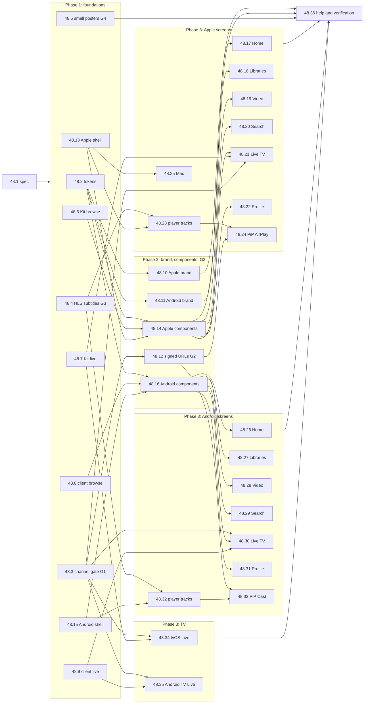

# Epic 48 plan: order, tracks, risks, verification

Read with the [README](README.md) (the stories and their checks).

## 1. The graph

An arrow means "merges after". Stories on the same row of a phase run at the same time.

Longest chain (the critical path): 48.13 → 48.14 → a screen, and 48.3 → 48.12 → 48.24 / 48.33
after 48.23 / 48.32. Phase 1 is ten agents at once; phase 3 up to seventeen.

## 2. Tracks: no two parallel stories edit the same file

| Track | Files it owns | Stories, in order |
|---|---|---|
| **D** design tokens | `web/design-system/**`, generated `MaktabaKit/Sources/MaktabaKit/Tokens.swift`, generated `apps/android/core/…/ui/Tokens.kt`, `Makefile` (`test-tokens`) | 48.2 |
| **S** web-port gate | `cmd/maktaba-server/stream_gate.go` and its tests | 48.3 → 48.12 |
| **M** streaming | `streaming/internal/handlers/manifest.go`, new `subtitle_playlist.go` | 48.4 |
| **V** posters | `api/internal/handlers/videos/poster.go` | 48.5 |
| **K1** Kit browse | new `MaktabaKit/Sources/MaktabaKit/Browse.swift` + tests | 48.6 |
| **K2** Kit live | new `MaktabaKit/Sources/MaktabaKit/Live.swift` + tests | 48.7 |
| **K3** Kit brand | `MaktabaKit/Sources/MaktabaKit/{Theme,StartViews,Brand}.swift`, `Resources/`, `Package.swift`, `Player/Info-*.plist`, `Remote/Info-*.plist` | 48.10 |
| **C1** client browse | new `apps/android/client/…/api/Browse.kt` + tests | 48.8 |
| **C2** client live | new `apps/android/client/…/api/Live.kt` + tests | 48.9 |
| **C3** core brand | `apps/android/core/…/ui/{Theme,StartScreens}.kt`, `core/src/main/res/values*/themes.xml` | 48.11 |
| **AP** Apple Player | `apps/apple/Player/**`, `apps/apple/project.yml`, `apps/apple/UITests/**`, `apps/apple/PlayerMacTests/**`, `MaktabaKit/PlayerSurface.swift`, `.github/workflows/_apple-apps.yml`, `tools/apple/check-string-catalogs.py` | 48.13 → 48.14 → {48.17, 48.18, 48.19, 48.20, 48.21, 48.22, 48.25} in parallel, 48.23 → 48.24 |
| **AN** Android Player | `apps/android/player/**`, `apps/android/gradle/libs.versions.toml`, `.github/workflows/_android-apps.yml` | 48.15 → 48.16 → {48.26 … 48.31} in parallel, 48.32 → 48.33 |
| **TA** Apple TV | `apps/tv/tvos/**` | 48.34 |
| **TN** Android TV | `apps/tv/android/**` | 48.35 |
| **H** help | `web/src/help/content/**`, `CHANGELOG.md`, `docs/claude-trail.md` | 48.36 |

Inside AP and AN, the screen stories run in parallel because each owns its own folder and its
own strings table (`Player/<Screen>/` + `<Screen>.xcstrings`; `player/…/<screen>/` +
`values*/strings_<screen>.xml`). Two files are shared inside a track and handled by rule:

- **The section list** (`PlayerSection.enabled`): each screen story adds one line. A conflict
  there is one line; the later PR rebases.
- **`project.yml`** (Apple): XcodeGen picks up new files in `Player/` by folder, so screen stories
  do not edit it. Only 48.13 does.
- 48.25 (Mac) edits `PlayerApp.swift`'s commands; no other phase-3 story touches that file.
- 48.23 and 48.24 both edit `Playback.swift`, so they are serial; so are 48.32 and 48.33.

Every story also appends to `CHANGELOG.md` and `docs/claude-trail.md`: append-only lines, a
rebase resolves them.

## 3. Merge order

1. 48.1 (this spec).
2. Phase 1 in any order; 48.2 and 48.3 first if possible (most stories wait on them).
3. 48.10, 48.11, 48.12, 48.14, 48.16 as their parents land.
4. Phase 3: any order inside a platform. Each screen turns on its section, so whatever merges
   is complete and shippable. 48.24 after 48.23; 48.33 after 48.32.
5. 48.34 and 48.35 any time after 48.3 and their client.
6. 48.36 last.

The owner's PR flow applies to each story (implement, test, CI green, review, fix, merge).
No story cuts a release; they ride the next approved one (one release at a time).

## 4. Risks

| Risk | What we do |
|---|---|
| **Xcode 27 here, older Xcode on CI.** CI's `macos-26` runner has no Xcode 27, so code needing the iOS 27.1 SDK fails there. | Duo-only code stays behind `#if os(iOS) && compiler(>=6.4)` and `#available(iOS 27.1, *)`, as in `LibraryBrowser.swift`. Nothing else may use iOS 27 API. Every Apple story is built by CI's older Xcode (the `apple-apps` job) and locally with Xcode 27; the hinge split is checked locally on the Duo simulator. |
| **SwiftPM on the runner copies String Catalogs without compiling them** (Arabic and plurals would not resolve). | MaktabaKit tests keep running through `xcodebuild test`, never `swift test`, in CI. New MaktabaKit resources (fonts, art) go through `.process` and are tested by loading them in a test run by `xcodebuild`. |
| **TestFlight uploads on every tag.** A half-built screen would reach testers. | `PlayerSection.enabled`: a section shows only when its screen has merged. The shell keeps today's Libraries working. |
| **G1 is a live security gap today** (the web already plays channels this way). | 48.3 is phase 1 and does not wait for the apps; it fixes the web too. No native live player merges before it. |
| **G2 widens what a signed URL can do.** | Only session and direct paths, only with a `sig` the streaming service verifies (audience, expiry, library guard); channel paths still need a session. Role tests in 48.12. |
| **AirPlay through the loopback proxy.** | 48.24 hands the receiver the signed URL; the phone keeps playing through the proxy otherwise. |
| **Cast SDK needs Google Play Services.** | Cast hides when Play Services is missing (de-Googled phones); everything else works. Open question 3. |
| **Simulator crashes in front of the owner** (SpringBoard, 2026-10-31). | Throwaway simulators only (`xcrun simctl create`, delete after); stop any log stream you start. |
| **Seventeen parallel agents in phase 3.** | Folder-per-screen ownership; the coordinator merges one PR at a time and re-runs CI on the rebased tip (main has no branch protection; confirm green yourself). |
| **Screenshot tests flake on fonts and time.** | Fixed clock, fixed fixtures, bundled fonts only, animations off; a reference changes only in a reviewed PR. |
| **Mock fixtures drift from the real API.** | Fixtures are recorded from a branch stack's API (scratch Postgres) in 48.6 / 48.8, and a Go test in each of those PRs decodes the same JSON shape from the handlers' tests. |

## 5. Verification per story

| Story | Verified by |
|---|---|
| 48.2 | `make test-tokens` (stale check, CSS parity, contrast); both apps compile in CI |
| 48.3, 48.12 | Go unit and role tests in `cmd/maktaba-server`; on a branch stack, `curl` a library channel as a one-library viewer (403) and as admin (200) |
| 48.4 | Go golden tests on the master; the web's `VideoPlayer.hls.test.tsx`; AVPlayer on a branch stack shows the subtitle |
| 48.5 | Go tests with role test |
| 48.6–48.9 | unit tests decoding recorded answers; run against a branch stack once |
| 48.10, 48.11 | screenshot tests (dark/light, en/ar, phone/tablet); a launch recording with no white frame |
| 48.13, 48.15 | CI runs the new UI / Roborazzi jobs green; Duo hinge split checked locally (Xcode 27) |
| 48.14, 48.16 | component screenshot tests, image-cache unit tests |
| 48.17–48.22, 48.26–48.31 | the story's UI test against the mock home, accessibility audit, dark en/ar screenshots on phone and tablet; one walk on a branch stack |
| 48.23, 48.24, 48.32, 48.33 | UI tests with the mock's HLS; unit tests on the URL handed to AirPlay / Cast; a real AirPlay and a real Cast run on a branch stack, noted in the PR |
| 48.25 | Mac UI test driving the menus |
| 48.34, 48.35 | TV UI tests against the mock home; a walk on the simulators |
| 48.36 | the help coverage test; the full walk; NFR-1 to NFR-3 measured and recorded |

Never the live database: branch stacks use scratch Postgres (the trail's rule). Testing on the
live Mac is fine for a look, after saying so; updates are not part of this epic.
