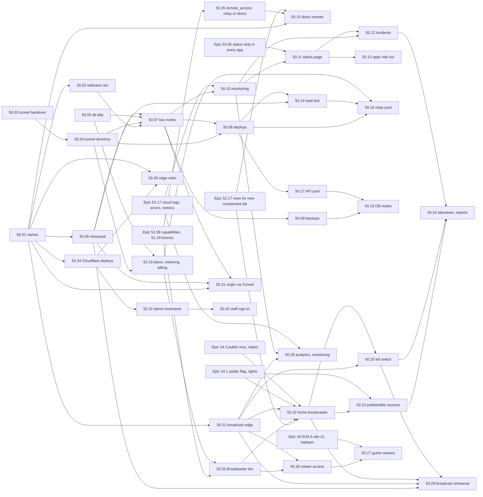

# Epic 50: Maktaba Cloud with no downtime: from one VPS to a relay people can pay for

> **Status:** spec (2026-11-03). **Builds on:** [Epic 25](../25-cloud-relay/README.md) (the
> cloud, relay, metering, tiers, entitlements) and [Epic 30](../30-relay-analytics/README.md)
> (relay metrics). **Works with:** [Epic 53](../53-logs-errors-reports/README.md) (logs, errors,
> problem reports and application metrics: the cloud's come from 53.17; see §4.5 and §10 for
> who owns what) and [Epic 51](../51-configurable-components/README.md) (built: the home's
> cloud parts are components, `cloud.link` and `cloud.relay`, and this epic adds two; §4.6).
> **Research:** [research.md](research.md): the code as it is, Plex, Jellyfin,
> Emby, Tailscale, Cloudflare Tunnel, Hetzner prices, all with sources.
> **Wiki:** [epic-50-cloud-no-downtime.md](../../../docs/wiki/epics/epic-50-cloud-no-downtime.md).
> **Home broadcasting** (publishing a home's TV channels to people outside it, the Broadcaster
> tier): §14, research in [research-broadcasting.md](research-broadcasting.md), stories 50.20–50.29.
> **Cloudflare in front** (the user portal and the operator console on `admin.maktaba.tv`
> behind the Cloudflare proxy, the origin only through a Tunnel, staff sign-in with MFA): §15,
> stories 50.30–50.34.

## 1. Why

The requirement (2026-11-03): once people pay for remote access, the cloud must have no
downtime.

Maktaba Cloud has no VPS yet. The plan is to start on one Hetzner VPS with the existing
single-machine deploy (`deploy/cloud-relay/`). That works for a demo, but it isn't something
to charge for: every reboot, deploy or disk fault on that one machine stops remote play for
every paying home, and a lost disk loses every account. This epic takes the cloud from one
VPS to two machines that cover for each other (Phase 1, before taking money), then to a pool
of relays (Phase 2, when the homes outgrow one machine).

## 2. What we found

From [research.md](research.md) §1, with the code checked on 2026-11-03:

| # | Gap today | Fixed by |
|---|---|---|
| G1 | One machine runs relay, API, Postgres, Redis and Caddy. | 50.07 |
| G2 | Every deploy drops every tunnel and every stream (the container is replaced; `http.Server.Shutdown` doesn't close the hijacked WebSockets). | 50.03, 50.04, 50.08 |
| G3 | Homes reconnect without jitter, so they all retry at the same instants. | 50.03 |
| G4 | One Let's Encrypt certificate **per home**, issued on demand and kept on one disk. Let's Encrypt's limit is 50 new certificates per domain per week, so a fresh standby can't get them in time. | 50.02 |
| G5 | The relay queries Postgres on **every** request (`BySlug`, `Meter.Allow`), so a 30-second database failover fails 30 seconds of requests. | 50.05 |
| G13 | The plan limits don't agree, and the relay doesn't enforce stream limits. The architecture doc says Pro 2 / Family 5 streams; `cloud/internal/billing/plans.go` has Free / Pro / Family with 1 / 4 / 10 streams and 5 / 100 / 500 GiB, the license maps them to `free` / `home` / `pro`, and the cloud web app's strings say "Home" and "Pro". Only the billing API reports the limit; no relay enforces it, and the byte cap cuts relayed play off with a `402`. **Decided (§13, decisions 4 and 6):** all of these are replaced by **Free** (no relay; direct remote free), **Basic** (relay capped at ~3 Mbps, 2 streams, 500 GB soft fair use) and **Pro** (full quality, an allowance, N streams, optional pay-as-you-go with a cap, paid extra streams); Family is dropped; prices TBD. The relay enforces each plan and never cuts a paid plan off; old names migrate `pro`→`basic`, `family`→`pro`. | 50.19 (plans, enforcement, metering, billing through a payment provider TBD, migration); 50.16 keeps the counts across relays |
| G14 | Nothing writes `direct_ip` / `direct_port`, so `direct_url` in the home list is in practice always empty. | 50.15 |
| G12 | Architecture §13.10 and story 25.14 describe `NOTIFY tier_changed`, but neither the NOTIFY nor a LISTEN exists in the code, so a plan change reaches the relay only when it next queries. | 50.05, 50.17 |
| G6 | Tunnels are held in one process's memory. Story 25.8's multi-relay routing ("consistent hash on `server_id` at the L4 LB") was never built, and Hetzner's load balancer can't do it. | 50.04, 50.16 |
| G7 | Story 25.1 assumes managed Postgres; Hetzner has none. | 50.07, 50.18 |
| G8 | Backups are one `pg_dump` line in a README. | 50.09 |
| G9 | No outside monitoring and no status page. | 50.10, 50.11 |
| G10 | The direct path is plain HTTP and needs a port forwarded by hand. | 50.15 |
| G11 | An old name: `relay.maktaba.app` in a comment in `cloud/migrations/00040001_servers.sql`. **maktaba.app is not ours**; it should say `maktaba.tv`. (`com.maktaba.app` / `io.maktaba.app` in Epic 12/22 plans are app identifiers, not hostnames, and stay.) | 50.01 |

## 3. Goals

1. **Remote play keeps working when one machine fails.** It is back within 3 minutes, with
   nobody touching anything.
2. **Deploys are invisible.** No dropped tunnel, no failed request, no stopped stream.
3. **No data is lost** when a machine dies (RPO 0 while both nodes are healthy), and at most
   one minute's worth if the whole data centre is lost.
4. **We know before users do.** An outside probe plays through a canary home every 30 s and
   pages the owner within 90 s of a failure.
5. **Users are told the truth**, in English and Arabic: a status page and an in-app banner,
   both driven by the probe, not by hand.
6. **The home keeps working without the cloud**: local playback always, direct remote when it
   is set up, and cloud features for 7 days (as today).
7. **Every failure path is proven in CI before it reaches the VPS**, the same rule as the
   update rehearsal (`docs/update-rehearsal.md`): failover, deploy, rollback and restore.
8. **Costs stay below the ceilings in §5** at 100, 1,000 and 10,000 homes.

### Not in this epic

- More regions (US, Asia), and clients choosing the nearest relay (Tailscale-style). That is
  Phase 3, written down in §8 but not specced.
- Setting prices. The plans themselves are decided (§13 decision 4) and built in 50.19, which
  replaces the tiers of Epic 25.12 / 25.15; the prices, Pro's allowance and stream count are
  the owner's, still **TBD**.
- End-to-end encryption through the relay (architecture §13.11 keeps the cloud in the trust
  boundary).

## 4. Requirements

### 4.1 Functional

| ID | Requirement | Story |
|---|---|---|
| F1 | **Failover.** When the active node dies, the standby takes over the database, the public address and the cloud processes by itself. Two nodes can never both be active. | 50.07 |
| F2 | **Zero-downtime deploys.** A new release starts beside the old one; homes move their tunnels to it before the old one stops; in-flight streams finish. A failed health check rolls back on its own. | 50.03, 50.04, 50.08 |
| F3 | **Planned node work** (OS patches, resizing): a switchover to the other node, announced 48 h ahead on the status page. | 50.07, 50.11 |
| F4 | **Backups and restore.** Continuous database archive off the machine, nightly full backup, 30 days of point-in-time restore, secrets kept apart, a restore tested every week. | 50.09 |
| F5 | **Monitoring and alerting.** A canary home, outside probes from two networks, metrics, alerts to the owner's phone. | 50.10 |
| F6 | **Multi-relay routing** (Phase 2). Any relay answers for any home; each home is assigned to relays by a hash over the healthy ones; a home holds tunnels to two relays. | 50.04, 50.16 |
| F7 | **Status page** at `status.maktaba.tv`, hosted off Hetzner, and a banner in every app. | 50.11 |
| F8 | **Incident handling.** Severity levels, runbooks, user messages in English and Arabic, postmortems. | 50.12 |
| F9 | **Apps ride out the cloud being down.** They keep the last connection list, try direct addresses first, and show plain messages. | 50.13 |
| F10 | **Direct remote like Plex.** UPnP / NAT-PMP, an outside reachability check, and HTTPS on the direct path, with names on several separate direct-name domains (never under `maktaba.tv`). **Free on every plan.** | 50.15 |
| F11 | **Plans the relay enforces.** Free: no relay. Basic: relay capped at ~3 Mbps (the home transcodes down to it), 2 relayed streams, 500 GB a month soft fair use. Pro: full quality within an allowance and N streams, optional pay-as-you-go up to a user-set cap, paid extra streams, then Basic's capped quality. A paid plan never cuts relayed play off. Metered, billed through usage-based items at a payment provider TBD. | 50.19 |
| F12 | **Home broadcasting: the Broadcaster tier** (§14.4). Pro gains guest sharing (1 invite-only channel on demand, 5 viewers, 50 viewer-hours); Broadcaster, an add-on to Pro, gives 3 channels, 100 concurrent viewers, 5,000 viewer-hours, up to 1080p, then optional pay-as-you-go viewer-hours with a cap, then the lowest rung, then new viewers wait. A viewer already playing is never stopped by a limit. Billed through the same payment provider (TBD). | 50.20 |
| F13 | **The broadcast edge.** The home pushes each segment of each rendition once to Maktaba's Cloudflare edge (Worker, Durable Object, R2). Viewers never reach the home or the Hetzner relay. Segments are cached under token-free keys, so the home's upload doesn't depend on the number of viewers. Stream is a switchable fallback. | 50.21 |
| F14 | **The home publishes channels**, with the ladder at home (top rung `copy`), an uplink check (≤ 50 % of the measured uplink), encoder-slot accounting against `max_active_channels`, always-on for open channels and on demand for invite-only ones, and an offline slate. | 50.22 |
| F15 | **Only publishable items air** (a safety feature on the publisher's home): own recordings, Creative Commons (CC BY detected at YouTube intake) and sources with a recorded permission and proof link; the scheduler skips the rest while a channel is published; optional geo rules. Maktaba Cloud does no curation: channel building, scheduling and intake stay on the home. | 50.23 |
| F16 | **What hosting status requires** (Maktaba charges for infrastructure, not content): a designated agent, notice and takedown (EN/AR form, counter-notice), a repeat-infringer policy (3 strikes in 12 months), acting on actual knowledge, publisher terms that put rights on the publisher; a Report button on every watch surface and a moderation queue for service admins. | 50.24 |
| F17 | **Kill switch.** Per channel, publisher, home or global, through a signed broadcast revocation list (the Epic 54 pattern) that the edge and homes honour within 60 s, plus a break-glass switch. | 50.25 |
| F18 | **Viewer access, free for viewers:** `invite` (default) or `open` (Turnstile, verified publishers) only; 10-minute heartbeat tokens, concurrency and per-IP limits. | 50.26 |
| F19 | **Guest viewers** on `watch.maktaba.tv` and in every Maktaba Player and TV app (link, QR or short code), in English and Arabic. | 50.27 |
| F20 | **Viewer analytics for the publisher** through Epic 53 (no personal data, small counts folded), and a canary broadcast probed from outside. | 50.28 |

### 4.2 Non-functional: the numbers

| Area | Target (Phase 1) | Target (Phase 2) | How it is measured |
|---|---|---|---|
| **Availability (SLO)** | **99.9 %** a month = at most **43.8 min** down | **99.95 %** = 21.9 min | The canary probe (50.10): `GET https://canary.relay.maktaba.tv/api/health` through the relay, plus `GET https://api.maktaba.tv/readyz`, every 30 s from two outside networks. A minute counts as down when both networks fail it. Planned work counts too. A **target, not a promise**: no credit or refund for downtime (§13 decision 1; 50.12). |
| **RTO, one node lost** | relay and API serving again in **≤ 3 min** (expected ~90 s) | ≤ 30 s (homes already hold a second tunnel) | Failover rehearsal (50.06) and the canary. |
| **RTO, data centre or zone lost** | ≤ 4 h, by a runbook: restore from backup in another zone or provider, then change DNS | ≤ 1 h | Restore drill (50.09). |
| **RPO** | **0** while both nodes are healthy (synchronous replication); **≤ 60 s** if both are lost (WAL archived at least every 60 s) | same | Rehearsal checks the last committed row after failover. |
| **Failover detection** | ≤ 30 s (Patroni leader lease 30 s) | same | Rehearsal timings. |
| **Tunnel reconnect** after a relay is reachable | p95 ≤ 20 s, p99 ≤ 45 s, for 1,000 homes | p99 ≤ 10 s | Rehearsal with 1,000 simulated homes (50.06, 50.14). |
| **Requests during a reconnect** | held up to **15 s** for a home seen in the last 2 min, then `503 home_reconnecting` with `Retry-After` | same | Rehearsal. |
| **Deploy impact** | **0** dropped tunnels, **0** failed requests, **0** stopped streams | same | Deploy rehearsal (50.08). |
| **Planned switchover impact** | ≤ 15 s pause in remote streams, at most once a month | none (drain the relay first) | Rehearsal. |
| **Relay throughput per node** | plan at **300 Mbit/s** relayed and 5,000 idle tunnels until 50.14 measures the real numbers | measured | Load test (50.14). |
| **Added latency through the relay** | ≤ 20 ms p95 over the home↔relay path, at 70 % of measured capacity | same | Load test. |
| **Cost** | §5 ceilings | §5 ceilings | Monthly in the admin revenue page (25.21). |
| **Security** | §4.4 | §4.4 | Review per story. |
| **Observability** | §4.5 | §4.5 | 50.10. |
| **Broadcast playback availability (SLO)** | **99.9 %** a month for channels whose home is up (a target, no credit) | same | The canary broadcast (50.28): an outside viewer probe plays it every 60 s from two networks; a minute counts as down when both fail. |
| **Broadcast: upload from the home per channel** | **1×** each rendition, whatever the number of viewers | same | Fan-out load test (50.29): 1 home, 1,000 simulated viewers, home bytes out = segments × rungs. |
| **Broadcast glass-to-glass latency** | p95 **≤ 20 s** (≈ 12 s typical, 4 s segments) | same | Timestamp burned into the canary pattern (50.28). |
| **Broadcast startup / channel switch** | start p75 ≤ 3 s; warm switch p75 < 2 s; on-demand cold start ≤ 15 s (tuning card < 100 ms) | same | Player telemetry (50.28), rehearsal (50.29). |
| **Segment visible at the edge** after the home finishes it | p95 ≤ 1.5 s | same | Ingest timing (50.21). |
| **Home offline → slate** | ≤ 15 s; no player error | same | Rehearsal (50.29). |
| **Kill switch / takedown effect** | ≤ 60 s for new and playing viewers after the action | same | Rehearsal (50.29), 50.25. |
| **Takedown handling** | valid notice to disabled ≤ 24 h (≤ 1 h urgent) | same | Moderation queue timestamps (50.24). |
| **Broadcast with the Hetzner pair down** | channels keep playing ≤ 24 h (ingest token life) | same | Rehearsal (50.29). |
| **Broadcast cost** | §14.4 cost model; alert at 80 % of the month's broadcast budget | same | Admin revenue page (25.21), 50.28. |

### 4.3 What keeps working when the cloud is down

| | Today | After this epic |
|---|---|---|
| Playback at home (LAN) | Yes: the home signs its own users in. | Yes. A test proves it with the cloud unreachable (50.13). |
| A user already signed in through Maktaba Cloud | Their home session lasts. | Same. |
| A **new** sign-in with a Maktaba Cloud account | Fails (the home checks the cloud's assertion). | Still fails, with a clear message suggesting the home password (50.13). |
| Remote play over the **relay** (Basic and Pro; Free has no relay) | Down. | Down only if **both** nodes are down. |
| Remote play over a **direct** address (every plan, Free included) | In practice never: the home list has a `direct_url` field, but nothing fills it (G14). | Works from the app's **cached** connection list, over HTTPS, with ports opened by UPnP / NAT-PMP (50.13, 50.15). |
| Cloud features on the home (relay plan flags) | 7-day grace on the last signed entitlement. | Same (story 25.26). |
| Paying, changing plans | The payment provider (TBD) hosts checkout and retries its webhooks; choosing one that retries for days is a selection rule (50.19 §6). | Same; nothing lost. Pay-as-you-go usage queues in Postgres and reaches the payment provider later with the same idempotency identifiers (50.19). |
| Push notifications | Down. | Down; the outbox in Postgres sends them after recovery if they are still within their TTL. |

### 4.4 Security

- Only the edge (Caddy, ports 80/443) faces the internet. Postgres, etcd, Redis and the cloud
  processes listen on the **Hetzner private network** or loopback only. A Hetzner Cloud
  Firewall and UFW both enforce it.
- **Caddy serves relay names only.** The API, the cloud web app and the operator console are
  reached **only through Cloudflare**, by a Cloudflare Tunnel that `cloudflared` dials out from
  the leader; the operator console is on `admin.maktaba.tv` alone, with staff accounts and
  mandatory MFA (§15, 50.30–50.33).
- Replication and etcd traffic use TLS and SCRAM, even on the private network.
- Production lives in **its own Hetzner project**, so the API token on the nodes (needed to
  move the Floating IP) can't touch anything else. The Cloudflare token is scoped to DNS edits
  on the `maktaba.tv` zone only. The direct-name domains (50.15) are delegated to our own
  responder, so no token touches them.
- Backups are encrypted before they leave the machine (pgBackRest `aes-256-cbc`). The key and
  the cloud's own secrets (token secret, entitlement signing key, payment provider keys) are kept in the
  owner's password manager too, never in the repo, never in a backup bucket without
  encryption.
- SSH by key only, no root login, and the deploy key works only for the `deploy` user.
- Resume tickets (50.03) are HMAC-signed, bound to one home, valid 10 minutes, and never logged.
- No media is stored. The relay passes bytes through (architecture §13.1).

### 4.5 Observability

- Probes every 30 s from two outside networks (not Hetzner), so a Hetzner-wide outage still
  pages.
- Alerts page the owner within **90 s** (two failed probes in a row). SLO burn alerts: 2 % of
  the month's budget in 1 h (fast), 5 % in 6 h (slow).
- Metrics kept 30 days; the existing `/metrics` (architecture §13.12) plus the new ones listed
  in 50.10 (replication lag, failover count, drain progress, held requests).
- **Logs, error groups and the application metrics come from [Epic 53](../53-logs-errors-reports/README.md),
  story [53.17](../53-logs-errors-reports/story-53-17-cloud-observability.md):** the cloud's
  processes use the shared log schema, keep 14 days of logs on each node and forward them to
  the witness W (so a dead node's last lines survive), group errors, and emit
  `maktaba_errors_total` and the request metrics that 50.10 scrapes and alerts on. Epic 50 owns
  the infrastructure metrics, Prometheus, Alertmanager, Grafana, the probes, paging, the status
  page and incidents; Epic 53 owns what the processes log and report. The split is in Epic 53
  README §9.
- Every alert links to its runbook (50.12).

### 4.6 The home's side: Epic 51 components

Most of this epic runs in the cloud, which Epic 51 does not cover. The parts that run **on the
home** are Epic 51 components, in
[`shared/components/catalog.toml`](../../../shared/components/catalog.toml), and follow its rules:
desired state set by an admin (`PUT /api/components/{id}`, `/stop`, `/start`; contract in
`shared/api/openapi.yaml`, tag Components), actual state per
machine in `component_status`, licence gating by one existing flag (story 51.19), and
`409 component_off` on their routes when off.

| Component | Kind | What it is on the home | Licence flag | Story |
|---|---|---|---|---|
| `cloud.link` (exists) | `process` (`relay/`) | the relay agent: claim, tunnel, identity, `META_ENDPOINTS`. On as `[cloud] enabled` said at the seed (51.03); never licence-gated, so a Free home can still claim and get its licence | — | 50.03, 50.13, 50.15 |
| `cloud.relay` (exists) | `loop` (`api:cloudlink_reporter`) | relayed play and its reporting; requires `cloud.link` | `cloud_relay` | 50.19 |
| **`cloud.direct`** (new) | `loop` | direct remote access: port mapping, the TLS listener, the per-home certificate; requires `cloud.link` | — (free on every plan) | 50.15 |
| **`livetv.broadcast`** (new) | `loop` | the home's broadcaster: publish, ladder, uploader, control socket; requires `livetv` and `cloud.link` | **`broadcast`** (new flag, 50.20) | 50.22 |

- **Plans map onto one flag each.** Basic and Pro carry `cloud_relay`; Free does not, so on a
  Free home `cloud.relay` is *Waiting* with reason `licence_missing` and its want is kept, while
  `cloud.link` and `cloud.direct` keep running. Pro (guest sharing) and Broadcaster carry
  `broadcast`. A lapsed plan stops the component, never deletes the wish; the licence's grace
  (7 days, story 25.26) applies unchanged. Stream counts, bitrate caps and viewer-hours are the
  relay's and the edge's to enforce (50.19, 50.26), not the home's.
- **Capabilities.** `cloud.link` and `cloud.relay` serve the viewer feature `remote_access` in
  `GET /api/capabilities`. As built, a feature is on only when **every** component listing it is
  on (`api/internal/components/features.go`), so a Free home (no `cloud_relay`) reads
  `remote_access: off` even when direct remote works. **50.35** makes `cloud.relay` and
  `cloud.direct` one group for `remote_access`: either is enough, with `cloud.link` on.
  `livetv.broadcast` serves no viewer feature (Epic 51's `features` list stays at nine).
- **New ids on seeded homes.** Epic 51 writes desired rows once; an id a later release adds has
  no row, and no row reads as on. [Epic 52.17](../52-transcript-word-review/story-52-17-new-component-defaults.md)
  gives new ids a row as the home's bundle says. 50.15 and 50.22 ship after it.
- **A cloud kill switch never writes the home's desired state.** The broadcast revocation list
  (50.25) stops a channel at the edge and on the home; it does not hold or disable
  `livetv.broadcast`, which only the home's admin changes.

## 5. Sizing and cost

Prices are **as of 2026-11-03**, EUR a month excluding VAT, from Hetzner's plan pages (sources
in [research.md](research.md) §4). Hetzner raised prices twice in 2026, and today the
CX and CAX plans say "currently not available" to order. So each row shows what can be ordered
today (**orderable**) and what it costs if the cheaper plan comes back (**if CX/CAX**). Check
the vCPU and RAM of a plan when ordering: each node needs at least **2 vCPU and 4 GB RAM**
(Postgres, Patroni, etcd, Caddy and the cloud processes on one machine).

### Traffic estimate

| Homes linked | Paying (assume 25 %) | Relayed a month (40 GB per paying home, after direct and LAN) | Peak relay throughput (10 % of paying homes streaming at 5 Mbit/s) |
|---|---|---|---|
| 100 | 25 | 1 TB | 13 Mbit/s |
| 1,000 | 250 | 10 TB | 125 Mbit/s |
| 10,000 | 2,500 | 100 TB | 1.25 Gbit/s |

Each Hetzner server includes 20 TB a month in the EU, and extra traffic is €1/TB. Relayed
bytes go in and out of the relay, so 1 TB relayed is about 1 TB out (Hetzner bills outbound
traffic). Every byte the direct path (50.15) carries instead is a byte we don't pay for.

### Phase 1 (launch): two nodes and a witness

| Item | Orderable | If CX/CAX |
|---|---|---|
| Node A (FSN1) and node B (NBG1) | 2 × CPX22 = €39.98 | 2 × CX33 = €17.98 |
| Hetzner backups for A and B (20 %) | €8.00 | €3.60 |
| Witness W (HEL1): etcd member (its only witness job), with monitoring, canary home and restore drill as guests (decided: CPX22 now, §13 decision 3) | CPX22 €19.99 | CPX22 €19.99 (not waiting for CX23) |
| Floating IPv4 + 3 primary IPv4 | €3.00 + €1.50 | same |
| Object Storage (backups, HEL1) | €6.49 | same |
| Second backup copy off Hetzner (Cloudflare R2, ~20 GB; decided, §13 decision 2) | ~€0.30 | same |
| Direct-name domains (3–4, registered by the owner, 50.15) | a domain's yearly fee ÷ 12 each, a few euros a month in all | same |
| Outside probes, status page | €0 (free tiers, see 50.10 / 50.11) | same |
| **Total** (before the direct-name domains) | **≈ €79** | **≈ €53** |

At 1,000 homes the same layout moves A and B to CPX32 (€35.99 each): **≈ €117 orderable**.
Traffic (10 TB) fits in the active node's 20 TB.

### Phase 2 (scale-out): around 10,000 homes

| Item | Orderable |
|---|---|
| 6 relay nodes, CPX32 | €215.94 |
| 3 API/worker nodes, CPX22 | €59.97 |
| 3 database nodes, CCX13 (dedicated vCPU) + backups | €130.47 + €26.09 |
| LB11 for the API (not for video: 1 TB limit) | €7.49 |
| Witness/monitoring node CPX22 | €19.99 |
| IPs (relay primaries, Floating IP for the DB) | ~€8 |
| Object Storage (2 TB) | ~€13 |
| Traffic: 100 TB against 6 × 20 TB included | €0 (overage €1/TB past that) |
| **Total** | **≈ €481** |

### Ceilings

| Homes | Ceiling a month (infrastructure + traffic) | Expected |
|---|---|---|
| 100 | **€100** | €53–79 |
| 1,000 | **€250** | €84–117 |
| 10,000 | **€1,000** | ≈ €481 |

The admin revenue page (25.21) alerts when the month's spend passes 80 % of the ceiling for
the current number of homes.

## 6. Phase 1: launch-ready (two nodes, one address)

```
                         status.maktaba.tv (off Hetzner)        outside probes (2 networks)
                                   ▲                                   │
   apps ── api.maktaba.tv (Cloudflare proxy) ──┐                       │
   apps ── <slug>.relay.maktaba.tv (DNS only) ─┼──► Floating IP ◄──────┘
   homes ─ relay.maktaba.tv (WSS)  ────────────┘        │ held by the database leader
                                                        ▼
        ┌──────── node A (FSN1), leader ────────┐   ┌──────── node B (NBG1), standby ───────┐
        │ Caddy :443 (wildcard cert)            │   │ Caddy :443 (wildcard cert, idle)      │
        │ maktaba-cloud blue|green              │   │ (cloud processes stopped)             │
        │   api · relay · worker                │   │                                       │
        │ Postgres primary ── sync replication ─┼──►│ Postgres replica (Patroni)            │
        │ Patroni · etcd · Redis (cache only)   │   │ Patroni · etcd · Redis (cache only)   │
        └──────────────┬────────────────────────┘   └───────────────┬───────────────────────┘
                       │  Hetzner private network (eu-central)      │
                       └──────────────► witness W (HEL1) ◄──────────┘
                                         etcd · Prometheus/Alertmanager · canary home
                                         pgBackRest repo check · restore drill
                                                │
                                   Object Storage (HEL1) + R2 copy
```

**The rule: everything follows the database leader.** Patroni decides which node holds the
Postgres primary, using a lease in etcd with three members (A, B and the witness W), so
two nodes can never both win. When a node becomes leader, Patroni's role-change callback
moves the **Floating IP** to it (one Hetzner API call) and starts the cloud processes there.
When it loses the lease it stops them and Postgres turns read-only. DNS never changes on
failover, so no TTL wait.

**Updated by §15 (50.31):** `api.maktaba.tv` and `app.maktaba.tv` (and `admin.maktaba.tv`) no
longer point at the Floating IP. They reach the leader through a Cloudflare Tunnel, whose
`cloudflared` the same role-change callback starts and stops. Only the relay names use the
Floating IP.

Why these choices (the alternatives we weighed are in 50.07):

- **Patroni + etcd with a witness**, not keepalived (two nodes can't break a tie, so split
  brain), not pg_auto_failover (its monitor is a single point of failure), not a home-made
  controller (more code to get wrong).
- **Synchronous replication with fallback** (`synchronous_mode: true`,
  `synchronous_mode_strict: false`): no committed write is lost while both nodes run, and if
  B dies A keeps taking writes alone.
- **A and B in different data centres** of the same zone (FSN1, NBG1), because a Floating IP
  can only move inside one network zone. The witness is in a third (HEL1).
- **One wildcard certificate per node** for `relay.maktaba.tv` and `*.relay.maktaba.tv`,
  issued by DNS-01 through Cloudflare (50.02), so the standby is ready to serve TLS before it
  is needed.
- **Redis holds nothing we can't lose.** Today no cloud code connects to Redis at all (the
  config reads `MAKTABA_CLOUD_REDIS_URL` and nothing uses it). The rule from 50.05: Redis may
  only ever hold caches; anything that must survive lives in Postgres. Each node runs its own
  Redis, with no replication, or none at all.
- **Tunnels move before they break** (50.03, 50.04): a deploy starts the new process beside
  the old one; the old one sends each home a `DRAIN` frame; the home opens a new tunnel (with
  a resume ticket, so no bcrypt) and the old tunnel finishes its streams. A relay process that
  doesn't hold a home's tunnel forwards the request to the one that does (the tunnel
  directory), and holds it up to 15 s while a home reconnects.
- **The relay rides out a database blip** (50.05): it caches each home's lookup and tier, and
  buffers metering in memory while Postgres fails over.

## 7. Phase 2: scale-out (a pool of relays)

Triggered when the active relay passes **60 % of its measured capacity** (50.14) at peak for a
week, or at about 2,000 linked homes, whichever comes first.

- **Relays are a pool**, each with its own public IPv4 and name (`r1.relay.maktaba.tv`, …).
  All of them serve `relay.maktaba.tv` and `*.relay.maktaba.tv` as DNS round robin over the
  healthy ones (the witness removes a dead relay's record through the Cloudflare API, TTL
  60 s).
- **Assignment by rendezvous hashing** of the home's ID over the healthy relays: deterministic,
  and adding or removing a relay moves only the homes it gains or loses. A home holds its
  **primary tunnel to rank 1 and a standby tunnel to rank 2** (the Cloudflare Tunnel idea), so
  losing a relay means clients switch to a tunnel that already exists.
- **Any relay answers for any home.** The tunnel directory in Postgres (built in 50.04) says
  which relay holds a home's tunnel; the receiving relay forwards over the private network
  (free traffic). The API also gives apps a **relay hint**, `https://<slug>.r3.relay.maktaba.tv`,
  so most requests take one hop.
- **The API is stateless** behind a Hetzner LB11 (the LB can do this part; it can't route video
  by home). Cloudflare stays in front of `api.maktaba.tv`. The worker runs on every API node
  and works only while it holds a Postgres advisory lock (50.17).
- **The database moves to its own three nodes**: Patroni primary, synchronous replica, async
  replica, PgBouncer in front, the Floating IP on the primary (50.18).

**Why not route at the load balancer?** Hetzner's LB can only do round robin or least
connections, and it carries 1 TB a month on LB11. **Why not per-home DNS records** pointing at
the home's relay? Failover would then wait on DNS caches that ignore short TTLs; with
forwarding plus hints, the stable name always works and the hint is only a shortcut.

## 8. Phase 3 (not specced)

A second region (Hetzner Ashburn or Singapore) with its own relay pool, apps picking the
nearest by latency and moving to the next when a region fails (as Tailscale's DERP regions do),
and the database staying in eu-central with a replica per region for reads.

## 9. Plex, compared

Full detail and sources in [research.md](research.md) §2 and §6.

| | Plex | Maktaba today | Maktaba after this epic |
|---|---|---|---|
| Direct remote | UPnP / NAT-PMP, or a manual port; plex.tv checks from outside | `http://<ip>:<port>` if the user forwarded a port | UPnP / NAT-PMP, manual port, outside check, HTTPS (50.15) |
| HTTPS on the direct path | `*.<hash>.plex.direct` certificate per server, IP-encoded names | none | `*.<home-id>.<direct-domain>` per home, IP-encoded names, on several separate domains so Let's Encrypt's weekly limit is per domain (50.15) |
| Direct remote, who gets it | since 2025-04-29 remote play needs a paid pass | — | **free on every plan** (50.15) |
| Relay | fallback, capped at **2 Mbps**; needs a paid pass | fallback, paid plans only, capped by GB a month (then cut off), no bitrate cap | fallback, paid only: **Basic** capped at ~3 Mbps (the home transcodes), **Pro** full quality then Basic's cap; never cut off (50.19); on two nodes, then a pool |
| How apps choose | connection list from plex.tv, flagged local / remote / relay | home list with `direct_url` and `relay_url`, not cached | connection list cached in the app, ranked local → direct → relay hint → relay (50.13) |
| When the cloud is down | local sign-in often fails (July 2026: local servers unreachable for ~2 h) | local works; cloud sign-in and remote fail | local works; direct remote works from the cache; relay survives one node |
| Status page | missed the July 2026 impact | none | driven by the canary probe, English and Arabic (50.11) |

**Copy:** direct first, router setup with an outside check, per-home certificates, a cached
connection list. **Avoid:** local play depending on the cloud, a status page that's updated
by hand, one DNS name for direct access with no fallback (Plex's April 2026 `plex.direct`
fault), and charging for direct remote (ours is free). **Changed by the 2026-11-03 decision:** we
copy Plex's relay cap for **Basic** (about 3 Mbps, higher than Plex's 2 Mbps because Basic is
paid), and Pro is uncapped within its allowance (§13 decision 4).

## 10. Stories

| # | Story | Phase | Depends on |
|---|---|---|---|
| 50.01 | [Names and the DNS plan](story-50-01-names-and-dns.md) | 1 | — |
| 50.02 | [One wildcard certificate on every node](story-50-02-wildcard-certificate.md) | 1 | 50.01 |
| 50.03 | [Homes move their tunnel without a gap](story-50-03-tunnel-handover.md) | 1 | — |
| 50.04 | [Any relay process answers for any home](story-50-04-tunnel-directory.md) | 1 | 50.03 |
| 50.05 | [The relay rides out a database blip](story-50-05-database-blip.md) | 1 | — |
| 50.06 | [The cloud rehearsal in CI](story-50-06-cloud-rehearsal.md) | 1 | 50.01 |
| 50.07 | [Two nodes, one address](story-50-07-two-nodes.md) | 1 | 50.02, 50.04, 50.05, 50.06 |
| 50.08 | [Deploys with no downtime](story-50-08-zero-downtime-deploys.md) | 1 | 50.04, 50.07 |
| 50.09 | [Backups and restore](story-50-09-backups-restore.md) | 1 | 50.07 |
| 50.10 | [Monitoring, the canary home and alerts](story-50-10-monitoring.md) | 1 | 50.07, [53.17](../53-logs-errors-reports/story-53-17-cloud-observability.md) |
| 50.11 | [Status page and in-app status](story-50-11-status-page.md) | 1 | 50.10, [53.06](../53-logs-errors-reports/story-53-06-status-strip.md) |
| 50.12 | [Incident handling](story-50-12-incident-handling.md) | 1 | 50.10, 50.11 |
| 50.13 | [Apps ride out a cloud outage](story-50-13-apps-ride-out-outage.md) | 1 | 50.11 |
| 50.14 | [Load test and sizing](story-50-14-load-test.md) | 1 | 50.06, 50.08 |
| 50.15 | [Direct remote access, like Plex](story-50-15-direct-remote.md) | 1b | 50.01, 50.35, Epic 52.17 |
| 50.16 | [A pool of relays](story-50-16-relay-pool.md) | 2 | 50.08, 50.14, 50.19 |
| 50.17 | [A stateless API pool](story-50-17-api-pool.md) | 2 | 50.08 |
| 50.18 | [The database on its own nodes](story-50-18-database-nodes.md) | 2 | 50.09, 50.17 |
| 50.19 | [Plans: Free, Basic and Pro, enforced by the relay and billed by usage](story-50-19-plans-relay-billing.md) | 1 | 50.04, 50.05 |
| 50.20 | [The Broadcaster tier and guest sharing](story-50-20-broadcaster-tier.md) | B | 50.19, Epic 51 (51.19) |
| 50.21 | [The broadcast edge](story-50-21-broadcast-edge.md) | B | 50.01 |
| 50.22 | [The home's broadcaster](story-50-22-home-broadcaster.md) | B | 50.20, 50.21, Epic 34.1, 34.3, Epic 52.17 |
| 50.23 | [Publishable sources: permissions, Creative Commons, own recordings; geo](story-50-23-publishable-sources.md) | B | 50.22, Epic 34.1 |
| 50.24 | [Takedown, reports and repeat infringers](story-50-24-takedown-reports.md) | B | 50.12, 50.23, 50.25 |
| 50.25 | [Kill switch and the signed broadcast revocation list](story-50-25-kill-switch.md) | B | 50.21, 50.22 |
| 50.26 | [Viewer access, limits and tokens](story-50-26-viewer-access.md) | B | 50.20, 50.21 |
| 50.27 | [Guest viewers: the watch pages and the apps](story-50-27-guest-viewers.md) | B | 50.26, Epic 34.5, 34.6 |
| 50.28 | [Viewer analytics and broadcast monitoring](story-50-28-analytics-monitoring.md) | B | 50.10, 50.21, 53.17 |
| 50.29 | [The broadcast rehearsal and fan-out load test](story-50-29-broadcast-rehearsal.md) | B | 50.06, 50.21, 50.22, 50.25 |
| 50.30 | [Cloudflare in front: TLS, WAF, rate limits and bot protection](story-50-30-cloudflare-edge-rules.md) | 1 | 50.01, 50.34 |
| 50.31 | [The origin only through Cloudflare: the Tunnel and the trusted client IP](story-50-31-origin-through-cloudflare.md) | 1 | 50.01, 50.06, 50.07 |
| 50.32 | [The operator console on admin.maktaba.tv](story-50-32-admin-hostname.md) | 1 | 50.34 |
| 50.33 | [Staff sign-in for the operator console](story-50-33-staff-auth.md) | 1 | 50.32 |
| 50.34 | [Cloudflare deploys from CI](story-50-34-cloudflare-deploys.md) | 1 | 50.01 |
| 50.35 | [Remote access is on when any remote path is on](story-50-35-remote-access-capability.md) | 1b | Epic 51 (51.09, 51.19) |

Phase **B** (home broadcasting, §14) comes after Phase 1's launch gate and doesn't depend on
Phase 2.



Work that can start at once, in parallel: **50.01, 50.03, 50.05, 50.35** (and 50.15 after
50.01 and 50.35; 50.19 after 50.04 and 50.05). Epic 51 is built; the home-side stories (50.15,
50.20, 50.22, 50.35) use its components as §4.6 says.

Two edges come from [Epic 53](../53-logs-errors-reports/README.md): 50.10 needs 53.17 (the
cloud's logs, error groups and application metrics to watch) and 50.11 needs 53.06 (the one
status strip every app draws; 50.11 feeds it the cloud's state instead of building its own
banner).

50.06 builds the rehearsal harness early. Each later story turns on its own scenarios in it
(they are listed as expected failures until then), so 50.06 only needs 50.01 to start.

## 11. Launch gate

Paid plans are switched on only when all of these hold:

1. Stories **50.01 – 50.14**, **50.19** and **50.30 – 50.34** are merged, and their CI
   rehearsals pass on the deployed sha.
2. The production pair has run for **14 days** with the canary at ≥ 99.9 %, including one
   **planned switchover** and one **forced failover** (power off the leader in the Hetzner
   console, by the owner) that met the RTO.
3. A **restore** from the off-site backup into a scratch machine has passed, timed against the
   4 h RTO.
4. The status page, alerts to the owner's phone, and the runbooks in 50.12 are live.
5. The owner has set the prices, Pro's allowance and stream count, and the prices of a
   pay-as-you-go GB and an extra stream; the catalog has no `TBD` left (50.19 T12).

50.15 (direct remote) is recommended before launch but doesn't gate it: it cuts relay cost,
keeps remote play working through a full cloud outage, and is the only remote play Free homes
get.

## 12. What the owner does (nothing here creates or buys anything)

Building this epic calls no Hetzner, Cloudflare, DNS, payment provider or VPS API. The owner, when ready:

1. Creates a Hetzner project for production, the nodes A, B and W (W a CPX22), the private
   network, a Floating IP and an Object Storage bucket, and a Cloudflare R2 bucket for the
   second backup copy (50.07 / 50.09 list the exact settings).
2. Creates the scoped API tokens (Hetzner project token; Cloudflare DNS-edit token for
   `maktaba.tv`; Object Storage and R2 keys) and stores them as GitHub `production`
   environment secrets.
3. Points the DNS names in 50.01 at the Floating IP.
4. Picks the outside probe and status page provider (50.10 / 50.11 recommend free tiers).
5. Registers the first 3–4 direct-name domains (never under `maktaba.tv`), delegates their `NS`
   to the responder on A and B, adds their `CAA` records, and lists them in `direct.domains`
   (50.15 §4); later domains are added the same way, by configuration only.
6. Picks the payment provider (TBD; 50.19 §6), sets the prices and Pro's numbers,
   then creates at that provider the flat prices for Basic and Pro, the metered price for
   pay-as-you-go GB, and the per-unit price for extra streams, and puts their IDs in the
   `production` config (50.19 §6).
7. Sets up Cloudflare in front of the portal and the console: the zone's plan, the CI token's
   permissions, the Tunnel and its token, the Turnstile widget, and the first staff account
   with its passkey and TOTP (§15.7 lists the steps and the estimated costs).

## 13. Decisions (2026-11-03)

The owner's answers to the open questions, applied to the stories above.

1. **Downtime credits: none.** The 99.9 % (Phase 2: 99.95 %) uptime target stays, with its
   alerts, error budget and postmortems, and the status page publishes the measured figure.
   But it is a target, not a promise: **no credit, refund or discount** for downtime. 50.12 §5
   and 50.11 say so in English and Arabic (`uptime.policy`); no credit job, setting or payment
   provider balance entry exists.
2. **Off-Hetzner backup copy: yes, Cloudflare R2.** pgBackRest writes every backup and the WAL
   archive to Hetzner Object Storage (repo1) and to R2 (repo2), each encrypted with its own
   passphrase; the drill restores from R2 once a month; the encrypted secrets copy is in both
   (50.09).
3. **Witness: a Hetzner CPX22 (€19.99 a month), now.** Its witness job is etcd only (the third
   vote), which needs about 1–2 vCPU, 1–2 GB RAM and ~20 GB disk. Monitoring, the canary home
   and the restore drill share the machine as guests at lower priority and move off if they
   ever crowd etcd. **Cloudflare can't host it:** Cloudflare sells no VMs, and Cloudflare Tunnel
   is only a connector into a machine that already exists (50.07).
4. **Plans: Free, Basic and Pro.** They replace both the architecture doc's Pro 2 / Family 5
   and the code's 1 / 4 / 10 with its "Home" / "Pro" names (gap G13). Specced in **50.19**.
   - **Free:** no relay. Play at home, plus direct remote (decision 6).
   - **Basic (paid):** relay at capped quality like Plex, about **3 Mbps**; the home transcodes
     down to it, which costs the home CPU or GPU time while a relayed stream plays (bounded by
     the stream limit). At most **2 relayed streams** at once. A **500 GB a month fair-use soft
     limit**: above it streams slow further (to 1.5 Mbps), they don't stop.
   - **Pro (paid):** full-quality relay with a **monthly GB allowance** and **N relayed
     streams**. Optional **pay-as-you-go GB**, off by default, with a **spending cap the user
     sets**. When the allowance and the cap are used up it falls back to Basic's capped quality
     and never cuts off. **Extra concurrent streams** are a paid add-on.
   - **Family plan: dropped.** **Prices: TBD by the owner** (with Pro's allowance and N, and the
     prices of a pay-as-you-go GB and an extra stream); the launch gate (§11) waits for them.
   - 50.19 specs how the relay enforces each plan (refuse / full / capped / capped-slow, a cap
     header the home transcodes to, pacing as a backstop, `relay_streams` counting), the
     metering (bytes per mode per month, Pro's order: allowance, pay-as-you-go, capped), the
     billing through a payment provider TBD (a flat price per plan, a usage-based
     metered price for pay-as-you-go, a per-unit price for extra streams), and the migration from today's code
     names (`pro`→`basic`, then `family`→`pro`; license tier `home` read as `basic` during the
     grace).
5. **Direct-connection certificates: several separate direct-name domains, never under
   `maktaba.tv`.** Start with 3–4. Each has its own Let's Encrypt limit of 50 new certificates a
   week, so homes are assigned across the domains by the room each has left that week, and
   adding a domain is configuration only. **ZeroSSL**, then **Google Trust Services**, take the
   overflow; ask Let's Encrypt for higher limits as growth needs it. Paid per-home certificates
   ($35–1,000 a year each at retail) were rejected (50.15 §4, 50.01).
6. **Direct remote on Free: yes, free.** Only the relay is paid. The home never checks its plan
   for direct access, and a Free home's connection list has local and direct entries only
   (50.15 §5, 50.13).

## 14. Home broadcasting

> **Status:** spec (2026-11-03). Decisions of 2026-11-03:
>
> - **Viewers never pay.** Access is **open or by invite link** only.
> - The publisher pays Maktaba for the Broadcaster tier (payment provider TBD).
> - **Maktaba charges for infrastructure, not content:** Maktaba Cloud is an infrastructure and
>   hosting provider (§14.6).
>
> The questions still open are in §14.10.
> **Research:** [research-broadcasting.md](research-broadcasting.md) (Plex, Jellyfin, Emby,
> Owncast, PeerTube, Twitch, YouTube, Cloudflare Stream, Mux, Bunny, R2, LL-HLS, cost per
> viewer-hour, rights; all with sources). **Stories:** 50.20–50.29.

### 14.1 Why, and what it is

The requirement (2026-11-03): homes can stream their TV channels to other people, as a paid
tier for home streamers, and this section says what that requires.

**Home broadcasting** lets a Maktaba home owner (the **publisher**) publish chosen live TV
channels to **viewers who aren't users of their home**, through Maktaba Cloud. These are Maktaba
TV's 24/7 channels built from the library, with the burned-in watermark and the guide. Viewers
watch on a web page (`watch.maktaba.tv/<publisher>/<channel>`) or in the Maktaba Player and TV
apps as **guests**, with no account on the home. **Viewers never pay.**

**Maktaba Cloud carries the stream; the publisher makes the channel.** Everything that decides
what airs runs on the **publisher's own home server**, under the publisher's control: channel
building, scheduling, YouTube intake and the publishable marks. Maktaba Cloud receives finished
segments and delivers them. It never selects, uploads, curates, recommends or owns what a
publisher airs. This split is a design rule for every story below.

| | Remote play (Epic 25, this epic) | Epic 34 public site | **Home broadcasting (§14)** |
|---|---|---|---|
| Who watches | the home's own users | anyone the owner allows | anyone with the link (open) or an invite |
| Whose cloud | Maktaba Cloud (relay) | **the owner's own Cloudflare account** | **Maktaba Cloud** (Maktaba's Cloudflare account) |
| Publishers | — | one (the account owner) | **many** (any Pro home owner) |
| Video path | relay tunnel to the home | RTMPS push to the owner's Stream inputs | **segments pushed to R2**, served by Maktaba's Worker |
| Who handles takedown | — | the owner | **Maktaba**, as host, with a process (§14.6) |
| Paid by | Basic / Pro | the owner pays Cloudflare | the publisher's **Broadcaster** tier (§14.4); viewers pay nothing |

**Reused from Epic 34, not rebuilt:**

- the per-channel public flag and rights confirmation (34.1);
- the public mux and its slate (34.3);
- the guide publisher's blob format (34.2, `schema: 1`);
- the site UI and `@maktaba/tvplayer` (34.5, 34.6);
- the heartbeat tokens and limits (34.4, 34.9).

A home can run both: the same public mux feeds the owner's own Epic 34 site and Maktaba
broadcasting.

**Not in this section:**

- viewer payments, paid passes or payouts to publishers (decided 2026-11-03);
- VOD, catch-up or DVR (segments are deleted after 10 minutes);
- a public directory or search of broadcasts (unlisted only, §14.6);
- chat, comments and ads;
- P2P delivery and LL-HLS;
- custom domains per publisher (later, not specced: Cloudflare for SaaS would carry them, with
  100 hostnames included and then $0.10 each a month);
- more regions (Phase 3).

### 14.2 Design

```
  HOME (publisher)                                   MAKTABA CLOUD
 ┌──────────────────────────────────────┐   ┌──────────────── Cloudflare (Maktaba's account) ──────────────────────────────┐
 │ channel (publishable items only)     │   │ ingest.maktaba.tv  Worker: verify ingest token ─► R2 (segments, 10 min)       │
 │  └ mux (watermark + strip)           │   │                                       └─► DO ChannelLive (playlist, state)    │
 │  └ ladder at home: copy + 720p/480p  │   │ live.maktaba.tv    Worker: viewer token ─► Cache API ─miss─► R2 ; playlist ◄─ DO│
 │ broadcaster uploader ─ HTTPS PUT ────┼──►│ watch.maktaba.tv   site + API: play, beat, report, guide (R2 blobs)           │
 │ control WS (wake, off-air, limits) ──┼──►│ DO PublisherControl · DO Revocations (signed list) · Analytics Engine         │
 │ cloud link (existing tunnel) ────────┼─┐ └──────────────────────────────────────▲───────────────────────────────────────┘
 └──────────────────────────────────────┘ │                                        │ HLS + JSON
                                          │  Hetzner pair (§6, unchanged)          │
                                          └► api.maktaba.tv: accounts, Broadcaster plan, ingest tokens (Ed25519, 24 h),
                                             source permissions, takedown queue, revocation signing, metering, billing
                                                                       viewers (browser, Maktaba Player/TV apps as guests)
```

- **Push, not pull.** The home uploads each finished segment of each rendition **once**, over
  outbound HTTPS, to `ingest.maktaba.tv`. Viewers only ever reach Cloudflare, so the home's
  upload is the same for 1 viewer as for 10,000. The Hetzner relay carries no broadcast video, so
  broadcasting can't take capacity from paid remote play.
  - The pull alternative (the relay fetches from the home and the edge caches) was rejected. It
    needs requests into the home, the first viewer in each location waits, it uses relay capacity,
    and caching non-R2 video through Cloudflare's CDN conflicts with its terms (research §2.4,
    §4.1).
- **Fetched from the home once, whatever the viewers.**
  - Segment URLs are immutable and cached under a key without the viewer's token, so one cached
    copy serves every viewer in a location.
  - Cloudflare's cache lock collapses simultaneous misses to one R2 read per location.
  - Playlists come from the channel's Durable Object and are cached at the edge for 1 s, so the DO
    sees about one request per rendition per location per second (research §4.4).
- **The ladder at home.**
  - The top rung is a `copy` of the channel's own encode. The lower rungs (720p at 3 Mbps, 480p
    at 1.2 Mbps) are extra hardware-encoder sessions in the same ffmpeg.
  - Cloud transcoding on Hetzner would cost about one CCX13 per channel.
  - Cloudflare Stream is the fallback (free encoding, $0.06 a viewer-hour). It serves homes whose
    uplink can't carry a ladder, and the case where Cloudflare reads its terms against R2
    delivery (`broadcast.delivery = stream`, 50.21).
- **Latency.** Standard HLS with 4 s segments:
  - glass to glass ≤ 20 s at p95 (about 12 s typical);
  - start ≤ 3 s;
  - channel switch < 2 s.

  LL-HLS is left out. It needs about 10× the R2 writes, and library channels don't need it.
- **Control plane on the Hetzner pair, data plane on Cloudflare.**
  - The cloud API (Epic 50's two nodes) issues each published channel an **ingest token**. It is
    Ed25519-signed, bound to the publisher, the channel and the rungs, valid 24 h, and refreshed
    hourly over the cloud link.
  - The edge checks it with the cloud's public key, so no shared secret sits at the edge (unlike
    Epic 34's single `HOME_HMAC`).
  - The cloud API also keeps accounts, plans, source permissions, the takedown queue, metering and
    billing, and it **signs the revocation list**.
  - A Hetzner outage doesn't stop broadcasts for up to 24 h (§14.8).
- **Names.** These are proxied Workers Custom Domains on `maktaba.tv`; 50.01's DNS table gains
  the rows in 50.21's PR:
  - `watch.maktaba.tv`: pages and the API;
  - `live.maktaba.tv`: playlists and segments;
  - `ingest.maktaba.tv`: homes.

### 14.3 What a publisher does

1. On a **Pro** home, open Admin → Live TV → **Broadcast** and choose a channel. The page shows
   how much of the channel's content is **publishable** (§14.6): the owner's own recordings,
   Creative Commons items, and sources whose speaker or channel allows sharing. Only those can
   air while the channel is published.
2. Mark more sources publishable if they qualify: record the permission and a proof link (50.23).
3. Choose the access (`invite` by default, or `open`), the ladder (checked against the measured
   uplink and the encoder slots) and, optionally, countries.
4. Publish. Within 30 s the channel is on `watch.maktaba.tv/<publisher>/<channel>` with its guide.
   The publisher shares a link, a QR code or a short code (`MK-7Q4F`) for TV apps.
5. Watch live viewers, viewer-hours and countries on the Broadcast page (50.28). Notices and
   reports about the publisher's channels arrive there too (50.24).

### 14.4 Plans: the Broadcaster tier

This keeps decision 4's rules:

- Free and Basic get no broadcasting.
- Pro keeps everything it has and gains **guest sharing**.
- **Broadcaster** is an add-on that needs Pro. It uses Pro's billing model: an allowance, then
  optional pay-as-you-go with a cap the user sets, then lower quality.

**A viewer already watching is never cut off by a limit;** at the end, *new* viewers wait. Only a
takedown, a kill switch or a lapsed plan stops a playing viewer. **Viewers never pay**; only the
publisher does.

**We charge for infrastructure, not content** (decided 2026-11-03). Every Broadcaster unit is a
unit of infrastructure: channels carried, concurrent viewers served, viewer-hours of delivery,
and the quality ladder's bandwidth. None of them is priced by what airs, and no price or plan
depends on a programme, a source or a genre.

| | Free | Basic | **Pro: guest sharing** | **Broadcaster** (add-on to Pro) |
|---|---|---|---|---|
| Published channels | — | — | **1**, invite-only, on demand | **3**; extra channels are a paid add-on |
| Access | — | — | `invite` | `invite` or `open` (Turnstile; verified publisher) |
| Concurrent viewers (all channels) | — | — | **5** | **100**; extra blocks of 100 are a paid add-on |
| Viewer-hours a month | — | — | **50** | **5,000** |
| Past the allowance | — | — | new guests wait (`broadcast.full`) | optional **pay-as-you-go viewer-hours** (off by default, with a monthly cap the user sets), then **lowest rung only** up to 2× the allowance (fair use), then new viewers wait |
| Ladder | — | — | up to 720p + 480p | up to **1080p** (10 Mbps) + 720p + 480p |
| Address | — | — | `watch.maktaba.tv/<publisher>/<channel>` | same |
| Analytics (50.28) | — | — | live viewers, hours | full: viewers, peak, hours, average watch time, countries, devices, quality, errors |
| Price | — | — | included in Pro | **TBD by the owner** |

- **The meter is viewer-hours**, counted from heartbeats: a session that heartbeats for a minute
  is a viewer-minute. On the primary path the cost follows requests, not bytes, and viewers
  understand hours (research §3).
- **Billing** goes through the same `billing.Provider` (TBD), on Pro's
  subscription:
  - item 4: the Broadcaster flat price;
  - item 5: metered `broadcast_viewer_hours` for pay-as-you-go (hourly reports, idempotent,
    clamped to the cap, as 50.19 §6);
  - item 6: extra channels, per unit;
  - item 7: extra blocks of 100 viewers, per unit.

  Money only ever flows from the publisher to Maktaba. There are no payouts and no seller of
  record for viewers.
- **Why a separate tier, not part of Pro:** broadcasting to people outside the home brings costs
  Pro doesn't have: always-on uploads (about $7–14 a channel a month), moderation and takedown
  handling. Pro's guest sharing is on demand and invite-only, so it costs about a dollar a month
  (below).

#### Cost model (what it costs Maktaba a month; **estimates** from research §3)

| | Primary path (R2 + Worker) | Fallback: Bunny Volume | Fallback: Cloudflare Stream | Worst region: Bunny Standard, Middle East |
|---|---|---|---|---|
| Per viewer-hour (blend 40 % 1080p, 40 % 720p, 20 % 480p = 2.45 GB/h) | ≈ $0.001 | ≈ $0.012 | $0.060 | ≈ $0.147 |
| Fixed, per always-on channel: 1 rung / 3 rungs | ≈ $7.4 / $13.8 | same (R2 stays the origin) | ≈ $0.63 (recording capacity) | same as Bunny |
| **Pro guest sharing** (on demand, ≤ 50 h at ≤ 720p) | **≈ $1** | ≈ $1.3 | ≈ $3 | ≈ $5 |
| **Broadcaster** (3 channels × 3 rungs, 5,000 h) | **≈ $46** | ≈ $102 | ≈ $302 | ≈ $775 |
| Broadcaster at the fair-use ceiling (another 5,000 h at 480p only) | +$5 | +$14 | +$300 | +$162 |
| Pay-as-you-go, per 100 viewer-hours | $0.10 | $1.22 | $6.00 | $14.70 |
| Extra channel (3 rungs) | $13.8 | $13.8 | $0.63 | $13.8 |

- **Shared costs, not per tier:**
  - Workers Paid, $5 a month (once per account);
  - the DMCA agent, $6 every 3 years;
  - a lawyer's review before launch (not estimated);
  - **moderation time**, probably the largest real cost;
  - the control plane, which rides on Epic 50's existing pair (no new Hetzner machine).
- **What it means for prices (the owner sets them):**
  - A Broadcaster price that covers the **Bunny fallback** (about $102 at the allowance) with
    margin is safe on every path except the worst region.
  - Stream is the emergency path; switching to it should come with a smaller allowance.
  - Pay-as-you-go priced at or above the Stream cost ($6 per 100 h) never loses money on any path
    except Bunny Middle East.
- **Exposure is bounded** by concurrent viewers × hours (at most 100 × 730 = 73,000 h a month),
  and past the fair-use ceiling new viewers wait.

### 14.5 What the home needs

- **Uplink:** the total of the rungs × 1.1 (research §5.1).

  | Ladder | Uplink per channel |
  |---|---|
  | `copy` | 7.2 Mbps |
  | `copy` + 480p | 8.5 Mbps |
  | 1080p + 720p + 480p | 15.6 Mbps |
  | 720p + 480p | 4.6 Mbps |
  | 480p | 1.3 Mbps |

  - Published channels together may use **at most 50 %** of the uplink.
  - The uplink is measured by a 10 s upload test to `ingest.maktaba.tv` at publish time and once
    a day.
  - The home refuses a ladder that breaks the rule and suggests a smaller one.
- **Encoder:**
  - **One ffmpeg per published channel, always on while it is published.** Watch-only channels
    are different: Epic 32 starts their encode at the first viewer and stops it after the warm
    grace.
  - Each lower rung is one more hardware session (`nvenc_max_sessions`,
    `videotoolbox_max_sessions`).
  - A published channel takes one `tv_output.max_active_channels` slot **permanently**. Each lower
    rung takes `broadcast.rung_slot_weight` of a slot (default 0.5, measured in 50.22). Epic 34's
    `reserve_slots` (2) stay free for LAN and Plex.
  - Invite-only channels on demand hold their slot only while a guest watches.
  - `docs/hardware.md` isn't on main yet; 50.22 links it when it lands.
- **Always connected:**
  - the cloud link, for ingest tokens and the revocation list;
  - the control WebSocket to the edge, for wake, off-air and limits.

### 14.6 Maktaba as a host: rights, takedown and moderation

> **Not legal advice. Confirm with a lawyer before launch.** This section is a practical summary
> of how copyright usually works and what the services' terms say (research §6), and the
> low-friction way the product handles it.

**The position: Maktaba Cloud is an infrastructure and hosting provider.**

- It sells relay, bandwidth and uptime. It doesn't sell content.
- It never selects, uploads or owns what a publisher airs.
- **The publisher is responsible for having the rights** to what they broadcast.

Hosting safe harbours (US DMCA § 512(c); the EU DSA's hosting rules) protect a host only when it
has certain things in place. They are **what that status requires**, and each is small:

| What hosting status requires | Where it is built |
|---|---|
| A **designated agent** for copyright notices (US Copyright Office, $6, renewed every 3 years) | 50.24 |
| **Notice and takedown**: a notice form, disabling the named material quickly, and a counter-notice path | 50.24 |
| A **repeat-infringer policy**: published, enforced and audited | 50.24 |
| **Acting on actual knowledge**: when Maktaba learns of clearly infringing or illegal material (a report, a notice, an authority), it acts, even without a formal notice | 50.24, 50.25 |
| **Publisher terms that put rights on the publisher**: the publisher warrants they have the rights and accepts takedowns and the policy | 50.20 (agreement at purchase), 50.22 (shown at publish) |

**Keeping the position strong in the design:**

- **No cloud-side curation.** Maktaba Cloud doesn't build channels, schedule programmes, pick
  items, recommend, rank or feature anything. Channel building, scheduling and YouTube intake stay
  on the publisher's home (Epic 27, Epic 34.1–34.3).
- **The cloud only carries finished segments, the guide the home publishes, and the access
  settings.** The only content-related acts Maktaba takes are the ones hosting status requires:
  takedown, kill switch and acting on knowledge.
- **No directory in the first version.** Channels are unlisted (link, QR code, short code). If a
  directory comes later, it **lists only what publishers choose to list**, in a neutral order
  (for example alphabetical or newest), with no picks, rankings or recommendations by Maktaba.

**The question:** if a YouTube video is public and nobody pays to watch it, what is the legal
issue with re-broadcasting it? The short answer:

- **Free to watch isn't the same as free to re-broadcast.** Copyright covers copying a work and
  showing it to the public (public performance, or "communication to the public"), whether or not
  money changes hands.
- **YouTube's Terms** allow watching in YouTube's own player. They don't allow downloading or
  redistributing outside it, unless the rights holder allows it.
- **Non-commercial use helps** a fair-use argument in the US, but doesn't make re-broadcasting
  safe. And Maktaba charging publishers for the tier makes the platform commercial.
- **The fix is simple:** air content that is clearly **allowed to be shared**. A lot of the
  owner's kind of content is.

**The "publishable" default: a safety feature on the publisher's home (50.23).** It isn't
Maktaba vetting content. It is the publisher's own home helping the publisher meet their
responsibility, and the marks live on the home. While a channel is published, an item may air on
it only if it is marked **publishable**, for one of these reasons:

1. **Permission from the source.** The speaker or the channel allows sharing. Many Islamic
   lecturers and dawah channels say so explicitly, in a video description, on their channel's
   About page or on their website. The publisher records the permission once **per source**
   (a YouTube channel, a speaker or a playlist), with a **proof link** and an optional
   screenshot. Every item from that source becomes publishable.
2. **Creative Commons.** YouTube lets uploaders choose the Creative Commons Attribution licence
   (CC BY). The YouTube intake reads the licence and marks those items publishable
   automatically. The guide and the watch page show the attribution (title, uploader, a link,
   "CC BY").
3. **The owner's own recordings.** The publisher marks a collection as their own work.

**Quran recitation audio** is treated like any other source: the Qur'an's text has no copyright,
but a specific recording belongs to its reciter or label. A recording is publishable when its
reciter or label allows sharing (reason 1), when it is CC (reason 2), or when it is the owner's
own (reason 3).

**How it works on the channel:**

- **By default, only publishable items can air on a published channel.**
- A channel may mix sources. While it is published, **the scheduler skips the items that aren't
  publishable**, so the schedule (and the guide) contains only publishable programmes. LAN viewers
  see the same channel.
- Epic 34's slate is kept only as the fallback for an item that loses its mark after it was
  scheduled (a takedown, or a source's permission withdrawn).
- The Broadcast page shows each channel's publishable share and the sources it could add, with a
  one-click "record permission" for each.
- Publishing a channel asks the publisher to confirm once that they have the rights to what it
  airs (the agreement's warranty, §14.6 table). That confirmation is kept with the date and their
  name. It is not a long legal form.
- The cloud receives only the confirmation's date and version, for the takedown record. The marks,
  the proof links and the schedule stay on the home.

**Takedown (50.24).** It is cheap, and hosting status requires it:

- A copyright page at `maktaba.tv/legal/copyright` (English and Arabic) with a notice form and
  the designated agent's email. The agent is registered with the US Copyright Office ($6,
  renewed every 3 years).
- A valid notice takes the named item, source or channel off air. The target is ≤ 24 h, and
  ≤ 1 h for urgent illegal content. If the notice names a source, its publishable mark is removed.
- The publisher is told why and can counter-notify. We restore after 10–14 business days unless
  the notifier goes to court.

**Repeat infringers (50.24).** A valid notice is a **strike** on the publisher. **3 strikes in
12 months** ends their broadcasting, and strikes expire after 12 months. The policy is published
in English and Arabic and shown when publishing.

**Moderation:**

- **Reporting:** a *Report* button on every watch surface (copyright, illegal content, abuse,
  other). Reports go to Maktaba's moderation queue (service admins only, enforced by the API's
  role checks) and to the publisher.
- **Kill switch (50.25):**
  - It works per channel, per publisher, per home, or globally, from the cloud admin.
  - It is sent as a **signed revocation list** in the Epic 54 §6.3 pattern (Ed25519, a version
    that only goes up, sticky entries) to the edge and to homes.
  - It takes effect within 60 s for new and playing viewers. The home stops uploading and tells
    the publisher why.
  - A break-glass Worker variable turns everything off if the cloud API itself is down.
- **Geo (50.23):** optional per-channel allow or deny lists (`CF-IPCountry`, at the edge), plus a
  Maktaba-wide deny list for sanctions.
- **Publisher terms:** a short **Broadcaster agreement**, accepted when buying the tier. It says:
  - Maktaba provides infrastructure;
  - you are responsible for having the rights to what you air;
  - we act on notices and on actual knowledge, and can take channels off air;
  - the repeat-infringer policy applies.
- **Before `open` access:** the publisher must be verified (a paid plan in good standing, a
  confirmed email, and 7 days since the first publish).

### 14.7 Viewers

- **Access (50.26). Viewers never pay; there are two modes only:**
  - `invite` (the default): signed invite links with an expiry, a use count and optional named
    guests. A guest pass is kept in a cookie or in the app's keychain.
  - `open`: anyone with the link, after one Turnstile check per session.
- **Limits:**
  - concurrent viewers per publisher (the plan's) and per channel (the publisher's setting);
  - 3 sessions per IP (a salted hash, kept ≤ 24 h);
  - 10-minute viewer tokens, refreshed by a 60 s heartbeat (Epic 34 R4.3/R4.4);
  - rate limits per IP.
- **Viewer apps (50.27):**
  - The `watch.maktaba.tv` pages are Epic 34's site UI made multi-tenant: mobile-first, Arabic
    (RTL) by default and English, the guide, `@maktaba/tvplayer` channel switching, attribution
    for CC items, and the Report button.
  - The **Maktaba Player and TV apps** (Apple, Android, Android TV, web) gain **Watch a
    broadcast**: open a link, scan a QR code, or type the short code on a TV.
  - The guest sees only that publisher's channels and guide, and needs no account. Every string
    ships in English and Arabic.
- **Viewer analytics for the publisher (50.28), via Epic 53:**
  - The edge writes Analytics Engine events (play, heartbeat, rung, error, country, device
    class, hashed session) and logs in the 53.01 schema (`service = broadcast-edge`).
  - The cloud rolls them up hourly into `broadcast_usage_hourly`, for metering and for the
    publisher's page, and emits the `maktaba_broadcast_*` metrics (53.17) that 50.10 alerts on.
  - Countries with fewer than 5 viewers are folded into "other". No IP or viewer identity is
    stored.

### 14.8 Riding on the no-downtime design, and SLOs

- **The data plane doesn't need Hetzner.** Playback, playlists, tokens and the last copy of the
  revocation list all live on Cloudflare. If both Hetzner nodes are down:
  - channels keep playing for up to the ingest token's 24 h;
  - new publishes, permission changes and billing wait;
  - metering stays in the edge's queue and in Analytics Engine, and is read when the API is back;
  - kill switches still work through the break-glass variable.
- **When the home goes offline:**
  - With no new segment for 3 target durations (12 s), the channel's DO switches its playlists
    to the **"Channel offline" slate**, after an `EXT-X-DISCONTINUITY`. The slate is in English
    and Arabic, rendered by the home at publish time and uploaded once.
  - The page shows `broadcast.homeOffline` and keeps the last published guide with its "last
    updated" time.
  - Players keep playing the slate, so nothing errors.
  - When segments resume, there is another discontinuity and the channel is live again.
  - After 24 h offline the channel shows *Off air* and can't be played until the home returns.
- **Deploys:** Workers deploy with gradual rollouts (versions, by percentage), rehearsed in 50.29.
  Durable Objects keep their state across versions. The cloud API follows 50.08.
- **Monitoring (50.28):**
  - The canary home (50.10) publishes a **canary broadcast**: the `canary` publisher,
    invite-only, a test pattern.
  - An outside viewer probe plays it every 60 s from two networks and measures glass-to-glass
    latency from a timestamp burned into the pattern.
  - It pages on two failures in a row, as 50.10 does.
- **SLOs:** targets, not promises (no credit, decision 1). They are the *Broadcast …* rows in
  §4.2's table.

### 14.9 To confirm with a lawyer before launch

This isn't legal advice. These are the points to take to a lawyer once, before `open`
broadcasting, so the defaults above can be confirmed or adjusted (research §6.4):

1. **Hosting status:** that §14.6's list (designated agent, notice and takedown, repeat-infringer
   policy, acting on actual knowledge, publisher terms) is what's needed for Maktaba Cloud to be
   treated as a hosting provider in the US (DMCA § 512(c)) and the EU (DSA). Points to cover:
   - we keep live segments for only minutes;
   - we charge publishers for infrastructure, not content;
   - all content choices stay on the publisher's home.
2. **What counts as permission:** whether a source's public statement that sharing is allowed,
   recorded with a proof link, is enough evidence, and whether CC BY items need anything beyond
   the attribution we show.
3. **YouTube's Terms:** whether the CC BY and permission routes are enough to air downloaded
   YouTube items in our own player, given the Terms' download and redistribution rules.
4. **Where Maktaba is established,** and whether that brings duties beyond the notice form (for
   example a contact point, or an EU representative).
5. **The short Broadcaster agreement** (rights on the publisher, our infrastructure role), the
   viewer terms, and the privacy notice (Cloudflare as processor, Turnstile, analytics).

### 14.10 Open questions for the owner (with the recommended default)

Decided on 2026-11-03:

- Viewers never pay.
- Access is open or by invite only.
- Only publishable items air on published channels (a safety feature on the publisher's home).
- Maktaba charges for infrastructure, not content, and is a hosting provider. The publisher holds
  the rights responsibility, and Maktaba does no content curation.

1. **Name.** *Broadcaster*, *Entertainment* or *Home streamer*? **Default: Broadcaster** (البث).
2. **Does Broadcaster need Pro?** **Default: yes, as an add-on to Pro.**
3. **Broadcaster's numbers.** **Default: 3 channels, 100 concurrent viewers, 5,000 viewer-hours a
   month, up to 1080p with 3 rungs.**
4. **Prices** (Broadcaster, pay-as-you-go per 100 viewer-hours, an extra channel, an extra 100
   viewers). **Default: set so the Bunny fallback is covered with margin** (about $102 at the
   allowance), and pay-as-you-go **at or above $6 per 100 h**. The broadcasting gate stays shut
   while any price is `TBD`.
5. **Guest sharing in Pro** (1 invite-only channel on demand, 5 viewers, 50 h). **Default: yes.**
6. **Meter in viewer-hours or GB?** **Default: viewer-hours.**
7. **Past the allowance and the cap.** **Default: lowest rung only up to 2× the allowance, then
   new viewers wait.**
8. **Delivery path.** **Default: R2 + Worker, once Cloudflare confirms in writing** that serving
   HLS from R2 through Workers fits its terms at our volume; Stream is the switchable fallback.
9. **Ladder at home or cloud ABR?** **Default: at home**; Stream per publisher later if uplinks
   need it.
10. **Default access.** **Default: `invite`**; `open` for verified publishers.
11. **A public directory of broadcasts?** **Default: not in the first version** (unlisted only).
    If one comes later, it lists only the channels publishers choose to list, in a neutral order,
    with no picks, rankings or recommendations by Maktaba.
12. **Which sources count as publishable?** **Default: the owner's own recordings, CC BY items
    detected at YouTube intake, and sources with a recorded permission and proof link.** Nothing
    else airs on a published channel.
13. **When an item isn't publishable on a published channel.** **Default: the scheduler skips
    it** (the channel's schedule holds publishable items only); the slate only covers an item
    that loses its mark after scheduling.
14. **Who records source permissions.** **Default: the publisher, for their own home;** Maktaba
    keeps no shared list. (A shared list of known-permissive sources across publishers could
    come later.)
15. **Designated agent.** **Default: register with the US Copyright Office** under the legal
    entity's name before open broadcasting.
16. **Repeat-infringer threshold.** **Default: 3 valid strikes in 12 months; strikes expire after
    12 months.**
17. **Takedown targets.** **Default: ≤ 24 h from a valid notice; ≤ 1 h for urgent illegal
    content.**
18. **Geo default.** **Default: nothing blocked except a Maktaba-wide sanctions list;** the
    publisher can restrict per channel.
19. **Catch-up or DVR.** **Default: none;** segments are deleted after 10 minutes.
20. **Analytics privacy threshold.** **Default: fold anything with fewer than 5 viewers into
    "other".**
21. **Guest mode in which apps.** **Default: all at once** (web, Apple TV and iOS, Android and
    Android TV), English and Arabic together.

### 14.11 Stories, phase and the broadcasting gate

All in **Phase B** (broadcasting), after Phase 1's launch gate; it doesn't depend on Phase 2.

| # | Story | Phase | Depends on |
|---|---|---|---|
| 50.20 | [The Broadcaster tier and guest sharing: plans, viewer-hour metering, billing](story-50-20-broadcaster-tier.md) | B | 50.19, Epic 51 (51.19) |
| 50.21 | [The broadcast edge: ingest, R2 segments, playlists, one fetch from the home](story-50-21-broadcast-edge.md) | B | 50.01 |
| 50.22 | [The home's broadcaster: publish, ladder at home, uplink and encoder checks](story-50-22-home-broadcaster.md) | B | 50.20, 50.21, Epic 34.1, 34.3, Epic 52.17 |
| 50.23 | [Publishable sources: permissions, Creative Commons, own recordings; geo](story-50-23-publishable-sources.md) | B | 50.22, Epic 34.1 |
| 50.24 | [Takedown, reports and repeat infringers](story-50-24-takedown-reports.md) | B | 50.12, 50.23, 50.25 |
| 50.25 | [Kill switch and the signed broadcast revocation list](story-50-25-kill-switch.md) | B | 50.21, 50.22 |
| 50.26 | [Viewer access: invite and open; limits and tokens](story-50-26-viewer-access.md) | B | 50.20, 50.21 |
| 50.27 | [Guest viewers: the watch pages and the Maktaba apps](story-50-27-guest-viewers.md) | B | 50.26, Epic 34.5, 34.6 |
| 50.28 | [Viewer analytics and broadcast monitoring](story-50-28-analytics-monitoring.md) | B | 50.10, 50.21, 53.17 |
| 50.29 | [The broadcast rehearsal and fan-out load test in CI](story-50-29-broadcast-rehearsal.md) | B | 50.06, 50.21, 50.22, 50.25 |

Work that can start at once: **50.21** (after 50.01) and **50.20** (after 50.19). Then 50.22,
50.25 and 50.26 can run in parallel.

**The broadcasting gate.** Broadcasting is switched on only when all of these hold:

1. Epic 50's own launch gate (§11) has passed.
2. 50.20–50.29 are merged, and their CI rehearsals pass on the deployed sha.
3. Cloudflare has confirmed the delivery path in writing (question 8), or `broadcast.delivery`
   is `stream`.
4. The designated agent is registered, and the copyright page, the Broadcaster agreement and the
   repeat-infringer policy are live in English and Arabic.
5. The lawyer's review in §14.9 is done.
6. The Broadcaster catalog has no `TBD` left.
7. The canary broadcast has met the §4.2 broadcast SLOs for 14 days.

Until then `broadcast.enabled = false`, except for test publishers an admin grants on staging.
`invite` can open before `open`: `broadcast.open_access.enabled` also needs items 4 and 5.

## 15. Cloudflare in front: the user portal and the operator console

> **Status:** spec (2026-11-03). **Stories:** 50.30–50.34. The decisions of 2026-11-03, stated
> once here:
>
> - The **user portal** (account, billing, the cloud web app and the API on `maktaba.tv`'s user
>   names) and the **operator console** both sit behind the **Cloudflare proxy**.
> - The operator console has **its own hostname, `admin.maktaba.tv`**, and is never served on
>   a user name.
> - The origin is reachable **only through Cloudflare**, by a **Cloudflare Tunnel** by default.
> - The operator console signs staff in with **Maktaba's own auth**, made stronger for staff
>   (mandatory MFA, short sessions, re-authentication, lockout, audit). No Cloudflare Access or
>   Zero Trust identity layer is used.
>
> The **plugin store** is a separate service on Cloudflare, at `plugins.maktaba.tv` with signed
> files on `plugins-cdn.maktaba.tv`, with its own accounts, auth, payments and admin pages
> (`plugins.maktaba.tv/admin`, Epic 54). It sits behind the same Cloudflare proxy, but none of
> its routes, roles or accounts live in the cloud API or in this console.

### 15.1 What it is, and what changes

Today the cloud API (`cloud/cmd/maktaba-cloud --role api`) serves the user routes and the
operator routes (`/v1/admin/*`, `RequireServiceAdmin`) from one listener, and the cloud web app
(`web/cloud/`) ships the operator console inside the user bundle (`/admin` in `App.tsx`). The
Phase 1 design (§6) points `api.maktaba.tv` and `app.maktaba.tv` at the Floating IP through the
Cloudflare proxy, so the origin's port 443 is open to the whole internet and anyone who finds
the address can skip Cloudflare. A service admin is a customer account with
`users.role = 'service_admin'`, signed in with a password only (`cloud/docs/accounts-billing-admin.md`,
*Still open*: no admin step-up, no MFA).

After this section:

| | Before | After |
|---|---|---|
| User names (`app.maktaba.tv`, `api.maktaba.tv`) | proxied; origin open on the Floating IP | proxied; **WAF managed rules, rate limits, Turnstile on the auth pages**; origin only through the **Tunnel** (50.30, 50.31) |
| Operator console | `/admin` inside the user web app; `/v1/admin/*` on every API name | **`admin.maktaba.tv` only**, with its own bundle, listener, cookies and CSP; `/v1/admin/*` is **404 on every user name** (50.32) |
| Who can operate | a customer account with `role = service_admin`, password only | a **staff account**, separate from customer accounts, **MFA required** (passkey or TOTP), 15-minute idle timeout, 8-hour cap, re-authentication for sensitive actions, lockout, an audit row for every sign-in and action, an optional IP allow-list (50.33) |
| Client IP | `CF-Connecting-IP` when `trust_proxy_headers` is on, from any peer | `CF-Connecting-IP` **only from a trusted peer** (the local `cloudflared`, or the fallback's checked proxy); otherwise the TCP peer (50.31) |
| Cloudflare deploys | the developer portal only (`devportal-deploy.yml`) | Workers, zone rules and the Tunnel's routes **from CI only**, with `CLOUDFLARE_API_TOKEN` and `CLOUDFLARE_ACCOUNT_ID` (50.34) |

### 15.2 The picture

```
  people, apps, homes                                          staff
        │                                                        │
        ▼                                                        ▼
 ┌──────────────────────────── Cloudflare (maktaba.tv zone) ───────────────────────────────┐
 │ app.maktaba.tv                             api.maktaba.tv         admin.maktaba.tv        │
 │   TLS · WAF managed rules · custom rules · rate limits · Turnstile on the auth pages      │
 │ Worker maktaba-cloud-web (user bundle)     (no Worker)            Worker maktaba-admin-web│
 │   /v1/* passed to the origin ──┐               │                  (admin bundle)          │
 │                                │               │                  /v1/* passed ───┐       │
 │ watch. live. ingest. (50.21 Workers, R2, Durable Objects: no origin)               │       │
 └────────────────────────────────┼───────────────┼────────────────────────────────────┼─────┘
                                  │    Cloudflare Tunnel (outbound from the node; no open port)
                                  ▼               ▼                                    ▼
   node A (leader)   cloudflared ──► 127.0.0.1:8090 user listener      127.0.0.1:8091 admin listener
                                     /v1/* except admin                 staff auth, /v1/admin/*
                     Caddy :443 ───► relay.maktaba.tv, *.relay.maktaba.tv only (DNS only: video)

   relayed video: apps ── <slug>.relay.maktaba.tv (DNS only) ──► Floating IP ──► Caddy ──► relay
```

- **Three kinds of name, three paths.** User and admin names go through the Cloudflare proxy
  and the Tunnel. Relay names stay **DNS only** to the Floating IP (video, §15.5). The broadcast
  names are Workers with no origin (50.21).
- **Two listeners in the api role.** The user listener never mounts `/v1/admin/*`. The admin
  listener mounts only the staff auth and `/v1/admin/*`, and answers only for
  `Host: admin.maktaba.tv`. The Tunnel's ingress sends each name to its listener and everything
  else to `http_status:404`.
- **The relay's Caddy is the only public web listener** on the node (443, and 80 for the
  redirect), next to UDP/TCP 53 for the direct-name responder (50.15). It serves relay names
  only: any other `Host` gets no certificate and no answer.
- **The plugin store** (Epic 54) is its own service on Cloudflare (`plugins.maktaba.tv`,
  `plugins-cdn.maktaba.tv`), not on the Hetzner nodes and not behind this Tunnel. Its WAF and
  rate-limit rules share the zone's rule budget, so the zone file (50.30) counts them; its
  accounts, auth, review and admin pages are not part of this section.

### 15.3 Requirements

| ID | Requirement | Story |
|---|---|---|
| C1 | **Both hostnames proxied.** TLS 1.2+ at the edge (1.3 on), Always Use HTTPS, HSTS from the responses' headers. WAF managed rules on. Rate limits at the edge on sign-in, sign-up and the API, with the API's own limits behind them. Bot protection on the auth pages by Turnstile, checked by the API. | 50.30 |
| C2 | **Origin only through Cloudflare.** A Cloudflare Tunnel from the leader, so the API has no inbound port. Fallbacks, in order: per-hostname Authenticated Origin Pulls with Maktaba's own client certificate **and** a Cloudflare IP allow-list in Caddy; never an IP allow-list alone. | 50.31 |
| C3 | **Trusted client IP.** The API reads `CF-Connecting-IP` only from a peer in `server.trusted_proxies`; the relay never reads it. | 50.31 |
| C4 | **Admin on its own name.** `/v1/admin/*` is served only on `admin.maktaba.tv`; on every user name it is **404**, at the edge and at the origin. | 50.32 |
| C5 | **Separation.** Separate cookies (`__Host-` prefix, host-only; `SameSite=Strict` on admin), a separate CSP per hostname, separate bundles: **no admin code ships on a user name**, checked in CI. | 50.32 |
| C6 | **Staff auth.** Staff accounts separate from customer accounts, created from the CLI only; MFA required (passkey/WebAuthn or TOTP, with recovery codes); 10-minute access tokens, a 15-minute idle timeout and an 8-hour cap; re-authentication within 5 minutes for sensitive actions; lockout and rate limits on staff sign-in; an audit row for every sign-in attempt and every admin action; an optional IP allow-list. | 50.33 |
| C7 | **Roles enforced by the API.** Every admin route checks the staff role on each request. Role tests: no session (or a customer's token, which is no staff session) **401**; a staff account without the role **403**; a staff account without MFA **403 `mfa_required`**; any admin route on a user name **404**. | 50.32, 50.33 |
| C8 | **Deploys from CI only**, with the org secrets `CLOUDFLARE_API_TOKEN` and `CLOUDFLARE_ACCOUNT_ID`; each piece's token permissions are listed (§15.6); pull requests never call Cloudflare. | 50.34 |
| C9 | **Every user-facing string in English and Arabic**: the edge's error responses, the Turnstile and rate-limit messages, and every staff sign-in screen. | 50.30, 50.32, 50.33 |

### 15.4 Why these choices

- **A Tunnel, not open ports.** `cloudflared` dials out to Cloudflare (4 connections to at least
  2 data centres, research §3), so the API needs no inbound port and the Floating IP's 443 stays
  the relay's alone. Nobody can reach the API by its address.
  - It runs on the **leader only**, started and stopped by 50.07's role-change callback with the
    cloud processes. Running it on the standby too would send part of the traffic to a stopped
    API, because Cloudflare picks a connector by proximity, not by the origin's health.
  - The reconnect after a failover takes seconds, inside the 3-minute RTO (§4.2).
  - In Phase 2 (50.17) `cloudflared` runs on two API nodes and points at the LB11's private
    address, so the LB keeps doing the balancing and health checks.
- **Why the fallbacks are what they are.** Zone-level Authenticated Origin Pulls use a
  certificate Cloudflare shares across its customers, so anyone's zone could pull from our
  origin. Per-hostname AOP with **our own** certificate closes that. An IP allow-list alone has
  the same hole (any Cloudflare customer's traffic comes from those ranges), so it is only ever
  an extra check. Both put the API's names on Caddy, which is why the Tunnel is the default.
- **Maktaba's own staff auth.** One sign-in system to build, test and audit. MFA, sessions and
  re-authentication are enforced by the API itself, next to the role checks (hidden UI is never
  a rule).
- **Staff accounts separate from customer accounts.** A customer account can sign in with
  Google or Apple, reset its password by email, and be linked to homes; none of that belongs on
  an operator. A separate table, written only by the CLI, means a taken-over customer account
  never becomes an operator, and staff sign-in has no OAuth and no email reset path.
- **Turnstile, not Bot Fight Mode, on the auth pages.** Bot Fight Mode applies to the whole
  zone and can't be skipped on the Free plan, so it would challenge homes and native apps calling
  `api.maktaba.tv`. Turnstile is checked by the API on exactly the auth routes, from web clients
  (50.30 §3).
- **Separate bundles and listeners, not hidden routes.** A user page that can't load admin code,
  and a user listener with no admin routes, can't leak either through a routing mistake.

### 15.5 Video and streaming

- **Relayed video never goes through the Cloudflare proxy or the Tunnel.** Cloudflare's terms
  ask non-Enterprise customers to use its paid media products for video (research §3), and a
  Tunnel is part of the same network. So `relay.maktaba.tv` and `*.relay.maktaba.tv` stay
  **DNS only** to the Floating IP and Caddy (50.01), and the Tunnel's ingress lists no relay
  name; a CI check fails if it ever does (50.31 T05).
- **The API carries no media.** It serves JSON and small files (exports). The user and admin
  Workers serve the web bundles as static assets.
- **Home broadcasting (§14) is unchanged.** `watch.`, `live.` and `ingest.maktaba.tv` are
  Workers with Durable Objects and R2 on Maktaba's account (50.21); they have no origin to hide.
  Their calls to `api.maktaba.tv` (ingest tokens, reports, metering) go through the same proxy
  and WAF. If a managed rule ever challenges them, a skip rule for the zone's own Workers
  (`cf.worker.upstream_zone eq "maktaba.tv"`) is added to the zone file, and the API still
  checks the edge's signature.
- **The Cloudflare terms question stays where §14.10 question 8 puts it:** R2 + Worker delivery
  waits for Cloudflare's written confirmation, and Stream is the switchable fallback
  (`broadcast.delivery = stream`). Nothing in this section adds video to Cloudflare's network;
  it only puts JSON and HTML behind it.

### 15.6 Deploys and the token

Every Cloudflare piece deploys **from CI only**, with the org secrets `CLOUDFLARE_API_TOKEN` and
`CLOUDFLARE_ACCOUNT_ID`, as `devportal-deploy.yml` already does for maktaba.dev. Pull requests
only build, test and check the files offline; a push to main deploys. Without the secrets a
deploy job says so and skips, and main stays green (50.34).

| Piece | Workflow | Token permissions it needs |
|---|---|---|
| Developer portal (maktaba.dev, existing) | `devportal-deploy.yml` | Account: Workers Scripts Edit. Zone `maktaba.dev`: Workers Routes Edit, Zone Read, DNS Edit. |
| User web (`maktaba-cloud-web`) and admin web (`maktaba-admin-web`) Workers | `cloud-web-deploy.yml` (new) | Account: Workers Scripts Edit. Zone `maktaba.tv`: Workers Routes Edit, Zone Read. |
| Zone security: WAF custom rules, managed rules, rate-limit rules, SSL/TLS settings | `cloudflare-zone.yml` (new) | Zone `maktaba.tv`: Zone WAF Edit, Zone Settings Edit, Zone Read. |
| The Tunnel's ingress and its DNS records | `cloudflare-zone.yml` | Account: Cloudflare Tunnel Edit. Zone `maktaba.tv`: DNS Edit. |
| Per-hostname Authenticated Origin Pulls certificate (50.31's fallback only) | `cloudflare-zone.yml` | Zone `maktaba.tv`: SSL and Certificates Edit. |
| Broadcast edge (50.21, later) | `broadcast-edge.yml` | Account: Workers Scripts Edit, Workers R2 Storage Edit. Zone `maktaba.tv`: Workers Routes Edit, DNS Edit (custom domains). |
| DNS-01 certificates on the nodes (50.02) | none: a **separate** token kept on the nodes | Zone `maktaba.tv`: DNS Edit only. Never the CI token. |
| The plugin store (Epic 54) | the store's own workflows | **its own deploy token**, set up with Epic 54; separate from the nodes' DNS-edit token and not one of the cloud's rows here. |

One token holds the CI rows (their union, limited to this account and the two zones). The
Tunnel's own credential (`CLOUDFLARE_TUNNEL_TOKEN`) is not an API token: it only lets a
`cloudflared` connect as that one tunnel. It lives in the GitHub `production` environment and on
the nodes (`/opt/maktaba-cloud/secrets/tunnel.token`, 0600), written by 50.08's deploy.

### 15.7 What the owner does, and what it costs

Building 50.30–50.34 calls no Cloudflare API, DNS or VPS: CI uses Miniflare, a stand-in edge
and fakes. When the owner is ready:

1. **The zone.** Check that `maktaba.tv` is in the account `CLOUDFLARE_ACCOUNT_ID` names, and
   pick its plan (below).
2. **The token.** Add the permissions in §15.6 to `CLOUDFLARE_API_TOKEN` (or make a new token
   and replace the org secret). The two secrets already exist for the developer portal.
3. **The Tunnel.** Create one tunnel, `maktaba-cloud-production` (dashboard → Networks →
   Tunnels). Cloudflare may ask to choose the free Zero Trust plan to open that page; that turns
   on no access policy. Put the tunnel's token in the GitHub `production` environment as
   `CLOUDFLARE_TUNNEL_TOKEN`. CI writes the ingress and the DNS records from the repo (50.34).
4. **Turnstile.** Create one widget (managed mode) for `maktaba.tv`, `app.maktaba.tv` and
   `admin.maktaba.tv`. Put the site key in the `production` config and the secret key in the
   `production` environment as `TURNSTILE_SECRET_KEY`.
5. **Staff accounts.** On the leader, over SSH: `maktaba-cloud staff add --email … --role
   service_admin`. It prints a one-time enrolment link (valid 24 h). Open it on
   `admin.maktaba.tv`, set a password, register a passkey and a TOTP app, and keep the 10
   recovery codes in the password manager.
6. **The optional IP allow-list.** Decide whether staff sign-in is limited to some networks
   (`admin.ip_allowlist`; empty means off, the default; 50.33 §7).

**Costs. Every figure is an estimate** (list prices as of 2026-11-03, USD a month; check the
plan pages before buying):

| Item | On the Free plan | On the Pro plan (recommended) |
|---|---|---|
| Zone plan for `maktaba.tv` | $0: the Free managed ruleset, 5 custom rules, 1 rate-limit rule | ≈ $20 billed yearly (≈ $25 billed monthly): the full Cloudflare managed ruleset, 20 custom rules, 2 rate-limit rules |
| Cloudflare Tunnel | $0 | $0 |
| Turnstile | $0 | $0 |
| Workers for the two web bundles (static assets are free; the `/v1` pass-through counts as requests) | Workers Paid ≈ $5 (10 M requests included), shared with §14 | same |
| Staff MFA, sessions and audit (Maktaba's own code) | $0 | $0 |
| **Total** | **≈ $5** | **≈ $25–30** |

**Pro is recommended** because C1 asks for WAF managed rules beyond the Free set and for more
than one rate-limit rule. On Free, 50.30 §2 folds the edge's rate limits into one rule (the
auth routes) and leaves the API's limits to the origin. Rule counts and prices change, so the
zone file names its plan and CI fails a file that doesn't fit that plan's counts.

### 15.8 Stories

| # | Story | Phase | Depends on |
|---|---|---|---|
| 50.30 | [Cloudflare in front: TLS, WAF, rate limits and bot protection](story-50-30-cloudflare-edge-rules.md) | 1 | 50.01, 50.34 |
| 50.31 | [The origin only through Cloudflare: the Tunnel and the trusted client IP](story-50-31-origin-through-cloudflare.md) | 1 | 50.01, 50.06, 50.07 |
| 50.32 | [The operator console on admin.maktaba.tv: its own host, bundle, cookies and CSP](story-50-32-admin-hostname.md) | 1 | 50.34 |
| 50.33 | [Staff sign-in for the operator console: MFA, short sessions, re-authentication](story-50-33-staff-auth.md) | 1 | 50.32 |
| 50.34 | [Cloudflare deploys from CI](story-50-34-cloudflare-deploys.md) | 1 | 50.01 |
| 50.35 | [Remote access is on when any remote path is on](story-50-35-remote-access-capability.md) | 1b | Epic 51 (51.09, 51.19) |

They are part of the launch gate (§11 item 1): the console that suspends accounts and sets
plans is protected before anyone pays. 50.34 can start at once, then 50.30 and 50.32 in
parallel; 50.31 follows 50.07.
