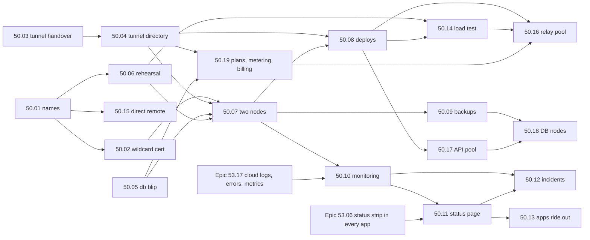

# Epic 50: Maktaba Cloud with no downtime: from one VPS to a relay people can pay for

> **Status:** spec (2026-11-03). **Builds on:** [Epic 25](../25-cloud-relay/README.md) (the
> cloud, relay, metering, tiers, entitlements) and [Epic 30](../30-relay-analytics/README.md)
> (relay metrics). **Works with:** [Epic 53](../53-logs-errors-reports/README.md) (logs, errors,
> problem reports and application metrics: the cloud's come from 53.17; see §4.5 and §10 for
> who owns what). **Research:** [research.md](research.md): the code as it is, Plex, Jellyfin,
> Emby, Tailscale, Cloudflare Tunnel, Hetzner prices, all with sources.
> **Wiki:** [epic-50-cloud-no-downtime.md](../../../docs/wiki/epics/epic-50-cloud-no-downtime.md).

## 1. Why

The owner, 2026-11-03, on taking payments for remote access:

> "if we are letting people pay then there should be no downtime"

Maktaba Cloud has no VPS yet. The plan is to start on one Hetzner VPS with the existing
single-machine deploy (`deploy/cloud-relay/`). That works for a demo, but it isn't something
to charge for: every reboot, deploy or disk fault on that one machine stops remote play for
every paying home, and a lost disk loses every account. This epic takes the cloud from one
VPS to two machines that cover for each other (Phase 1, before taking money), then to a pool
of relays (Phase 2, when the homes outgrow one machine).

## 2. What we found

From [research.md](research.md) §1, with the code checked on 2026-11-03:

| # | Gap today | Fixed by |
|---|---|---|
| G1 | One machine runs relay, API, Postgres, Redis and Caddy. | 50.07 |
| G2 | Every deploy drops every tunnel and every stream (the container is replaced; `http.Server.Shutdown` doesn't close the hijacked WebSockets). | 50.03, 50.04, 50.08 |
| G3 | Homes reconnect without jitter, so they all retry at the same instants. | 50.03 |
| G4 | One Let's Encrypt certificate **per home**, issued on demand and kept on one disk. Let's Encrypt's limit is 50 new certificates per domain per week, so a fresh standby can't get them in time. | 50.02 |
| G5 | The relay queries Postgres on **every** request (`BySlug`, `Meter.Allow`), so a 30-second database failover fails 30 seconds of requests. | 50.05 |
| G13 | The plan limits don't agree, and the relay doesn't enforce stream limits. The architecture doc says Pro 2 / Family 5 streams; `cloud/internal/billing/plans.go` has Free / Pro / Family with 1 / 4 / 10 streams and 5 / 100 / 500 GiB, the license maps them to `free` / `home` / `pro`, and the cloud web app's strings say "Home" and "Pro". Only the billing API reports the limit; no relay enforces it, and the byte cap cuts relayed play off with a `402`. **Decided (§13, decisions 4 and 6):** all of these are replaced by **Free** (no relay; direct remote free), **Basic** (relay capped at ~3 Mbps, 2 streams, 500 GB soft fair use) and **Pro** (full quality, an allowance, N streams, optional pay-as-you-go with a cap, paid extra streams); Family is dropped; prices TBD. The relay enforces each plan and never cuts a paid plan off; old names migrate `pro`→`basic`, `family`→`pro`. | 50.19 (plans, enforcement, metering, billing through a payment provider TBD (not Stripe), migration); 50.16 keeps the counts across relays |
| G14 | Nothing writes `direct_ip` / `direct_port`, so `direct_url` in the home list is in practice always empty. | 50.15 |
| G12 | Architecture §13.10 and story 25.14 describe `NOTIFY tier_changed`, but neither the NOTIFY nor a LISTEN exists in the code, so a plan change reaches the relay only when it next queries. | 50.05, 50.17 |
| G6 | Tunnels are held in one process's memory. Story 25.8's multi-relay routing ("consistent hash on `server_id` at the L4 LB") was never built, and Hetzner's load balancer can't do it. | 50.04, 50.16 |
| G7 | Story 25.1 assumes managed Postgres; Hetzner has none. | 50.07, 50.18 |
| G8 | Backups are one `pg_dump` line in a README. | 50.09 |
| G9 | No outside monitoring and no status page. | 50.10, 50.11 |
| G10 | The direct path is plain HTTP and needs a port forwarded by hand. | 50.15 |
| G11 | An old name: `relay.maktaba.app` in a comment in `cloud/migrations/00040001_servers.sql`. **maktaba.app is not ours**; it should say `maktaba.tv`. (`com.maktaba.app` / `io.maktaba.app` in Epic 12/22 plans are app identifiers, not hostnames, and stay.) | 50.01 |

## 3. Goals

1. **Remote play keeps working when one machine fails.** It is back within 3 minutes, with
   nobody touching anything.
2. **Deploys are invisible.** No dropped tunnel, no failed request, no stopped stream.
3. **No data is lost** when a machine dies (RPO 0 while both nodes are healthy), and at most
   one minute's worth if the whole data centre is lost.
4. **We know before users do.** An outside probe plays through a canary home every 30 s and
   pages the owner within 90 s of a failure.
5. **Users are told the truth**, in English and Arabic: a status page and an in-app banner,
   both driven by the probe, not by hand.
6. **The home keeps working without the cloud**: local playback always, direct remote when it
   is set up, and cloud features for 7 days (as today).
7. **Every failure path is proven in CI before it reaches the VPS**, the same rule as the
   update rehearsal (`docs/update-rehearsal.md`): failover, deploy, rollback and restore.
8. **Costs stay below the ceilings in §5** at 100, 1,000 and 10,000 homes.

### Not in this epic

- More regions (US, Asia), and clients choosing the nearest relay (Tailscale-style). That is
  Phase 3, written down in §8 but not specced.
- Setting prices. The plans themselves are decided (§13 decision 4) and built in 50.19, which
  replaces the tiers of Epic 25.12 / 25.15; the prices, Pro's allowance and stream count are
  the owner's, still **TBD**.
- End-to-end encryption through the relay (architecture §13.11 keeps the cloud in the trust
  boundary).

## 4. Requirements

### 4.1 Functional

| ID | Requirement | Story |
|---|---|---|
| F1 | **Failover.** When the active node dies, the standby takes over the database, the public address and the cloud processes by itself. Two nodes can never both be active. | 50.07 |
| F2 | **Zero-downtime deploys.** A new release starts beside the old one; homes move their tunnels to it before the old one stops; in-flight streams finish. A failed health check rolls back on its own. | 50.03, 50.04, 50.08 |
| F3 | **Planned node work** (OS patches, resizing): a switchover to the other node, announced 48 h ahead on the status page. | 50.07, 50.11 |
| F4 | **Backups and restore.** Continuous database archive off the machine, nightly full backup, 30 days of point-in-time restore, secrets kept apart, a restore tested every week. | 50.09 |
| F5 | **Monitoring and alerting.** A canary home, outside probes from two networks, metrics, alerts to the owner's phone. | 50.10 |
| F6 | **Multi-relay routing** (Phase 2). Any relay answers for any home; each home is assigned to relays by a hash over the healthy ones; a home holds tunnels to two relays. | 50.04, 50.16 |
| F7 | **Status page** at `status.maktaba.tv`, hosted off Hetzner, and a banner in every app. | 50.11 |
| F8 | **Incident handling.** Severity levels, runbooks, user messages in English and Arabic, postmortems. | 50.12 |
| F9 | **Apps ride out the cloud being down.** They keep the last connection list, try direct addresses first, and show plain messages. | 50.13 |
| F10 | **Direct remote like Plex.** UPnP / NAT-PMP, an outside reachability check, and HTTPS on the direct path, with names on several separate direct-name domains (never under `maktaba.tv`). **Free on every plan.** | 50.15 |
| F11 | **Plans the relay enforces.** Free: no relay. Basic: relay capped at ~3 Mbps (the home transcodes down to it), 2 relayed streams, 500 GB a month soft fair use. Pro: full quality within an allowance and N streams, optional pay-as-you-go up to a user-set cap, paid extra streams, then Basic's capped quality. A paid plan never cuts relayed play off. Metered, billed through usage-based items at a payment provider TBD (not Stripe). | 50.19 |

### 4.2 Non-functional: the numbers

| Area | Target (Phase 1) | Target (Phase 2) | How it is measured |
|---|---|---|---|
| **Availability (SLO)** | **99.9 %** a month = at most **43.8 min** down | **99.95 %** = 21.9 min | The canary probe (50.10): `GET https://canary.relay.maktaba.tv/api/health` through the relay, plus `GET https://api.maktaba.tv/readyz`, every 30 s from two outside networks. A minute counts as down when both networks fail it. Planned work counts too. A **target, not a promise**: no credit or refund for downtime (§13 decision 1; 50.12). |
| **RTO, one node lost** | relay and API serving again in **≤ 3 min** (expected ~90 s) | ≤ 30 s (homes already hold a second tunnel) | Failover rehearsal (50.06) and the canary. |
| **RTO, data centre or zone lost** | ≤ 4 h, by a runbook: restore from backup in another zone or provider, then change DNS | ≤ 1 h | Restore drill (50.09). |
| **RPO** | **0** while both nodes are healthy (synchronous replication); **≤ 60 s** if both are lost (WAL archived at least every 60 s) | same | Rehearsal checks the last committed row after failover. |
| **Failover detection** | ≤ 30 s (Patroni leader lease 30 s) | same | Rehearsal timings. |
| **Tunnel reconnect** after a relay is reachable | p95 ≤ 20 s, p99 ≤ 45 s, for 1,000 homes | p99 ≤ 10 s | Rehearsal with 1,000 simulated homes (50.06, 50.14). |
| **Requests during a reconnect** | held up to **15 s** for a home seen in the last 2 min, then `503 home_reconnecting` with `Retry-After` | same | Rehearsal. |
| **Deploy impact** | **0** dropped tunnels, **0** failed requests, **0** stopped streams | same | Deploy rehearsal (50.08). |
| **Planned switchover impact** | ≤ 15 s pause in remote streams, at most once a month | none (drain the relay first) | Rehearsal. |
| **Relay throughput per node** | plan at **300 Mbit/s** relayed and 5,000 idle tunnels until 50.14 measures the real numbers | measured | Load test (50.14). |
| **Added latency through the relay** | ≤ 20 ms p95 over the home↔relay path, at 70 % of measured capacity | same | Load test. |
| **Cost** | §5 ceilings | §5 ceilings | Monthly in the admin revenue page (25.21). |
| **Security** | §4.4 | §4.4 | Review per story. |
| **Observability** | §4.5 | §4.5 | 50.10. |

### 4.3 What keeps working when the cloud is down

| | Today | After this epic |
|---|---|---|
| Playback at home (LAN) | Yes: the home signs its own users in. | Yes. A test proves it with the cloud unreachable (50.13). |
| A user already signed in through Maktaba Cloud | Their home session lasts. | Same. |
| A **new** sign-in with a Maktaba Cloud account | Fails (the home checks the cloud's assertion). | Still fails, with a clear message suggesting the home password (50.13). |
| Remote play over the **relay** (Basic and Pro; Free has no relay) | Down. | Down only if **both** nodes are down. |
| Remote play over a **direct** address (every plan, Free included) | In practice never: the home list has a `direct_url` field, but nothing fills it (G14). | Works from the app's **cached** connection list, over HTTPS, with ports opened by UPnP / NAT-PMP (50.13, 50.15). |
| Cloud features on the home (relay plan flags) | 7-day grace on the last signed entitlement. | Same (story 25.26). |
| Paying, changing plans | The payment provider (TBD, not Stripe) hosts checkout and retries its webhooks; choosing one that retries for days is a selection rule (50.19 §6). | Same; nothing lost. Pay-as-you-go usage queues in Postgres and reaches the payment provider later with the same idempotency identifiers (50.19). |
| Push notifications | Down. | Down; the outbox in Postgres sends them after recovery if they are still within their TTL. |

### 4.4 Security

- Only the edge (Caddy, ports 80/443) faces the internet. Postgres, etcd, Redis and the cloud
  processes listen on the **Hetzner private network** or loopback only. A Hetzner Cloud
  Firewall and UFW both enforce it.
- Replication and etcd traffic use TLS and SCRAM, even on the private network.
- Production lives in **its own Hetzner project**, so the API token on the nodes (needed to
  move the Floating IP) can't touch anything else. The Cloudflare token is scoped to DNS edits
  on the `maktaba.tv` zone only. The direct-name domains (50.15) are delegated to our own
  responder, so no token touches them.
- Backups are encrypted before they leave the machine (pgBackRest `aes-256-cbc`). The key and
  the cloud's own secrets (token secret, entitlement signing key, payment provider keys) are kept in the
  owner's password manager too, never in the repo, never in a backup bucket without
  encryption.
- SSH by key only, no root login, and the deploy key works only for the `deploy` user.
- Resume tickets (50.03) are HMAC-signed, bound to one home, valid 10 minutes, and never logged.
- No media is stored. The relay passes bytes through (architecture §13.1).

### 4.5 Observability

- Probes every 30 s from two outside networks (not Hetzner), so a Hetzner-wide outage still
  pages.
- Alerts page the owner within **90 s** (two failed probes in a row). SLO burn alerts: 2 % of
  the month's budget in 1 h (fast), 5 % in 6 h (slow).
- Metrics kept 30 days; the existing `/metrics` (architecture §13.12) plus the new ones listed
  in 50.10 (replication lag, failover count, drain progress, held requests).
- **Logs, error groups and the application metrics come from [Epic 53](../53-logs-errors-reports/README.md),
  story [53.17](../53-logs-errors-reports/story-53-17-cloud-observability.md):** the cloud's
  processes use the shared log schema, keep 14 days of logs on each node and forward them to
  the witness W (so a dead node's last lines survive), group errors, and emit
  `maktaba_errors_total` and the request metrics that 50.10 scrapes and alerts on. Epic 50 owns
  the infrastructure metrics, Prometheus, Alertmanager, Grafana, the probes, paging, the status
  page and incidents; Epic 53 owns what the processes log and report. The split is in Epic 53
  README §9.
- Every alert links to its runbook (50.12).

## 5. Sizing and cost

Prices are **as of 2026-11-03**, EUR a month excluding VAT, from Hetzner's plan pages (sources
in [research.md](research.md) §4). Hetzner raised prices twice in 2026, and today the
CX and CAX plans say "currently not available" to order. So each row shows what can be ordered
today (**orderable**) and what it costs if the cheaper plan comes back (**if CX/CAX**). Check
the vCPU and RAM of a plan when ordering: each node needs at least **2 vCPU and 4 GB RAM**
(Postgres, Patroni, etcd, Caddy and the cloud processes on one machine).

### Traffic estimate

| Homes linked | Paying (assume 25 %) | Relayed a month (40 GB per paying home, after direct and LAN) | Peak relay throughput (10 % of paying homes streaming at 5 Mbit/s) |
|---|---|---|---|
| 100 | 25 | 1 TB | 13 Mbit/s |
| 1,000 | 250 | 10 TB | 125 Mbit/s |
| 10,000 | 2,500 | 100 TB | 1.25 Gbit/s |

Each Hetzner server includes 20 TB a month in the EU, and extra traffic is €1/TB. Relayed
bytes go in and out of the relay, so 1 TB relayed is about 1 TB out (Hetzner bills outbound
traffic). Every byte the direct path (50.15) carries instead is a byte we don't pay for.

### Phase 1 (launch): two nodes and a witness

| Item | Orderable | If CX/CAX |
|---|---|---|
| Node A (FSN1) and node B (NBG1) | 2 × CPX22 = €39.98 | 2 × CX33 = €17.98 |
| Hetzner backups for A and B (20 %) | €8.00 | €3.60 |
| Witness W (HEL1): etcd member (its only witness job), with monitoring, canary home and restore drill as guests (decided: CPX22 now, §13 decision 3) | CPX22 €19.99 | CPX22 €19.99 (not waiting for CX23) |
| Floating IPv4 + 3 primary IPv4 | €3.00 + €1.50 | same |
| Object Storage (backups, HEL1) | €6.49 | same |
| Second backup copy off Hetzner (Cloudflare R2, ~20 GB; decided, §13 decision 2) | ~€0.30 | same |
| Direct-name domains (3–4, registered by the owner, 50.15) | a domain's yearly fee ÷ 12 each, a few euros a month in all | same |
| Outside probes, status page | €0 (free tiers, see 50.10 / 50.11) | same |
| **Total** (before the direct-name domains) | **≈ €79** | **≈ €53** |

At 1,000 homes the same layout moves A and B to CPX32 (€35.99 each): **≈ €117 orderable**.
Traffic (10 TB) fits in the active node's 20 TB.

### Phase 2 (scale-out): around 10,000 homes

| Item | Orderable |
|---|---|
| 6 relay nodes, CPX32 | €215.94 |
| 3 API/worker nodes, CPX22 | €59.97 |
| 3 database nodes, CCX13 (dedicated vCPU) + backups | €130.47 + €26.09 |
| LB11 for the API (not for video: 1 TB limit) | €7.49 |
| Witness/monitoring node CPX22 | €19.99 |
| IPs (relay primaries, Floating IP for the DB) | ~€8 |
| Object Storage (2 TB) | ~€13 |
| Traffic: 100 TB against 6 × 20 TB included | €0 (overage €1/TB past that) |
| **Total** | **≈ €481** |

### Ceilings

| Homes | Ceiling a month (infrastructure + traffic) | Expected |
|---|---|---|
| 100 | **€100** | €53–79 |
| 1,000 | **€250** | €84–117 |
| 10,000 | **€1,000** | ≈ €481 |

The admin revenue page (25.21) alerts when the month's spend passes 80 % of the ceiling for
the current number of homes.

## 6. Phase 1: launch-ready (two nodes, one address)

```
                         status.maktaba.tv (off Hetzner)        outside probes (2 networks)
                                   ▲                                   │
   apps ── api.maktaba.tv (Cloudflare proxy) ──┐                       │
   apps ── <slug>.relay.maktaba.tv (DNS only) ─┼──► Floating IP ◄──────┘
   homes ─ relay.maktaba.tv (WSS)  ────────────┘        │ held by the database leader
                                                        ▼
        ┌──────── node A (FSN1), leader ────────┐   ┌──────── node B (NBG1), standby ───────┐
        │ Caddy :443 (wildcard cert)            │   │ Caddy :443 (wildcard cert, idle)      │
        │ maktaba-cloud blue|green              │   │ (cloud processes stopped)             │
        │   api · relay · worker                │   │                                       │
        │ Postgres primary ── sync replication ─┼──►│ Postgres replica (Patroni)            │
        │ Patroni · etcd · Redis (cache only)   │   │ Patroni · etcd · Redis (cache only)   │
        └──────────────┬────────────────────────┘   └───────────────┬───────────────────────┘
                       │  Hetzner private network (eu-central)      │
                       └──────────────► witness W (HEL1) ◄──────────┘
                                         etcd · Prometheus/Alertmanager · canary home
                                         pgBackRest repo check · restore drill
                                                │
                                   Object Storage (HEL1) + R2 copy
```

**The rule: everything follows the database leader.** Patroni decides which node holds the
Postgres primary, using a lease in etcd with three members (A, B and the witness W), so
two nodes can never both win. When a node becomes leader, Patroni's role-change callback
moves the **Floating IP** to it (one Hetzner API call) and starts the cloud processes there.
When it loses the lease it stops them and Postgres turns read-only. DNS never changes on
failover, so no TTL wait.

Why these choices (the alternatives we weighed are in 50.07):

- **Patroni + etcd with a witness**, not keepalived (two nodes can't break a tie, so split
  brain), not pg_auto_failover (its monitor is a single point of failure), not a home-made
  controller (more code to get wrong).
- **Synchronous replication with fallback** (`synchronous_mode: true`,
  `synchronous_mode_strict: false`): no committed write is lost while both nodes run, and if
  B dies A keeps taking writes alone.
- **A and B in different data centres** of the same zone (FSN1, NBG1), because a Floating IP
  can only move inside one network zone. The witness is in a third (HEL1).
- **One wildcard certificate per node** for `relay.maktaba.tv` and `*.relay.maktaba.tv`,
  issued by DNS-01 through Cloudflare (50.02), so the standby is ready to serve TLS before it
  is needed.
- **Redis holds nothing we can't lose.** Today no cloud code connects to Redis at all (the
  config reads `MAKTABA_CLOUD_REDIS_URL` and nothing uses it). The rule from 50.05: Redis may
  only ever hold caches; anything that must survive lives in Postgres. Each node runs its own
  Redis, with no replication, or none at all.
- **Tunnels move before they break** (50.03, 50.04): a deploy starts the new process beside
  the old one; the old one sends each home a `DRAIN` frame; the home opens a new tunnel (with
  a resume ticket, so no bcrypt) and the old tunnel finishes its streams. A relay process that
  doesn't hold a home's tunnel forwards the request to the one that does (the tunnel
  directory), and holds it up to 15 s while a home reconnects.
- **The relay rides out a database blip** (50.05): it caches each home's lookup and tier, and
  buffers metering in memory while Postgres fails over.

## 7. Phase 2: scale-out (a pool of relays)

Triggered when the active relay passes **60 % of its measured capacity** (50.14) at peak for a
week, or at about 2,000 linked homes, whichever comes first.

- **Relays are a pool**, each with its own public IPv4 and name (`r1.relay.maktaba.tv`, …).
  All of them serve `relay.maktaba.tv` and `*.relay.maktaba.tv` as DNS round robin over the
  healthy ones (the witness removes a dead relay's record through the Cloudflare API, TTL
  60 s).
- **Assignment by rendezvous hashing** of the home's ID over the healthy relays: deterministic,
  and adding or removing a relay moves only the homes it gains or loses. A home holds its
  **primary tunnel to rank 1 and a standby tunnel to rank 2** (the Cloudflare Tunnel idea), so
  losing a relay means clients switch to a tunnel that already exists.
- **Any relay answers for any home.** The tunnel directory in Postgres (built in 50.04) says
  which relay holds a home's tunnel; the receiving relay forwards over the private network
  (free traffic). The API also gives apps a **relay hint**, `https://<slug>.r3.relay.maktaba.tv`,
  so most requests take one hop.
- **The API is stateless** behind a Hetzner LB11 (the LB can do this part; it can't route video
  by home). Cloudflare stays in front of `api.maktaba.tv`. The worker runs on every API node
  and works only while it holds a Postgres advisory lock (50.17).
- **The database moves to its own three nodes**: Patroni primary, synchronous replica, async
  replica, PgBouncer in front, the Floating IP on the primary (50.18).

**Why not route at the load balancer?** Hetzner's LB can only do round robin or least
connections, and it carries 1 TB a month on LB11. **Why not per-home DNS records** pointing at
the home's relay? Failover would then wait on DNS caches that ignore short TTLs; with
forwarding plus hints, the stable name always works and the hint is only a shortcut.

## 8. Phase 3 (not specced)

A second region (Hetzner Ashburn or Singapore) with its own relay pool, apps picking the
nearest by latency and moving to the next when a region fails (as Tailscale's DERP regions do),
and the database staying in eu-central with a replica per region for reads.

## 9. Plex, compared

Full detail and sources in [research.md](research.md) §2 and §6.

| | Plex | Maktaba today | Maktaba after this epic |
|---|---|---|---|
| Direct remote | UPnP / NAT-PMP, or a manual port; plex.tv checks from outside | `http://<ip>:<port>` if the user forwarded a port | UPnP / NAT-PMP, manual port, outside check, HTTPS (50.15) |
| HTTPS on the direct path | `*.<hash>.plex.direct` certificate per server, IP-encoded names | none | `*.<home-id>.<direct-domain>` per home, IP-encoded names, on several separate domains so Let's Encrypt's weekly limit is per domain (50.15) |
| Direct remote, who gets it | since 2025-04-29 remote play needs a paid pass | — | **free on every plan** (50.15) |
| Relay | fallback, capped at **2 Mbps**; needs a paid pass | fallback, paid plans only, capped by GB a month (then cut off), no bitrate cap | fallback, paid only: **Basic** capped at ~3 Mbps (the home transcodes), **Pro** full quality then Basic's cap; never cut off (50.19); on two nodes, then a pool |
| How apps choose | connection list from plex.tv, flagged local / remote / relay | home list with `direct_url` and `relay_url`, not cached | connection list cached in the app, ranked local → direct → relay hint → relay (50.13) |
| When the cloud is down | local sign-in often fails (July 2026: local servers unreachable for ~2 h) | local works; cloud sign-in and remote fail | local works; direct remote works from the cache; relay survives one node |
| Status page | missed the July 2026 impact | none | driven by the canary probe, English and Arabic (50.11) |

**Copy:** direct first, router setup with an outside check, per-home certificates, a cached
connection list. **Avoid:** local play depending on the cloud, a status page that's updated
by hand, one DNS name for direct access with no fallback (Plex's April 2026 `plex.direct`
fault), and charging for direct remote (ours is free). **Changed by the owner's decision:** we
copy Plex's relay cap for **Basic** (about 3 Mbps, higher than Plex's 2 Mbps because Basic is
paid), and Pro is uncapped within its allowance (§13 decision 4).

## 10. Stories

| # | Story | Phase | Depends on |
|---|---|---|---|
| 50.01 | [Names and the DNS plan](story-50-01-names-and-dns.md) | 1 | — |
| 50.02 | [One wildcard certificate on every node](story-50-02-wildcard-certificate.md) | 1 | 50.01 |
| 50.03 | [Homes move their tunnel without a gap](story-50-03-tunnel-handover.md) | 1 | — |
| 50.04 | [Any relay process answers for any home](story-50-04-tunnel-directory.md) | 1 | 50.03 |
| 50.05 | [The relay rides out a database blip](story-50-05-database-blip.md) | 1 | — |
| 50.06 | [The cloud rehearsal in CI](story-50-06-cloud-rehearsal.md) | 1 | 50.01 |
| 50.07 | [Two nodes, one address](story-50-07-two-nodes.md) | 1 | 50.02, 50.04, 50.05, 50.06 |
| 50.08 | [Deploys with no downtime](story-50-08-zero-downtime-deploys.md) | 1 | 50.04, 50.07 |
| 50.09 | [Backups and restore](story-50-09-backups-restore.md) | 1 | 50.07 |
| 50.10 | [Monitoring, the canary home and alerts](story-50-10-monitoring.md) | 1 | 50.07, [53.17](../53-logs-errors-reports/story-53-17-cloud-observability.md) |
| 50.11 | [Status page and in-app status](story-50-11-status-page.md) | 1 | 50.10, [53.06](../53-logs-errors-reports/story-53-06-status-strip.md) |
| 50.12 | [Incident handling](story-50-12-incident-handling.md) | 1 | 50.10, 50.11 |
| 50.13 | [Apps ride out a cloud outage](story-50-13-apps-ride-out-outage.md) | 1 | 50.11 |
| 50.14 | [Load test and sizing](story-50-14-load-test.md) | 1 | 50.06, 50.08 |
| 50.15 | [Direct remote access, like Plex](story-50-15-direct-remote.md) | 1b | 50.01 |
| 50.16 | [A pool of relays](story-50-16-relay-pool.md) | 2 | 50.08, 50.14, 50.19 |
| 50.17 | [A stateless API pool](story-50-17-api-pool.md) | 2 | 50.08 |
| 50.18 | [The database on its own nodes](story-50-18-database-nodes.md) | 2 | 50.09, 50.17 |
| 50.19 | [Plans: Free, Basic and Pro, enforced by the relay and billed by usage](story-50-19-plans-relay-billing.md) | 1 | 50.04, 50.05 |



Work that can start at once, in parallel: **50.01, 50.03, 50.05** (and 50.15 after 50.01;
50.19 after 50.04 and 50.05).

Two edges come from [Epic 53](../53-logs-errors-reports/README.md): 50.10 needs 53.17 (the
cloud's logs, error groups and application metrics to watch) and 50.11 needs 53.06 (the one
status strip every app draws; 50.11 feeds it the cloud's state instead of building its own
banner).

50.06 builds the rehearsal harness early. Each later story turns on its own scenarios in it
(they are listed as expected failures until then), so 50.06 only needs 50.01 to start.

## 11. Launch gate

Paid plans are switched on only when all of these hold:

1. Stories **50.01 – 50.14** and **50.19** are merged, and their CI rehearsals pass on the
   deployed sha.
2. The production pair has run for **14 days** with the canary at ≥ 99.9 %, including one
   **planned switchover** and one **forced failover** (power off the leader in the Hetzner
   console, by the owner) that met the RTO.
3. A **restore** from the off-site backup into a scratch machine has passed, timed against the
   4 h RTO.
4. The status page, alerts to the owner's phone, and the runbooks in 50.12 are live.
5. The owner has set the prices, Pro's allowance and stream count, and the prices of a
   pay-as-you-go GB and an extra stream; the catalog has no `TBD` left (50.19 T12).

50.15 (direct remote) is recommended before launch but doesn't gate it: it cuts relay cost,
keeps remote play working through a full cloud outage, and is the only remote play Free homes
get.

## 12. What the owner does (nothing here creates or buys anything)

Building this epic calls no Hetzner, Cloudflare, DNS, payment provider or VPS API. The owner, when ready:

1. Creates a Hetzner project for production, the nodes A, B and W (W a CPX22), the private
   network, a Floating IP and an Object Storage bucket, and a Cloudflare R2 bucket for the
   second backup copy (50.07 / 50.09 list the exact settings).
2. Creates the scoped API tokens (Hetzner project token; Cloudflare DNS-edit token for
   `maktaba.tv`; Object Storage and R2 keys) and stores them as GitHub `production`
   environment secrets.
3. Points the DNS names in 50.01 at the Floating IP.
4. Picks the outside probe and status page provider (50.10 / 50.11 recommend free tiers).
5. Registers the first 3–4 direct-name domains (never under `maktaba.tv`), delegates their `NS`
   to the responder on A and B, adds their `CAA` records, and lists them in `direct.domains`
   (50.15 §4); later domains are added the same way, by configuration only.
6. Picks the payment provider (TBD, not Stripe; 50.19 §6), sets the prices and Pro's numbers,
   then creates at that provider the flat prices for Basic and Pro, the metered price for
   pay-as-you-go GB, and the per-unit price for extra streams, and puts their IDs in the
   `production` config (50.19 §6).

## 13. Decisions (2026-11-03)

The owner's answers to the open questions, applied to the stories above.

1. **Downtime credits: none.** The 99.9 % (Phase 2: 99.95 %) uptime target stays, with its
   alerts, error budget and postmortems, and the status page publishes the measured figure.
   But it is a target, not a promise: **no credit, refund or discount** for downtime. 50.12 §5
   and 50.11 say so in English and Arabic (`uptime.policy`); no credit job, setting or payment
   provider balance entry exists.
2. **Off-Hetzner backup copy: yes, Cloudflare R2.** pgBackRest writes every backup and the WAL
   archive to Hetzner Object Storage (repo1) and to R2 (repo2), each encrypted with its own
   passphrase; the drill restores from R2 once a month; the encrypted secrets copy is in both
   (50.09).
3. **Witness: a Hetzner CPX22 (€19.99 a month), now.** Its witness job is etcd only (the third
   vote), which needs about 1–2 vCPU, 1–2 GB RAM and ~20 GB disk. Monitoring, the canary home
   and the restore drill share the machine as guests at lower priority and move off if they
   ever crowd etcd. **Cloudflare can't host it:** Cloudflare sells no VMs, and Cloudflare Tunnel
   is only a connector into a machine that already exists (50.07).
4. **Plans: Free, Basic and Pro.** They replace both the architecture doc's Pro 2 / Family 5
   and the code's 1 / 4 / 10 with its "Home" / "Pro" names (gap G13). Specced in **50.19**.
   - **Free:** no relay. Play at home, plus direct remote (decision 6).
   - **Basic (paid):** relay at capped quality like Plex, about **3 Mbps**; the home transcodes
     down to it, which costs the home CPU or GPU time while a relayed stream plays (bounded by
     the stream limit). At most **2 relayed streams** at once. A **500 GB a month fair-use soft
     limit**: above it streams slow further (to 1.5 Mbps), they don't stop.
   - **Pro (paid):** full-quality relay with a **monthly GB allowance** and **N relayed
     streams**. Optional **pay-as-you-go GB**, off by default, with a **spending cap the user
     sets**. When the allowance and the cap are used up it falls back to Basic's capped quality
     and never cuts off. **Extra concurrent streams** are a paid add-on.
   - **Family plan: dropped.** **Prices: TBD by the owner** (with Pro's allowance and N, and the
     prices of a pay-as-you-go GB and an extra stream); the launch gate (§11) waits for them.
   - 50.19 specs how the relay enforces each plan (refuse / full / capped / capped-slow, a cap
     header the home transcodes to, pacing as a backstop, `relay_streams` counting), the
     metering (bytes per mode per month, Pro's order: allowance, pay-as-you-go, capped), the
     billing through a payment provider TBD, not Stripe (a flat price per plan, a usage-based
     metered price for pay-as-you-go, a per-unit price for extra streams), and the migration from today's code
     names (`pro`→`basic`, then `family`→`pro`; license tier `home` read as `basic` during the
     grace).
5. **Direct-connection certificates: several separate direct-name domains, never under
   `maktaba.tv`.** Start with 3–4. Each has its own Let's Encrypt limit of 50 new certificates a
   week, so homes are assigned across the domains by the room each has left that week, and
   adding a domain is configuration only. **ZeroSSL**, then **Google Trust Services**, take the
   overflow; ask Let's Encrypt for higher limits as growth needs it. Paid per-home certificates
   ($35–1,000 a year each at retail) were rejected (50.15 §4, 50.01).
6. **Direct remote on Free: yes, free.** Only the relay is paid. The home never checks its plan
   for direct access, and a Free home's connection list has local and direct entries only
   (50.15 §5, 50.13).
