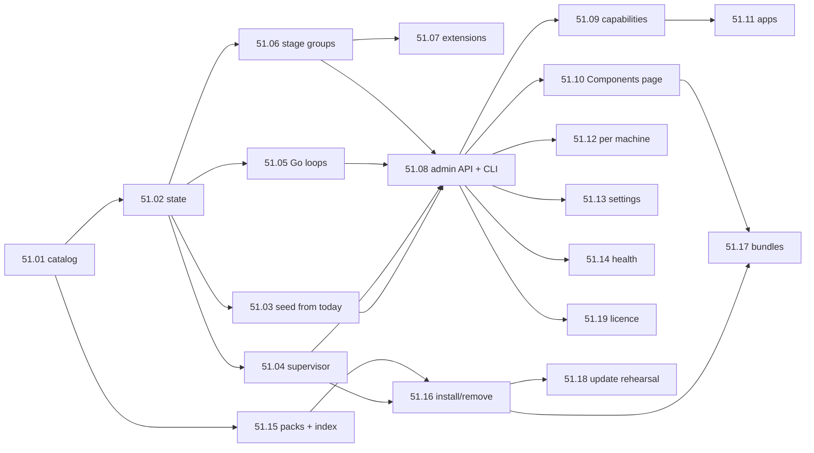

# Epic 51: Every part of Maktaba can be turned on, off, added later or left out

> **Status:** spec (2026-11-03). **Builds on:** [Epic 6](../06-job-queue/README.md) (the queue),
> [Epic 16](../16-subscriptions/README.md) (licences and flags), [Epic 31](../31-multi-instance/README.md)
> (machines and per-machine stage switches), [Epic 35](../35-cluster-full-nodes-and-updates/README.md)
> (updates), [Epic 36](../36-mac-app/README.md) / [38](../38-windows-app/README.md) /
> [39](../39-linux-app/README.md) (the one-installation apps and their payload),
> [Epic 40](../40-queue-health/README.md) (parking and failure classes) and
> [Epic 42](../42-apps-player-remote-server/README.md) (editions).
> **Research:** [research.md](research.md): what runs today and where it is switched, file by
> file, plus Plex, Jellyfin, Home Assistant, Nextcloud, Kubernetes, systemd, feature flags and
> signed package indexes, with sources.
> **Wiki:** [epic-51-configurable-components.md](../../../docs/wiki/epics/epic-51-configurable-components.md).
> **Used by:** [Epic 52](../52-transcript-word-review/README.md) lists language packs as
> add-on components of this epic.

## 1. Why

The owner, 2026-11-03: *"currently all workers and features work right away, we need all to be
config, setting, whatever based, so that it can be stopped/started, enabled/disabled, even
server bundles, with and without components, ability to add later and so on."*

Today a new install starts everything it can: transcription workers, the index worker, the
LLM server, Live TV slots, YouTube sync, the cluster hub, the relay agent and about 40
background loops in the API, streaming and the pipeline. A home that only wants to play its
films still downloads about 2 GB of machine-learning wheels and models on first run, and still
runs the workers. An admin who wants transcription off tonight has to pause stages one by one on the
Queues page. A Linux owner who never wants Live TV has to edit `server.toml` and restart.
Nothing tells the apps that a feature is off, so they show Live TV tabs that cannot work.

## 2. What we found (details and line numbers in [research.md](research.md) §1)

There are **four on/off layers today, stored in four places**, and none of them knows about
the others:

| Layer | Where it is stored | Live? | Examples |
|---|---|---|---|
| `server.toml` sections | the config file the supervisor reads at boot | no, needs `/config/restart` | `[llm] enabled`, `[tv] slots`, `[cloud] enabled`, `[pipeline] index_worker`, `[transcription] workers`, `[postgres] enabled`, `[backups]` |
| Environment variables | process environment set by the supervisor | no | `MAKTABA_UPDATE_DISABLE`, `MAKTABA_TELEMETRY_ENABLED`, `MAKTABA_PIPELINE_SEMANTIC`, `MAKTABA_CLUSTER_AGENT`, `MAKTABA_PIPELINE_NO_ENGINE` |
| Database rows | `job_stages.enabled/paused`, `extensions.enabled`, `cluster_node_stages.enabled`, `cluster_nodes.drain`, `app_settings` `rules.*` keys, `hdhr_device.enabled` | yes, the pipeline re-reads them | stage disable (`disabled_reason`), Plex / dizqueTV / Cloudflare Stream extensions, a machine's stage switches |
| Licence and flags | `licenses`, `license_state`, `feature_flag_overrides` | yes | `cloud_relay`, `multi_user`, `federation` |

What has **no switch at all**: most Go loops in the API (tvchange controller, tvremote,
updates discoverer and scheduler loops, enrichment auto-accept, queue snapshots, cluster hub,
pairing sweep, usage counter), streaming's channel engine and HDHomeRun discovery when slots
are off, and the pipeline's reconciler, channel top-up and queue-health watchers.

What already works and this epic reuses rather than replaces:

- The supervisor's `Process` table with probes, backoff, restart limits, `StopGrace`,
  `OnDemand`, and **`Want(role, instance, on)`**, which starts and stops a process at runtime.
  Only the TV slots and the relay use it today (`cmd/maktaba-server/internal/supervisor/run.go`).
- The pipeline's **`StageSelector`**, which re-reads switches every refresh and records why
  a stage is off (`workers.stages_off`: `switched_off`, `draining`, `unavailable`, …), and
  `job_stages.enabled` with a `disabled_reason` (`not_configured`, `extension_disabled`,
  `operator`).
- Pausing that never loses work: `job_stages.paused` with an owner (0172), `queue_control`,
  per-machine drain, the 15 s pipeline drain on shutdown, Epic 40's parking.
- One schema per settings section (`rules.py` `SECTIONS` plus `*_settings.py`), which already
  generates `schema.json` and validates the web forms.
- The release trust chain: payloads are signed with Sigstore and checked with the same trust
  root in production and in the update rehearsal (`-tags e2etrust`).
- Payload layout and kept-payload rollback in the launcher; Linux runtime copies under
  `<data>/runtime/<v>_<digest>`.

What is missing: **one list of the parts of Maktaba**, one place that says which should run,
one loop that makes it so on every machine, a way to add a part that is not in the payload,
and one answer the apps can read to know what is on.

## 3. Goals

1. **One component catalog.** Every worker, background loop, feature, extension, bundled
   binary, runtime and model belongs to exactly one component with an id, a version,
   dependencies, what it needs on disk and in memory, and the platforms it runs on. CI fails
   when new code is not in it.
2. **Desired and actual state, kept apart.** Admins set what they want; each machine reports
   what is true, with a reason. One loop per machine closes the gap.
3. **Enable/disable and start/stop are different controls.** *Enabled* means "this should run
   on this home". *Stopped* means "hold it now", and lasts until someone starts it again or a
   chosen time passes.
4. **Live.** Turning a component on or off never restarts the server, the API or other
   components. In-flight jobs are drained, never lost.
5. **Install, remove, add later.** A component that is not in the payload can be downloaded,
   verified against the release signature, installed and later removed, online or from a file.
6. **Server bundles.** One choice at setup (Core, Full, Worker machine, or Custom) and the
   same choice later from the admin UI. The Full bundle is exactly today's Maktaba.
7. **Clients know.** One capabilities answer tells every app which features are on. Apps hide
   features that are off for viewers, and explain them to admins.
8. **No change for existing installs.** An update to the first release with this epic leaves
   every home running exactly what it ran before. The update rehearsal proves it.

### Not in this epic

- A third-party component store or marketplace. Pipeline extensions loaded through Python
  entry points stay a developer feature (§9, H5).
- New paid tiers or new paywalls. Gating reuses the existing licence flags only (H10).
- Moving the database out of the bundle. `[postgres] enabled = off` (an external Postgres)
  stays as it is: Postgres is a bootstrap component, not a switchable one.
- Per-library feature switches (Jellyfin-style "no trickplay for this library"). The Queues
  page already has per-library requeue. A later epic can add per-library overrides on top of
  this model.

## 4. The component model

### 4.1 What a component is

A **component** is the smallest part of Maktaba an admin can sensibly turn on or off. It is a
feature, not a stage: there are about 55 stages but about 30 components (H11). Each component
has one of five **kinds**, and the kind says how the machine makes it run:

| Kind | What it is | How it runs | How it stops |
|---|---|---|---|
| `process` | a supervised OS process (stt workers, index worker, ollama, relay agent, TV slots) | supervisor `Allow(role, i, true)` (51.04, built on today's `Want`) | `Allow(false)`: SIGTERM, the catalog's stop grace, then kill (today's `Want(false)` waits a fixed 10 s) |
| `stages` | a group of pipeline stages (thumbnails, convert, dedup, YouTube, classify…) | `job_stages.enabled = true`, the `StageSelector` claims them | stop claiming, drain in-flight jobs, force-pause the rest, keep the queue (§4.5) |
| `loop` | a goroutine or asyncio task inside the API, streaming or the pipeline (tvchange controller, HDHomeRun discovery, queue-health watchers…) | the process's component runner starts it with its own context | cancel its context, wait up to its stop grace |
| `extension` | an integration with another product (Plex, dizqueTV, Cloudflare Stream) | today's `extensions` row, now owned by the component | as today, plus its stages and loops |
| `asset` | something on disk with no process of its own: a model, a runtime (Python ML wheels, ollama), a tool (yt-dlp, ffmpeg on Linux) | nothing runs; it is *installed* or not | nothing to stop; it can be *removed* |

Most features are a small tree: `transcription` (stages + process) requires
`runtime.ml` (asset) and one of `model.whisper-*` (asset).

**Bootstrap parts are not components.** Postgres, the launcher, the supervisor, the API's
core routes, the web UI, streaming's playback, and the pipeline runtime with scan and probe
are always on. Without them there is no home to configure. They appear in the catalog as
`core.*` with `switchable = false` so the UI can show their health, and nothing can disable
them.

### 4.2 The catalog

One file, **`shared/components/catalog.toml`**, versioned with the code and embedded in every
binary (Go `embed`, Python `importlib.resources`). One entry per component:

```toml
[[component]]
id          = "transcription"
kind        = "stages+process"
group       = "processing"             # the UI section
title_key   = "components.transcription.title"   # words in en.json / ar.json, never in here
stages      = ["extract", "transcribe"]  # refine, second listen and word merge run inside transcribe
processes   = ["pipeline/stt-*"]       # supervisor role/instance patterns
loops       = []
requires    = ["runtime.ml", "any:model.whisper-turbo|model.whisper-large-v3|model.whisper-medium"]
wants       = ["model.cohere-arabic"]  # used when present; missing means degraded, not blocked
conflicts   = []
settings    = ["transcription"]        # rules.* sections it owns
platforms   = ["darwin-arm64", "windows-amd64", "linux-amd64", "linux-arm64"]
placement   = "any"                    # any | home  (from StageDef.placement)
resources   = { ram_mb = 6000, disk_mb = 0, gpu = "preferred" }
drain       = { grace_s = 120, checkpoint = true }
licence     = ""                       # an existing flag name, or empty
bundles     = ["full", "worker"]       # enabled by default in these bundles
since       = "0.4.0"                  # first release with this id
```

Assets carry what they need to be fetched:

```toml
[[component]]
id        = "model.whisper-turbo"
kind      = "asset"
group     = "models"
source    = "hf:mlx-community/whisper-large-v3-turbo@<revision>"
files     = [{ path = "weights.safetensors", sha256 = "…", size = 1617000000 }]
platforms = ["darwin-arm64"]
bundles   = ["full"]
in_payload = false                     # downloaded, never shipped in a dmg
```

The full list is in §5. Two CI checks keep the catalog honest (story 51.01): every `StageDef`
in `engine/graph.py`, every supervisor role and every registered loop belongs to exactly one
component; and every component's `title_key` has English **and** Arabic words.

### 4.3 States

**Desired state**, per component, per home, with optional per-machine overrides. An admin
writes it:

| Field | Values | Meaning |
|---|---|---|
| `want` | `absent` · `installed` · `enabled` | not on disk · on disk but off · should run |
| `hold` | null · `{by, at, until}` | stopped by an admin; `until` null means until started again |
| `generation` | integer | bumped on every change; actual state echoes the generation it acted on |

**Actual state**, per component, per machine. Only the machine writes it. It is reported as
one **phase** for people and a list of **conditions** for code (the Kubernetes pattern; H1):

| Phase (shown in UI) | When |
|---|---|
| Not installed | an asset or pack is not on disk |
| Installing / Removing | a download, verify, unpack or delete is in progress (progress %) |
| Off | installed, `want = installed` |
| Stopped | `want = enabled` and a `hold` is set |
| Waiting | `want = enabled` but a condition blocks it: a requirement is off, the licence is missing, the platform or resources don't allow it |
| Starting | the machine is bringing it up |
| Running | up and passing its probe |
| Degraded | running, but a `wants` is missing or a probe is flaky |
| Draining | stopping; in-flight jobs are finishing |
| Failed | it crashed past its restart limit, or its install failed verification; `reason` says why |

| Condition | True when |
|---|---|
| `Installed` | its files are on disk and verified |
| `RequirementsMet` | every `requires` is Running on this machine (or on the home for `placement = home`) |
| `Licensed` | its `licence` flag is on, or it has none |
| `Supported` | this machine's platform and resources allow it |
| `Ready` | it is running and passes its probe |

Each condition carries `status` (true / false / unknown), a **reason code** (`dependency_off`,
`licence_missing`, `platform_unsupported`, `not_enough_memory`, `verify_failed`,
`crash_loop`, `held`, …), the time it last changed and the `generation` it saw. Every reason
code has English and Arabic words, the same way `detail_codes.json` does today, with the same
kind of test.

### 4.4 Reconciling: one loop per machine

```
admin ── PUT /api/components/{id} ──► components (desired, generation++)
                                         │  NOTIFY components_changed
                                         ▼
     ┌──────────── each machine ─────────────────────────────────────┐
     │ supervisor reconciler: processes, assets, installs            │
     │ API component runner:       loops in the API                  │
     │ streaming component runner: loops in streaming                │
     │ pipeline component runner:  stage groups + pipeline loops     │
     └─────────────────────── writes ───────────────────────────────┘
                                         ▼
                              component_status (actual, per machine)
```

- **One writer per row.** The API writes desired state. Each runner writes only its own
  `component_status` rows (machine, component, part). Nobody else writes them (H13).
- **Level-based.** Each runner compares desired with actual on every `NOTIFY` and at least
  every 30 s, and acts on the difference. A missed message is caught up on the next pass.
- **Before the database is up** (supervisor boot), the supervisor uses the last desired state
  it saw, cached in `<data>/state/components.json`. A first boot with no cache uses the
  bundle chosen at setup.
- **Ordering.** Requirements start first and stop last (systemd's `After=` and `Requires=`
  rolled into one, because Maktaba's dependencies are always also ordering).

### 4.5 Stopping without losing work

A component with stages stops in four steps. These are the existing queue mechanisms, put
in order:

1. **Stop claiming** (≤ 2 s). The pipeline runner drops the component's stages from its
   served set (`stages_off = component_off:<id>` or `component_held:<id>`). Other machines
   see the desired state change at the same time.
2. **Drain** (≤ `drain.grace_s`, default 30 s). In-flight jobs keep running. Stages that
   checkpoint (transcription saves its finished segments) checkpoint and yield.
3. **Return** what is left. A job still running at the deadline is force-paused (state
   `paused`, with its checkpoint), the path the shutdown drain already uses
   (`engine/claim.py`). It does not move to `failed`, its attempt count does not go up, and it
   adds no failure class.
4. **Don't feed.** While a component is off, the graph does not create new jobs for its
   stages. The upstream stage records the edge as skipped (`skipped_component_off`) instead
   of enqueueing. Jobs already queued **stay queued**, shown on the Queues page as "waiting:
   transcription is off". They are never cancelled or deleted. Nothing writes `parked_on`
   (Epic 40's `park_max_hours` would release them); the disabled stage is what holds them.
   A *hold* differs in one way: new jobs still queue and wait, because a hold is short.

When the component is enabled again, its runner first resumes what was paused, then runs a
**catch-up** with the existing reconciler: every item whose upstream finished while the
component was off gets its job. The catch-up is a queue job of its own (`component_catchup`),
batched, with progress on the Queues page (H4).

`process` components follow the supervisor's existing stop path (`StopGrace`). `loop`
components get their context cancelled and have their stop grace (default 5 s) to return.

### 4.6 Dependencies and conflicts

- **`requires`** (hard). A component cannot become Running until its requirements are
  Running. `any:a|b|c` means any one of them is enough (any installed Whisper model).
- **`wants`** (soft). Used when present. Missing only makes the component *Degraded*, with a
  reason (no Cohere model: transcription runs without the second listen).
- **`conflicts`**. Two components that cannot both run (`livetv.slots` and
  `livetv.inprocess`: one channel engine or the other). Enabling one asks to disable the
  other in the same request.
- **Turning off a requirement keeps the dependents' wish** (H3). Disabling `llm` while
  `classify.llm` is enabled leaves `classify.llm` at `want = enabled`. It goes to *Waiting*
  with reason `dependency_off:llm`. When `llm` comes back, so does `classify.llm`, with
  nobody touching it. Before the change, the UI and API show the effect: "Turning off LLM
  also stops: Smart grouping, Book detection".
- **Removing** (`want = absent`) a component that something enabled requires is refused
  (`409 component_required_by`, with the list). Remove or disable the dependents first. This
  is the one place we refuse rather than wait, because removing deletes files.

### 4.7 Settings

Settings stay where they are (H7). Each component lists the `rules.*` sections and
`server.toml` keys it owns (`settings = [...]`). The Components page links each component to
its form, which is generated from the existing schema. What this epic adds:

- **A `schema_version` per section**, with major and minor numbers. A minor bump only adds
  fields with defaults. A major bump ships a migration function in the section's module
  (`migrate_v1_to_v2`), run by the pipeline runner the first time it reads an older value. A
  value it cannot migrate keeps the component in *Failed* with `settings_invalid` and a link
  to the form. It never loads defaults silently.
- **Validation on write** already exists (`PATCH /api/rules/{section}` checks `schema.json`).
  This epic adds the version check to it, so a value from a newer schema is refused too.
- **Settings survive disable and remove**, like Nextcloud's `app:remove --keep-data` default.
  `DELETE …?purge=true` also deletes settings and the component's own data (caches, models).
  It asks first.
- **`server.toml` keys that become desired state** (`[llm] enabled`, `[tv] slots`,
  `[cloud] enabled`, `[backups] nightly`) are imported **once**
  by the first release with this epic (story 51.03). From then on the database decides.
  `[transcription] workers` and `[pipeline] index_worker` stay settings: they decide where
  work runs, not whether. If the file still sets a key to something else, the Components page shows "server.toml says
  otherwise; the database wins" with the key's line, and the supervisor logs
  `toml_key_superseded` once per boot. Headless owners use `maktaba-server components …`.

### 4.8 Bundles

A **bundle** is a named starting set: which components are enabled, and which assets the
payload carries. Four bundles:

| Bundle | For | Enabled | Payload carries | Downloads at setup |
|---|---|---|---|---|
| **Full** | today's Maktaba; the default for every existing install | everything in §5 marked F | today's payload (ollama on the Mac, Python, the pipeline wheel) | the ML wheels and models, as today |
| **Core** | a home that plays and organises its media | core, thumbnails, convert, dedup, keyword search, queue health, analytics, backups, updates | the Mac: no ollama. Every platform: `constraints-core.txt`, a venv with no ML extras | nothing |
| **Worker machine** | a cluster machine that only takes jobs | the pipeline components the home chooses for it | today's node payload | what its chosen components require |
| **Custom** | anyone | ticked by the admin, starting from Core or Full | — | what the ticks require |

The bundle is a **starting point, not a lock** (H9). After setup, any component can be added
or removed. The Components page shows "Based on Core, plus Transcription and Semantic search".
Changing bundle later shows the difference and applies it as one batch of desired-state
changes.

**Payload flavours.** No payload carries the ML wheels today: the venv downloads them from
PyPI on first run, from the pins in `constraints.txt`. So the flavours differ only where the
payload really differs. The **Mac** has two dmgs, `full` and `core`: core leaves out ollama,
and has its own update-feed key (`darwin-aarch64-core`). **Windows** has one installer (it
carries no ollama), and the setup choice does the work. **Linux** has two packages, `maktaba`
(core) and `maktaba-full`, which depends on it and adds the wheelhouse packs. Every payload
carries `constraints-core.txt` for a venv with no ML extras. The CI job `bundle-size` fails if
Core's footprint grows past its budget (§6.2, story 51.17).

### 4.9 Adding a component later: packs

An asset that is not in the payload is a **pack**: a `.tar.zst` built for each platform by a
`package-packs` job in `release.yml` (the workflow the signing identity trusts), attached to
the same GitHub release and listed in its signed `checksums.txt`, so one Sigstore signature
covers payloads, packs and the index. `runtime.ml` is a wheelhouse fed to the existing venv
builder. Each release has one signed index, **`components-<version>.json`**:

```json
{ "version": "0.4.2", "expires": "2027-05-01T00:00:00Z",
  "packs": [ { "id": "runtime.ml", "platform": "darwin-arm64",
               "url": "…/runtime.ml-0.4.2-darwin-arm64.tar.zst",
               "sha256": "…", "size": 812000000, "server": ">=0.4.2 <0.4.3" } ],
  "models": [ { "id": "model.whisper-turbo", "source": "hf:…@<revision>",
                "files": [ { "path": "…", "sha256": "…", "size": … } ] } ] }
```

- **First-party packs move with the server version** (H5). A pack is built from the same
  commit as the server and is only valid for that version. An update downloads the new pack
  for each installed component *before* it switches. This uses the same staging as payloads,
  so the switch is all-or-nothing. A rollback goes back to the kept packs.
- **Models are pinned, not re-signed** (H6). Models come from Hugging Face at a pinned
  revision, and every file's sha256 and size is in the signed index. A download that doesn't
  match is deleted and the component goes to *Failed* (`verify_failed`).
- **Install path.** `<data>/components/<id>/<version>_<digest>/`, then an atomically written
  `current` pointer file (not a symlink: Windows needs elevation for those), the same pattern
  as Linux runtime copies. Removing deletes the folder after the
  component has stopped. Like a Kubernetes finalizer, the desired row stays `Removing` until
  the files are gone.
- **Offline.** "Download for offline" fetches every pack and model a bundle needs, as one
  file the owner can carry. Settings → Components → Import a file installs from it. The
  verification is the same (H6, the Plex lesson: on-demand only is not enough).
- **Never unsigned.** There is no switch to load an unsigned pack. Developer builds trust a
  developer index through the existing `-tags e2etrust` build, never through a runtime
  setting.

### 4.10 Licence gating

A component can name **one existing licence flag** (`licence = "cloud_relay"`). The API
refuses to enable it without the flag (`403 licence_missing`). The runners treat a missing
flag as a *Waiting* condition, so a lapsed licence stops the component and keeps the wish.
When the licence comes back, so does the component. The licence store's grace applies
unchanged (a 31-day licence refreshed daily, plus `SkewGrace`, 72 h). Today only
`cloud.relay` (relayed traffic and the reporter) is gated, by `cloud_relay`. The relay agent
itself is `cloud.link`, never gated: it does the claim and writes the identity the licence
refresher needs, so gating it would lock a home out of the licence that unlocks it
(story 51.19). Every other component is free in every tier (H10).

### 4.11 Roles

- **Only admins** change desired state, install, remove, hold, apply a bundle or change
  settings. Every route has a role test as no one, as a viewer, and as a cloud-linked play
  sign-in. Hiding the UI is not the rule (standing rule, 2026-10-25).
- **Machines** (the cluster role) write only their own `component_status` rows, through
  guarded database functions; the `maktaba_worker` login loses direct writes to the table
  (story 51.02).
- **Viewers** read only `GET /api/capabilities`, which lists the user-facing features and
  whether each is on, with no internals, versions, machines or reasons.
- Every change writes an `audit_log` row: who, what, before, after.

### 4.12 Clients

`GET /api/capabilities` answers, for the signed-in user:

```json
{ "etag": "c-1842",
  "features": { "live_tv": "on", "transcripts": "on", "semantic_search": "off",
                "youtube": "off", "plex": "on", "remote_access": "on" },
  "admin": { "manage_components": true } }
```

- Features are a **short, stable list of user-facing words** (`live_tv`, `transcripts`,
  `subtitles`, `semantic_search`, `chapters`, `youtube`, `plex`, `remote_access`,
  `recommendations`), each mapped in the catalog to the components it needs. The list of
  components can change without breaking apps.
- It is fetched with sign-in, refreshed on foreground and every 5 minutes with the ETag, and
  pushed as `capabilities_changed` on a new server-sent-events channel every signed-in user
  can open, `/ws/home` (the live channels today are SSE under `/ws/*`, and none is
  home-wide). `chapters` and `recommendations` have no component behind them yet and always
  answer `on`.
- **A viewer's app hides** what is off (no Live TV tab, no transcript button). **An admin's app
  explains** it ("Live TV is off on this home. Turn it on in Components") with a link.
- **A route whose component is off** answers `409` with `{"code":"component_off",
  "component":"livetv"}`. Every client maps the code to its words, as for the other server
  codes. Keyword search answers when semantic search is off; it doesn't fail.
- **Older apps** that don't read capabilities keep working. They see `409 component_off`,
  which they already show as a generic error.

### 4.13 Health and telemetry

- `component_status` is the source. The Components page and `GET /api/components` show the
  phase, conditions, uptime, restarts, last error code, version, memory and disk per machine.
- Supervisor `/metrics` adds `maktaba_component_up{id,machine}`,
  `maktaba_component_restarts_total`, `maktaba_component_transition_seconds{id,to}`.
- The Queues page shows held-back items per component ("waiting: transcription is off").
  Epic 40's tiles gain a fourth state, `off`, shown grey: not red (a red tile means something
  is wrong) and not amber (`waiting` would count toward "N stages waiting").
- Anonymous usage data, only when the owner has opted in (existing `telemetry` setting): the
  bundle and the set of enabled component ids. No counts of media, no names. Maktaba Cloud
  refuses unknown fields today (`cloud/internal/telemetry/validate.go`), so the cloud change
  ships first and a home falls back to the old report if an older cloud refuses it.

## 5. The components

`F` = enabled in Full, `C` = enabled in Core, `W` = offered to a Worker machine. `P` =
carried in the full payload; `D` = downloaded (a pack or model).

| Id | Kind | What it covers today (stages, roles, loops) | Requires · wants | F | C | W |
|---|---|---|---|---|---|---|
| `core.*` | — | postgres, launcher, supervisor, API core, web, streaming playback, pipeline runtime, scan, probe, heartbeat, reconciler | — | ✓ | ✓ | ✓ |
| `media.thumbnails` | stages | the thumbnail stages (preview strips and portrait thumbs are part of them) | — | ✓ | ✓ | W |
| `library.convert` | stages | `convert_mp4` | ffmpeg | ✓ | ✓ | W |
| `library.dedup` | stages | `dedup_scan`, `dedup_apply`, `trash_purge`, `file_restore` | — | ✓ | ✓ | — |
| `library.repair` | stages | `repair_broken` | `tool.yt-dlp` (wants) | ✓ | — | — |
| `transcription` | stages + process | `extract`, `transcribe` (refine, second listen and word merge run inside it), `pipeline/stt-N` workers | `runtime.ml`, any `model.whisper-*` · wants `model.cohere-arabic` | ✓ | — | W |
| `subtitles` | stages | `subtitle_gen` | `transcription` | ✓ | — | W |
| `search.semantic` | stages + process | `index`, `chapter_infer`, `topic_assign`, `topic_recluster`, the `pipeline/index` worker, pipeline gRPC semantic | `runtime.ml`, `model.embedder` | ✓ | — | W |
| `classify` | stages | detect, tag, tag check, books, display titles, groups, `topic_collections`, `check_tags`, `check_clips` | — · wants `llm` | ✓ | — | W |
| `enrich` | stages + loop | `enrich` (lookup pool), enrichment auto-accept loop | — | ✓ | — | — |
| `llm` | process | ollama, its model pull | `runtime.ollama`, any `model.llm.*` | ✓ | — | — |
| `youtube` | stages | `youtube_sync`, `youtube_fetch`, `youtube_backfill`, `exact_dates`, refresh (Epic 47) | `tool.yt-dlp` | ✓ | — | W |
| `livetv` | stages + loops | planner, `plan_channels`, `write_channels`, channel top-up, streaming channel engine, tvchange controller, tvremote loops | ffmpeg | ✓ | — | — |
| `livetv.slots` | process | blue/green/amber TV slots, `tv_stage`, `tv_swap`, `tv_gc`, `tv_rollback` | `livetv` · conflicts `livetv.inprocess` | ✓ | — | — |
| `livetv.inprocess` | loop | channel engine inside streaming (today: `[tv] slots = off`) | `livetv` · conflicts `livetv.slots` | — | — | — |
| `livetv.hdhomerun` | loop | HDHomeRun emulation, SSDP discovery, XMLTV | `livetv` | ✓ | — | — |
| `ext.plex` | extension | Plex extension, plexlive | — | per `extensions` row | — | — |
| `ext.dizquetv` | extension | dizqueTV extension | `livetv` | per row | — | — |
| `ext.cloudflare_stream` | extension | Cloudflare Stream extension | `livetv` | per row | — | — |
| `cloud.link` | process | `maktaba-cloudlink`: the claim, the identity, the tunnel | — | per `[cloud]` | — | — |
| `cloud.relay` | loop | relayed traffic and the cloudlink reporter | `cloud.link` · licence `cloud_relay` | per `[cloud]` and licence | — | — |
| `cluster` | loops | cluster hub, home link, pairing, cluster mDNS, node housekeeping, switchover, network probes, cluster agent | — | ✓ | — | ✓ |
| `discovery.mdns` | loop | supervisor and API mDNS | — | ✓ | ✓ | ✓ |
| `queue_health` | loops | queue-health watchers, failing-items page | — | ✓ | ✓ | — |
| `analytics` | loops | watch reaper, usage counter | — | ✓ | ✓ | — |
| `telemetry` | loop | telemetry sender (also needs the owner's opt-in, unchanged) | — | per opt-in | per opt-in | — |
| `backups` | loop | nightly `pg_dump` backups (`[backups] nightly`) | — | ✓ | ✓ | — |
| `updates.auto` | loops | discoverer, scheduler, driver loops; **manual update always works** | — | ✓ | ✓ | ✓ |
| `runtime.ml` | asset | the venv's ML wheels (torch / MLX / faster-whisper / transformers / camel-tools); today downloaded from PyPI on first run, as a pack a wheelhouse | — | D (first run) | — | D |
| `runtime.ollama` | asset | the ollama binary | — | P (Mac only) | — | — |
| `model.whisper-turbo`, `model.whisper-large-v3`, `model.whisper-medium` | asset | STT models: turbo is what the workers load (`models/fetch_cli.py`), the others are `cmd/maktaba-server/internal/models` choices; each id has an MLX source on the Mac and a faster-whisper source elsewhere | `runtime.ml` | D | — | D |
| `model.cohere-arabic`, `model.refine`, `model.embedder` | asset | second-listen, refine and embedding models | `runtime.ml` | D | — | D |
| `model.llm.<name>` | asset | each ollama model | `runtime.ollama` | D | — | — |
| `tool.yt-dlp` | asset | yt-dlp (today the `[mediaintel]` extra) | — | D (first run) | — | D |
| `tool.ffmpeg` | asset | Linux only: ffmpeg when the distribution's is missing or too old | — | system | system | system |
| `lang.*` | asset | language packs from [Epic 52](../52-transcript-word-review/README.md) | its own | — | — | — |

Notes: `ffmpeg` is core on Mac and Windows (bundled) and on Linux comes from the system or
`tool.ffmpeg`. Updates (manual) are core: no setting can leave a home unable to update.
Chapter detection has no stage of its own today; it gets a component when it gets one.

## 6. Requirements

### 6.1 Functional

| # | Requirement |
|---|---|
| F1 | Every stage, supervisor role and background loop belongs to exactly one catalog component; CI fails otherwise. |
| F2 | Admins set `want` (absent / installed / enabled) and `hold` per component, per home, and per machine as an override. |
| F3 | Each machine reconciles desired with actual within the latencies of §6.2 and reports phase and conditions with reason codes. |
| F4 | Enabling, disabling, starting and stopping a component never restarts the server, the API, streaming or other components. |
| F5 | Disabling a component with stages drains, force-pauses what is left and keeps the queue; no job is lost, failed or cancelled by it (§4.5). Enabling resumes and catches up. |
| F6 | `requires`, `wants` and `conflicts` are enforced as §4.6 says; the effect of a change is shown before it is made. |
| F7 | Assets and packs install from the signed release index or an offline file, are verified (signature, sha256, size), install atomically and remove cleanly. |
| F8 | Setup offers Core, Full, Worker machine and Custom. The admin UI can switch bundle later, showing and applying the difference. |
| F9 | Release builds produce `full` and `core` payloads per platform; packs and their index are signed by the release identity. |
| F10 | Updates fetch new packs for installed components before switching. Rollback restores the kept packs. Both are proven in the update rehearsal. |
| F11 | `GET /api/capabilities` gives every signed-in user the feature list; every app hides or explains features that are off. |
| F12 | Routes whose component is off answer `409 component_off`; every client has words for it in English and Arabic. |
| F13 | All component routes are admin-only and role-tested. Machines write only their own status. Every change is audited. |
| F14 | Settings are validated on write, versioned, migrated, and kept on disable and remove unless purged. |
| F15 | Existing installs keep running exactly what they ran: same processes, same stages enabled, same extensions, same loops. |
| F16 | A CLI (`maktaba-server components list|show|enable|disable|start|stop|install|remove|bundle`) does everything the admin UI does, for headless installs. |

### 6.2 Non-functional: the numbers

| # | Measure | Target | How it is checked |
|---|---|---|---|
| N1 | Desired change seen by every machine | p95 ≤ 2 s (NOTIFY), ≤ 30 s worst case (poll) | integration test with two pipeline runners on a scratch Postgres |
| N2 | `loop` / `stages` component: click → Running | p95 ≤ 5 s | `components-live` CI job |
| N3 | `process` component: click → Running | p95 ≤ 15 s plus its own warm-up, reported apart (STT model load is warm-up) | `components-live` CI job |
| N4 | Stop claiming after disable or hold | ≤ 2 s | same |
| N5 | Drain | ≤ the component's `drain.grace_s` (30 s default, 120 s transcription) | same |
| N6 | Jobs lost, failed or cancelled by a disable | **0** over 100 random enable/disable flips under load | `components-chaos` CI job (CI only) |
| N7 | Core footprint after setup (payload + first-run downloads), macOS | ≤ 45 % of Full's, and ≤ 400 MB | `bundle-size` CI job; baseline v0.3.62 (Full dmg 188.3 MB) in 51.17 |
| N8 | Core idle memory (postgres + API + streaming + pipeline, no media work) | ≤ 700 MB RSS on an M-series Mac | `bundle-size` job's footprint step, on the macOS runner |
| N9 | Core idle processes | 4 (postgres, API, streaming, pipeline) besides supervisor and launcher | same |
| N10 | Pack install (download excluded): verify + unpack + pointer switch | ≤ 30 s for `runtime.ml` on CI hardware; the venv rebuild after it is warm-up, reported apart | `components-packs` CI job |
| N11 | Capabilities answer | ≤ 20 ms p95 at the API; ≤ 1 KB | API benchmark test |
| N12 | Reconciler cost when nothing changes | ≤ 1 query per runner per 30 s; no CPU spin | unit test with a counting fake DB |
| N13 | Update with packs installed | rehearsal downtime budget unchanged (the same as without packs) | update-rehearsal scenario 13 |

### 6.3 What must not change

- An existing Full install updated to the first release with this epic runs the same OS
  processes, the same `job_stages.enabled` set, the same extensions and the same loops as
  before. Update-rehearsal scenario 12 compares processes, stages and extensions before and
  after (story 51.03). The rehearsal runs a stand-in pipeline, so `components-live` checks the
  pipeline's loops and claiming.
- `job_stages.paused` and the Queues page keep working as operations tools. A stage pause is
  not a component hold. Both can be set at once, and both must be cleared for the stage to
  run.
- `cluster_node_stages` keeps working. Per-machine component overrides (51.12) write through
  it for stage groups, so Epic 31's UI and the new page agree.

### 6.4 Security

- Packs and the index are verified against the release's Sigstore identity with the trust
  root the updater already uses. A pack that fails verification is deleted, never run.
- The index expires (`expires`). For each server version, a client refuses an index older
  than the newest it has seen for that version, which blocks downgrade and freeze (the TUF
  timestamp/snapshot idea, H6) and still lets a home rolled back to 0.4.2 install 0.4.2 packs.
- Unpacking refuses absolute paths, `..`, links that leave the folder, and device files.
- A pack cannot run code at install time. There are no install scripts. What a pack holds is
  files, and the runner decides what to start.
- Admin-only routes as in §4.11. The supervisor's local API keeps its per-boot token and its
  loopback-only listener.

## 7. Phases

- **Phase 1: the model, with no visible change** (51.01–51.07). The catalog, desired and
  actual state, the import of today's switches, and the four runners. After Phase 1 every
  component can be switched by its desired-state row (the tests and the seed do that).
  Existing homes see no difference. The API and CLI come first in Phase 2 (51.08).
- **Phase 2: control and clients** (51.08–51.14). The admin API and CLI, capabilities, the
  Components page, the apps, per-machine overrides, settings versioning, health and metrics.
- **Phase 3: bundles and packs** (51.15–51.19). Packs and the signed index, install / remove /
  offline, the Core payload and the setup choice, update and rollback with packs in the
  rehearsal, licence gating.

Each phase ships on its own. Phase 1 changes no behaviour, so it can go out in the next
release, as soon as the rehearsal proves that.

## 8. Plex, Jellyfin, Home Assistant, compared

| | Plex | Jellyfin | Home Assistant | **Maktaba (this epic)** |
|---|---|---|---|---|
| Turn a feature off | per-task checkboxes, per-library agents | per-library options; plugins | integration entries can be disabled | one component switch, live |
| Takes effect | at once / next task | plugins: after restart | reload without restart | at once, drained |
| Add later | codecs fetched on first need | plugins from a manifest repo | add-ons from repositories | signed packs, online or from a file |
| Offline | hard: codecs only on demand | manual DLL | add-on images | "Download for offline" file |
| Desired vs actual | — | `PluginStatus` (`Active`, `Restart`, `Malfunctioned`…) | config entry states | `want` + `hold` vs phase + conditions |
| Signing | Plex-signed | repo manifest checksum | — | release Sigstore identity + sha256 + expiry |

Sources in [research.md](research.md) §2.

## 9. Hard calls, and what we rejected

| # | Call | Rejected, and why |
|---|---|---|
| H1 | **Desired state in Postgres, actual state per machine with conditions.** | *Everything in `server.toml`*: not live, not per-cluster, not editable from the web. *A `phase` column only*: loses the reason, can't show "running but degraded". *etcd / a new store*: one more thing to run on a home. |
| H2 | **Enable and Stop are two controls. A hold persists across restarts** until Start or its `until`. | *systemd's "stop lasts until reboot"*: an update restarts the server, so "stop transcription tonight" would undo itself at 3 a.m. *One switch*: the owner asked for both. |
| H3 | **Disabling a requirement keeps the dependents' wish; they wait.** | *Cascade-disable the dependents* (systemd `Requires=` stop): turning one thing back on would mean finding and re-ticking five others. *Refuse while dependents are on*: annoying for a temporary stop. Refusal is kept only for remove. |
| H4 | **Disable = stop claiming, drain, force-pause what is left, keep the queue, don't feed; enable = resume + catch-up.** | *Keep enqueueing and park everything*: a home with transcription off for months would grow millions of parked rows. *Cancel queued jobs*: loses work and history. *Fail in-flight jobs*: pollutes Epic 40's failure classes. |
| H5 | **First-party components and packs are versioned with the server.** No third-party store in this epic. | *Independent component versions*: a compatibility matrix for each pair, and the update rehearsal would have to cover every mix. *A public store*: needs review, signing for others, and support. A later epic can add it on this model. |
| H6 | **Packs are signed by the existing Sigstore release identity; models are pinned by revision + sha256 in the signed index; the index expires and can't go back.** | *A new minisign key*: a second key to guard and rotate. *Trusting Hugging Face TLS alone*: a changed model would load. *TUF in full*: the four roles are more than one publisher needs; we take its expiry and anti-rollback rules. |
| H7 | **Settings stay in `app_settings` `rules.*` and `server.toml`**; components point at them; versions and migrations are added. `server.toml` switches are imported once, then the DB wins. | *A new JSON blob per component*: migrates every existing section for no gain. *`server.toml` keeps winning*: a web switch that the file silently overrides is worse than one documented one-time move. |
| H8 | **The upgrade seeds desired state from what runs today, as `full`.** Proven by a rehearsal that diffs processes and stages. | *Start everyone on Core*: would switch off features people use. *Ask at update time*: updates have no UI moment on headless homes. |
| H9 | **Flavours only where payloads really differ (two Mac dmgs, two Linux packages, one Windows installer), plus downloadable packs.** A bundle is a starting point, not a lock. | *One tiny payload, download everything*: breaks offline installs (Plex's codec lesson) and makes the first run slow. *One payload per bundle on every platform*: up to twelve artifacts to build, sign and rehearse, most of them identical. |
| H10 | **Gating reuses existing licence flags; nothing new is paywalled here.** A lapsed licence makes the component wait, not disappear. | *Gate Live TV or transcription by tier now*: a product decision this epic should not make in passing. |
| H11 | **Components are features (about 30), not stages (about 55).** Stage pause stays on the Queues page. | *One switch per stage*: too fine for owners. Dependencies between stages are the graph's job, not the owner's. |
| H12 | **Viewers see a feature list only; admins see reasons.** Viewer apps hide; admin apps explain. | *Same answer for everyone*: leaks machine names and versions to viewers. *Hide for admins too*: an admin couldn't find what to turn on. |
| H13 | **One writer per row.** The API writes desired; each runner writes its own status. | *The supervisor writes everything*: it can't see inside the API's and pipeline's loops. *The API polls every process*: one more moving part, and it would be wrong whenever the API is down. |
| H14 | **Loops get a runner in each Go process and the pipeline**, started from the catalog, instead of being started by hand in `main.go`. | *Leave loops hard-wired and switch with env vars*: needs restarts, and no status. |

## 10. Stories

| # | Story | Phase | Depends on |
|---|---|---|---|
| 51.01 | [The component catalog](story-51-01-catalog.md) | 1 | — |
| 51.02 | [Desired and actual state in the database](story-51-02-state-tables.md) | 1 | 51.01 |
| 51.03 | [Existing installs keep running what they run](story-51-03-seed-from-today.md) | 1 | 51.02 |
| 51.04 | [The supervisor reconciles process components](story-51-04-supervisor-reconciler.md) | 1 | 51.02 |
| 51.05 | [Go loops start and stop from the catalog](story-51-05-go-loop-runner.md) | 1 | 51.02 |
| 51.06 | [Pipeline stage groups stop without losing work](story-51-06-pipeline-stage-groups.md) | 1 | 51.02 |
| 51.07 | [Extensions become components](story-51-07-extensions.md) | 1 | 51.06 |
| 51.08 | [Admin API and CLI, with roles enforced](story-51-08-admin-api-cli.md) | 2 | 51.03, 51.04, 51.05, 51.06 |
| 51.09 | [Capabilities and the `component_off` answer](story-51-09-capabilities.md) | 2 | 51.08 |
| 51.10 | [The Components page](story-51-10-components-page.md) | 2 | 51.08 |
| 51.11 | [Apps hide or explain what is off](story-51-11-clients.md) | 2 | 51.09 |
| 51.12 | [Per-machine components](story-51-12-per-machine.md) | 2 | 51.08 |
| 51.13 | [Component settings: validated, versioned, kept](story-51-13-settings.md) | 2 | 51.08 |
| 51.14 | [Health, metrics and the Queues page](story-51-14-health.md) | 2 | 51.08 |
| 51.15 | [Packs and the signed component index](story-51-15-packs-index.md) | 3 | 51.01 |
| 51.16 | [Install, remove and offline import](story-51-16-install-remove.md) | 3 | 51.04, 51.15 |
| 51.17 | [Bundles: the Core payload and the setup choice](story-51-17-bundles.md) | 3 | 51.10, 51.16 |
| 51.18 | [Updates and rollback carry packs](story-51-18-update-rehearsal.md) | 3 | 51.16 |
| 51.19 | [Licence gating](story-51-19-licence.md) | 3 | 51.08 |



**Parallel tracks.** After 51.02: 51.03, 51.04, 51.05 and 51.06 in parallel (different
processes, no shared files). 51.15 can start right after 51.01. After 51.08: 51.09–51.14 and
51.19 in parallel. 51.17 and 51.18 come last.

## 11. CI added by this epic

| Job | Runs on | What it proves |
|---|---|---|
| `catalog` (lint/repo) | every PR touching `engine/graph.py`, supervisor roles, loop registrations or the catalog | F1; every title and reason code has en + ar words |
| `components-live` | PRs touching the runners, the reconciler or the catalog | N1–N5 on a scratch Postgres with the real API, streaming, pipeline and supervisor |
| `components-chaos` (CI only) | nightly and on runner changes | N6: 100 random flips under load, zero lost or failed jobs |
| `components-packs` | PRs touching packs, the index or the installer | F7, N10; bad signature, bad sha256, path traversal and expired index are all refused |
| `bundle-size` | release builds and PRs touching payload scripts | N7–N9 |
| update-rehearsal scenarios 12 (51.03), 13–14 (51.18) | as today (gates every tag) | F15 (12); F10, N13 (13–14) |

## 12. Rollout and rollback for the whole epic

- **Phase 1 ships dark.** The first release seeds desired state from today and runs the
  runners, which find nothing to change. A kill switch `[components] reconcile = off` in
  `server.toml` makes every runner report status but act on nothing. That is the rollback if a
  runner misbehaves, with no downgrade needed.
- **Schema rollback.** The new tables are additive. An older release ignores them. A rollback
  of the release leaves the tables in place, unused, and today's switches (which Phase 1 keeps
  writing through, §4.7) still work.
- **Phase 3 packs** are only fetched when a component that needs one is enabled. Full
  installs already have everything in their payload, so nothing is downloaded on update until
  an admin asks for something new.

## 13. Open questions for the owner

None block the build. These are the defaults the spec picks. Each can be changed later.

1. **Core's contents.** The spec puts thumbnails, convert, dedup, keyword search, queue
   health, analytics and backups in Core, and leaves transcription, semantic search, Live TV, YouTube,
   LLM and enrichment out. Should transcription be in Core for Arabic-first homes? (Default:
   no. It needs about 2 GB of downloads.)
2. **Hold expiry choices in the UI:** until I start it, 1 hour, until tomorrow 06:00. Other
   choices?
3. **New paid gating** (for example Live TV in Home and Pro only) is left out on purpose (H10).
