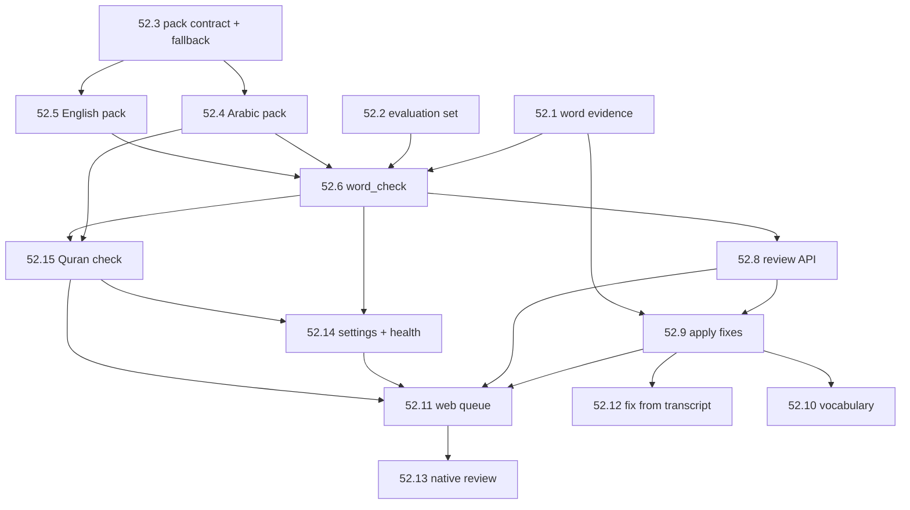

# Epic 52 build plan: order, dependencies, rollout

> For [README.md](README.md). Each story file has its own build plan (files, tests, rollout).
> This page gives the order across them, the shared contracts, and how the epic reaches the live
> home.

## 1. Dependency DAG

52.7 (LLM judge) is **removed** (decision 3, 2026-11-03) and has no node. 52.15 (Quran
check) is new (decision 4).

| Story | Depends on | Can run in parallel with |
|---|---|---|
| 52.1 | — | 52.2, 52.3 |
| 52.2 | — (uses 52.1's output for its confidence curves once it lands) | 52.1, 52.3 |
| 52.3 | — | 52.1, 52.2 |
| 52.4 | 52.3 | 52.5 |
| 52.5 | 52.3 | 52.4 |
| 52.6 | 52.1, 52.2, 52.3, 52.4, 52.5 | — |
| 52.15 | 52.4, 52.6 | 52.8 |
| 52.8 | 52.6 | 52.14, 52.15 |
| 52.14 | 52.6, 52.15 (its reason switch) | 52.8 |
| 52.9 | 52.1, 52.8 | — |
| 52.11 | 52.8, 52.9, 52.14, 52.15 (its reason label) | 52.12, 52.10 |
| 52.12 | 52.9 | 52.11, 52.10 |
| 52.10 | 52.9 | 52.11, 52.12 |
| 52.13 | 52.8, 52.9, 52.11 (wording) | — |
| ~~52.7~~ | Removed 2026-11-03 | — |

Following the project rule for big efforts (trail §1): parallel worktree agents per track into
one integration branch, one PR per phase, not one PR per story.

| Track | Stories |
|---|---|
| A: pipeline evidence | 52.1 → 52.6 (with C's packs) → 52.15 |
| B: evaluation | 52.2 (then feeds A and E) |
| C: language packs | 52.3 (contract, generic Hunspell, fallback) → 52.4 ∥ 52.5 |
| D: API and web | 52.8 ∥ 52.14 → 52.9 → 52.11 ∥ 52.12 |
| E: learning | 52.10 |
| F: native | 52.13 |

## 2. Shared contracts (fixed before the tracks split)

1. **`word_data` format** (52.1): byte layout, version byte, character offsets in Unicode code
   points. Golden fixtures in `shared/testdata/word_data/*.bin` + `.json` are decoded by both
   Python (`stt/word_data.py`) and Go (`api/internal/transcript/worddata`) tests.
2. **`word_flags` schema and status values** (52.6). The API (52.8) and the web (52.11) use the
   same reason and status codes (including `quran_mismatch` and the candidate source `quran`;
   no `llm_disagrees`, no `llm`); a test in each fails on an unknown code.
3. **Pack contract** (52.3): the `LanguagePack` protocol (with the optional `scripture()` for
   52.15) and its conformance test suite, which every pack must pass, including any third-party
   pack that later arrives through Epic 54's plugin store. Every pack is deterministic.
4. **Edit semantics** (52.9): character-span edits, revision bump, undo rules. Go owns the write;
   Python owns the carry-over at re-transcription. Both are tested against the same fixtures.

## 3. Migrations

Slot numbers are taken at merge time (0172 is the highest on main on 2026-11-03). Each has a
Postgres file and a SQLite twin, passes `tools/migration-lint`, and is additive (no table
rewrite on the 23 M-row `transcript_segments`: `ADD COLUMN` without a default is metadata-only).

| Story | Change |
|---|---|
| 52.1 | `transcript_segments.word_data BYTEA NULL` |
| 52.3 | `language_packs (code PK, version, enabled, source, data_sha256, installed_at, settings JSONB)` |
| 52.6 | `word_flags` and its indexes |
| 52.8 | `word_flags.locked_by`, `word_flags.locked_until` |
| 52.9 | `transcripts.revision INT NOT NULL DEFAULT 0`, `transcript_edits` |
| 52.10 | `vocabulary`, `vocab_pairs` |

## 4. Rollout to the live home

Every step follows the standing PR flow (implement, test, CI green, review, merge, release).
None of it touches update, restore or migration *code paths*, but the migrations ride a normal
release, so `update-rehearsal` runs on the tag as for every release.

| Step | What changes live | Guard |
|---|---|---|
| R1 (52.1) | New transcripts keep `word_data`. Nothing reads it yet | Storage per word measured read-only on the live DB after a day; if > 12 bytes a word, stop and revisit |
| R2 (52.3-52.6, 52.15) | `word_check` with the Quran check runs on new transcripts (`word_review.enabled` default on) | Flags visible only to admins on a read-only page; the flag rate is checked against ≤ 3% of words on a read-only sample, and `quran_mismatch` flags on recitation libraries are spot-checked |
| R3 | Backfill of **all ~45k existing transcripts** (decision 2), lowest priority, idle-only (`backfill` default on) | Queue health tile with progress; never runs while `transcribe` has pending work |
| R4 (52.8-52.14) | The review queue, for home admins only (decision 1) | Role tests in CI (`write` → 403); Arabic + English strings |
| R5 (52.10) | Vocabulary on; derived prompt for new transcriptions | A CI test proves a vocabulary change does not change `transcribe`'s input fingerprint |
| R6 (52.13) | Native review in the next app release (TestFlight, Android) | Throwaway simulators; Mac UI tests only in CI |

The first draft's R6 (LLM judge) is gone with story 52.7.

## 5. Evaluation gates

Story 52.2's harness runs in CI on the fixture subset (fast, deterministic: stored transcripts and
word evidence, no models), and on demand on the full gold set on a Mac with the models. A change
to a pack, a threshold or the scoring must not drop precision or recall on the CI subset by more
than 0.02 without a `Eval-Change: <reason>` trailer, the same way `No-Test-Change` works for the
affected-tests gate.
