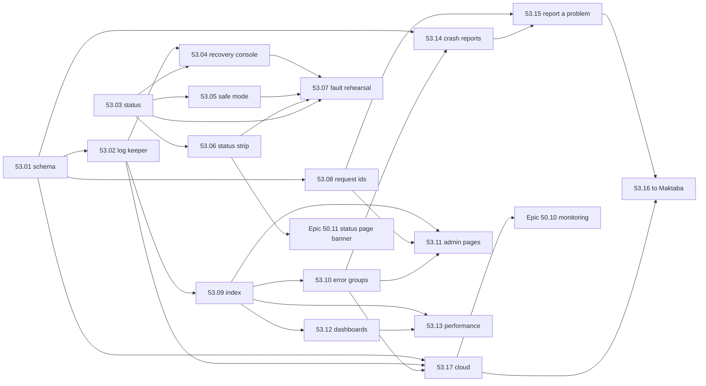

# Epic 53: Logs, errors and problem reports from every part, and a UI that never goes dark

> **Status:** spec (2026-11-03). **Builds on:** [Epic 21](../21-observability/README.md) (the
> loggers, metrics, probes; this epic takes over 21.1's leftovers and 21.5),
> [Epic 36](../36-mac-app/README.md) (the Mac app and its supervisor),
> [Epic 16.7](../16-subscriptions/README.md) (opt-in usage data to Maktaba Cloud),
> [Epic 29](../29-analytics/README.md) / [Epic 44](../44-viewing-analytics/README.md)
> (analytics), [Epic 40](../40-queue-health/README.md) (queue health), and the error audits
> (PR #291, PRs #378–#387). **Works with:** [Epic 50](../50-cloud-no-downtime/README.md)
> (cloud monitoring, status page, incidents: see §9 for who owns what) and Epic 51
> (configurable components, §10). **Research:** [research.md](research.md).
> **Wiki:** [epic-53-logs-errors-reports.md](../../../docs/wiki/epics/epic-53-logs-errors-reports.md).

## 1. Why

The owner, 2026-11-03:

> "log reporting, bug reporting, error reporting, server, app, cloud, api, all customer facing,
> and the server admin ui to view, analytics, ui, logs, how to view logs, search, dashboards,
> every part of the server need to be reportable, no crash that breaks all, makes the server not
> accessible, i mean ui here"

Maktaba logs well inside each process (PR #291, PRs #378–#387), but:

- the logs live in **one 50 MB `server.log`** with one old copy, and in 10,000-line in-memory
  rings that die with their process;
- the admin's tools for finding out what went wrong (Logs, System health, diagnostics) **need
  the API and Postgres**, the two parts most likely to be what went wrong;
- crashes on phones, TVs and the Mac stay on the device; **nobody can report a problem**;
- the same error happening 10,000 times shows as 10,000 lines, with no count and no "first seen";
- the cloud logs in its own format, and Epic 50's monitoring has no logs or error data to use.

## 2. What we found

From [research.md](research.md) §1 (the code on `main` at `7aa1af482`):

| # | Gap today | Fixed by |
|---|---|---|
| G1 | Postgres down: sign-in fails, so Logs and System health are unreachable. No page works without the database. | 53.03, 53.04 |
| G2 | API down: the web shows "Maktaba is restarting" and nothing else, logs included. | 53.04 |
| G3 | The supervisor down: nothing answers; launchd retries every 10 s forever with no cut-off; the Mac app shows no reason. | 53.05 |
| G4 | No banner tells users which part is down; a broken Live TV looks like a broken app. | 53.03, 53.06 |
| G5 | All processes share `server.log` (50 MB, one `.1` copy); rings are memory-only. | 53.02 |
| G6 | Logs can't be searched beyond the rings; no live tail (the viewer polls). | 53.09, 53.11 |
| G7 | No error groups, counts, first/last seen at the home (the cloud has them only for anonymous usage data). | 53.10 |
| G8 | Request ids: no client sends one; the pipeline drops the API's; most handler lines lack it. | 53.08 |
| G9 | Cloud services don't use the shared logger: no common fields, no redaction contract. | 53.17 |
| G10 | No home endpoint for client crash or log uploads; tvOS and Android TV have no crash record. | 53.14 |
| G11 | No "report a problem" in any app. | 53.15 |
| G12 | Nothing keeps metric history, so no dashboards over time. | 53.12 |
| G13 | Nothing in CI kills the API or Postgres and checks the UI still loads. | 53.07 |
| G14 | The user id is logged raw, so a log bundle that leaves the home names people. | 53.01 |

## 3. Goals

1. **The UI never goes dark because one part crashed.** With any one of the pipeline, a worker,
   streaming, Postgres, the API or the log index down, the web app loads, says what is down in
   English and Arabic, and an admin can reach a recovery page with logs and one-click fixes.
2. **Every part writes the same log line**, with ids that let one request be followed from the
   app through the API and the pipeline to streaming.
3. **Logs are kept, searchable and live** on the home itself, with retention and a disk cap,
   and readable even when Postgres is down.
4. **The same error is one row** with a count, first and last seen, and the requests it hit.
5. **Anyone can report a problem** from any app, sees what will be sent, and it reaches the
   home's admin; with consent, Maktaba too.
6. **Crashes are reported** from every app to the home, with no Google or third-party service.
7. **Admins see dashboards** of the home's work and use over time, inside Maktaba, with no
   Grafana, Loki or Sentry to install.
8. **The cloud uses the same model**, and its logs, errors and metrics feed Epic 50's monitoring.
9. **It costs little:** within the budget in §5.3 on the home Mac.
10. **Every failure path is proven in CI** before a release, like the update rehearsal.

### Not in this epic

- Alerting to the owner's phone for the *cloud* (Epic 50.10 owns paging). Home alerts here are
  in-app notifications and the existing notifications table, not pages.
- Distributed tracing UI (spans, flame graphs). We keep W3C ids and the optional OTLP export
  (Epic 21.3); a trace view is a later epic.
- Uploading media, titles or file names to Maktaba. Never.

## 4. Requirements

### 4.1 Functional

| ID | Requirement | Story |
|---|---|---|
| F1 | One log line schema for Go, Python, Swift, Kotlin, TypeScript and the cloud, checked by a shared conformance test. User and home ids hashed. | 53.01 |
| F2 | The supervisor captures each child's output, tags it, and writes capped, rotated segment files per component, independent of Postgres. | 53.02 |
| F3 | A status endpoint served by the supervisor, without the API or Postgres: one state per component. | 53.03 |
| F4 | A recovery console served by the supervisor: logs from files, component states, restart, safe mode, roll back, diagnostics download; admin sign-in that works without Postgres and the API. | 53.04 |
| F5 | Safe mode (one start, minimal parts) and crash-loop cut-offs for every child and for the supervisor itself. | 53.05 |
| F6 | A status strip in every app (web, desktop, Apple, Android, TV) when a part of the home, or the cloud (Epic 50.11), is down. | 53.06 |
| F7 | A fault rehearsal in CI that kills each component and checks the UI, the banner and the recovery console. | 53.07 |
| F8 | A request id from every client, carried through the API, pipeline jobs and streaming. | 53.08 |
| F9 | A log index with full-text search and live tail, by component, level, time, request and job. | 53.09 |
| F10 | Error groups: deduped, counts, first/last seen, status (new, seen, resolved, muted), regressions reopen. | 53.10 |
| F11 | Admin pages: Logs (live tail, search, follow a request), Errors, and the recovery console's links. Admin-only, enforced by the API. | 53.11 |
| F12 | Dashboards: queue throughput, transcription and thumbnail rates, streaming sessions, errors over time, storage, use of the home. | 53.12 |
| F13 | Crash reports from every app to the home; Android TV and tvOS covered. | 53.14 |
| F14 | "Report a problem" in every app: describe, preview, consent, send to the home's admin; reports inbox. | 53.15 |
| F15 | With the admin's opt-in and the user's consent, reports and error groups go on to Maktaba through the cloud link; a service admin view across homes. | 53.16 |
| F16 | The cloud's processes on the same schema, store and error groups; their logs, errors and metrics feed Epic 50.10. | 53.17 |

### 4.2 Non-functional: the numbers

Measured on the home Mac class (Apple silicon, 16 GB) and in CI by 53.13 and 53.07.

| Area | Target | How it is measured |
|---|---|---|
| **UI availability, one part down** | With any **one** of pipeline, a worker, streaming, Postgres, the API, the log index down: the web shell loads (HTTP 200, the app's script runs) in **100 %** of rehearsal runs, first byte **≤ 1 s** on the LAN | 53.07, one scenario per part |
| **Banner** | shown **≤ 15 s** after a part crashes (the supervisor knows at once; apps poll every 10 s), **≤ 30 s** after a part that still runs starts failing its checks (two 10 s checks must agree), gone ≤ 30 s after it is back | 53.07 |
| **Recovery console** | reachable and signed in **≤ 10 s** with Postgres or the API down | 53.07 |
| **Supervisor down** | back by launchd ≤ 15 s; after **3** failed starts in 2 min, the Mac app shows its own "can't start" page (bundled, no server) within 20 s, with the last lines of the log and Restart / Safe mode / Roll back | 53.05, 53.07 |
| **Log ingest** | sustained **500 lines/s** per machine with index lag p95 **≤ 2 s**; a burst of **5,000 lines/s for 60 s** loses **0** lines to the segment files (the index catches up ≤ 2 min after) | 53.13 |
| **Live tail** | a line appears in the viewer **≤ 2 s** after it is written | 53.13 |
| **Search latency** | filters only (component, level, 24 h): p95 **≤ 300 ms**; full text over **14 days / 30 M lines**: p95 **≤ 1.5 s**; follow one request id: p95 **≤ 300 ms** | 53.13 |
| **Retention** | info and above **14 days**; debug **24 h**; error occurrences **90 days**; reports **180 days**; whichever comes first with the disk cap | 53.02, 53.10 |
| **Disk cap** | segments **2 GB** + index **1.5 GB** by default (settable); oldest dropped first; debug dropped first when the data volume has < 5 GB free; never fills the disk | 53.02 |
| **Error group** | a new group visible ≤ **10 s** after its first line | 53.10 |
| **Report size** | the app's part ≤ **512 KB** compressed (≤ 2,000 log lines) + optional screenshot ≤ 1 MB; the home's part ≤ **5 MB** compressed; to Maktaba ≤ **8 MB**. 10 reports a day per device | 53.15 |
| **Crash upload** | ≤ 1 MB per crash envelope, ≤ 50 per device per hour, ≤ 3 retries over 7 days, then dropped | 53.14 |
| **Arabic** | every user-facing string ships English and Arabic in the same PR; RTL checked | the existing missing-Arabic tests on each platform |
| **Roles** | logs, errors, dashboards, reports inbox, recovery console: admin only, enforced by the API and the supervisor; a viewer sees only their own reports | role tests per route (try as nobody and as a viewer) |

### 4.3 What keeps working when a part fails (after this epic)

| Part down | Web shell | Banner (all apps) | Admin can | Playback |
|---|---|---|---|---|
| Pipeline / a worker | yes | "Processing is paused" (admins: which stage) | see why on the console and Logs | yes |
| Streaming | yes | "Playback and Live TV are unavailable" | restart it from the console | no (the reason is shown) |
| Postgres | yes | "Maktaba is having trouble with its database" | sign in to the **recovery console** (recovery pass, cached keys), read logs from files, restart Postgres, start in safe mode, restore a backup (existing flow) | no |
| API | yes | "Maktaba is restarting" | the recovery console, as above | no |
| Log index (`logs` role) | yes | none for viewers; admins see "Log search is restarting" | read recent logs straight from the files | yes |
| Supervisor | no (nothing serves the port) | apps: "Can't reach the home" (existing) | on the Mac: the app's own "can't start" page | no |

### 4.4 Privacy

- **The home is the boundary.** Logs, crash reports and problem reports stay on the home unless
  the home's admin turned on sharing with Maktaba (53.16) **and** the person sending a report
  ticks the box for that report. Anonymous error groups to Maktaba stay governed by the
  existing usage-data opt-in (Epic 16.7), unchanged.
- **Hashed ids:** logs carry `user_h` (HMAC-SHA256 of the user id with a per-home key, first 16
  hex), never the raw id, name or email. The admin UI turns `user_h` back into a name locally;
  a bundle leaving the home can't.
- **Scrubbed values** (53.01): one rule list, shared by every language and by the home's
  ingest of client data: tokens, passwords, JWTs, DSNs, `token|key|sig` query values, emails,
  IPs (last octet / last 80 bits zeroed), `/Users/<name>/` and `/home/<name>/` collapsed to `~`.
  Media paths and titles are kept at home (admins need them) and **removed** from anything sent
  to Maktaba.
- **Consent is visible:** the report screen shows the exact files and a preview of their text
  before sending (Emby anonymises on download; Home Assistant asks authors to review by hand:
  we let the sender review).
- **Store disclosures:** Apple "Crash Data" and "Other Diagnostic Data" (crashes to the home are
  automatic, so disclosed); Google Play Data safety "Crash logs" and "Diagnostics", optional.
  53.14 updates both.
- **Deletion:** a user deleted at the home has their reports deleted; "Forget my device"
  (existing) also deletes its crash reports. Maktaba deletes a home's reports when the home
  unlinks or asks.

## 5. Design

### 5.1 The pieces

```
 apps (web, desktop, Apple, Android, TV)
   │  X-Request-Id on every call; crash envelopes; problem reports
   ▼
 supervisor  maktaba-server serve  ─────────────────────────────────────────────┐
   │ web port :8088: the SPA, /status.json (53.03), /recovery (53.04),           │
   │   /api/ → API, /stream/ → streaming (as today)                              │
   │ capture: each child's stdout/stderr → tag → segment files (53.02)           │
   │ children: postgres · api · streaming · pipeline workers · logs (new) · …    │
   ▼                                                                             │
 <data>/logs/segments/<component>/<yyyymmdd-hh>.ndjson.zst   (always written) ◄──┘
   │ tailed by
   ▼
 logs role  maktaba-server logs   (crash-isolated child, 53.09)
   │ <data>/logs/index/logs.db (SQLite, FTS5): lines · error groups · metric rollups · reports
   ▼
 API  /api/admin/logs/* · /api/admin/errors/* · /api/admin/dashboards/* · /api/reports/*
   │ (auth, roles; proxies to the logs role over loopback)
   ▼
 web admin pages (53.11, 53.12)     cloud link → Maktaba (53.16, opt-in)
```

### 5.2 Decisions and why

| # | Decision | Weighed against | Why |
|---|---|---|---|
| D1 | **Logs are always written to files first**, by the supervisor that owns the pipes; the index is built from the files. | Services writing straight to a database. | A file write needs nothing else running. If the index, the API or Postgres is down, nothing is lost and the console can still read the files. |
| D2 | **The index is a separate SQLite file (`logs.db`, FTS5), owned by a `logs` child role**, not tables in the library Postgres. | Postgres partitions + pg_trgm (the research agent's pick); Loki + Prometheus + Grafana; self-hosted Sentry or GlitchTip. | Search must work when Postgres is down (G1). Logs in Postgres would also go into every backup, the cluster copy's logical replication (every full node, Epic 37) and the update rehearsal's dumps, and would add write load to the database that serves playback. SQLite via `modernc.org/sqlite` is already in `cmd/maktaba-server` and pure Go (`CGO_ENABLED=0` builds keep working). Loki alone needs ~1.5–4 GB; Sentry 16 GB; both are more processes to supervise. |
| D3 | **The index is a child role, not goroutines in the supervisor.** | Index inside the supervisor. | A panic or a corrupt index file must not take down the process that serves the UI. The supervisor stays small: capture, status, console. |
| D4 | **Auth without Postgres:** the console accepts (a) a **recovery pass**: a 7-day JWT the API gives signed-in admins while it is up, in an `HttpOnly` cookie scoped to `/recovery` (the web's normal session is an opaque id checked in Postgres, so it can't be used), or a Remote app's JWT access token; both checked with the API's JWKS public keys cached on disk (as streaming already does, `streaming/internal/auth/jwks.go`), with a revocation file the API writes on demotion; or (b) a one-time link the Mac app's tray asks the supervisor for over its loopback admin port. | A separate console password; no auth on the LAN; extending the web session to work without Postgres. | No new secret for the owner to keep. A viewer never gets a pass. A pass opens only `/recovery`, expires, and is revoked without Postgres. |
| D5 | **Client crash and report uploads use a subset of the Sentry envelope format**, written by our own small senders. | The Sentry SDKs; Crashlytics; ACRA's format. | A standard, documented framing (stock SDKs can point at the home if a power user wants), without pulling an SDK with its own telemetry, and with no Google dependency. |
| D6 | **tvOS uses PLCrashReporter**; iOS, iPadOS and macOS use MetricKit (already in the app); Android uses `CrashLog` (already) plus `ApplicationExitInfo` for ANRs and native crashes. | Crashlytics everywhere; KSCrash (tvOS support only in a 2026 beta). | MetricKit has no tvOS. PLCrashReporter supports tvOS 12+ and is MIT-licensed. |
| D7 | **One id per request: `X-Request-Id` (UUIDv7)**, made by the client per user action, carried as `request_id` everywhere; W3C `traceparent` only when OTLP export is on. | Trace ids everywhere. | The id already exists in the API and the logger; adding it to clients, the pipeline and streaming closes the gap with the least new code. |
| D8 | **Error fingerprint = the cloud's existing one** (`telemetry_error_groups`: source, app, scrubbed message, first own frame), extended with the component and the error code. | A new algorithm. | The same error has the same fingerprint at the home and in the cloud, so a forwarded group joins its anonymous twin. |
| D9 | **Metric history = 1-minute rollups in `logs.db`** scraped from the existing `/metrics` endpoints by the `logs` role; 7 days at 1 min, 90 days at 1 h. | Prometheus; storing every sample. | Dashboards need trends, not raw series; ~200 series × 1,440 a day is a few MB. |
| D10 | **Safe mode is one start**, like Home Assistant's: Postgres, API, web only. A crash-looping child stops at its cut-off and raises a repair item. | Endless retries; stopping everything. | The owner's rule: recovery is automatic or one click, never a terminal. |

### 5.3 Performance budget (home Mac)

| Piece | CPU (average, one core) | Memory | Disk |
|---|---|---|---|
| Capture in the supervisor | ≤ 1 % at 500 lines/s | ≤ 20 MB | ≤ 2 GB/day written at 500 lines/s compressed (zstd) |
| `logs` role (index, tail, rollups) | ≤ 3 % | ≤ 120 MB RSS | index ≤ 1.5 GB |
| Logging in each service | ≤ 20 µs per line p99, ≤ 2 % CPU | — | — |
| Apps (crash sender, report) | idle unless sending | ≤ 5 MB | ≤ 2 MB of pending crashes |
| **Total** | **≤ 5 %** | **≤ 200 MB** | **≤ 3.5 GB** (cap) |

At the expected normal rate of the live home (well under 50 lines/s) the real numbers are a
tenth of these. 53.13 measures them in CI and fails the build above budget.

## 6. Phases

**Phase 1: never in the dark.** 53.01, 53.02, 53.03, 53.04, 53.05, 53.06, 53.07. The UI and
the recovery console survive any one crash, logs are on disk per component, and CI proves it.

**Phase 2: see everything.** 53.08, 53.09, 53.10, 53.11, 53.12, 53.13. Ids end to end, search,
live tail, error groups, dashboards, within budget.

**Phase 3: people can tell us.** 53.14, 53.15. Crash reports and "Report a problem" from every
app to the home.

**Phase 4: beyond the home.** 53.16, 53.17. Opt-in reports to Maktaba, the service admin view,
and the cloud on the same model, feeding Epic 50.

## 7. Plex and its peers, compared

| | Plex | Jellyfin | Home Assistant | Maktaba today | Maktaba after this epic |
|---|---|---|---|---|---|
| Server log files | `Plex Media Server.log` + `.1`–`.5` (forum), rolled on restart and size | daily files, retention days setting | one log + raw | one `server.log`, 50 MB + `.1` | per-component segments, 14 days, capped (53.02) |
| View logs in the UI | no (download only) | Logs page lists files | System log (condensed + raw) | ring viewer, polled; file window | live tail, full-text search, follow a request (53.09, 53.11) |
| Download logs | zip from Troubleshooting; no crash dumps or plugin logs | files | per-integration diagnostics, redacted | tar.gz (admin), user-scoped bundle | same, plus redaction and a preview (53.04, 53.15) |
| Grouped errors with counts | no | no | yes (condensed log) | no | yes, with first/last seen and status (53.10) |
| Crash reporting | server uploads on next start (opt-in) | none found | Sentry, opt-in, Supervisor only | local only (Apple, Android phone) | every app to the home; to Maktaba with consent (53.14, 53.16) |
| "Report a problem" | no (forums) | no | no (issue tracker) | no | every app, with preview and consent (53.15) |
| Dashboard | Now Playing, bandwidth, CPU/RAM, history, alerts (Plex Pass); alerts last one browser session | activity | energy, system | queue tiles, System health | dashboards over 90 days (53.12) |
| UI when the DB breaks | users restore or rebuild by hand (forum) | "database is locked" errors | **recovery mode keeps the UI, logs and restore** | sign-in fails; nothing works | recovery console, safe mode, banner (53.03–53.05) |
| Third-party tools needed | Tautulli for history and alerts | Webhook plugin for alerts | none | — | none |

**Copy:** Home Assistant's recovery and safe modes (the UI must not depend on what failed),
Emby's anonymised download, Plex's next-start crash upload (but to the home first, and opt-in
beyond it). **Avoid:** Plex's download-only logs and session-only alerts, needing a third-party
tool for history, and anything that needs a 16 GB monitoring stack at home.

## 8. Stories

| # | Story | Phase | Depends on |
|---|---|---|---|
| 53.01 | [One log line for every part](story-53-01-log-schema.md) | 1 | — |
| 53.02 | [The log keeper: every component's log on disk](story-53-02-log-keeper.md) | 1 | 53.01 |
| 53.03 | [The home's status, without the API or the database](story-53-03-status-endpoint.md) | 1 | — |
| 53.04 | [The recovery console](story-53-04-recovery-console.md) | 1 | 53.02, 53.03 |
| 53.05 | [Safe mode and crash-loop cut-offs](story-53-05-safe-mode.md) | 1 | 53.03 |
| 53.06 | [A status strip in every app](story-53-06-status-strip.md) | 1 | 53.03 |
| 53.07 | [The fault rehearsal in CI](story-53-07-fault-rehearsal.md) | 1 | 53.03, 53.04, 53.05, 53.06 |
| 53.08 | [One request id from the app to the last process](story-53-08-request-ids.md) | 2 | 53.01 |
| 53.09 | [Log index, search and live tail](story-53-09-log-index.md) | 2 | 53.02 |
| 53.10 | [Error groups](story-53-10-error-groups.md) | 2 | 53.09 |
| 53.11 | [Admin Logs and Errors pages](story-53-11-admin-pages.md) | 2 | 53.08, 53.09, 53.10 |
| 53.12 | [Dashboards and home analytics](story-53-12-dashboards.md) | 2 | 53.09 |
| 53.13 | [Performance budget and load test](story-53-13-performance.md) | 2 | 53.09, 53.12 |
| 53.14 | [Crash reports from every app](story-53-14-crash-reports.md) | 3 | 53.01, 53.10 |
| 53.15 | [Report a problem](story-53-15-report-a-problem.md) | 3 | 53.08, 53.14 |
| 53.16 | [Reports and errors to Maktaba](story-53-16-reports-to-maktaba.md) | 4 | 53.15, 53.17 |
| 53.17 | [The cloud on the same model, feeding Epic 50](story-53-17-cloud-observability.md) | 4 | 53.01, 53.02, 53.10 |



Work that can start at once, in parallel: **53.01 and 53.03**. Then 53.02, 53.05, 53.06 and
53.08. 53.07 builds its harness early: each scenario is listed in its expected-failures file
until its story merges, as the update rehearsal does.

## 9. Epic 50: who owns what

Epic 50 makes the cloud survive a failed machine and watches it from outside. This epic makes
every process, at home and in the cloud, say what it is doing and what went wrong. One owner
each, no duplicated stories:

| Concern | Owner | The other epic |
|---|---|---|
| Log line schema, redaction, hashed ids for the cloud's processes | **53.01, 53.17** | 50 uses it in every runbook's "Check" step |
| Cloud logs: kept on each node (segments), forwarded to the witness W so a dead node's last minutes survive, 14 days, searchable by the service admin | **53.17** | 50 §4.5's "logs 14 days" points here; W's machine is 50.07's |
| Cloud error groups (the cloud's own errors and opted-in home and app errors), reports inbox | **53.16, 53.17** | 50.12 postmortems cite them |
| Application metrics on the cloud's `/metrics` (names, labels, error counters `maktaba_errors_total`, request latency) | **53.17** defines and emits | **50.10** scrapes them and owns the alert rules, including `cloud_error_spike` built on 53's counter |
| Infrastructure metrics (Patroni, postgres_exporter, node_exporter, Caddy), Prometheus, Alertmanager, Grafana on W, outside probes, the canary, paging | **50.10** | — |
| Status page and `summary.json` | **50.11** | 53.06's status strip shows it in every app |
| The in-app banner component in every app | **53.06** (one strip for home and cloud) | 50.11 feeds it a cloud source instead of building its own banner |
| Incident severities, runbooks, postmortems | **50.12** | runbooks link to 53's cloud log search and error groups |
| CI rehearsal of failures | home: **53.07**; cloud: **50.06** | both follow the update-rehearsal pattern; 50.06's scenarios also assert 53.17's log forwarding |

The DAG edges: 53.17 → 50.10 (metrics and logs to watch) and 53.06 → 50.11 (the banner).

## 10. Epic 51: configurable components

Epic 51 makes the home's parts configurable (which components run, where). This epic does not
redesign that. It asks one thing of every component, whatever Epic 51 calls it:

- it **logs** with the 53.01 schema to stdout/stderr, with `service` set to its component name;
- it answers **`/healthz`** (alive) and, where it has one, **`/readyz`** (ready), as the children
  do today;
- it declares a **status mapping** (53.03): what its probe failing means to users (which
  features stop) and the banner key to show.

Until Epic 51 lands, the supervisor's role list is the registry, and 53.03 keeps the mapping
in a table in the supervisor. When Epic 51's component descriptor exists, the mapping moves
into it as two fields (`status.features`, `status.banner`); nothing else changes.

## 11. Rollout

- Every story ships dark or additive: new files and endpoints first, then the UI.
- 53.02 keeps writing `server.log` (the tray and `docs/troubleshooting-logs.md` read it) at a
  smaller size, until the Mac app reads the new segments; then `server.log` becomes the
  supervisor's own lines only.
- Stories that touch the supervisor or the launcher (53.02, 53.03, 53.04, 53.05) fall under the
  rule that `update-rehearsal` must pass on the exact commit before a release; 53.07 adds the
  fault rehearsal to the same tag guard.
- One release at a time on the live Mac (the owner's rule).

## 12. Open questions for the owner

1. **Crash reports to the home on by default?** Recommended: yes, for apps signed in to a home
   (the home is the household's own server), with a notice at first launch and a switch in
   Settings. Beyond the home: always opt-in.
2. **Retention defaults** (14 days of logs, 90 days of errors, 180 days of reports, 3.5 GB):
   fine for the live home's big disk?
3. **Screenshots in reports:** offered, off by default. Keep, or leave out entirely?
