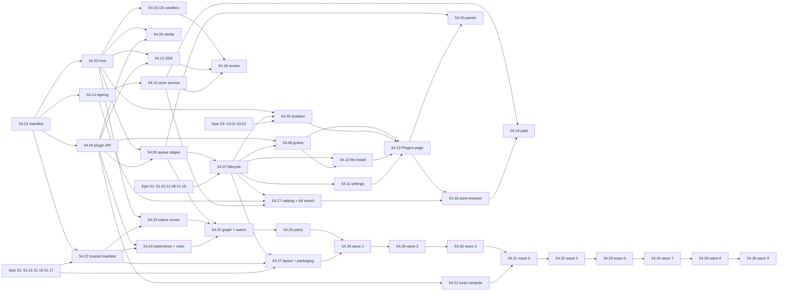

# Epic 54: Plugins: new functions from the queue, with no internet, from a Maktaba store

> **Status:** spec (2026-11-03; decisions applied in §14; first-party plugins added in
> §15). **Builds on:** [Epic 51](../51-configurable-components/README.md)
> (components, desired and actual state, drain without lost work, signed packs, offline import),
> [Epic 6](../06-job-queue/README.md) (the queue), [Epic 40](../40-queue-health/README.md)
> (failure classes and parking), [Epic 53](../53-logs-errors-reports/README.md) (logs, health and
> problem reports per component), [Epic 16](../16-subscriptions/README.md) (the licence grace
> rules, reused as numbers only) and
> [Epic 42](../42-apps-player-remote-server/README.md) (the apps). The store does not build on
> Epics 25 or 50: it is independent of Maktaba Cloud (§6.0).
> **Research:** [research.md](research.md): the queue and extension code as it is, Jellyfin,
> Plex, Home Assistant, Nextcloud, VS Code, Obsidian, Deno and WASI, Wasmtime, OS sandboxes,
> marketplace payouts and store moderation, with sources.
> **Wiki:** [epic-54-plugins.md](../../../docs/wiki/epics/epic-54-plugins.md).

## 1. Why

Requirement: a plugin system for third-party queue extenders that never call the internet and
add new functions by working with the queues and the Maktaba API, and a store for those
plugins.

In short: other people can add functions to Maktaba. A plugin takes jobs from the queue, reads
what it is allowed to read through the Maktaba API, and writes results back. It can never
reach the internet. Maktaba runs a store that reviews, signs and sells plugins.

Today the only way to add a function is a Python package with an entry point in the group
`maktaba.extensions` (`pipeline/src/maktaba_pipeline/extensions/__init__.py`). It is loaded
into the pipeline worker with the worker's database login, its network, its disk and the home
secrets key path. One bad package can read every library, send it anywhere, or crash every
worker. That is fine for Maktaba's own Plex and dizqueTV code. It is not something to offer
strangers. Epic 51 left a store to "a later epic on this model" (Epic 51 H5). This is it.

## 2. What we found (details in [research.md](research.md))

- **The queue already has the shape a plugin needs.** A `StageDef` with edges from core
  stages, a handler that returns a `StageResult`, pools, retries, failure classes, scheduled
  stages (`every_minutes_rule`), and the drain that force-pauses running jobs. The extension
  contract (`Extension.register(GraphBuilder)`) already lets outside code add stages and
  edges without core naming it. We keep that shape and change *where* the code runs.
- **Every other media server runs plugins in its own process with full rights** (Jellyfin,
  Plex until 2018, Home Assistant integrations, Nextcloud). VS Code and Obsidian say they
  cannot sandbox and live with malicious uploads. Home Assistant add-ons are the exception
  (containers with a security rating), and need Docker.
- **Plex retired its plugins** because few used them, the protocol was old and hard to
  support, and most were web-content channels that broke. A plugin system lasts only if its
  contract is small and versioned and plugins work on the owner's own library.
- **WebAssembly components** give a sandbox that is the same on every OS: a component can call
  only what the host links into it. If the host never links sockets or HTTP, a plugin has no
  way to name the network. Wasmtime adds fuel, deadlines and memory limits, and starts an
  instance in microseconds with pre-instantiation and pooling.
- **Python in Wasm has no native extensions** (no NumPy or torch). So heavy compute stays in
  Maktaba as host services: decoded frames and audio, transcripts, local embeddings, the local
  language model.
- **Stores that last** pair a developer key with a store countersignature (Nextcloud, app
  stores), check every version automatically, review by hand at first submission and when
  rights grow (Obsidian), and can switch off installed copies (Chrome).

## 3. Goals

1. **Plugins add functions through the queue.** A plugin adds stages that run after stable
   events (a video was added, a transcript is ready…), on a schedule, or when another of its
   own stages asks. It writes metadata, tags, chapters, subtitles, artwork and its own data,
   and can declare settings pages and (Phase 3) panels the apps draw.
2. **No internet, enforced.** A plugin cannot open a socket, resolve a name or make an HTTP
   request. It cannot see the disk. It reaches media only through handles the API grants for
   the job it is running. CPU, memory, disk and time are capped. CI proves each of these on
   macOS, Linux and Windows with tests that try and must fail.
3. **A narrow, versioned, capability-scoped API.** A plugin declares the capabilities it needs.
   The admin grants them at install, like phone app permissions. The API enforces them on
   every call, server-side. Plugins never get admin rights, user credentials or secrets.
4. **One lifecycle with Epic 51.** Each installed plugin is a component: install, enable,
   disable, hold, update, rollback and uninstall, with Epic 51's drain that never loses a job.
   A plugin that crashes cannot take down the pipeline; its health and logs are its own
   (Epic 53).
5. **A Maktaba store.** Developer accounts, submission, automated checks and human review,
   signing by the developer and by Maktaba, a revocation list homes honour, free and paid
   plugins (the payment provider is chosen at Phase 3, §6.5), ratings and reports. **The store
   is independent of Maktaba Cloud** (§6.0): its own accounts, database, deploy, hostname
   (`plugins.maktaba.tv`) and payments, all on Cloudflare. Users browse there and in the web
   app; developers read docs on maktaba.dev.
6. **Offline still works.** A plugin installs from a file. A store-signed file installs like
   one from the store. An unsigned or developer-only file needs the admin's opt-in and is
   marked "Unreviewed" everywhere. The sandbox is the same either way.
7. **A good developer experience.** An SDK and templates for Rust, JavaScript/TypeScript,
   Python and Go (TinyGo), a local test harness with a mock Maktaba API, and docs.
8. **English and Arabic** for every Maktaba string, and every store-listed plugin's strings.
9. **Maktaba's own stages are plugins too** (decided 2026-11-03). All 56 of today's stages move,
   stage by stage with no downtime and no data loss, into first-party plugins that use the same
   manifest, dispatch and plugin API as third-party ones, with a trusted capability set that
   only Maktaba's release signature unlocks (§15).

### Not in this epic

- Plugins that reach the internet, under any permission. There is no `network` capability.
  Integrations that need the internet (Plex, Cloudflare Stream) stay first-party extensions
  (Epic 51 `ext.*`).
- Plugins that change playback or streaming (codecs, transcoding, DRM), or that add API routes
  for apps. Plugins work through the queue and the plugin API only.
- Arbitrary code in the apps. UI is declared as data (settings forms, panels) and drawn by
  Maktaba's own code.
- Plugins on cluster machines other than the home. Plugin stages are `placement = home` in
  this epic (H12).
- Moving first-party code into the **WebAssembly** sandbox. Maktaba's own stages, the Plex and
  dizqueTV extensions included, become **native trusted** first-party plugins behind the same
  interface (§15, H16), not Wasm components. Cloudflare Stream (no stage) and Epic 52's
  language packs (assets) stay as they are. Entry-point extensions remain a developer feature
  behind the existing switch.
- Loops (Epic 51 `loop` components) and the routes apps use. Only queue stages become plugins.

## 4. The plugin model

### 4.1 What a plugin is

A **plugin** is one signed package (`.mkplugin`) holding one WebAssembly component, a manifest,
strings in English and Arabic, an icon, and optional declarative UI. It can provide:

| Part | What it does | Declared in the manifest as |
|---|---|---|
| **Stages** | queue job types run by the plugin's exported `run` function | `[[stage]]` |
| **Triggers** | when a stage gets a job: after a stable event, on a schedule, or on request from another of the plugin's own stages | `[[stage.trigger]]`, `[[schedule]]` |
| **Outputs** | what it writes: its own data, metadata fields, tags, chapters, subtitles, artwork, suggestions for review, admin notices | capabilities (§4.4) |
| **Settings** | an admin form, drawn by Maktaba from a JSON schema | `[settings]` |
| **Panels** (Phase 3) | read-only views on a video, series or library page, drawn by every app from a small schema | `[[panel]]` |

A plugin cannot add API routes, run at boot, run in the apps, run outside a job, or talk to
another plugin except through data that plugin chose to export (§4.4).

### 4.2 Events a plugin can follow

Plugins never attach to internal stage names (they change between releases). They follow a
short, stable list of **events**, each mapped by Maktaba to the core stage whose output means
it. The list is part of the plugin API version (§4.4):

| Event | Subject | Fires when (core stage today) |
|---|---|---|
| `video.added` | video | a new video is probed (`probe`) |
| `video.changed` | video | its file changed (`content_hash` output changed) |
| `audio.ready` | video | audio extracted (`extract`) |
| `transcript.ready` | video | a transcript was written or replaced (`transcribe`) |
| `subtitles.ready` | video | subtitles written (`subtitle_gen`) |
| `thumbnails.ready` | video | thumbnails made (thumbnail stages) |
| `metadata.changed` | video | title, tags or grouping changed (classify stages, an admin edit) |
| `series.changed` | series | a series or season was formed or changed (`detect`) |
| `library.scanned` | library | a library scan finished |
| `schedule` | catalog | the plugin's own schedule (every N minutes, from its settings, min 15) |

A trigger is an `Edge` from the mapped core stage to the plugin stage, added by the plugin
loader through `GraphBuilder.add_edge`, exactly how built-in extensions wire in today
(`extensions/base.py`). A schedule is `every_minutes_rule` on a catalog-subject stage
(`engine/reconcile.py`). A request is a `Request` to a stage in the plugin's own
`may_request`; requests to other plugins' or core stages are refused (`GraphViolation`).

### 4.3 How a job runs

```
pipeline worker (Python)                      plugin host: maktaba-plugind (Rust, Wasmtime)
  claims plugin stage job (pool "plugins")       one process per home, OS-sandboxed (§5.3)
  │ POST /internal/plugins/invocations ──► API   no network, no DB login, no secrets
  │   (machine auth) mints invocation token      │
  │ ◄── token {plugin, version, job, subject,     │
  │           grants, libraries, exp}            │
  │ dispatch(job, token) ── unix socket ────────►│ fresh Store: fuel, epoch deadline, memory cap
  │                                              │ instantiate (InstancePre, pooled)
  │                                              │ call export run(job)
  │                                              │   guest calls WIT imports: maktaba:plugin/*
  │                                              │   host forwards each with the token ──► plugin API
  │                                              │                    (Go API, unix socket only)
  │ ◄──────────── result (outputs, log) ─────────│   API checks token + grant + library + quota
  │ StageResult → Epic 40 failure policy          │
```

- **The pipeline still owns the queue.** Claiming, pools, retries, failure classes, drain and
  parking are unchanged. A plugin stage is a `StageDef` with `extension = "plugin:<id>"` and a
  handler that forwards the job to the plugin host and maps the answer to a `StageResult`.
- **The plugin host owns the sandbox.** It is one supervised process per home (`plugins.host`,
  an Epic 51 `process` component). Each job gets a fresh Wasmtime store. A trap, a deadline or
  a memory cap ends that job, not the host.
- **The API owns the rules.** It mints the invocation token from the grants *it* stores (never
  from what the pipeline or the host says), and checks the token, the grant, the library scope
  and the quota on every call. The guest never sees the token: it calls typed imports, and the
  host attaches the token.

### 4.4 The plugin API

**One WIT package, `maktaba:plugin@1.x`**, versioned with semver. The host links only these
interfaces plus a minimal WASI subset (§5.2). A minor version only adds functions; a plugin
built for 1.2 runs on any host with 1.2 or later in the 1.x line. Maktaba supports the current
and the previous major for at least 12 months after a new major ships.

| Interface | Functions (sketch) | Capability needed |
|---|---|---|
| `job` | `subject()`, `payload()`, `settings()`, `progress(pct)`, `checkpoint(bytes)` | none (always) |
| `log` | `log(level, code, fields)` (rate-limited, §4.7) | none |
| `data` | `get/put/delete/list(subject, key)` in the plugin's own namespace | none (quota applies) |
| `library` | `video(id)`, `series(id)`, `list(library, filter, page)` | `library.read` |
| `transcript` | `segments(video)`, `words(video)` | `transcript.read` |
| `media` | `open(video) -> stream` (read at offset), `frame(video, t, size)`, `audio(video, t0, t1, rate)` | `media.read`, `media.frames`, `media.audio` |
| `write` | `set-field(video, field, value)`, `add-tags`, `set-chapters`, `add-subtitle(video, lang, vtt)`, `set-artwork(subject, kind, image)` | `metadata.write`, `tags.write`, `chapters.write`, `subtitles.write`, `artwork.write` |
| `suggest` | `suggest(subject, field, value, reason)` into the admin's review queue | `suggest` |
| `queue` | `request(stage, subject, payload)` for the plugin's own stages | `jobs.enqueue` |
| `notify` | `admin(code, params)`: an in-app notice to admins, from the plugin's strings | `notify.admin` |
| `exports` | `read(plugin, subject, key)` of data another plugin marked as exported | `plugin-data.read:<id>` |
| `compute` (Phase 3) | `embed(texts)`, `generate(prompt, opts)` on the home's own models | `compute.embed`, `compute.llm` |

Rules the API enforces on every call:

- **Scope to the job.** `media.*` and `write.*` act only on the job's subject (or, for a
  library or catalog job, on items inside the libraries the admin granted). `library.read`
  lists only granted libraries. A call outside scope answers `403 plugin_scope`.
- **Capabilities are checked, not trusted.** A call without the grant answers
  `403 plugin_capability`, is logged, and counts toward the plugin's circuit breaker.
- **Core fields are guarded.** `set-field` can write only fields in an allow-list
  (description, sort title, year, rating, external ids that are local only). Titles written by
  an admin are never overwritten; a plugin can only `suggest` over them. `videos.state` is
  never written (only `advance_after_stage` writes it, research §1.1).
- **Every write is attributed** (`origin = plugin:<id>@<version>`), so it can be listed,
  undone per plugin, and kept out of anything that leaves the home (§9).
- **No secrets, no users.** There is no call that returns users, sessions, tokens, settings of
  other components, `home_secrets`, file paths or machine addresses.

The API listens for plugin calls **only on a unix domain socket** (`<data>/run/plugin-api.sock`;
Windows 10+ supports AF_UNIX), never on TCP, so the LAN cannot reach it and a plugin token is
useless off the box.

### 4.5 Capabilities and grants

| Capability | Words shown to the admin (en) | Risk |
|---|---|---|
| `library.read` | Read titles, descriptions and grouping in the libraries you choose | low |
| `transcript.read` | Read transcripts of videos in those libraries | medium |
| `media.read` | Read video files, only while working on them | medium |
| `media.frames` / `media.audio` | See still frames / hear audio clips of videos it works on | medium |
| `metadata.write` | Change descriptions and other details (never titles you set) | medium |
| `tags.write` / `chapters.write` | Add tags / chapters | low |
| `subtitles.write` | Add subtitle tracks | low |
| `artwork.write` | Set posters and thumbnails | low |
| `suggest` | Suggest changes for you to accept | low |
| `jobs.enqueue` | Queue more of its own work | low |
| `notify.admin` | Send notices to admins | low |
| `plugin-data.read:<id>` | Read what plugin X shares | depends on X |
| `compute.embed` / `compute.llm` | Use this home's search model / language model | low |

- The manifest marks each capability `required` or `optional`. At install the admin sees them
  in plain words (English and Arabic, from Maktaba's strings, not the plugin's), picks the
  libraries (**none ticked**: the admin ticks each one; decided 2026-11-03), and can
  untick optional ones. The plugin is told which it has (`job.grants()`).
- **A plugin's rating** is shown like Home Assistant's add-on rating: from the capabilities it
  asks for and whether the store reviewed it (story 54.08).
- **An update that asks for more** installs but waits (Epic 51 *Waiting*, reason
  `grants_needed`) until an admin approves; the old version keeps running meanwhile.
- **Revoking** a grant takes effect on the next call (tokens live ≤ the job's deadline and are
  checked against the grant table's generation).

### 4.6 The manifest

`manifest.toml` at the package root:

```toml
schema      = 1
id          = "dev.example.silence-chapters"   # reverse-DNS; the dev's verified prefix
version     = "1.4.0"                           # semver
plugin_api  = "1.2"                             # WIT package minor it was built against
maktaba     = ">=0.6.0, <0.9.0"                 # server range (Nextcloud-style min and max)
platforms   = ["any"]                           # Wasm is portable; "any" unless a host service is OS-specific
languages   = ["ar", "en"]                      # content languages it is good at (store filter)
licence     = "MIT"                             # SPDX, or "proprietary"
price       = "free"                            # or a store product id (Phase 3)
data_version = 2                                # bump when its stored data changes shape (§4.8)

[strings]                                       # keys into i18n/en.json and i18n/ar.json; both required
name        = "plugin.name"
summary     = "plugin.summary"

[capabilities]
required = ["library.read", "media.audio", "chapters.write"]
optional = ["notify.admin"]

[resources]                                     # caps the host enforces; the admin can lower them
memory_mb   = 256          # max 1024
timeout_s   = 300          # per job; max 1800
fuel        = "default"    # or an explicit instruction budget
scratch_mb  = 0            # per-job temp space in the host; max 512
data_mb     = 50           # its own data, total; max 1024
concurrency = 2            # jobs at once; the plugins pool caps the home's total

[[stage]]
name        = "find_silences"                   # becomes plugin stage "p.<short-hash>.find_silences"
subject     = "video"
export      = "run-find-silences"               # the component export to call
version     = 3                                 # bump to rerun on everything
may_request = ["write_chapters"]
  [[stage.trigger]]
  event = "audio.ready"

[[schedule]]
stage       = "weekly_report"
every_minutes_setting = "report_interval"       # a field of [settings]; min 15

[settings]
schema      = "ui/settings.schema.json"         # JSON Schema subset; no secret fields

[[panel]]                                       # Phase 3
on          = "video"
schema      = "ui/panel.json"
# shown to everyone in the home who can see the subject, viewers included (decided 2026-11-03)
```

The manifest is validated by one schema (`shared/plugins/manifest.schema.json`) in the Go API,
the Rust host, the store and the SDK, from one file. Story 54.01 lists every field and its
limits.

### 4.7 Resources and quotas

| Resource | Default | Max | Enforced by |
|---|---|---|---|
| Linear memory per job | 256 MB | 1 GB | Wasmtime `StoreLimits` |
| Wall time per job | 300 s | 1,800 s | epoch deadline (100 ms ticks) |
| CPU instructions per job | derived from wall time | — | fuel (deterministic tests) |
| Concurrent jobs | plugin: 2; home: pool `plugins` = max(1, cores ÷ 4) | 8 | the `plugins` pool in `graph.py` POOLS |
| Scratch disk per job | 0 | 512 MB | host-side in-memory or quota'd temp dir, deleted after the job |
| Own data | 50 MB | 1 GB | API quota on `plugin_data` |
| Artifacts (subtitles, artwork) | 200 MB | 2 GB | API quota |
| Plugin API calls | 200 /s per job | — | API token bucket |
| One value / one write | 64 KB / 4 MB (artwork, subtitles) | — | API |
| Log lines | 100 /s, 10 MB per day | — | host, before Epic 53's segments |
| Package size | — | 50 MB | installer, store |
| Plugin host process | — | 2 GB RSS (Job Object / cgroup / `RLIMIT_AS` fallback) | OS |

### 4.8 Lifecycle, on Epic 51

Each installed plugin is an Epic 51 component of a new kind, **`plugin`**, with id
`plugin.<plugin id>`. It is not in the static `catalog.toml`: the catalog gains *dynamic
entries* read from `plugin_installs` (story 54.07). Everything else is Epic 51's:

| Action | What happens |
|---|---|
| **Install** | verify signatures and revocation (§6.3) → validate manifest → audit the component's imports against its capabilities → AOT-compile (`.cwasm`, cached) → unpack to `<data>/plugins/<id>/<version>_<digest>/` → grants dialog → `want = installed` |
| **Enable** | `want = enabled`. The plugin loader adds its stages and edges at the next graph sync (≤ 2 s via `NOTIFY`), `job_stages` rows appear with `extension = 'plugin:<id>'`, workers claim. Existing items are *not* back-filled unless the admin ticks "Run on my existing library" (a catch-up, Epic 51 §4.5). |
| **Disable / hold** | Epic 51 §4.5: stop claiming ≤ 2 s, drain ≤ the plugin's `timeout_s` (capped at 120 s), force-pause the rest, keep the queue, don't feed. An admin's disable also sets **keep off** for the plugin id (§6.3): no update, restore or reinstall turns it back on; only an admin does. |
| **Update** | the new version installs beside the old one, grants are compared (more → *Waiting* `grants_needed`), the old version drains, the `current` pointer switches, stage versions decide what reruns. The previous version is kept for rollback. |
| **Rollback** | switch back to the kept version. Refused when the kept version's `data_version` is lower than the data's, unless the admin chooses "roll back and clear this plugin's data". |
| **Uninstall** | `want = absent`: drain, remove stages (their queued jobs are deleted, the only time jobs are dropped, and the dialog says how many), delete files. Data, attributed writes and settings are kept unless "Also remove what it wrote" (purge, Epic 51 §4.7): purge deletes `plugin_data`, artifacts, and reverts attributed writes it made that no one changed since. |

The plugin host itself is a first-party `process` component, `plugins.host`, enabled only
while at least one plugin is enabled (so a home without plugins runs no extra process).

### 4.9 Crash isolation, health and logs

- **A trap, a deadline or a memory cap fails the job, not the host.** Each has a new cause in
  Epic 40's table (`engine/failure_classes.py`): `plugin_trap` and `plugin_timeout` are
  `transient` (one retry; plugin stages have `max_attempts = 2`); `plugin_memory`,
  `plugin_capability`, `plugin_scope` and `plugin_quota` are `item_permanent`; a held or revoked
  plugin is `dependency:plugin`, so its jobs wait without spending attempts.
- **A circuit breaker** holds a plugin (Epic 51 hold, reason `plugin_crash_loop`) after 5
  traps in 10 minutes or more than 50 % failures over the last 20 jobs, and tells admins. It
  stays held until an admin starts it.
- **If the host process dies**, the supervisor restarts it with Epic 51's backoff. Jobs in
  flight go back to the queue without counting an attempt, as the shutdown drain does today.
  The pipeline worker never imports plugin code, so it cannot be crashed by one.
- **Logs**: the host writes each plugin's lines to Epic 53's segments with
  `service = plugin.<id>`, the plugin's version and the job id, rate-limited (§4.7). Health
  per plugin (phase, conditions, last error code, jobs done and failed, p95 job time, memory
  high-water mark) is in `component_status` and on the Plugins page.

### 4.10 UI

- **Web, admin only:** Settings → **Plugins**, with *Installed* (status, grants, libraries,
  settings, logs, update, roll back, disable, remove, "what it wrote") and *Browse* (the store
  catalog for this server version, story 54.18), plus *Install from a file*.
- **Settings pages** are forms generated from the plugin's JSON schema by the web's existing
  schema form code (the one that draws `rules.*` sections). No secret fields: a plugin with no
  internet has nothing to sign in to.
- **Panels (Phase 3)** are a fixed set of blocks (key–value list, badges, chips, a table of up
  to 50 rows, timeline markers, an artifact image) drawn natively by web, Apple, Android and TV
  apps. **No URLs, no HTML, no markdown links**: text is plain, images are artifacts served by
  the home. This closes the beacon channel (§9, T4).
- **Plugin outputs in every app** need no app change for core fields: tags, chapters,
  subtitles and artwork show where they show today, with "Added by {plugin}" in the admin's
  details sheet.
- Every Maktaba string is in `en.json` and `ar.json` together (and Android `values-ar`, Apple
  String Catalogs). Plugin strings come from the plugin's own `i18n/en.json` and `i18n/ar.json`,
  both required for store listing.

## 5. The "no internet" guarantee

### 5.1 The rule

A plugin, and the process that runs it, cannot send or receive a byte over any network
interface, including loopback TCP to Maktaba's own ports. The only way out of the sandbox is
the plugin API over a unix socket, which is not a network and reaches only the home's API.
The home server may reach the internet for the store (§6.4); that is Maktaba's code, not the
plugin's.

### 5.2 Layer 1: the WebAssembly component

- **What is linked:** `maktaba:plugin/*` (§4.4) and from WASI 0.2 only `wasi:clocks`
  (monotonic and wall), `wasi:random` (insecure and secure), `wasi:io/streams` and
  `wasi:cli/{stdout,stderr,environment}` with an empty environment. Stdout and stderr go to the
  plugin's log, rate-limited.
- **What is not linked, at all:** `wasi:sockets`, `wasi:http`, `wasi:filesystem`,
  `wasi:cli/stdin`, any process or exec interface. A component that imports one fails the
  install audit (`plugin_forbidden_import`) and, if it got past, fails to instantiate.
- **Limits:** fuel, an epoch deadline, `StoreLimits` on memory, tables and instances; a fresh
  store per job, so no state survives between jobs except through `data` and `checkpoint`.
- **Pinned runtime:** the host pins Wasmtime to a version and updates it within 14 days of a
  Wasmtime security advisory, through the normal release path.

### 5.3 Layer 2: the OS sandbox on the plugin host

The host applies its sandbox to itself at start, before it loads any plugin, and refuses to
run if it cannot (`sandbox_unavailable`, the plugins component goes *Failed*).

| OS | How | Network | Files |
|---|---|---|---|
| macOS | Seatbelt profile applied with `sandbox_init_with_parameters` (the Chromium approach), shipped as `plugind.sb` in the app bundle | `(deny network*)` then `(allow network-outbound (remote unix-socket (path-literal "<data>/run/plugin-api.sock")))` and the dispatch socket | read: its binary, the plugins folder, the `.cwasm` cache; write: its run folder and scratch; nothing else |
| Linux | in-process, no setuid: new user, network, mount, IPC and PID namespaces when unprivileged user namespaces are allowed (a network namespace with no interfaces up); always seccomp-bpf refusing `socket()` for every family but `AF_UNIX`, plus `ptrace`, `bpf`, `mount`, `keyctl`; always Landlock for files (and Landlock ABI ≥ 4 network rules where the kernel has them) | no interfaces; `socket(AF_INET/AF_INET6/AF_NETLINK/AF_PACKET)` → `EPERM` | Landlock: read the plugins folder and cache, write run and scratch |
| Windows | the host is started by the supervisor inside an **AppContainer** with **no capabilities** (no `internetClient`, `internetClientServer` or `privateNetworkClientServer`) and in a **Job Object** (memory, CPU rate, no child processes, kill on close) | the Windows Filtering Platform blocks outbound by default for AppContainers without network capabilities | only folders whose ACL grants the AppContainer SID: the plugins folder (read), run and scratch (write) |

Where the OS sandbox is weaker than designed (an old Linux kernel without Landlock, a distro
that blocks user namespaces), the host still runs with what it has *only if* seccomp is in
force, and reports *Degraded* with `sandbox_partial` and the missing layers. Without seccomp
on Linux, or without the Seatbelt profile or AppContainer, it does not run.

### 5.4 How CI proves it (CI only, never on the owner's Mac)

A job **`plugins-sandbox`** runs on `macos-15`, `ubuntu-24.04`, `ubuntu-22.04` and
`windows-2022` on every PR touching `plugind/`, `shared/plugins/`, the plugin API or the
supervisor's plugin role, and nightly:

1. **Hostile components** built from `plugind/tests/hostile/` (Rust and Python, so both a
   small and a CPython guest are covered):
   - imports `wasi:sockets` / `wasi:http` / `wasi:filesystem` → refused at audit *and* at
     instantiation (the audit is bypassed with a test flag to prove layer 1 alone);
   - an infinite loop → ends at the deadline ± 200 ms, host still serves the next job;
   - a memory bomb → trapped at the cap, host RSS back under its baseline + 50 MB;
   - a call without the capability, outside the job's subject, in another library → 403 from
     the API, logged;
   - a flood of API calls and log lines → throttled, the job still finishes;
   - an oversize write, a path in a subtitle name, a `javascript:` or `http://` string in a
     panel → refused.
2. **Escape probes in the host process itself.** A test-only build (`--features escape-probes`)
   of `maktaba-plugind` applies the real sandbox and then, as native code (stronger than any
   plugin), tries to: connect TCP and UDP to a canary listener the job runs on `127.0.0.1`,
   `::1`, the runner's LAN address and a public address literal; resolve a name; open a raw
   socket; bind a port; read `~/.ssh`, `/etc/passwd` or `C:\Windows\System32\config\SAM`;
   write outside its run folder; spawn a process. **Every attempt must fail**, and the canary
   listener must log **zero** connections. The public address is never actually reached in a
   passing run, and the canary is local, so the test makes no internet call even if it fails
   open (the step runs with the runner's egress firewalled to the canary only).
3. **Positive controls.** The same probes run once *without* the sandbox and must succeed, so a
   test that "passes" because the probe is broken is caught.
4. **Performance** numbers N1–N6 (§7.2) are measured in the same job and fail it if missed.

## 6. The store

### 6.0 Why the store is independent of Maktaba Cloud

Decided 2026-11-03: the store has its own accounts and sign-in for developers and buyers, its
own database and deploy, its own hostname and, if payments are added, its own payment setup.
It shares no tables, sessions or cookies with the cloud and keeps working when the cloud is
down. The reasons, in short (story 54.15 has them in full):

- the people differ (developers, reviewers and buyers are not relay subscribers);
- failures stay apart (a cloud outage never stops revocations, entitlements or installs, and a
  store incident never touches the relay);
- the money differs (third-party resale with an 85/15 split, payouts and refunds is not
  Maktaba's own plan billing);
- the store holds the online key every home trusts, safer behind its own MFA-only sign-in;
- nothing shared means nothing to unwind if either side changes.

### 6.1 Where it lives

- **One hostname for the store: `plugins.maktaba.tv`.** It hosts the listing pages, buyer
  accounts, the developer console, the store API, linking a home (`/link`) and the store-admin
  and review pages (`/admin`). Developer docs, the SDK and the API reference stay on
  **maktaba.dev/plugins**. maktaba.app is not ours and is never used.
- **Public signed files on the Cloudflare CDN: `plugins-cdn.maktaba.tv`.** Packages, icons,
  the catalog, the revocation list and `store-keys.json` from R2 through Cloudflare's cache;
  paid packages through a small Worker that checks a signed URL. Both names are proxied by
  Cloudflare.
- **All on Cloudflare, no VPS ever:** Workers for the console, API and accounts; D1 for
  accounts, listings, versions, reviews and entitlements; Durable Objects for rate limits,
  lockouts and pairing codes; R2 for files; Queues and Cron Triggers for background work;
  upload checks in a Worker plus an isolated runner (Cloudflare Containers, or a CI runner
  with no secrets and no network); payment webhooks to a Worker. Deployed by GitHub Actions
  with the org's Cloudflare secrets. The limits (D1 size and writes, Worker CPU and body size,
  Containers' maturity), backups (D1 Time Travel plus a nightly export to R2) and a cost
  estimate (about $5 a month at launch, about $60 at 50,000 homes) are in story 54.15.
- **Store accounts** are the store's own: email verification; MFA required for developers
  (TOTP or passkeys) and offered to buyers; passkeys required for reviewers and store admins;
  re-authentication for sensitive actions; roles enforced by the store API with role tests.
- **Store admin and review** are on the store host (`plugins.maktaba.tv/admin`), not on
  `admin.maktaba.tv`, which is the cloud's operator console: putting them there would tie the
  store to cloud accounts and cloud uptime. Sign-in is the store's own; no Cloudflare Access.
- **Users** browse plugins on `plugins.maktaba.tv` and inside their home's web app
  (Settings → Plugins → Browse), which shows only what fits their server version and platform.
- **Homes fetch** the catalog, packages and the revocation list **straight from
  `plugins-cdn.maktaba.tv` over HTTPS**, never through Maktaba Cloud. That is Maktaba's own
  code, not a plugin; signatures, not the channel, are what it trusts. A home **links to a
  store account** only to buy paid plugins and to rate, with a device code like the TV
  pairing (54.15 §5); its entitlements are signed by the store and checked offline (§6.5).

### 6.2 Developer accounts and submission

1. A developer signs up for a **store account** (not a Maktaba Cloud account), verifies email,
   turns on MFA (TOTP or a passkey, required to publish), accepts the developer agreement and chooses an **id prefix**
   (`dev.example`), proven by a DNS TXT record or reserved under `tv.maktaba.community.<name>`.
2. The developer makes a signing key with the SDK (`mkp keys new`, Ed25519; the private key
   never leaves their machine) and registers its public half. A key can be rotated; old
   signatures stay valid until the developer revokes the old key.
3. They upload a package signed with their key, plus a **source archive** (required for every
   version, kept private to reviewers) and release notes in English and Arabic. A store
   listing needs English **and** Arabic strings; machine translation is allowed and labelled
   on the listing (decided 2026-11-03).
4. **Automated checks** (story 54.16) run in ≤ 30 minutes: manifest schema; signature; size;
   the import audit (only allowed interfaces; every imported `maktaba:plugin` interface covered
   by a declared capability, and declared capabilities not imported flagged); a malware scan;
   string checks (every key in `en` and `ar`; no URLs in strings shown to users); a **sandbox
   run** in the same harness as `plugins-sandbox` with the plugin's own fixtures plus generated
   events, recording every API call, its resources and its outputs; and a diff against the
   previous version (new capabilities, new exports, size jump).
5. **Human review** for every first submission, every version that adds a capability or a
   panel, and every version the automated checks flag. Reviewers see the checks report, the
   call trace and the source. **Every version's source archive goes to reviewers** and is
   kept private (decided 2026-11-03); a version without one is refused.
6. On approval the store **countersigns** and publishes. On rejection the developer gets the
   reasons from a fixed list plus notes.

### 6.3 Signing, trust and revocation

- **Two signatures over one file list.** A package carries `files.json` (path, sha256, size of
  every file) and two Ed25519 signatures over it: the developer's (`developer.sig`, with the key
  id) and the store's (`store.sig`, with the plugin id, version, review level and date).
- **The trust root** `plugins-root.json` is embedded in every server binary: the store's root
  public keys (two, held offline by the owner, either can sign), which sign a short-lived
  `store-keys.json` naming the online store signing keys (rotated yearly, expiry 13 months).
  The release Sigstore identity (Epic 51 H6) is not used for plugins: it proves "built by
  Maktaba's release workflow", and plugins are not.
- **The catalog** (`catalog-<api major>.json`) and **the revocation list** (`revoked.json`)
  are signed by the online key, expire (catalog 7 days, revocation list 48 hours), and a home
  refuses a copy older than the newest it has seen (anti-rollback, as Epic 51 §6.4).
- **Revocation entries** name a plugin id, a version range and an action:
  - `disable`: the home holds the plugin within one fetch (drain, then stop) and tells admins
    why. Used for malware, data abuse, or a severe bug. An admin **cannot** undo it (only
    uninstall). This store switch-off is separate from the admin's own "keep off" below.
  - `warn`: the plugin keeps running; admins see the warning and can disable it.
  - `delist`: removed from the catalog; installed copies keep working.
- **The admin's "keep off"** is the home's own switch, not the store's: when an admin
  disables a plugin, it stays off through plugin updates, server updates and rollbacks,
  backup restores and reinstalls of the same plugin id, until an admin turns it on (decided
  2026-11-03). It is stored per plugin id in `plugin_keep_off`, outside the install
  row, so removing and reinstalling the plugin does not clear it. A store `disable` and a
  keep-off can both apply; turning keep-off off never undoes a store `disable`.
- **How fast:** every home, linked or not, polls a tiny signed `revoked-head.json` on the CDN
  every 5 minutes and fetches the full list when it changed (and every hour regardless), so a
  `disable` reaches it within about 7 minutes without any Maktaba Cloud connection. Each
  server release also carries the revocation list as of its build, so an offline home that
  updates gets it.
- **Developer key compromise:** the store revokes the key; every version signed only by it
  and not yet countersigned is refused; countersigned versions are re-reviewed and either
  re-signed or revoked.

### 6.4 Offline install from a file

- **Store-signed file** (downloaded from `plugins.maktaba.tv`, carried on a USB stick): installs like
  from the store, offline. The install dialog shows the age of the revocation list the home
  has ("Last checked for withdrawn plugins: 12 days ago").
- **Developer-signed or unsigned file**: refused unless an admin has turned on **Allow
  unreviewed plugins** (Settings → Plugins, off by default, asks for the admin's password
  again, audited). Then it installs with a red **Unreviewed** badge on every screen that
  names the plugin, and a typed confirmation of the plugin's name. The sandbox, grants and
  quotas are exactly the same. Turning the setting off disables every unreviewed plugin
  (drained, kept).
- **Developer mode** (`maktaba-server plugins dev <folder>`) loads an unpacked plugin with
  reload on change, only when unreviewed plugins are allowed, and marks it **Development**.

### 6.5 Free and paid plugins (Phase 3)

Decisions of 2026-11-03: **no Stripe, ever** (no Stripe, Stripe Connect, Stripe Tax or
any Stripe-owned service such as Lemon Squeezy); Maktaba keeps **15 %** of each paid plugin
sale and the developer gets **85 %**; publishing free plugins is free, selling needs a
**one-time $25** developer fee. Payments belong to the store, not to Maktaba Cloud: its own
provider account and seller-of-record choice, separate from cloud billing, and payouts, tax
records and refunds owned by the store.

- **Payment processor and seller of record: open, decided at Phase 3.** The store resells
  third-party products, which many sellers of record restrict (Paddle among them), so every
  candidate must confirm in writing that it allows plugin resale, and that it does not run on
  Stripe, before it is chosen. Models and non-Stripe candidates:
  1. **A merchant of record sells for the store** (Paddle, FastSpring, 2Checkout), and the
     store pays developers their 85 % monthly;
  2. **The store as seller** with a marketplace payment provider (Adyen for Platforms, PayPal's
     marketplace platform, Checkout.com; Tap Payments, PayTabs or Paymob for the Gulf and
     Egypt), and the store files the VAT and sales tax;
  3. **Developers sell directly** on their own checkout, and the store verifies their licence
     keys offline (the buyer pays the developer; the store invoices its 15 %).

  Story 54.19 is written against a `PaymentProvider` interface so any of the three fits.
- **Split:** developer 85 %, Maktaba 15 % of the price.
- **Prices:** one-time or yearly. Refunds within 14 days, no questions; a refund revokes the
  entitlement at the next refresh.
- **Entitlement:** the store signs a plugin entitlement with its own entitlement key (listed
  in `store-keys.json` under the plugin root), bound to the store's home id and the home's
  store key (31 days, refreshed daily, the same grace numbers as Epic 16's licences). The home
  checks it offline and never calls Maktaba Cloud for it. A lapsed entitlement holds the plugin (Epic 51 *Waiting*
  `licence_missing`), never deletes data. With candidate 3 the developer's licence key is
  checked instead, offline, against a public key the developer registered with the store.
- **Plugins never handle payment.** No capability touches money; a plugin cannot show a
  price, a paywall or a link.

### 6.6 Ratings and reports

- One rating (1–5 stars, optional text in any language) per store account per plugin, only
  from an account linked to a home that has had the plugin installed for at least 24 hours
  (the home confirms it with its signed `seen` report). Developers can reply once per review.
- **Report** a plugin from the home or the listing: reasons from a fixed list (malware, data
  misuse, does not work, misleading, offensive, copyright), optional details. Malware and data
  misuse reports alert the store on-call (the store's `store_admin`s) and are triaged within
  24 hours; others within 2 business days.
- Moderation is done by store accounts with the store-side `store_reviewer` role (not home
  admins and not cloud accounts), every action audited.

## 7. Requirements

### 7.1 Functional

| # | Requirement |
|---|---|
| F1 | A plugin package is one `.mkplugin` (tar.zst) with a manifest validated by one shared schema; the manifest has id, version, plugin API version, Maktaba range, capabilities, resources, platforms, languages, stages, triggers, schedules, settings, panels and English + Arabic strings. |
| F2 | Third-party plugin stages run in the queue like core stages: claimed from a `plugins` pool, retried, drained, parked and classified by Epic 40's rules. |
| F3 | Plugins attach only to the stable events of §4.2, their own schedules, and their own stages. |
| F4 | Third-party plugin code runs only in `maktaba-plugind`, as a WebAssembly component with no sockets, HTTP, filesystem or process imports, under per-job memory, time and fuel limits. |
| F5 | `maktaba-plugind` runs under the OS sandbox of §5.3 on macOS, Linux and Windows, or does not run. |
| F6 | Every plugin API call is checked server-side for token, capability, subject and library scope, and quota; refusals are logged and counted. |
| F7 | Admins grant capabilities and libraries at install; an update that asks for more waits for approval; a revoked grant applies on the next call. |
| F8 | Each plugin is an Epic 51 component: install, enable, disable, hold, update, rollback, uninstall, purge, with no job lost by disable or update. |
| F9 | A crashing plugin fails only its jobs; the circuit breaker holds it; the host restarts without losing jobs. |
| F10 | Each plugin has its own logs (Epic 53), health and counters on the Plugins page. |
| F11 | Plugins install from a file offline; files without a store signature need the admin opt-in and show "Unreviewed". |
| F12 | The store is a service independent of Maktaba Cloud (own accounts, database, deploy and hostname `plugins.maktaba.tv`, all on Cloudflare, no VPS), with store accounts (email verification, MFA required for developers, passkeys for reviewers and store admins, re-auth for sensitive actions, server-side roles), signing keys per developer account, submission, automated checks, human review, countersigning, a signed catalog and a signed revocation list. |
| F13 | Homes fetch the catalog, packages and revocation list through the home server, straight from the store's CDN and never through Maktaba Cloud, honour `disable` revocations within one fetch, and refuse expired or rolled-back lists. |
| F14 | Paid plugins (Phase 3) are bought on `plugins.maktaba.tv` by a home linked to a store account, through the store's own payment provider chosen at Phase 3 (never Stripe, separate from cloud billing); the developer gets 85 %, Maktaba 15 %; the home checks a store-signed entitlement offline. |
| F15 | Ratings and reports, with moderation by store reviewers. |
| F16 | All `/api/plugins/*` routes are admin-only with role tests; viewers see plugin outputs and the panels of installed plugins, only for subjects their library access allows. |
| F17 | SDK, templates and a local harness with a mock plugin API for Rust, JS/TS, Python and TinyGo; docs on maktaba.dev. |
| F18 | Every Maktaba string added by this epic ships in English and Arabic on every platform in the same PR. |
| F19 | Every one of today's 56 stages runs as a first-party plugin (§15.2), under its exact stage name, with the same pool, edges and version, and the pipeline worker imports no stage code after the last wave. |
| F20 | First- and third-party plugins share one manifest schema, one dispatch protocol and one plugin API; first-party rights beyond it are a declared trusted capability set (§15.4) honoured only for packages in the running release's signed checksums with the server's version. |
| F21 | First-party plugins reach the database only through named statements registered from their release-signed package, with scope arguments bound by the API from the token and a per-plugin Postgres role limited to the tables the manifest lists. |
| F22 | Each stage moves with a per-stage switch (`job_stages.impl`) that drains, flips and resumes without losing or rerunning a job, and flips back the same way. |
| F23 | CI proves for every stage that the plugin writes the same rows and files, returns the same result and computes the same fingerprints as the in-process code, and that the graph assembled from manifests equals the golden graph. |
| F24 | Each first-party plugin is its Epic 51 component; bundles are sets of first-party plugins; desired state and settings carry over unchanged. |

### 7.2 Non-functional: the numbers

| # | Measure | Target | How it is checked |
|---|---|---|---|
| N1 | Job start overhead (token mint + dispatch + instantiate, compiled and cached) | p95 ≤ 20 ms; instantiate alone p95 ≤ 5 ms | `plugins-sandbox` bench step |
| N2 | First job after host start (load `.cwasm`, pre-instantiate) | p95 ≤ 300 ms for a 10 MB component | same |
| N3 | Install-time AOT compile | ≤ 15 s for a 20 MB component on CI hardware | same |
| N4 | Plugin API call round trip (unix socket, token check, simple read) | p95 ≤ 2 ms | Go benchmark + bench step |
| N5 | Compute overhead vs the same Rust code native | ≤ 2× on the reference workloads (hashing, parsing a VTT, a 10k-item sort) | bench step |
| N6 | Plugin host idle memory with 10 plugins installed, none running | ≤ 80 MB RSS | bench step |
| N7 | A runaway job stopped after its deadline | ≤ deadline + 200 ms | hostile tests |
| N8 | Successful network connections from the host or a plugin | **0** in every run on every OS | escape probes + canary |
| N9 | Disable → no plugin job claimed | ≤ 2 s; drained ≤ min(timeout, 120 s); 0 lost jobs over 100 flips under load | `components-chaos` gains plugin stages |
| N10 | Revocation `disable` reaches a home (linked or not) | ≤ 7 min (5-minute head poll + 60 s edge cache); ≤ 65 min if the head poll fails | home integration test with a fake clock |
| N11 | Store automated checks | ≤ 30 min p95 from upload to report | store job metrics |
| N12 | Human review | first response ≤ 5 business days for a new plugin, ≤ 2 for an update; malware reports triaged ≤ 24 h | store dashboard, published on maktaba.dev |
| N13 | Catalog page in the web app | ≤ 300 ms p95 from the home's cache, ≤ 1.5 s on a cold fetch | web perf test |
| N14 | A home with no plugins | 0 extra processes, ≤ 5 MB extra RSS in the API | bundle-size footprint step (Epic 51) |
| N15 | Package size | ≤ 50 MB; the Python template's hello-world ≤ 25 MB | store check, SDK test |
| N16 | First-party stage job time vs in-process | p50 ≤ 1.10×, p95 ≤ 1.15× per stage | `plugins-parity` |
| N17 | Native dispatch overhead (token mint + `Run` to a warm runner + `Result`) | p95 ≤ 10 ms | `plugins-parity` bench step |
| N18 | Named statement round trip (unix socket, token and registry check, `SET LOCAL ROLE`, a one-row read) | p95 ≤ 2 ms | Go benchmark |
| N19 | Fingerprints for 1,000 subjects in one propagate | ≤ 1.5× the in-process time | `plugins-parity` bench step |
| N20 | Extra memory of the runners on a Full home, idle, vs today's workers | ≤ 300 MB RSS | bundle-size footprint step (Epic 51) |
| N21 | Stage flip (drain, set, resume) | ≤ the stage's grace + 2 s; 0 lost jobs and 0 reruns over 100 flips under load | `components-chaos` |

### 7.3 What must not change

- The pipeline worker never imports third-party plugin code, and after the last wave of §15
  no first-party stage code either. Until its wave, each built-in stage and extension keeps
  working as today; after it, it writes exactly what it wrote before (§15.8). Entry-point
  extensions keep working as today.
- Stage names, queue rows, stage output hashes, fingerprints and `rules.*` settings do not
  change in the migration of §15.
- Claiming, pools, failure policy and parking work the same for core stages; plugin stages
  only add a pool and failure causes.
- A home that never installs a plugin sees no new process, no store traffic beyond an hourly
  revocation check (skipped while no plugin is installed), and no UI beyond the Plugins entry
  in admin settings.

## 8. Phases

- **Phase 1: runtime, plugin API and local install** (54.01–54.13). Manifest and package, the
  host and its sandbox with CI proof, the plugin API with capabilities, media handles, plugin
  stages, Epic 51 lifecycle, grants, crash isolation and logs, install from a file (unreviewed
  opt-in), settings as data, the SDK and harness, the admin Plugins page. After Phase 1 the
  owner and developers can write, install and run plugins; nothing is distributed.
- **Phase 2: store, signing and review** (54.14–54.18). Trust root and signatures, the store
  service and developer console, automated checks and review, the home's catalog with updates
  and the kill switch, the store browser, listing pages, ratings and reports.
- **Phase 3: paid plugins and UI extensions** (54.19–54.21). Payouts through the payment
  provider chosen at Phase 3 and entitlements,
  panels in every app, local compute capabilities.

- **Phase 4: Maktaba's own stages as first-party plugins** (54.22–54.36). The trusted manifest,
  the native runner, the statement registry, the graph from manifests with the per-stage
  switch, the parity proof, the repo layout, then nine waves that move every stage (§15.9).
  It starts after Phase 1 and runs alongside Phases 2 and 3; wave 4 needs 54.21.

Each phase ships on its own. Phase 1 is dark until an admin installs a plugin. Each Phase 4
wave is one release with its stages flipped at update and a per-stage switch back.

## 9. Security and privacy: threat model

| # | Threat | Mitigations |
|---|---|---|
| T1 | **A malicious plugin tries to send data out** (sockets, DNS, HTTP) | No network interfaces linked in Wasm (§5.2); OS sandbox on the host (§5.3); CI escape probes with a canary (§5.4); no `network` capability exists. |
| T2 | **…through Maktaba's own networked parts** (writes data that Plex sync, the cloud relay, telemetry or a problem report then carries out) | Every plugin write is attributed. First-party exporters (Plex collections, telemetry, problem reports to Maktaba, the cloud's metadata cache) skip `origin = plugin:*` fields and `plugin_data` unless an admin turns on "share with Plex" per plugin. Problem reports never include plugin data or logs unless the admin ticks them (Epic 53.15). |
| T3 | **…through files on disk** (subtitle files written next to videos on a NAS that syncs to the cloud) | Only `subtitles.write` writes next to media; content is parsed as WebVTT/SRT and re-serialised by Maktaba (no arbitrary bytes), ≤ 4 MB, names chosen by Maktaba. Other artifacts live under `<data>/plugins/`. Documented: the owner's own sync of media folders is outside Maktaba. |
| T4 | **…through the apps** (a panel or string that makes an app fetch a URL: a beacon) | Panels and strings are plain text; URLs, HTML and markdown links are refused by the API and again by each app's renderer; images only as home-served artifacts; CI test in every app. **Panels are shown to everyone in the home, viewers included, once the plugin is installed, with no separate viewer approval** (decided 2026-11-03). The guard is the store review (a person reviews every first submission and every version that adds a panel) plus the read-only, data-only panel schema; the admin can still disable or uninstall the plugin at any time, and viewers see panels only on subjects their library access allows. |
| T5 | **…through another plugin** (collusion: one reads, another leaks) | No plugin can leak (T1–T4), and cross-plugin reads need `plugin-data.read:<id>` granted by the admin and an explicit export by the other plugin. |
| T6 | **Reading more than granted** | Server-side scope checks per call; tokens bound to job, subject, libraries, grant generation, expiry; the guest never holds the token. Role tests and capability tests for every interface. |
| T7 | **Escaping Wasm** (a Wasmtime bug) | The OS sandbox still denies network and files; Wasmtime pinned and patched within 14 days of an advisory; fuzzing of host functions (`cargo fuzz`) in nightly CI. |
| T8 | **Denial of service** (CPU, memory, disk, queue flooding, log flooding) | §4.7 limits; per-plugin concurrency; the `plugins` pool; enqueue only to own stages and rate-limited (1,000 requests per job); circuit breaker; Epic 53 log rate limits. |
| T9 | **Supply chain: a tampered package** (CDN, mirror, USB stick) | Two signatures over `files.json`; every file's sha256 checked before unpack; unpack refuses absolute paths, `..`, links and devices (as Epic 51 §6.4). |
| T10 | **Supply chain: a stolen developer key or a hijacked account** | MFA to publish, re-auth for key changes and submissions, passkeys for reviewers and store admins, a 7-day hold on MFA resets; key revocation; store countersignature after checks; new capability → human review; revocation list. |
| T11 | **Supply chain: a stolen store key** | Root keys offline (two, either can rotate); online keys short-lived; anti-rollback; the server refuses a `store-keys.json` not signed by the embedded root. |
| T12 | **Freeze or rollback attacks** (serving an old catalog to hide a revocation) | Expiry (catalog 7 days, revocation 48 h) and newest-seen versions per home. An expired revocation list does not stop plugins (that would let a network outage kill every plugin); it shows a warning and blocks new installs from the store until refreshed. |
| T13 | **A plugin that misleads** (claims to be by Maktaba, squats a name, hides behaviour) | Verified id prefixes; reserved words (`maktaba`, `مكتبة`, `official`); human review on first submission; ratings and reports; `delist` and `disable`. |
| T14 | **A plugin that harms the library** (deletes, overwrites) | No delete calls on core data; admin-set titles never overwritten; every write attributed and revertible per plugin; purge reverts what no one changed since. |
| T15 | **Privacy of the home** | The store learns: the store's own home id (only when the home is linked to a store account; unrelated to any cloud home id), server version and platform for compatibility, and which plugins were downloaded. It never learns libraries, titles, plugin outputs or logs. Install counts shown on listings are aggregated. Ratings are tied to a store account, shown with a display name only. |
| T16 | **A third-party package claims first-party rights** (`[trusted]`, a `tv.maktaba.*` id, an exact core stage name) | `[trusted]` counts only when the package's digest is in the running release's Sigstore-verified `checksums.txt` and its version equals the server's; the store refuses such submissions (54.16 C3); the `tv.maktaba.` prefix and core stage names are reserved; CI test per refusal path (54.22). |
| T17 | **A first-party plugin bug writes outside its job** (wrong subject, wrong table) | Named statements only, registered from the signed package; scope arguments bound by the API from the token; a per-plugin Postgres role with grants on the manifest's tables only; per-plugin CI tests of each refusal (§15.10). |
| T18 | **A first-party runner is compromised** (a malicious file parsed by ffmpeg, a hostile page fetched by yt-dlp) | The runner has no database login and no secrets; its OS sandbox allows only its declared files, tools and (for `net` groups) network; secrets-bearing services only through the service door; the API checks every call it makes. |

## 10. Plex, Jellyfin, Home Assistant and Maktaba

| | Plex | Jellyfin | Home Assistant | **Maktaba (this epic)** |
|---|---|---|---|---|
| Where plugin code runs | (retired 2018) in server | in server | in process / containers | separate host, Wasm component |
| Network | yes | yes | yes | **none, enforced and tested** |
| Permissions | none | none | add-on rating | per-capability grants + library scope |
| Signing | Plex | checksum | none | developer + Maktaba |
| Review | Plex | none (3rd-party repos) | HACS structure checks | automated + human |
| Kill switch | removed directory | — | — | signed revocation list |
| Paid | no | no | no | yes, 85/15; payment provider chosen at Phase 3 |
| Offline install | manual | manual | manual | file, signed or opt-in unreviewed |

## 11. Hard calls, and what we rejected

| # | Call | Rejected, and why |
|---|---|---|
| H1 | **Plugins are WebAssembly components (WASI 0.2, component model).** | *Native code in OS sandboxes only*: a different, partly undocumented sandbox per OS, per-platform builds from every developer, three proofs. *Python entry points*: full access (today's model). *Containers*: no container runtime on Mac and Windows homes. *V8 isolates / Deno*: JavaScript only. *Extism*: its own ABI on core modules. |
| H2 | **One Rust host, `maktaba-plugind`, embedding Wasmtime, as a supervised child.** | *wasmtime-go in the API*: needs cgo (broken on the owner's Mac), no component API, and a plugin bug would sit in the API process. *wazero (pure Go)*: no component model, so no WIT bindings, no componentize-py or jco. *wasmtime-py in each pipeline worker*: no crash isolation, a runtime per worker. Rust is already built in CI (Tauri). |
| H3 | **Two layers: no network linked in Wasm, and an OS sandbox on the host.** | *Wasm only*: one runtime bug would be a full escape. *OS sandbox only*: H1. |
| H4 | **The pipeline keeps the queue; the host only runs jobs; the API only answers calls.** | *The host claims jobs itself*: it would need a database login and copy Epic 40's claim and failure logic. *Plugins call the API over HTTP*: needs sockets inside the sandbox. |
| H5 | **Plugin API calls go over a unix socket with a per-job token the guest never sees.** | *A TCP port on loopback*: reachable by anything on the box, and needs loopback networking in the sandbox. *Long-lived plugin API keys*: a leaked key would work forever. |
| H6 | **Capabilities are fixed, named, and granted by the admin, with library scope; updates asking for more wait.** | *All or nothing* (Jellyfin, Nextcloud): no informed consent. *Silent auto-grant on update*: the classic store-hijack path. |
| H7 | **Plugins follow stable events, not internal stage names.** | *Edges from any stage*: every Maktaba release could break every plugin (Jellyfin's ABI churn). |
| H8 | **No secrets and no network means no settings secrets.** | *Secret fields like built-in extensions*: nothing to sign in to; a secret field would only be a place to hide exfiltrated data. |
| H9 | **Store signing uses its own keys (offline root + online keys), not the release Sigstore identity.** | *Reuse Epic 51's release identity*: it means "built by Maktaba's release workflow from Maktaba's commit", which a third-party plugin is not; the store signs outside GitHub Actions. *Sigstore keyless for developers*: ties developers to an OIDC provider and makes offline verification of a developer's identity need Rekor; Ed25519 keys are simpler for an offline home. |
| H10 | **Revocation `disable` cannot be undone; an admin's own "keep off" sticks through updates, restores and reinstalls; an expired revocation list warns but does not stop plugins.** | *Admin override of everything*: a known-malware plugin would keep running. *Keep-off on the install row*: a reinstall or a restore would silently turn back on a plugin the admin switched off. *Expired list stops plugins*: a store or network outage would switch off every plugin in every home. |
| H11 | **Unreviewed install is allowed, off by default, behind a re-authenticated admin opt-in, and marked everywhere.** | *Never allow it*: kills development, offline sharing and private plugins; the sandbox does not depend on review. *Allow silently*: Obsidian learned to start in Restricted Mode. |
| H12 | **Third-party plugin stages run on the home only in this epic** (first-party ones keep their placement, §15.4). | *Any machine*: each node would need its own host, plugin API endpoint and token minting, and media handles across machines. Later, on the same model. |
| H13 | **Heavy compute is a host service, not plugin code.** | *Let plugins bring ML runtimes*: impossible in Wasm today (no NumPy/torch), huge packages, and duplicates what Maktaba already runs. |
| H14 | **85/15 split; the payment provider and seller of record are chosen at Phase 3, never Stripe; payouts sit behind a provider-agnostic interface.** | *70/30*: high for a small ecosystem. *No paid plugins*: the owner asked for them; developers need a reason to maintain plugins (Plex's lesson). *Stripe Connect*: ruled out (no Stripe, ever). *Choosing a seller of record now*: many restrict resale of third-party products; it needs written confirmation first. |
| H15 | **English and Arabic strings are required for store listing.** | *English only*: the product is Arabic-first; a plugin that can't name itself in Arabic would show English in an RTL UI. Developers may use machine translation; the listing says so (owner decision 2026-11-03). |
| H16 | **First-party plugins run as native Python in supervised runners, behind the same manifest, dispatch and plugin API, with a trusted capability set.** | *Compile first-party stages to Wasm and run them in `maktaba-plugind`*: they need torch, MLX, faster-whisper, ffmpeg, yt-dlp and the GPU, none of which run in WASI today (§2), and N5's 2× would cost hours on transcription. *Keep them in-process and call it a plugin*: no boundary at all, a back door by another name. *One process per plugin*: fifteen Python interpreters on every home; runner groups give the same boundary at a fraction of the memory. |
| H17 | **The database is reached through named statements and per-plugin Postgres roles, not a typed Go endpoint per write and not a database login.** | *A typed Go endpoint for every write*: rewriting about 780 Python SQL statements in Go, two languages for every change, years of work. *A database login per plugin*: no per-call check, no token scope, any SQL a bug produces. Named statements keep the SQL where it is reviewed today and let the API check every call. |
| H18 | **First-party plugins move with the server version; they are not updated through the store.** | *Store updates for first-party plugins*: the trusted interfaces follow the schema, which follows the server; a separately updated plugin would need cross-version statement compatibility and its own rehearsal. A fix ships as a server release. |
| H19 | **Exact stage names, equal fingerprints, a per-stage switch.** | *New `tv.maktaba.*` stage names*: every queue row, output hash and `job_events` row would need rewriting, and every subject would rerun. *A big-bang move*: one failure would roll back all 56 stages. |
| H20 | **The migration proves identity, not similarity.** | *Tolerances on outputs*: drift would compound across the graph; deterministic fakes plus a seeded CPU model make exact comparison possible. |
| H21 | **One first-party plugin per Epic 51 component.** | *One plugin per stage*: 56 components, against Epic 51's "a component is a feature, not a stage" (51 H11). *One plugin for everything*: nothing could be turned off. |
| H22 | **The store is a separate service on Cloudflare (Workers, D1, Durable Objects, R2), with its own accounts, hostname and payments, sharing nothing with Maktaba Cloud.** | *A part of the cloud API* (the first draft): shared accounts, database and uptime, so a cloud outage would stop store sign-in and purchases and a store incident would sit inside the relay. *A separate service on the cloud's Hetzner nodes*: still a shared failure domain and a VPS to run. *Cloud accounts for developers*: developers are not relay customers. *Store review on `admin.maktaba.tv`*: ties review to the cloud's SSO and nodes. *Cloudflare Access for admin pages*: a second identity system; the store's own passkey sign-in is enough and stays in one audit trail. |

## 12. Stories

| # | Story | Phase | Depends on |
|---|---|---|---|
| 54.01 | [The manifest and the package](story-54-01-manifest-package.md) | 1 | — |
| 54.02 | [The plugin host: Wasmtime, the WIT world and limits](story-54-02-plugin-host.md) | 1 | 54.01 |
| 54.03 | [The OS sandbox and the egress tests](story-54-03-os-sandbox.md) | 1 | 54.02 |
| 54.04 | [The plugin API: tokens, capabilities and scope](story-54-04-plugin-api.md) | 1 | 54.01 |
| 54.05 | [Media handles and host services](story-54-05-media-handles.md) | 1 | 54.02, 54.04 |
| 54.06 | [Plugin stages in the queue: events, schedules, dispatch](story-54-06-queue-stages.md) | 1 | 54.02, 54.04 |
| 54.07 | [Plugins are Epic 51 components](story-54-07-lifecycle.md) | 1 | 54.01, 54.06, Epic 51 (51.02, 51.06, 51.16) |
| 54.08 | [Grants, ratings and roles](story-54-08-grants-roles.md) | 1 | 54.04, 54.07 |
| 54.09 | [Crash isolation, health, logs and quotas](story-54-09-isolation-health.md) | 1 | 54.02, 54.07, Epic 53 (53.01, 53.02) |
| 54.10 | [Install from a file and the unreviewed opt-in](story-54-10-file-install.md) | 1 | 54.07, 54.08 |
| 54.11 | [Settings pages declared as data](story-54-11-settings.md) | 1 | 54.07, Epic 51 (51.13) |
| 54.12 | [SDK, templates, test harness and docs](story-54-12-sdk-harness.md) | 1 | 54.02, 54.04 |
| 54.13 | [The admin Plugins page](story-54-13-plugins-page.md) | 1 | 54.08, 54.09, 54.10, 54.11 |
| 54.14 | [Signing, the trust root and the revocation list](story-54-14-signing-trust.md) | 2 | 54.01 |
| 54.15 | [The store service, store accounts and linking a home](story-54-15-store-service.md) | 2 | 54.14 |
| 54.16 | [Automated checks and human review](story-54-16-review.md) | 2 | 54.03, 54.12, 54.15 |
| 54.17 | [The home's catalog, updates and the kill switch](story-54-17-catalog-kill-switch.md) | 2 | 54.07, 54.14, 54.15 |
| 54.18 | [Store browser, listing pages, ratings and reports](story-54-18-store-browser.md) | 2 | 54.13, 54.17 |
| 54.19 | [Paid plugins](story-54-19-paid-plugins.md) | 3 | 54.15, 54.18 |
| 54.20 | [Panels declared as data, in every app](story-54-20-panels.md) | 3 | 54.06, 54.13, Epic 51 (51.11) |
| 54.21 | [Local compute: embeddings and the language model](story-54-21-local-compute.md) | 3 | 54.04, Epic 51 (`llm`, `search.semantic`) |
| 54.22 | [First-party plugins: the trusted manifest and release signing](story-54-22-trusted-manifest.md) | 4 | 54.01, Epic 51 (51.15) |
| 54.23 | [The native plugin runner](story-54-23-native-runner.md) | 4 | 54.02, 54.22 |
| 54.24 | [Named statements and per-plugin database roles](story-54-24-statement-registry.md) | 4 | 54.04, 54.22 |
| 54.25 | [The graph from manifests and the per-stage switch](story-54-25-graph-and-switch.md) | 4 | 54.06, 54.23, 54.24 |
| 54.26 | [The parity proof](story-54-26-parity.md) | 4 | 54.25 |
| 54.27 | [Repo layout, packaging, components and ownership](story-54-27-layout-packaging.md) | 4 | 54.07, 54.22, Epic 51 (51.01, 51.17) |
| 54.28 | [Wave 1: classify's leaf stages](story-54-28-wave1-leaf-classify.md) | 4 | 54.26, 54.27 |
| 54.29 | [Wave 2: thumbnails and subtitles](story-54-29-wave2-thumbnails-subtitles.md) | 4 | 54.28 |
| 54.30 | [Wave 3: transcription and semantic search](story-54-30-wave3-transcription-search.md) | 4 | 54.29 |
| 54.31 | [Wave 4: classify with the language model, and enrich](story-54-31-wave4-classify-enrich.md) | 4 | 54.30, 54.21 |
| 54.32 | [Wave 5: convert, duplicates and the file trash](story-54-32-wave5-file-actions.md) | 4 | 54.31 |
| 54.33 | [Wave 6: YouTube and repair](story-54-33-wave6-youtube-repair.md) | 4 | 54.32 |
| 54.34 | [Wave 7: live TV](story-54-34-wave7-livetv.md) | 4 | 54.33 |
| 54.35 | [Wave 8: Plex and dizqueTV through the service door](story-54-35-wave8-plex-dizquetv.md) | 4 | 54.34 |
| 54.36 | [Wave 9: the core stages, and removing the in-process path](story-54-36-wave9-core.md) | 4 | 54.35 |



**Parallel tracks.** 54.01 first. Then 54.02, 54.04 and 54.14 in parallel (Rust host, Go
API, signing library). After 54.02 + 54.04: 54.03, 54.05, 54.06 and 54.12 in parallel. The
store track (54.15, 54.16) can start once 54.14 lands, alongside the rest of Phase 1. The
first-party track (Phase 4) starts with 54.22 after 54.01; 54.23 and 54.24 run in parallel
(Python runner, Go registry); 54.27 can run alongside them. The waves are serial on purpose:
each needs the previous one green in a tagged release.

## 13. CI added by this epic

| Job | Runs on | What it proves |
|---|---|---|
| `plugins-sandbox` (CI only) | PRs touching `plugind/`, `shared/plugins/`, the plugin API, the supervisor's plugin role; nightly | §5.4: hostile components, escape probes with canary, positive controls, N1–N8, on macOS, Linux (22.04, 24.04) and Windows |
| `plugins-api` | PRs touching `api/internal/plugins/` | capability, scope and quota tests for every interface; role tests for every `/api/plugins/*` route |
| `plugins-e2e` | PRs touching the pipeline plugin loader, the host or the API | a sample plugin per SDK language installed, granted, run on fixture media, updated, rolled back, disabled under load (0 lost jobs), uninstalled with purge |
| `plugins-fuzz` (nightly, CI only) | nightly | `cargo fuzz` of host function argument decoding and the manifest and package parsers |
| `store` | PRs touching `store/`, `shared/plugins/` or `api/internal/plugins/storelink/` | in Miniflare (local Workers, D1, Durable Objects, R2): store accounts, MFA, re-auth, role tests, home linking, submission, checks, countersigning, catalog and revocation signing, expiry and anti-rollback, ratings, reports, entitlements, payouts against a fake `PaymentProvider`; no import from `cloud/`; no Stripe; no live Cloudflare, email or payment calls. Weekly: restore drill from a D1 export fixture |
| `store-deploy` | tags `store-v*`, after `store` passed on that commit | D1 migrations, then gradual `wrangler deploy` with the org Cloudflare secrets |
| `components-chaos` (Epic 51) | as Epic 51 | gains plugin stages in its 100 flips |
| `catalog` (Epic 51) | as Epic 51 | plugin reason codes and capability words have English and Arabic |
| `plugins-parity` (§15.8) | PRs touching `plugins/first-party/`, `plugins/sdk/python/`, the runner, the statement registry or `pipeline/src/maktaba_pipeline/engine/`; nightly for all stages | each migrated stage writes the same rows and files, returns the same result and fingerprints as in-process; N16, N17, N19 |
| `graph-golden` | PRs touching a first-party manifest or `engine/graph.py` | the graph from manifests equals `shared/plugins/graph.golden.json` |
| `plugins-trusted` | PRs touching `shared/plugins/`, the runner, `api/internal/plugins/` | every refusal of §15.6 and §15.10: unsigned `[trusted]`, wrong version, unregistered statement, forged scope argument, table outside the role |
| `fp-<name>` (one per first-party plugin) | PRs touching that plugin's folder, `_lib`, the SDK or the runner | its unit, contract and parity tests |
| update-rehearsal scenario 15 | gates every tag | an installed plugin survives a server update and a rollback; an incompatible one goes *Waiting* `incompatible`, not *Failed* |
| update-rehearsal scenario 16 (one per wave) | gates every tag of a Phase 4 wave | a home updated mid-queue across the flip: no job lost or rerun, the wave's stages run as plugins, and a rollback runs them in-process again |

## 14. Decisions (2026-11-03)

Items 1 and 3–9 are decided. Open: the payment provider (item 2, at Phase 3), the
email provider (item 10) and the isolated check runner (item 11).

1. **Revenue split: decided.** Developer 85 %, Maktaba 15 % of each paid plugin sale.
2. **Seller of record and payment processor: decide at Phase 3.** No Stripe, ever (no Stripe,
   Stripe Connect, Stripe Tax or Stripe-owned services such as Lemon Squeezy). Known
   constraint: the store resells third-party products, which many sellers of record restrict
   (Paddle among them), so candidates must confirm resale in writing. Candidates: Paddle as
   seller with Maktaba paying developers monthly; Maktaba as seller with a marketplace payment
   provider such as Adyen for Platforms (Maktaba files tax); developers sell directly and
   Maktaba verifies their licence keys offline. §6.5, story 54.19.
3. **Developer fee: decided.** Free to publish free plugins; a one-time $25 to sell.
4. **Arabic for store listings: decided.** Every listing has English and Arabic; machine
   translation is allowed and labelled (H15).
5. **Source code to reviewers: decided.** Every plugin version's source goes to reviewers,
   kept private (§6.2, story 54.16).
6. **Kill switch and the admin's switch: decided.** An admin's disable is a "keep off" that
   sticks through updates, restores and reinstalls until an admin turns it on. The store's
   malware switch-off (a `disable` revocation) stays separate and cannot be undone (§6.3, H10,
   stories 54.07 and 54.17).
7. **Library scope in the permission dialog: decided.** Library checkboxes start empty; the
   admin ticks each (§4.5, stories 54.08 and 54.13).
8. **Panels for viewers: decided.** Panels (read-only, data-only) are shown to everyone in the
   home, viewers included, once the plugin is installed. No separate viewer approval step;
   the store review is the guard, and the admin can still disable or uninstall (§9 T4, story
   54.20).
9. **The store is independent of Maktaba Cloud: decided.** Its own accounts and sign-in for
   developers and buyers, its own D1 databases and deploy, its own hostname
   (`plugins.maktaba.tv`, files on `plugins-cdn.maktaba.tv`), all on Cloudflare with no VPS,
   and its own payment setup separate from cloud billing. Review and store-admin pages on the
   store host, with the store's own sign-in and no Cloudflare Access (§6.0, §6.1, H22,
   stories 54.15 and 54.19).
10. **Email provider for the store: open.** Cloudflare's Email Service (sending) if it is
    available on the account when the store is built, otherwise a non-Stripe provider such as
    Amazon SES or Postmark (story 54.15 §1).
11. **Isolated check runner: open, after a spike.** Cloudflare Containers if its limits and
    maturity fit and the plugin sandbox profile applies inside it; otherwise a CI runner job
    with no secrets and no network (story 54.16 §1).

## 15. Maktaba's own stages as first-party plugins

Added to this epic on 2026-11-03: turn **all** of Maktaba's own queues and stages into
first-party Maktaba plugins that use the same plugin interface as third-party ones. This
section is that design. Stories 54.22–54.36 build it (Phase 4, §8).

### 15.1 What there is today

Read from the code on 2026-11-03 (`pipeline/src/maktaba_pipeline/engine/graph.py`,
`engine/stages/registry.py`, `extensions/`, `api/internal/handlers/queues/`):

- **56 stages.** `GRAPH` has 49 (44 `StageDef`s and 5 legacy stages, `scan`, `probe`,
  `extract`, `thumbnail` and `categorize`, whose handlers predate the engine and chain by
  hand); the built-in extensions add 7 (`plex_index`, `plex_collection`, `plex_groups`,
  `plex_livetv`, `dizquetv_show`, `dizquetv_channels`, `dizquetv_audit`). Cloudflare Stream
  has settings and no stage.
- **12 pools** (`POOLS`): `nas_read`, `cpu`, `gpu` (the batch size of the worker's shared
  Whisper), `nas_write`, `network_plex`, `network_tv`, `network_yt`, `lookup` (the language
  model and the encyclopedia), `reports`, `audits`, `repairs`, `convert`. Epic 54 adds
  `plugins`.
- **Every stage runs inside the pipeline worker** with the worker's database login, its disk,
  its network and the home secrets path. Each handler is a Python coroutine
  `(db, job, ctx) → StageResult`, bound lazily through `CORE_MODULES`; its input and output
  fingerprints are Python functions that read the database. The stage code and the domain
  modules it calls (`stt/`, `classify/`, `thumbnail/`, `search/`, `library_mgmt/`,
  `schedule/`, `integrations/`, `tvrelease/`…) hold about **780 SQL statements in 125
  files**. The engine itself (claim, enqueue, propagate, reconcile, failure policy, prune,
  sync, health) holds about 90.
- **The queue tables** are `processing_jobs` (one row per job, with `input_hash` and
  `output_hash`), `job_stages` (one row per stage: enabled, paused, pool, extension, version,
  edges), `job_events`, `worker_pools`, `workers` and `cluster_node_stages`. All of them key on
  the stage **name**.
- **The Go API's queue handlers** (`api/internal/handlers/queues/`, routes in `queues.go`)
  read and write those tables by stage name: snapshot, graph, detail, pause, resume, retry,
  failures and their actions, and a few routes that enqueue a named stage
  (`/api/libraries/{id}/convert` → `convert_mp4`, `dedup-scan` → `dedup_scan`, the YouTube
  refresh, backfill and retry routes). None runs stage code.
- **Epic 51** groups the stages into components (story 51.01 §2): `core.pipeline` (not
  switchable) and the switchable `media.thumbnails`, `library.convert`, `library.dedup`,
  `library.repair`, `transcription`, `subtitles`, `search.semantic`, `classify`, `enrich`,
  `youtube`, `livetv`, `livetv.slots`, `ext.plex` and `ext.dizquetv`.

### 15.2 Stage by stage

One first-party plugin per Epic 51 component, so the component an admin turns on or off *is*
the plugin, and the bundles (§15.7) need no new words. Ids are under `tv.maktaba.`, reserved
for Maktaba (T13).

| Plugin | Epic 51 component | Stages | Pools kept | What it needs beyond the plugin API (§15.4) | Wave |
|---|---|---|---|---|---|
| `tv.maktaba.core-media` (always on) | `core.pipeline` | `scan`, `probe`, `content_hash`, `thumb_hash`, `link`, `fingerprint`, `style_sample`, `fp_gate`, `access_check`, `storage_canonicalize`, `categorize` | `nas_read`, `cpu` | read library files; run `ffprobe`, `ffmpeg`, `fpcalc` | 9 |
| `tv.maktaba.thumbnails` | `media.thumbnails` | `thumbnail`, `thumb_small`, `chapter_thumbs` | `nas_read` | read library files; write the thumbnail folders; `ffmpeg` | 2 |
| `tv.maktaba.convert` | `library.convert` | `convert_mp4` | `convert` | read and write library files; `ffmpeg` | 5 |
| `tv.maktaba.dedup` | `library.dedup` | `dedup_scan`, `dedup_apply`, `trash_purge`, `file_restore` | `nas_read`, `nas_write` | read and write library files and the file trash | 5 |
| `tv.maktaba.repair` | `library.repair` | `repair_broken` | `repairs` | write library files; `yt-dlp`; network to YouTube | 6 |
| `tv.maktaba.transcription` | `transcription` | `extract`, `transcribe` | `nas_read`, `gpu` | read library files; the GPU; Whisper and refine models; `ffmpeg`; network only to a remote speech-to-text URL if one is configured; its own runner (replaces today's `pipeline/stt-N` processes) | 3 |
| `tv.maktaba.subtitles` | `subtitles` | `subtitle_gen` | `nas_write` | write subtitle files next to videos | 2 |
| `tv.maktaba.semantic-search` | `search.semantic` | `index`, `chapter_infer`, `topic_assign`, `topic_recluster` | `cpu` | the embedding model; write the vector index folder | 3 |
| `tv.maktaba.classify` | `classify` | `detect`, `tag`, `check_tags`, `check_clips`, `display_title`, `books`, `topic_collections`, `promo_links`, `clip_groups`, `rate_style`, `review_pages` | `cpu`, `lookup`, `reports` | the language model through `compute.llm` (54.21); network to the encyclopedia (`ar.wikipedia.org`, `books`); write review pages | 1 (leaf stages), 4 (the rest) |
| `tv.maktaba.enrich` | `enrich` | `enrich` | `lookup` | `compute.llm`; network to the metadata providers it is configured for | 4 |
| `tv.maktaba.youtube` | `youtube` | `youtube_sync`, `youtube_fetch`, `youtube_backfill`, `exact_dates` | `network_yt` | write library files; `yt-dlp`; network to YouTube | 6 |
| `tv.maktaba.livetv` | `livetv` | `plan_channels`, `write_channels` | `cpu` | write the channel files streaming reads | 7 |
| `tv.maktaba.livetv-slots` | `livetv.slots` | `tv_stage`, `tv_swap`, `tv_gc`, `tv_rollback` | `cpu` | the TV slot release folders | 7 |
| `tv.maktaba.plex` | `ext.plex` | `plex_index`, `plex_collection`, `plex_groups`, `plex_livetv` | `network_plex` | Plex through the service door (story 31.R); never the token | 8 |
| `tv.maktaba.dizquetv` | `ext.dizquetv` | `dizquetv_show`, `dizquetv_channels`, `dizquetv_audit` | `network_tv`, `audits` | dizqueTV through the service door | 8 |

Not moved: Cloudflare Stream (no stage; it stays an `ext.*` settings component), Epic 51's
`component_catchup` (an engine stage), Epic 52's language packs (assets, not stages), and every
loop (Epic 51 `loop` components: the watcher, channel top-up, enrichment auto-accept, the
queue-health watchers and the rest). They are not queue stages.

### 15.3 What stays in the core, what moves out

| Stays in the core (pipeline runtime and API) | Moves into first-party plugins |
|---|---|
| The queue engine: claim, enqueue, propagate, reconcile and the scheduler (`every_minutes_rule`), debounce, pools and their sizes, leases, the reaper, prune, failure classes and policy, parking, drain, `job_events`, the graph sync into `job_stages` | Each stage's handler, its fingerprint functions, its `still_current` and `unavailable` checks, its per-worker `refresh` |
| `videos.state` and `advance_after_stage` (no plugin ever writes the state, §4.4) | The domain code the handlers call (`stt/`, `classify/`, `thumbnail/`, `search/`, `library_mgmt/`, `schedule/`, `integrations/`, `tvrelease/`, `scanner/`, `subtitle/`, `enrich/`, `identity/`, `audio/`) |
| The database schema and every migration (home only, Epic 31's schema guard) | The SQL those modules run, as **named statements** (§15.4) |
| The Go API's queue routes, the routes apps use, and the routes that enqueue a named stage | The `StageDef` fields, as manifest data (§15.5) |
| Epic 51 components, desired state, packs and assets; the supervisor | — |

After the last wave the pipeline worker is the queue engine plus dispatch. It imports no stage
code, first-party or third-party.

### 15.4 Native, trusted, behind the same interface

**Decision (H16):** first-party plugins run as **native Python** in a **plugin runner**
process, `maktaba-plugin-runner`, supervised per machine. They speak the **same plugin
interface** as third-party plugins: the same manifest schema, the same `maktaba:plugin@1.x`
interfaces (WIT is the one source; the Python binding is generated from it), the same
dispatch messages from the queue worker (`Run`, `Progress`, `Result`, `Cancel`, 54.02), the
same per-invocation token minted by the API, and the same API that checks every call. What a
first-party plugin may do beyond that is a **trusted capability set**, declared in its
manifest and honoured only for packages signed by Maktaba's release identity (§15.6).

```
pipeline worker (queue engine only)            maktaba-plugin-runner (native Python), per machine
  claims job for stage "transcribe"              runner group "ml": tv.maktaba.transcription
  │ POST /internal/plugins/invocations ──► API   OS sandbox from the manifests (no DB login,
  │ ◄── token {plugin, version, job, subject,    no secrets, network only where declared)
  │           grants + trusted set, exp}         │
  │ Run(job, token) ── unix socket ─────────────►│ handler(job) in the plugin package
  │                                              │   api.stmt("transcribe.upsert_words", …) ──►
  │                                              │   plugin API (this machine's Go API, unix socket):
  │                                              │   token + statement registry + scope + SET ROLE
  │ ◄──────────── Result (outputs, log) ─────────│
  │ StageResult → Epic 40 failure policy          │
```

**The trusted capability set** (none of these exists for third-party plugins; the store
refuses any submission that declares one, 54.16 C3):

| Trusted capability | What it allows | How it is checked or enforced |
|---|---|---|
| `db.statements` | run the plugin's own **named SQL statements** (`queries/*.sql` in the package), alone or as one transaction (`batch`) | The API runs only statements registered for that plugin id and version from its release-signed package; arguments named `subject_id`, `library_id` or `libraries` are bound by the API from the token, never by the plugin; each transaction runs `SET LOCAL ROLE maktaba_fp_<plugin>`, a Postgres role granted only the tables the manifest lists (`db.read`, `db.write`), so Postgres refuses anything else as a second layer |
| `settings.read:<section>` | read its `rules.<section>` settings | API, per section; never `home_secrets`, never another component's sections |
| `files.read:<area>` / `files.write:<area>` | areas: `library` (resolved per machine by the share-path mapping), `library.subtitles`, `trash`, `data.thumbnails`, `data.index`, `data.review`, `data.channels`, `data.tv-slots`, `models` | the runner's OS sandbox allows exactly these paths (§15.4 below); the API's `media.path(video)` answers paths only inside granted areas and the job's scope |
| `exec:<tool>` | run `ffmpeg`, `ffprobe`, `fpcalc`, `yt-dlp` | the runner's sandbox allows only those binaries (Epic 51 assets or the bundled ffmpeg); no shell |
| `gpu` | use the GPU (Metal, CUDA, DirectML) | sandbox profile fragment per OS; only the runner group that declares it |
| `net:<host,…>` | outbound network to the listed hosts | the sandbox denies all network to a runner group with no `net`; for groups with `net`, the list is enforced in CI (§15.9) by a recording proxy and logged at run time (OS sandboxes filter by address, not name) |
| `service:<name>` | call Plex or dizqueTV through the home's service door (story 31.R), which adds the secret | API; the plugin never sees the token or the address of a secret-bearing service |
| `graph.internal` | keep its exact stage names (no `p_<hash>_` prefix), use any core pool, wire edges from other first-party stages by name, and use every `StageDef` field (§15.5) | graph build; the CI golden graph (§15.8) |
| `placement:any` | run on cluster machines, not only the home | each machine's own Go API serves the plugin API on its unix socket (every machine is a full Maktaba since Epic 35), with that machine's database role, which is a member of the plugin roles |

**Not a back door.** Every one of these is a manifest line, reviewed in the PR that adds it,
signed with the release, shown on the Plugins page under the plugin ("What Maktaba's built-in
plugin can do"), and checked on every call. There is no flag, environment variable or setting
that gives a plugin trusted rights, and no call that runs SQL text sent by the plugin.

**Runner groups.** One runner process per group of first-party plugins with the same sandbox
profile, so a home does not run fifteen Python processes: `light` (core-media, thumbnails,
classify's no-network stages, livetv, livetv-slots, subtitles, convert, dedup), `ml`
(transcription, own process; it accepts up to the `gpu` pool's size of concurrent `Run`s and
batches them into one Whisper, as the worker does today), `index` (semantic-search, own
process, replacing `pipeline/index` for the queue part; the gRPC query server stays the
`search.semantic` process component), `net` (youtube, repair, classify's `books`, enrich) and
`service` (plex, dizquetv). A manifest can ask for `runner = "own"`, and a stage can name
another group than its plugin's (classify's `books` runs in `net`; its language-model stages
need no network, since `compute.llm` goes through the API). Each plugin still has its
own token, database role, logs (`service = plugin.tv.maktaba.<name>`, Epic 53) and health. A
crash restarts the group's runner with Epic 51's backoff; jobs in flight go back to the queue
without spending an attempt (§4.9).

**Fingerprints and per-worker checks.** A stage's input and output fingerprints, its
`still_current` and its `unavailable` check move into the plugin package as exports. Every
machine that runs the pipeline runs one small **fingerprint runner** (group `fp`, no ML
imports, no network, read-only statements) that serves the fingerprint exports of every
enabled first-party plugin, in batches (`fingerprints(stage, kind, subjects[])`), so the
engine's propagate never waits on a heavy runner and never imports plugin code. The
fingerprint values must equal today's for every subject (§15.8), so the migration reruns
nothing.

**The OS sandbox for trusted runners** is least privilege from the manifests of the group,
applied by the runner to itself before it imports any plugin: Seatbelt on macOS (the
`plugind.sb` approach with generated file, exec, GPU and network rules), Landlock and seccomp
on Linux (`AF_INET`/`AF_INET6` allowed only for `net` groups), and on Windows a restricted
token in a Job Object with a Windows Filtering Platform block for runners without `net`
(AppContainer cannot reach the SMB library shares that hold the media). It is the second line;
the first line is that a runner has no database login and no secrets.

### 15.5 One manifest for both

First-party plugins use the manifest of §4.6 with one extra table, `[trusted]`, and richer
`[[stage]]` entries:

```toml
schema      = 1
id          = "tv.maktaba.transcription"
version     = "0.9.0"                          # always the server version (§15.6)
plugin_api  = "1.4"
maktaba     = "=0.9.0"
runtime     = "native-python"                  # third-party: "wasm" (the default)

[strings]
name        = "fp.transcription.name"          # en + ar, like every plugin

[capabilities]
required = ["media.audio", "jobs.enqueue"]     # the same public capabilities as anyone

[trusted]                                      # only honoured when release-signed (§15.6)
runner      = "own"                            # or a group name
db.read     = ["videos", "transcripts", "transcript_segments", "transcript_words"]
db.write    = ["transcripts", "transcript_segments", "transcript_words"]
statements  = "queries/"                       # named SQL, one statement per file
settings    = ["transcription"]                # rules.* sections it reads (and the UI it keeps)
files.read  = ["library", "models"]
exec        = ["ffmpeg"]
gpu         = "preferred"
component   = "transcription"                  # its Epic 51 component (§15.7)

[resources]                                    # gpu and models as needs, for the scheduler and Epic 51
ram_mb      = 6000
gpu         = "preferred"
models      = ["any:model.whisper-turbo|model.whisper-large-v3|model.whisper-medium"]

[[stage]]
name        = "transcribe"                     # exact name: queue rows carry over
subject     = "video"
pool        = "gpu"
lane        = "speech"
lane_order  = 1
version     = 1                                # TRANSCRIBE_VERSION, unchanged
placement   = "any"
max_attempts = 3
edges       = [{ to = "subtitle_gen", map = "same" }, { to = "index", map = "same" }]
may_request = []
export      = "transcribe.run"                 # module.function in the package
fingerprint = { input = "transcribe.input_fp", output = "transcribe.output_fp" }
```

Every `StageDef` field (`label`, `subject_kinds`, `pool`, `lane`, `lane_order`, `version`,
`edges`, `may_request`, `entry_for`, `debounce_sec`, `debounce_max_sec`, `external_write`,
`hidden`, `max_attempts`, `placement`, `model_rules`, `relay`, `after_topup`,
`every_minutes_rule`, `unreleased`) has a manifest key with the same meaning. Third-party
manifests may use only the subset of §4.6; the schema (one file, `shared/plugins/manifest.schema.json`)
marks the rest `trusted_only`, and the API, the runner, the store and the SDK all refuse them
without a release signature.

**Events stay the contract for third-party plugins.** `shared/plugins/events.toml` keeps
mapping events to stage names; the names do not change, so third-party plugins built before
the migration keep working.

**Settings.** A first-party plugin's settings are the `rules.*` sections it lists; the web's
existing rules forms keep drawing them, and nothing is copied (§15.10).

### 15.6 Versions, release and signing

- **Bundled and lock-step (H18).** Each first-party plugin's version is the server version,
  `maktaba = "=<version>"`. It is built from the same commit, in `release.yml`, as one
  `.mkplugin` per plugin (manifest, strings, statements, the plugin's wheel). The payload
  carries all of them (they are Python source, a few MB together); their heavy dependencies
  are Epic 51 assets (`runtime.ml`, models, `tool.yt-dlp`). A server update or rollback swaps
  them with the server, in the same staging (Epic 51 §4.9).
- **Not separately updatable through the store in this epic.** The trusted interfaces move
  with the database schema, which moves with the server; a first-party fix ships as a server
  release (every release is tagged and rehearsed). The store never lists, countersigns or
  serves a `tv.maktaba.*` package.
- **Signing.** `files.json` of each first-party package is listed in the release's signed
  `checksums.txt`, so the release's Sigstore identity (Epic 51 H6) covers it; that, not the
  store key, is what makes `[trusted]` count. The API and the runner honour `[trusted]` only
  when the package's digest is in the running release's verified checksums **and** its
  version equals the server's; otherwise the package is refused (`plugin_trusted_unsigned`).
  Developer builds trust a developer index only through the existing `-tags e2etrust` build.

### 15.7 Epic 51 components and bundles

- Each first-party plugin **is** its Epic 51 component: the catalog entry of kind `stages` (or
  `stages+process`) becomes kind `plugin` with `first_party = true` and the same id, so desired
  state, bundles, licence gates and per-machine choices carry over with no change. `core.pipeline`
  maps to `tv.maktaba.core-media` with `switchable = false`.
- The catalog check "every stage belongs to exactly one component" (51.01) reads the stage list
  from the first-party manifests.
- **Bundles are plugin sets.** Full: every first-party plugin. Core: core-media, thumbnails,
  convert, dedup. Worker machine: the plugins the home chooses for it, among those with
  `placement:any`. Custom: ticked by the admin. The bundle table of Epic 51 §4.8 is unchanged;
  only what its rows point at changes.

### 15.8 Proving each stage is identical

A CI job, **`plugins-parity`**, runs on every PR that touches a first-party plugin, the runner,
the statement registry or the engine, and nightly for all stages:

1. A seeded Postgres (`shared/fixtures/parity/`: about 200 videos across 4 libraries, Arabic and
   English titles, series and loose clips, transcripts, duplicates, YouTube rows, TV channels)
   and the sample media in `shared/fixtures/samples/`.
2. For each stage, the same jobs run twice on two copies of that database: once through the
   in-process handler (`impl = inproc`), once through the plugin (`impl = plugin`).
3. Compared, and required to be **identical**: the rows of every table in the plugin's
   `db.write` (canonical order, with only the columns in its `parity.ignore` list masked,
   such as `updated_at`); the files it wrote (sha256 tree); the `StageResult` (output hash,
   outcome, requests, changed subjects, summary); the input and output fingerprints of every
   subject; the jobs it enqueued.
4. Models and outside services are deterministic fakes with recorded answers (the STT backend,
   the language model, YouTube, Plex, dizqueTV, the encyclopedia), plus one CPU run of the
   smallest Whisper model on three clips with a fixed seed, compared byte for byte.
5. **Performance:** per stage, p50 job time ≤ 1.10× and p95 ≤ 1.15× of the in-process path on
   the same runner; the number of plugin API calls per job is reported and must not grow by
   more than 10 % from one PR to the next.

The CI check **`graph-golden`** exports the graph assembled from the manifests (and the
remaining in-process stages) as JSON and compares it with `shared/plugins/graph.golden.json`,
taken from today's `GRAPH` before the first wave: every stage, field, edge and pool must match.
A PR that changes the graph on purpose updates the golden file in the same PR.

### 15.9 Migration: stage by stage, no downtime, no data loss

**The per-stage switch.** `job_stages` gains `impl TEXT NOT NULL DEFAULT 'inproc'`
(`inproc` | `plugin`). The worker reads it at claim time and either calls the in-process
handler or dispatches to the runner. Flipping a stage:

1. stop claiming that stage (≤ 2 s, as Epic 51 §4.5);
2. let in-flight jobs finish within the stage's grace, then force-pause the rest with their
   checkpoints (no attempt spent);
3. set `impl`;
4. resume. Queued jobs, their attempts and their history never move: both implementations
   read and write the same tables under the same stage name.

**Nothing to copy.** Queue rows (`processing_jobs`, `job_stages`, `job_events`,
`cluster_node_stages`), the stage output hashes, every domain table and every `rules.*`
section stay where they are. Fingerprints are equal (§15.8), so nothing reruns.

**Each wave** is one story and one release. It (a) turns legacy chaining into declared edges
where its stages still chain by hand, (b) adds the plugin package with its statements, (c)
passes `plugins-parity` and `graph-golden` for its stages, (d) passes an update-rehearsal
scenario that updates a home mid-queue across the flip and rolls back, and (e) ships with
`impl = plugin` set by a migration at update. The owner can flip any stage back with
`maktaba-server stages impl <stage> inproc` (admin API `PUT /api/queues/{stage}/impl`,
audited, role-tested). The in-process code stays for **one more release** after its wave; the
release after that deletes it, unless a stage was flipped back.

**Order** (lowest risk first; each wave needs the previous one green in a tagged release):

| Wave | Story | Stages | Why here |
|---|---|---|---|
| 0 | 54.22–54.27 | none (foundation) | manifest `[trusted]`, runner, statement registry and roles, graph from manifests and the switch, parity harness, repo layout |
| 1 | 54.28 | `promo_links`, `clip_groups`, `topic_collections`, `rate_style`, `display_title` | database in, database out, no files, no network, nothing heavy |
| 2 | 54.29 | `thumbnail`, `thumb_small`, `chapter_thumbs`, `subtitle_gen` | first file reads and writes, first legacy stage (`thumbnail`) |
| 3 | 54.30 | `extract`, `transcribe`, `index`, `chapter_infer`, `topic_assign`, `topic_recluster` | GPU and models; the `ml` and `index` runners replace `pipeline/stt-N` and the index worker's queue part |
| 4 | 54.31 | `detect`, `tag`, `check_tags`, `check_clips`, `books`, `review_pages`, `enrich` | the language model through `compute.llm` (needs 54.21) |
| 5 | 54.32 | `convert_mp4`, `dedup_scan`, `dedup_apply`, `trash_purge`, `file_restore` | writes and moves media files |
| 6 | 54.33 | `youtube_sync`, `youtube_fetch`, `youtube_backfill`, `exact_dates`, `repair_broken` | outside network (`net` runner) |
| 7 | 54.34 | `plan_channels`, `write_channels`, `tv_stage`, `tv_swap`, `tv_gc`, `tv_rollback` | live TV, with Epic 33's slots and swap |
| 8 | 54.35 | the 4 Plex and 3 dizqueTV stages | secrets, through the service door |
| 9 | 54.36 | `scan`, `probe`, `content_hash`, `thumb_hash`, `link`, `fingerprint`, `style_sample`, `fp_gate`, `access_check`, `storage_canonicalize`, `categorize`; then the in-process path, `CORE_MODULES` and the switch are removed | the bootstrap stages last, once every other stage has run as a plugin for a release |

**No skipping.** Every wave's release is marked "do not skip" for Epic 35's updater, so a home
that is several releases behind walks through each wave and never lands on a release whose
in-process code is gone while its stages were never flipped (54.36).

**Rollback per stage** is the switch (seconds, no release). **Rollback of a release** is Epic
51's: the older release has the in-process code for every stage whose wave it predates, and
the migration that set `impl = plugin` is expand-only (an older release ignores the column).

### 15.10 Interface checks that do not relax

- Every call from a first-party plugin carries a per-invocation token; the API checks token,
  statement (or public capability), scope and quota, as for any plugin (F6).
- A statement can touch only the tables of its plugin's Postgres role. CI runs, per plugin, a
  test that tries an unregistered statement, a registered statement with a forged
  `subject_id`, and a statement against a table outside `db.write`, and expects
  `403 plugin_capability`, `403 plugin_scope` and a Postgres permission error.
- Every write is attributed: the API sets `maktaba.origin = 'plugin:tv.maktaba.<name>@<version>'`
  per transaction, and the audit counters (`maktaba_plugin_statement_calls_total{plugin,
  statement}`) show what each plugin did.
- Settings are read only through `settings.read:<section>`; secrets are never readable.

### 15.11 Organisation

- **Repo layout.**
  ```
  plugins/
    sdk/python/                  maktaba-plugin-sdk: the generated binding, native mode, test harness (54.12)
    first-party/
      _lib/                      maktaba-fp-lib: code shared by several plugins (text, hashing, share paths)
      core-media/                one folder per plugin:
        manifest.toml              the manifest (§15.5)
        i18n/en.json, ar.json      its strings
        queries/*.sql              its named statements
        src/maktaba_fp_core_media/ its handlers, fingerprints and domain code
        tests/                     unit and contract tests
        parity.toml                tables, ignored columns and fixtures for §15.8
      thumbnails/ … dizquetv/
  pipeline/                      the queue engine, dispatch, runtime and loops only
  ```
  The folders form a `uv` workspace; each plugin's `pyproject.toml` names its own extras
  (transcription: `mlx`, `faster-whisper`, `torch`; semantic-search: the embedder), so a Core
  install never resolves ML wheels it does not use.
- **Ownership.** `CODEOWNERS` has one entry per plugin folder; each plugin has its own CI job,
  `fp-<name>` (unit, contract and parity tests for its stages), that runs only when its folder,
  `_lib`, the SDK or the runner changes (the standing rule: CI runs only related jobs).
- **Tests per plugin.** Unit tests of its pure code; contract tests through the SDK harness with
  a fake API that serves its statements against a test Postgres under its role; parity
  (§15.8); and its stages in `plugins-e2e` with the real runner and API.
