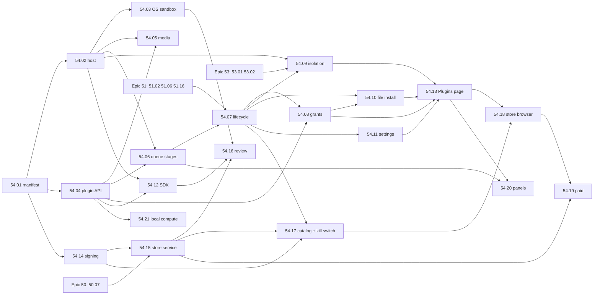

# Epic 54: Plugins: new functions from the queue, with no internet, from a Maktaba store

> **Status:** spec (2026-11-03). **Builds on:** [Epic 51](../51-configurable-components/README.md)
> (components, desired and actual state, drain without lost work, signed packs, offline import),
> [Epic 6](../06-job-queue/README.md) (the queue), [Epic 40](../40-queue-health/README.md)
> (failure classes and parking), [Epic 53](../53-logs-errors-reports/README.md) (logs, health and
> problem reports per component), [Epic 25](../25-cloud-relay/README.md) and
> [Epic 50](../50-cloud-no-downtime/README.md) (Maktaba Cloud, accounts, Stripe, no downtime),
> [Epic 16](../16-subscriptions/README.md) (licences) and
> [Epic 42](../42-apps-player-remote-server/README.md) (the apps and the Maktaba service admin).
> **Research:** [research.md](research.md): the queue and extension code as it is, Jellyfin,
> Plex, Home Assistant, Nextcloud, VS Code, Obsidian, Deno and WASI, Wasmtime, OS sandboxes,
> Stripe Connect and store moderation, with sources.
> **Wiki:** [epic-54-plugins.md](../../../docs/wiki/epics/epic-54-plugins.md).

## 1. Why

The owner, 2026-11-03: *"Spec a third-party no internet calling plugging queue extender that
allows new functions by interacting with queues and maktaba API and a store for such
plugins/jobs"*.

In short: other people can add functions to Maktaba. A plugin takes jobs from the queue, reads
what it is allowed to read through the Maktaba API, and writes results back. It can never
reach the internet. Maktaba runs a store that reviews, signs and sells plugins.

Today the only way to add a function is a Python package with an entry point in the group
`maktaba.extensions` (`pipeline/src/maktaba_pipeline/extensions/__init__.py`). It is loaded
into the pipeline worker with the worker's database login, its network, its disk and the home
secrets key path. One bad package can read every library, send it anywhere, or crash every
worker. That is fine for Maktaba's own Plex and dizqueTV code. It is not something to offer
strangers. Epic 51 left a store to "a later epic on this model" (Epic 51 H5). This is it.

## 2. What we found (details in [research.md](research.md))

- **The queue already has the shape a plugin needs.** A `StageDef` with edges from core
  stages, a handler that returns a `StageResult`, pools, retries, failure classes, scheduled
  stages (`every_minutes_rule`), and the drain that force-pauses running jobs. The extension
  contract (`Extension.register(GraphBuilder)`) already lets outside code add stages and
  edges without core naming it. We keep that shape and change *where* the code runs.
- **Every other media server runs plugins in its own process with full rights** (Jellyfin,
  Plex until 2018, Home Assistant integrations, Nextcloud). VS Code and Obsidian say they
  cannot sandbox and live with malicious uploads. Home Assistant add-ons are the exception
  (containers with a security rating), and need Docker.
- **Plex retired its plugins** because few used them, the protocol was old and hard to
  support, and most were web-content channels that broke. A plugin system lasts only if its
  contract is small and versioned and plugins work on the owner's own library.
- **WebAssembly components** give a sandbox that is the same on every OS: a component can call
  only what the host links into it. If the host never links sockets or HTTP, a plugin has no
  way to name the network. Wasmtime adds fuel, deadlines and memory limits, and starts an
  instance in microseconds with pre-instantiation and pooling.
- **Python in Wasm has no native extensions** (no NumPy or torch). So heavy compute stays in
  Maktaba as host services: decoded frames and audio, transcripts, local embeddings, the local
  language model.
- **Stores that last** pair a developer key with a store countersignature (Nextcloud, app
  stores), check every version automatically, review by hand at first submission and when
  rights grow (Obsidian), and can switch off installed copies (Chrome).

## 3. Goals

1. **Plugins add functions through the queue.** A plugin adds stages that run after stable
   events (a video was added, a transcript is ready…), on a schedule, or when another of its
   own stages asks. It writes metadata, tags, chapters, subtitles, artwork and its own data,
   and can declare settings pages and (Phase 3) panels the apps draw.
2. **No internet, enforced.** A plugin cannot open a socket, resolve a name or make an HTTP
   request. It cannot see the disk. It reaches media only through handles the API grants for
   the job it is running. CPU, memory, disk and time are capped. CI proves each of these on
   macOS, Linux and Windows with tests that try and must fail.
3. **A narrow, versioned, capability-scoped API.** A plugin declares the capabilities it needs.
   The admin grants them at install, like phone app permissions. The API enforces them on
   every call, server-side. Plugins never get admin rights, user credentials or secrets.
4. **One lifecycle with Epic 51.** Each installed plugin is a component: install, enable,
   disable, hold, update, rollback and uninstall, with Epic 51's drain that never loses a job.
   A plugin that crashes cannot take down the pipeline; its health and logs are its own
   (Epic 53).
5. **A Maktaba store.** Developer accounts, submission, automated checks and human review,
   signing by the developer and by Maktaba, a revocation list homes honour, free and paid
   plugins through Stripe, ratings and reports. Users browse on maktaba.tv and in the web app;
   developers read docs on maktaba.dev.
6. **Offline still works.** A plugin installs from a file. A store-signed file installs like
   one from the store. An unsigned or developer-only file needs the admin's opt-in and is
   marked "Unreviewed" everywhere. The sandbox is the same either way.
7. **A good developer experience.** An SDK and templates for Rust, JavaScript/TypeScript,
   Python and Go (TinyGo), a local test harness with a mock Maktaba API, and docs.
8. **English and Arabic** for every Maktaba string, and every store-listed plugin's strings.

### Not in this epic

- Plugins that reach the internet, under any permission. There is no `network` capability.
  Integrations that need the internet (Plex, Cloudflare Stream) stay first-party extensions
  (Epic 51 `ext.*`).
- Plugins that change playback or streaming (codecs, transcoding, DRM), or that add API routes
  for apps. Plugins work through the queue and the plugin API only.
- Arbitrary code in the apps. UI is declared as data (settings forms, panels) and drawn by
  Maktaba's own code.
- Plugins on cluster machines other than the home. Plugin stages are `placement = home` in
  this epic (H12).
- Moving the first-party extensions (Plex, dizqueTV, Cloudflare Stream) or Epic 52's language
  packs into the plugin sandbox. They need the network or the worker's Python; they stay as
  they are. Entry-point extensions remain a developer feature behind the existing switch.

## 4. The plugin model

### 4.1 What a plugin is

A **plugin** is one signed package (`.mkplugin`) holding one WebAssembly component, a manifest,
strings in English and Arabic, an icon, and optional declarative UI. It can provide:

| Part | What it does | Declared in the manifest as |
|---|---|---|
| **Stages** | queue job types run by the plugin's exported `run` function | `[[stage]]` |
| **Triggers** | when a stage gets a job: after a stable event, on a schedule, or on request from another of the plugin's own stages | `[[stage.trigger]]`, `[[schedule]]` |
| **Outputs** | what it writes: its own data, metadata fields, tags, chapters, subtitles, artwork, suggestions for review, admin notices | capabilities (§4.4) |
| **Settings** | an admin form, drawn by Maktaba from a JSON schema | `[settings]` |
| **Panels** (Phase 3) | read-only views on a video, series or library page, drawn by every app from a small schema | `[[panel]]` |

A plugin cannot add API routes, run at boot, run in the apps, run outside a job, or talk to
another plugin except through data that plugin chose to export (§4.4).

### 4.2 Events a plugin can follow

Plugins never attach to internal stage names (they change between releases). They follow a
short, stable list of **events**, each mapped by Maktaba to the core stage whose output means
it. The list is part of the plugin API version (§4.4):

| Event | Subject | Fires when (core stage today) |
|---|---|---|
| `video.added` | video | a new video is probed (`probe`) |
| `video.changed` | video | its file changed (`content_hash` output changed) |
| `audio.ready` | video | audio extracted (`extract`) |
| `transcript.ready` | video | a transcript was written or replaced (`transcribe`) |
| `subtitles.ready` | video | subtitles written (`subtitle_gen`) |
| `thumbnails.ready` | video | thumbnails made (thumbnail stages) |
| `metadata.changed` | video | title, tags or grouping changed (classify stages, an admin edit) |
| `series.changed` | series | a series or season was formed or changed (`detect`) |
| `library.scanned` | library | a library scan finished |
| `schedule` | catalog | the plugin's own schedule (every N minutes, from its settings, min 15) |

A trigger is an `Edge` from the mapped core stage to the plugin stage, added by the plugin
loader through `GraphBuilder.add_edge`, exactly how built-in extensions wire in today
(`extensions/base.py`). A schedule is `every_minutes_rule` on a catalog-subject stage
(`engine/reconcile.py`). A request is a `Request` to a stage in the plugin's own
`may_request`; requests to other plugins' or core stages are refused (`GraphViolation`).

### 4.3 How a job runs

```
pipeline worker (Python)                      plugin host: maktaba-plugind (Rust, Wasmtime)
  claims plugin stage job (pool "plugins")       one process per home, OS-sandboxed (§5.3)
  │ POST /internal/plugins/invocations ──► API   no network, no DB login, no secrets
  │   (machine auth) mints invocation token      │
  │ ◄── token {plugin, version, job, subject,     │
  │           grants, libraries, exp}            │
  │ dispatch(job, token) ── unix socket ────────►│ fresh Store: fuel, epoch deadline, memory cap
  │                                              │ instantiate (InstancePre, pooled)
  │                                              │ call export run(job)
  │                                              │   guest calls WIT imports: maktaba:plugin/*
  │                                              │   host forwards each with the token ──► plugin API
  │                                              │                    (Go API, unix socket only)
  │ ◄──────────── result (outputs, log) ─────────│   API checks token + grant + library + quota
  │ StageResult → Epic 40 failure policy          │
```

- **The pipeline still owns the queue.** Claiming, pools, retries, failure classes, drain and
  parking are unchanged. A plugin stage is a `StageDef` with `extension = "plugin:<id>"` and a
  handler that forwards the job to the plugin host and maps the answer to a `StageResult`.
- **The plugin host owns the sandbox.** It is one supervised process per home (`plugins.host`,
  an Epic 51 `process` component). Each job gets a fresh Wasmtime store. A trap, a deadline or
  a memory cap ends that job, not the host.
- **The API owns the rules.** It mints the invocation token from the grants *it* stores (never
  from what the pipeline or the host says), and checks the token, the grant, the library scope
  and the quota on every call. The guest never sees the token: it calls typed imports, and the
  host attaches the token.

### 4.4 The plugin API

**One WIT package, `maktaba:plugin@1.x`**, versioned with semver. The host links only these
interfaces plus a minimal WASI subset (§5.2). A minor version only adds functions; a plugin
built for 1.2 runs on any host with 1.2 or later in the 1.x line. Maktaba supports the current
and the previous major for at least 12 months after a new major ships.

| Interface | Functions (sketch) | Capability needed |
|---|---|---|
| `job` | `subject()`, `payload()`, `settings()`, `progress(pct)`, `checkpoint(bytes)` | none (always) |
| `log` | `log(level, code, fields)` (rate-limited, §4.7) | none |
| `data` | `get/put/delete/list(subject, key)` in the plugin's own namespace | none (quota applies) |
| `library` | `video(id)`, `series(id)`, `list(library, filter, page)` | `library.read` |
| `transcript` | `segments(video)`, `words(video)` | `transcript.read` |
| `media` | `open(video) -> stream` (read at offset), `frame(video, t, size)`, `audio(video, t0, t1, rate)` | `media.read`, `media.frames`, `media.audio` |
| `write` | `set-field(video, field, value)`, `add-tags`, `set-chapters`, `add-subtitle(video, lang, vtt)`, `set-artwork(subject, kind, image)` | `metadata.write`, `tags.write`, `chapters.write`, `subtitles.write`, `artwork.write` |
| `suggest` | `suggest(subject, field, value, reason)` into the admin's review queue | `suggest` |
| `queue` | `request(stage, subject, payload)` for the plugin's own stages | `jobs.enqueue` |
| `notify` | `admin(code, params)`: an in-app notice to admins, from the plugin's strings | `notify.admin` |
| `exports` | `read(plugin, subject, key)` of data another plugin marked as exported | `plugin-data.read:<id>` |
| `compute` (Phase 3) | `embed(texts)`, `generate(prompt, opts)` on the home's own models | `compute.embed`, `compute.llm` |

Rules the API enforces on every call:

- **Scope to the job.** `media.*` and `write.*` act only on the job's subject (or, for a
  library or catalog job, on items inside the libraries the admin granted). `library.read`
  lists only granted libraries. A call outside scope answers `403 plugin_scope`.
- **Capabilities are checked, not trusted.** A call without the grant answers
  `403 plugin_capability`, is logged, and counts toward the plugin's circuit breaker.
- **Core fields are guarded.** `set-field` can write only fields in an allow-list
  (description, sort title, year, rating, external ids that are local only). Titles written by
  an admin are never overwritten; a plugin can only `suggest` over them. `videos.state` is
  never written (only `advance_after_stage` writes it, research §1.1).
- **Every write is attributed** (`origin = plugin:<id>@<version>`), so it can be listed,
  undone per plugin, and kept out of anything that leaves the home (§9).
- **No secrets, no users.** There is no call that returns users, sessions, tokens, settings of
  other components, `home_secrets`, file paths or machine addresses.

The API listens for plugin calls **only on a unix domain socket** (`<data>/run/plugin-api.sock`;
Windows 10+ supports AF_UNIX), never on TCP, so the LAN cannot reach it and a plugin token is
useless off the box.

### 4.5 Capabilities and grants

| Capability | Words shown to the admin (en) | Risk |
|---|---|---|
| `library.read` | Read titles, descriptions and grouping in the libraries you choose | low |
| `transcript.read` | Read transcripts of videos in those libraries | medium |
| `media.read` | Read video files, only while working on them | medium |
| `media.frames` / `media.audio` | See still frames / hear audio clips of videos it works on | medium |
| `metadata.write` | Change descriptions and other details (never titles you set) | medium |
| `tags.write` / `chapters.write` | Add tags / chapters | low |
| `subtitles.write` | Add subtitle tracks | low |
| `artwork.write` | Set posters and thumbnails | low |
| `suggest` | Suggest changes for you to accept | low |
| `jobs.enqueue` | Queue more of its own work | low |
| `notify.admin` | Send notices to admins | low |
| `plugin-data.read:<id>` | Read what plugin X shares | depends on X |
| `compute.embed` / `compute.llm` | Use this home's search model / language model | low |

- The manifest marks each capability `required` or `optional`. At install the admin sees them
  in plain words (English and Arabic, from Maktaba's strings, not the plugin's), picks the
  libraries (all ticked by default), and can untick optional ones. The plugin is told which it
  has (`job.grants()`).
- **A plugin's rating** is shown like Home Assistant's add-on rating: from the capabilities it
  asks for and whether the store reviewed it (story 54.08).
- **An update that asks for more** installs but waits (Epic 51 *Waiting*, reason
  `grants_needed`) until an admin approves; the old version keeps running meanwhile.
- **Revoking** a grant takes effect on the next call (tokens live ≤ the job's deadline and are
  checked against the grant table's generation).

### 4.6 The manifest

`manifest.toml` at the package root:

```toml
schema      = 1
id          = "dev.example.silence-chapters"   # reverse-DNS; the dev's verified prefix
version     = "1.4.0"                           # semver
plugin_api  = "1.2"                             # WIT package minor it was built against
maktaba     = ">=0.6.0, <0.9.0"                 # server range (Nextcloud-style min and max)
platforms   = ["any"]                           # Wasm is portable; "any" unless a host service is OS-specific
languages   = ["ar", "en"]                      # content languages it is good at (store filter)
licence     = "MIT"                             # SPDX, or "proprietary"
price       = "free"                            # or a store product id (Phase 3)
data_version = 2                                # bump when its stored data changes shape (§4.8)

[strings]                                       # keys into i18n/en.json and i18n/ar.json; both required
name        = "plugin.name"
summary     = "plugin.summary"

[capabilities]
required = ["library.read", "media.audio", "chapters.write"]
optional = ["notify.admin"]

[resources]                                     # caps the host enforces; the admin can lower them
memory_mb   = 256          # max 1024
timeout_s   = 300          # per job; max 1800
fuel        = "default"    # or an explicit instruction budget
scratch_mb  = 0            # per-job temp space in the host; max 512
data_mb     = 50           # its own data, total; max 1024
concurrency = 2            # jobs at once; the plugins pool caps the home's total

[[stage]]
name        = "find_silences"                   # becomes plugin stage "p.<short-hash>.find_silences"
subject     = "video"
export      = "run-find-silences"               # the component export to call
version     = 3                                 # bump to rerun on everything
may_request = ["write_chapters"]
  [[stage.trigger]]
  event = "audio.ready"

[[schedule]]
stage       = "weekly_report"
every_minutes_setting = "report_interval"       # a field of [settings]; min 15

[settings]
schema      = "ui/settings.schema.json"         # JSON Schema subset; no secret fields

[[panel]]                                       # Phase 3
on          = "video"
schema      = "ui/panel.json"
audience    = "admins"                          # or "everyone", which the admin must approve
```

The manifest is validated by one schema (`shared/plugins/manifest.schema.json`) in the Go API,
the Rust host, the store and the SDK, from one file. Story 54.01 lists every field and its
limits.

### 4.7 Resources and quotas

| Resource | Default | Max | Enforced by |
|---|---|---|---|
| Linear memory per job | 256 MB | 1 GB | Wasmtime `StoreLimits` |
| Wall time per job | 300 s | 1,800 s | epoch deadline (100 ms ticks) |
| CPU instructions per job | derived from wall time | — | fuel (deterministic tests) |
| Concurrent jobs | plugin: 2; home: pool `plugins` = max(1, cores ÷ 4) | 8 | the `plugins` pool in `graph.py` POOLS |
| Scratch disk per job | 0 | 512 MB | host-side in-memory or quota'd temp dir, deleted after the job |
| Own data | 50 MB | 1 GB | API quota on `plugin_data` |
| Artifacts (subtitles, artwork) | 200 MB | 2 GB | API quota |
| Plugin API calls | 200 /s per job | — | API token bucket |
| One value / one write | 64 KB / 4 MB (artwork, subtitles) | — | API |
| Log lines | 100 /s, 10 MB per day | — | host, before Epic 53's segments |
| Package size | — | 50 MB | installer, store |
| Plugin host process | — | 2 GB RSS (Job Object / cgroup / `RLIMIT_AS` fallback) | OS |

### 4.8 Lifecycle, on Epic 51

Each installed plugin is an Epic 51 component of a new kind, **`plugin`**, with id
`plugin.<plugin id>`. It is not in the static `catalog.toml`: the catalog gains *dynamic
entries* read from `plugin_installs` (story 54.07). Everything else is Epic 51's:

| Action | What happens |
|---|---|
| **Install** | verify signatures and revocation (§6.3) → validate manifest → audit the component's imports against its capabilities → AOT-compile (`.cwasm`, cached) → unpack to `<data>/plugins/<id>/<version>_<digest>/` → grants dialog → `want = installed` |
| **Enable** | `want = enabled`. The plugin loader adds its stages and edges at the next graph sync (≤ 2 s via `NOTIFY`), `job_stages` rows appear with `extension = 'plugin:<id>'`, workers claim. Existing items are *not* back-filled unless the admin ticks "Run on my existing library" (a catch-up, Epic 51 §4.5). |
| **Disable / hold** | Epic 51 §4.5: stop claiming ≤ 2 s, drain ≤ the plugin's `timeout_s` (capped at 120 s), force-pause the rest, keep the queue, don't feed. |
| **Update** | the new version installs beside the old one, grants are compared (more → *Waiting* `grants_needed`), the old version drains, the `current` pointer switches, stage versions decide what reruns. The previous version is kept for rollback. |
| **Rollback** | switch back to the kept version. Refused when the kept version's `data_version` is lower than the data's, unless the admin chooses "roll back and clear this plugin's data". |
| **Uninstall** | `want = absent`: drain, remove stages (their queued jobs are deleted, the only time jobs are dropped, and the dialog says how many), delete files. Data, attributed writes and settings are kept unless "Also remove what it wrote" (purge, Epic 51 §4.7): purge deletes `plugin_data`, artifacts, and reverts attributed writes it made that no one changed since. |

The plugin host itself is a first-party `process` component, `plugins.host`, enabled only
while at least one plugin is enabled (so a home without plugins runs no extra process).

### 4.9 Crash isolation, health and logs

- **A trap, a deadline or a memory cap fails the job, not the host.** Each has a new cause in
  Epic 40's table (`engine/failure_classes.py`): `plugin_trap` and `plugin_timeout` are
  `transient` (one retry; plugin stages have `max_attempts = 2`); `plugin_memory`,
  `plugin_capability`, `plugin_scope` and `plugin_quota` are `item_permanent`; a held or revoked
  plugin is `dependency:plugin`, so its jobs wait without spending attempts.
- **A circuit breaker** holds a plugin (Epic 51 hold, reason `plugin_crash_loop`) after 5
  traps in 10 minutes or more than 50 % failures over the last 20 jobs, and tells admins. It
  stays held until an admin starts it.
- **If the host process dies**, the supervisor restarts it with Epic 51's backoff. Jobs in
  flight go back to the queue without counting an attempt, as the shutdown drain does today.
  The pipeline worker never imports plugin code, so it cannot be crashed by one.
- **Logs**: the host writes each plugin's lines to Epic 53's segments with
  `service = plugin.<id>`, the plugin's version and the job id, rate-limited (§4.7). Health
  per plugin (phase, conditions, last error code, jobs done and failed, p95 job time, memory
  high-water mark) is in `component_status` and on the Plugins page.

### 4.10 UI

- **Web, admin only:** Settings → **Plugins**, with *Installed* (status, grants, libraries,
  settings, logs, update, roll back, disable, remove, "what it wrote") and *Browse* (the store
  catalog for this server version, story 54.18), plus *Install from a file*.
- **Settings pages** are forms generated from the plugin's JSON schema by the web's existing
  schema form code (the one that draws `rules.*` sections). No secret fields: a plugin with no
  internet has nothing to sign in to.
- **Panels (Phase 3)** are a fixed set of blocks (key–value list, badges, chips, a table of up
  to 50 rows, timeline markers, an artifact image) drawn natively by web, Apple, Android and TV
  apps. **No URLs, no HTML, no markdown links**: text is plain, images are artifacts served by
  the home. This closes the beacon channel (§9, T4).
- **Plugin outputs in every app** need no app change for core fields: tags, chapters,
  subtitles and artwork show where they show today, with "Added by {plugin}" in the admin's
  details sheet.
- Every Maktaba string is in `en.json` and `ar.json` together (and Android `values-ar`, Apple
  String Catalogs). Plugin strings come from the plugin's own `i18n/en.json` and `i18n/ar.json`,
  both required for store listing.

## 5. The "no internet" guarantee

### 5.1 The rule

A plugin, and the process that runs it, cannot send or receive a byte over any network
interface, including loopback TCP to Maktaba's own ports. The only way out of the sandbox is
the plugin API over a unix socket, which is not a network and reaches only the home's API.
The home server may reach the internet for the store (§6.4); that is Maktaba's code, not the
plugin's.

### 5.2 Layer 1: the WebAssembly component

- **What is linked:** `maktaba:plugin/*` (§4.4) and from WASI 0.2 only `wasi:clocks`
  (monotonic and wall), `wasi:random` (insecure and secure), `wasi:io/streams` and
  `wasi:cli/{stdout,stderr,environment}` with an empty environment. Stdout and stderr go to the
  plugin's log, rate-limited.
- **What is not linked, at all:** `wasi:sockets`, `wasi:http`, `wasi:filesystem`,
  `wasi:cli/stdin`, any process or exec interface. A component that imports one fails the
  install audit (`plugin_forbidden_import`) and, if it got past, fails to instantiate.
- **Limits:** fuel, an epoch deadline, `StoreLimits` on memory, tables and instances; a fresh
  store per job, so no state survives between jobs except through `data` and `checkpoint`.
- **Pinned runtime:** the host pins Wasmtime to a version and updates it within 14 days of a
  Wasmtime security advisory, through the normal release path.

### 5.3 Layer 2: the OS sandbox on the plugin host

The host applies its sandbox to itself at start, before it loads any plugin, and refuses to
run if it cannot (`sandbox_unavailable`, the plugins component goes *Failed*).

| OS | How | Network | Files |
|---|---|---|---|
| macOS | Seatbelt profile applied with `sandbox_init_with_parameters` (the Chromium approach), shipped as `plugind.sb` in the app bundle | `(deny network*)` then `(allow network-outbound (remote unix-socket (path-literal "<data>/run/plugin-api.sock")))` and the dispatch socket | read: its binary, the plugins folder, the `.cwasm` cache; write: its run folder and scratch; nothing else |
| Linux | in-process, no setuid: new user, network, mount, IPC and PID namespaces when unprivileged user namespaces are allowed (a network namespace with no interfaces up); always seccomp-bpf refusing `socket()` for every family but `AF_UNIX`, plus `ptrace`, `bpf`, `mount`, `keyctl`; always Landlock for files (and Landlock ABI ≥ 4 network rules where the kernel has them) | no interfaces; `socket(AF_INET/AF_INET6/AF_NETLINK/AF_PACKET)` → `EPERM` | Landlock: read the plugins folder and cache, write run and scratch |
| Windows | the host is started by the supervisor inside an **AppContainer** with **no capabilities** (no `internetClient`, `internetClientServer` or `privateNetworkClientServer`) and in a **Job Object** (memory, CPU rate, no child processes, kill on close) | the Windows Filtering Platform blocks outbound by default for AppContainers without network capabilities | only folders whose ACL grants the AppContainer SID: the plugins folder (read), run and scratch (write) |

Where the OS sandbox is weaker than designed (an old Linux kernel without Landlock, a distro
that blocks user namespaces), the host still runs with what it has *only if* seccomp is in
force, and reports *Degraded* with `sandbox_partial` and the missing layers. Without seccomp
on Linux, or without the Seatbelt profile or AppContainer, it does not run.

### 5.4 How CI proves it (CI only, never on the owner's Mac)

A job **`plugins-sandbox`** runs on `macos-15`, `ubuntu-24.04`, `ubuntu-22.04` and
`windows-2022` on every PR touching `plugind/`, `shared/plugins/`, the plugin API or the
supervisor's plugin role, and nightly:

1. **Hostile components** built from `plugind/tests/hostile/` (Rust and Python, so both a
   small and a CPython guest are covered):
   - imports `wasi:sockets` / `wasi:http` / `wasi:filesystem` → refused at audit *and* at
     instantiation (the audit is bypassed with a test flag to prove layer 1 alone);
   - an infinite loop → ends at the deadline ± 200 ms, host still serves the next job;
   - a memory bomb → trapped at the cap, host RSS back under its baseline + 50 MB;
   - a call without the capability, outside the job's subject, in another library → 403 from
     the API, logged;
   - a flood of API calls and log lines → throttled, the job still finishes;
   - an oversize write, a path in a subtitle name, a `javascript:` or `http://` string in a
     panel → refused.
2. **Escape probes in the host process itself.** A test-only build (`--features escape-probes`)
   of `maktaba-plugind` applies the real sandbox and then, as native code (stronger than any
   plugin), tries to: connect TCP and UDP to a canary listener the job runs on `127.0.0.1`,
   `::1`, the runner's LAN address and a public address literal; resolve a name; open a raw
   socket; bind a port; read `~/.ssh`, `/etc/passwd` or `C:\Windows\System32\config\SAM`;
   write outside its run folder; spawn a process. **Every attempt must fail**, and the canary
   listener must log **zero** connections. The public address is never actually reached in a
   passing run, and the canary is local, so the test makes no internet call even if it fails
   open (the step runs with the runner's egress firewalled to the canary only).
3. **Positive controls.** The same probes run once *without* the sandbox and must succeed, so a
   test that "passes" because the probe is broken is caught.
4. **Performance** numbers N1–N6 (§7.2) are measured in the same job and fail it if missed.

## 6. The store

### 6.1 Where it lives

- **Users** browse plugins on **maktaba.tv/plugins** (listing pages, ratings) and inside their
  home's web app (Settings → Plugins → Browse), which shows only what fits their server version
  and platform.
- **Developers** read docs, the SDK and the API reference on **maktaba.dev/plugins**. Their
  console (account, keys, submissions, payouts) is at **maktaba.tv/developers**, signed in with
  a Maktaba Cloud account (Epic 25). maktaba.app is not ours and is never used.
- **The store service** is a new part of Maktaba Cloud (`cloud/internal/store/`), on Epic 50's
  two-node setup, with packages in its object storage and a CDN in front.
- **Homes fetch** the catalog, packages and the revocation list from the store **through the
  home server's own connection to Maktaba Cloud**. That is Maktaba's own code, not a plugin.
  A home without the cloud link fetches the same signed files over plain HTTPS from
  `store.maktaba.tv`; signatures, not the channel, are what it trusts.

### 6.2 Developer accounts and submission

1. A developer signs up with a Maktaba Cloud account, verifies email, turns on two-factor
   sign-in (required to publish), accepts the developer agreement and chooses an **id prefix**
   (`dev.example`), proven by a DNS TXT record or reserved under `tv.maktaba.community.<name>`.
2. The developer makes a signing key with the SDK (`mkp keys new`, Ed25519; the private key
   never leaves their machine) and registers its public half. A key can be rotated; old
   signatures stay valid until the developer revokes the old key.
3. They upload a package signed with their key, plus a **source archive** (kept private to
   reviewers) and release notes in English and Arabic.
4. **Automated checks** (story 54.16) run in ≤ 30 minutes: manifest schema; signature; size;
   the import audit (only allowed interfaces; every imported `maktaba:plugin` interface covered
   by a declared capability, and declared capabilities not imported flagged); a malware scan;
   string checks (every key in `en` and `ar`; no URLs in strings shown to users); a **sandbox
   run** in the same harness as `plugins-sandbox` with the plugin's own fixtures plus generated
   events, recording every API call, its resources and its outputs; and a diff against the
   previous version (new capabilities, new exports, size jump).
5. **Human review** for every first submission, every version that adds a capability or a
   panel with `audience = "everyone"`, and every version the automated checks flag.
   Reviewers see the checks report, the call trace and the source.
6. On approval the store **countersigns** and publishes. On rejection the developer gets the
   reasons from a fixed list plus notes.

### 6.3 Signing, trust and revocation

- **Two signatures over one file list.** A package carries `files.json` (path, sha256, size of
  every file) and two Ed25519 signatures over it: the developer's (`developer.sig`, with the key
  id) and the store's (`store.sig`, with the plugin id, version, review level and date).
- **The trust root** `plugins-root.json` is embedded in every server binary: the store's root
  public keys (two, held offline by the owner, either can sign), which sign a short-lived
  `store-keys.json` naming the online store signing keys (rotated yearly, expiry 13 months).
  The release Sigstore identity (Epic 51 H6) is not used for plugins: it proves "built by
  Maktaba's release workflow", and plugins are not.
- **The catalog** (`catalog-<api major>.json`) and **the revocation list** (`revoked.json`)
  are signed by the online key, expire (catalog 7 days, revocation list 48 hours), and a home
  refuses a copy older than the newest it has seen (anti-rollback, as Epic 51 §6.4).
- **Revocation entries** name a plugin id, a version range and an action:
  - `disable`: the home holds the plugin within one fetch (drain, then stop) and tells admins
    why. Used for malware, data abuse, or a severe bug. An admin **cannot** override it
    (except by uninstalling).
  - `warn`: the plugin keeps running; admins see the warning and can disable it.
  - `delist`: removed from the catalog; installed copies keep working.
- **How fast:** a home linked to the cloud gets a push over the cloud link within 5 minutes
  and checks the list every hour; a home without the link checks every hour over HTTPS. Each
  server release also carries the revocation list as of its build, so an offline home that
  updates gets it.
- **Developer key compromise:** the store revokes the key; every version signed only by it
  and not yet countersigned is refused; countersigned versions are re-reviewed and either
  re-signed or revoked.

### 6.4 Offline install from a file

- **Store-signed file** (downloaded from maktaba.tv, carried on a USB stick): installs like
  from the store, offline. The install dialog shows the age of the revocation list the home
  has ("Last checked for withdrawn plugins: 12 days ago").
- **Developer-signed or unsigned file**: refused unless an admin has turned on **Allow
  unreviewed plugins** (Settings → Plugins, off by default, asks for the admin's password
  again, audited). Then it installs with a red **Unreviewed** badge on every screen that
  names the plugin, and a typed confirmation of the plugin's name. The sandbox, grants and
  quotas are exactly the same. Turning the setting off disables every unreviewed plugin
  (drained, kept).
- **Developer mode** (`maktaba-server plugins dev <folder>`) loads an unpacked plugin with
  reload on change, only when unreviewed plugins are allowed, and marks it **Development**.

### 6.5 Free and paid plugins (Phase 3)

- **Stripe Connect** (Express accounts) for developers; buyers pay through Stripe Checkout on
  maktaba.tv with the cloud's existing Stripe client (`cloud/internal/billing/stripe.go`
  gains Connect parameters); destination charges with `application_fee_amount`.
- **Split:** developer 85 %, Maktaba 15 %, after Stripe's fee is paid by Maktaba from its
  share (owner question).
- **Prices:** one-time or yearly. Refunds within 14 days, no questions; a refund revokes the
  entitlement at the next refresh.
- **Entitlement:** the cloud's licence issuer (`cloud/internal/license/issuer.go`) signs a
  plugin entitlement bound to the home id (31 days, refreshed daily, the licence store's grace
  rules). The home checks it offline. A lapsed entitlement holds the plugin (Epic 51 *Waiting*
  `licence_missing`), never deletes data.
- **Plugins never handle payment.** No capability touches money; a plugin cannot show a
  price, a paywall or a link.

### 6.6 Ratings and reports

- One rating (1–5 stars, optional text in any language) per Maktaba account per plugin, only
  from an admin of a home that has the plugin installed for at least 24 hours (the home
  confirms it through the cloud link). Developers can reply once per review.
- **Report** a plugin from the home or the listing: reasons from a fixed list (malware, data
  misuse, does not work, misleading, offensive, copyright), optional details. Malware and data
  misuse reports page the store on-call (Epic 50.12) and are triaged within 24 hours; others
  within 2 business days.
- Moderation is done by the **Maktaba service admin** with a new `store_reviewer` role (Epic
  42's service admin, not home admins), every action audited.

## 7. Requirements

### 7.1 Functional

| # | Requirement |
|---|---|
| F1 | A plugin package is one `.mkplugin` (tar.zst) with a manifest validated by one shared schema; the manifest has id, version, plugin API version, Maktaba range, capabilities, resources, platforms, languages, stages, triggers, schedules, settings, panels and English + Arabic strings. |
| F2 | Plugin stages run in the queue like core stages: claimed from a `plugins` pool, retried, drained, parked and classified by Epic 40's rules. |
| F3 | Plugins attach only to the stable events of §4.2, their own schedules, and their own stages. |
| F4 | Plugin code runs only in `maktaba-plugind`, as a WebAssembly component with no sockets, HTTP, filesystem or process imports, under per-job memory, time and fuel limits. |
| F5 | `maktaba-plugind` runs under the OS sandbox of §5.3 on macOS, Linux and Windows, or does not run. |
| F6 | Every plugin API call is checked server-side for token, capability, subject and library scope, and quota; refusals are logged and counted. |
| F7 | Admins grant capabilities and libraries at install; an update that asks for more waits for approval; a revoked grant applies on the next call. |
| F8 | Each plugin is an Epic 51 component: install, enable, disable, hold, update, rollback, uninstall, purge, with no job lost by disable or update. |
| F9 | A crashing plugin fails only its jobs; the circuit breaker holds it; the host restarts without losing jobs. |
| F10 | Each plugin has its own logs (Epic 53), health and counters on the Plugins page. |
| F11 | Plugins install from a file offline; files without a store signature need the admin opt-in and show "Unreviewed". |
| F12 | The store has developer accounts with 2FA, signing keys, submission, automated checks, human review, countersigning, a signed catalog and a signed revocation list. |
| F13 | Homes fetch the catalog, packages and revocation list through the home server, honour `disable` revocations within one fetch, and refuse expired or rolled-back lists. |
| F14 | Paid plugins (Phase 3) are bought on maktaba.tv with Stripe; the home checks a signed entitlement offline. |
| F15 | Ratings and reports, with moderation by the Maktaba service admin. |
| F16 | All `/api/plugins/*` routes are admin-only with role tests; viewers see only plugin outputs and panels an admin approved for everyone. |
| F17 | SDK, templates and a local harness with a mock plugin API for Rust, JS/TS, Python and TinyGo; docs on maktaba.dev. |
| F18 | Every Maktaba string added by this epic ships in English and Arabic on every platform in the same PR. |

### 7.2 Non-functional: the numbers

| # | Measure | Target | How it is checked |
|---|---|---|---|
| N1 | Job start overhead (token mint + dispatch + instantiate, compiled and cached) | p95 ≤ 20 ms; instantiate alone p95 ≤ 5 ms | `plugins-sandbox` bench step |
| N2 | First job after host start (load `.cwasm`, pre-instantiate) | p95 ≤ 300 ms for a 10 MB component | same |
| N3 | Install-time AOT compile | ≤ 15 s for a 20 MB component on CI hardware | same |
| N4 | Plugin API call round trip (unix socket, token check, simple read) | p95 ≤ 2 ms | Go benchmark + bench step |
| N5 | Compute overhead vs the same Rust code native | ≤ 2× on the reference workloads (hashing, parsing a VTT, a 10k-item sort) | bench step |
| N6 | Plugin host idle memory with 10 plugins installed, none running | ≤ 80 MB RSS | bench step |
| N7 | A runaway job stopped after its deadline | ≤ deadline + 200 ms | hostile tests |
| N8 | Successful network connections from the host or a plugin | **0** in every run on every OS | escape probes + canary |
| N9 | Disable → no plugin job claimed | ≤ 2 s; drained ≤ min(timeout, 120 s); 0 lost jobs over 100 flips under load | `components-chaos` gains plugin stages |
| N10 | Revocation `disable` reaches a linked home | ≤ 5 min (push), ≤ 65 min worst case (poll) | store integration test with a fake clock |
| N11 | Store automated checks | ≤ 30 min p95 from upload to report | store job metrics |
| N12 | Human review | first response ≤ 5 business days for a new plugin, ≤ 2 for an update; malware reports triaged ≤ 24 h | store dashboard, published on maktaba.dev |
| N13 | Catalog page in the web app | ≤ 300 ms p95 from the home's cache, ≤ 1.5 s on a cold fetch | web perf test |
| N14 | A home with no plugins | 0 extra processes, ≤ 5 MB extra RSS in the API | bundle-size footprint step (Epic 51) |
| N15 | Package size | ≤ 50 MB; the Python template's hello-world ≤ 25 MB | store check, SDK test |

### 7.3 What must not change

- The pipeline worker never imports plugin code. Built-in extensions (Plex, dizqueTV,
  Cloudflare Stream) and entry-point extensions keep working as today.
- Claiming, pools, failure policy and parking work the same for core stages; plugin stages
  only add a pool and failure causes.
- A home that never installs a plugin sees no new process, no store traffic beyond an hourly
  revocation check (skipped while no plugin is installed), and no UI beyond the Plugins entry
  in admin settings.

## 8. Phases

- **Phase 1: runtime, plugin API and local install** (54.01–54.13). Manifest and package, the
  host and its sandbox with CI proof, the plugin API with capabilities, media handles, plugin
  stages, Epic 51 lifecycle, grants, crash isolation and logs, install from a file (unreviewed
  opt-in), settings as data, the SDK and harness, the admin Plugins page. After Phase 1 the
  owner and developers can write, install and run plugins; nothing is distributed.
- **Phase 2: store, signing and review** (54.14–54.18). Trust root and signatures, the store
  service and developer console, automated checks and review, the home's catalog with updates
  and the kill switch, the store browser, listing pages, ratings and reports.
- **Phase 3: paid plugins and UI extensions** (54.19–54.21). Stripe Connect and entitlements,
  panels in every app, local compute capabilities.

Each phase ships on its own. Phase 1 is dark until an admin installs a plugin.

## 9. Security and privacy: threat model

| # | Threat | Mitigations |
|---|---|---|
| T1 | **A malicious plugin tries to send data out** (sockets, DNS, HTTP) | No network interfaces linked in Wasm (§5.2); OS sandbox on the host (§5.3); CI escape probes with a canary (§5.4); no `network` capability exists. |
| T2 | **…through Maktaba's own networked parts** (writes data that Plex sync, the cloud relay, telemetry or a problem report then carries out) | Every plugin write is attributed. First-party exporters (Plex collections, telemetry, problem reports to Maktaba, the cloud's metadata cache) skip `origin = plugin:*` fields and `plugin_data` unless an admin turns on "share with Plex" per plugin. Problem reports never include plugin data or logs unless the admin ticks them (Epic 53.15). |
| T3 | **…through files on disk** (subtitle files written next to videos on a NAS that syncs to the cloud) | Only `subtitles.write` writes next to media; content is parsed as WebVTT/SRT and re-serialised by Maktaba (no arbitrary bytes), ≤ 4 MB, names chosen by Maktaba. Other artifacts live under `<data>/plugins/`. Documented: the owner's own sync of media folders is outside Maktaba. |
| T4 | **…through the apps** (a panel or string that makes an app fetch a URL: a beacon) | Panels and strings are plain text; URLs, HTML and markdown links are refused by the API and again by each app's renderer; images only as home-served artifacts; CI test in every app. |
| T5 | **…through another plugin** (collusion: one reads, another leaks) | No plugin can leak (T1–T4), and cross-plugin reads need `plugin-data.read:<id>` granted by the admin and an explicit export by the other plugin. |
| T6 | **Reading more than granted** | Server-side scope checks per call; tokens bound to job, subject, libraries, grant generation, expiry; the guest never holds the token. Role tests and capability tests for every interface. |
| T7 | **Escaping Wasm** (a Wasmtime bug) | The OS sandbox still denies network and files; Wasmtime pinned and patched within 14 days of an advisory; fuzzing of host functions (`cargo fuzz`) in nightly CI. |
| T8 | **Denial of service** (CPU, memory, disk, queue flooding, log flooding) | §4.7 limits; per-plugin concurrency; the `plugins` pool; enqueue only to own stages and rate-limited (1,000 requests per job); circuit breaker; Epic 53 log rate limits. |
| T9 | **Supply chain: a tampered package** (CDN, mirror, USB stick) | Two signatures over `files.json`; every file's sha256 checked before unpack; unpack refuses absolute paths, `..`, links and devices (as Epic 51 §6.4). |
| T10 | **Supply chain: a stolen developer key or a hijacked account** | 2FA to publish; key revocation; store countersignature after checks; new capability → human review; revocation list. |
| T11 | **Supply chain: a stolen store key** | Root keys offline (two, either can rotate); online keys short-lived; anti-rollback; the server refuses a `store-keys.json` not signed by the embedded root. |
| T12 | **Freeze or rollback attacks** (serving an old catalog to hide a revocation) | Expiry (catalog 7 days, revocation 48 h) and newest-seen versions per home. An expired revocation list does not stop plugins (that would let a network outage kill every plugin); it shows a warning and blocks new installs from the store until refreshed. |
| T13 | **A plugin that misleads** (claims to be by Maktaba, squats a name, hides behaviour) | Verified id prefixes; reserved words (`maktaba`, `مكتبة`, `official`); human review on first submission; ratings and reports; `delist` and `disable`. |
| T14 | **A plugin that harms the library** (deletes, overwrites) | No delete calls on core data; admin-set titles never overwritten; every write attributed and revertible per plugin; purge reverts what no one changed since. |
| T15 | **Privacy of the home** | The store learns: the home id (when linked), server version and platform for compatibility, and which plugins were downloaded. It never learns libraries, titles, plugin outputs or logs. Install counts shown on listings are aggregated. Ratings are tied to a Maktaba account, shown with a display name only. |

## 10. Plex, Jellyfin, Home Assistant and Maktaba

| | Plex | Jellyfin | Home Assistant | **Maktaba (this epic)** |
|---|---|---|---|---|
| Where plugin code runs | (retired 2018) in server | in server | in process / containers | separate host, Wasm component |
| Network | yes | yes | yes | **none, enforced and tested** |
| Permissions | none | none | add-on rating | per-capability grants + library scope |
| Signing | Plex | checksum | none | developer + Maktaba |
| Review | Plex | none (3rd-party repos) | HACS structure checks | automated + human |
| Kill switch | removed directory | — | — | signed revocation list |
| Paid | no | no | no | yes, 85/15 via Stripe |
| Offline install | manual | manual | manual | file, signed or opt-in unreviewed |

## 11. Hard calls, and what we rejected

| # | Call | Rejected, and why |
|---|---|---|
| H1 | **Plugins are WebAssembly components (WASI 0.2, component model).** | *Native code in OS sandboxes only*: a different, partly undocumented sandbox per OS, per-platform builds from every developer, three proofs. *Python entry points*: full access (today's model). *Containers*: no container runtime on Mac and Windows homes. *V8 isolates / Deno*: JavaScript only. *Extism*: its own ABI on core modules. |
| H2 | **One Rust host, `maktaba-plugind`, embedding Wasmtime, as a supervised child.** | *wasmtime-go in the API*: needs cgo (broken on the owner's Mac), no component API, and a plugin bug would sit in the API process. *wazero (pure Go)*: no component model, so no WIT bindings, no componentize-py or jco. *wasmtime-py in each pipeline worker*: no crash isolation, a runtime per worker. Rust is already built in CI (Tauri). |
| H3 | **Two layers: no network linked in Wasm, and an OS sandbox on the host.** | *Wasm only*: one runtime bug would be a full escape. *OS sandbox only*: H1. |
| H4 | **The pipeline keeps the queue; the host only runs jobs; the API only answers calls.** | *The host claims jobs itself*: it would need a database login and copy Epic 40's claim and failure logic. *Plugins call the API over HTTP*: needs sockets inside the sandbox. |
| H5 | **Plugin API calls go over a unix socket with a per-job token the guest never sees.** | *A TCP port on loopback*: reachable by anything on the box, and needs loopback networking in the sandbox. *Long-lived plugin API keys*: a leaked key would work forever. |
| H6 | **Capabilities are fixed, named, and granted by the admin, with library scope; updates asking for more wait.** | *All or nothing* (Jellyfin, Nextcloud): no informed consent. *Silent auto-grant on update*: the classic store-hijack path. |
| H7 | **Plugins follow stable events, not internal stage names.** | *Edges from any stage*: every Maktaba release could break every plugin (Jellyfin's ABI churn). |
| H8 | **No secrets and no network means no settings secrets.** | *Secret fields like built-in extensions*: nothing to sign in to; a secret field would only be a place to hide exfiltrated data. |
| H9 | **Store signing uses its own keys (offline root + online keys), not the release Sigstore identity.** | *Reuse Epic 51's release identity*: it means "built by Maktaba's release workflow from Maktaba's commit", which a third-party plugin is not; the store signs outside GitHub Actions. *Sigstore keyless for developers*: ties developers to an OIDC provider and makes offline verification of a developer's identity need Rekor; Ed25519 keys are simpler for an offline home. |
| H10 | **Revocation `disable` cannot be overridden; an expired revocation list warns but does not stop plugins.** | *Admin override of everything*: a known-malware plugin would keep running. *Expired list stops plugins*: a cloud outage would switch off every plugin in every home (Epic 50's "no downtime" says no). |
| H11 | **Unreviewed install is allowed, off by default, behind a re-authenticated admin opt-in, and marked everywhere.** | *Never allow it*: kills development, offline sharing and private plugins; the sandbox does not depend on review. *Allow silently*: Obsidian learned to start in Restricted Mode. |
| H12 | **Plugin stages run on the home only in this epic.** | *Any machine*: each node would need its own host, plugin API endpoint and token minting, and media handles across machines. Later, on the same model. |
| H13 | **Heavy compute is a host service, not plugin code.** | *Let plugins bring ML runtimes*: impossible in Wasm today (no NumPy/torch), huge packages, and duplicates what Maktaba already runs. |
| H14 | **85/15 split with Stripe Connect destination charges; Maktaba is merchant of record unless the owner picks a MoR service.** | *70/30*: high for a small ecosystem. *No paid plugins*: the owner asked for them; developers need a reason to maintain plugins (Plex's lesson). |
| H15 | **English and Arabic strings are required for store listing.** | *English only*: the product is Arabic-first; a plugin that can't name itself in Arabic would show English in an RTL UI. Developers may use machine translation; the listing says so (owner question). |

## 12. Stories

| # | Story | Phase | Depends on |
|---|---|---|---|
| 54.01 | [The manifest and the package](story-54-01-manifest-package.md) | 1 | — |
| 54.02 | [The plugin host: Wasmtime, the WIT world and limits](story-54-02-plugin-host.md) | 1 | 54.01 |
| 54.03 | [The OS sandbox and the egress tests](story-54-03-os-sandbox.md) | 1 | 54.02 |
| 54.04 | [The plugin API: tokens, capabilities and scope](story-54-04-plugin-api.md) | 1 | 54.01 |
| 54.05 | [Media handles and host services](story-54-05-media-handles.md) | 1 | 54.02, 54.04 |
| 54.06 | [Plugin stages in the queue: events, schedules, dispatch](story-54-06-queue-stages.md) | 1 | 54.02, 54.04 |
| 54.07 | [Plugins are Epic 51 components](story-54-07-lifecycle.md) | 1 | 54.01, 54.06, Epic 51 (51.02, 51.06, 51.16) |
| 54.08 | [Grants, ratings and roles](story-54-08-grants-roles.md) | 1 | 54.04, 54.07 |
| 54.09 | [Crash isolation, health, logs and quotas](story-54-09-isolation-health.md) | 1 | 54.02, 54.07, Epic 53 (53.01, 53.02) |
| 54.10 | [Install from a file and the unreviewed opt-in](story-54-10-file-install.md) | 1 | 54.07, 54.08 |
| 54.11 | [Settings pages declared as data](story-54-11-settings.md) | 1 | 54.07, Epic 51 (51.13) |
| 54.12 | [SDK, templates, test harness and docs](story-54-12-sdk-harness.md) | 1 | 54.02, 54.04 |
| 54.13 | [The admin Plugins page](story-54-13-plugins-page.md) | 1 | 54.08, 54.09, 54.10, 54.11 |
| 54.14 | [Signing, the trust root and the revocation list](story-54-14-signing-trust.md) | 2 | 54.01 |
| 54.15 | [The store service and developer accounts](story-54-15-store-service.md) | 2 | 54.14, Epic 50 (50.07) |
| 54.16 | [Automated checks and human review](story-54-16-review.md) | 2 | 54.03, 54.12, 54.15 |
| 54.17 | [The home's catalog, updates and the kill switch](story-54-17-catalog-kill-switch.md) | 2 | 54.07, 54.14, 54.15 |
| 54.18 | [Store browser, listing pages, ratings and reports](story-54-18-store-browser.md) | 2 | 54.13, 54.17 |
| 54.19 | [Paid plugins](story-54-19-paid-plugins.md) | 3 | 54.15, 54.18 |
| 54.20 | [Panels declared as data, in every app](story-54-20-panels.md) | 3 | 54.06, 54.13, Epic 51 (51.11) |
| 54.21 | [Local compute: embeddings and the language model](story-54-21-local-compute.md) | 3 | 54.04, Epic 51 (`llm`, `search.semantic`) |



**Parallel tracks.** 54.01 first. Then 54.02, 54.04 and 54.14 in parallel (Rust host, Go
API, signing library). After 54.02 + 54.04: 54.03, 54.05, 54.06 and 54.12 in parallel. The
store track (54.15, 54.16) can start once 54.14 lands, alongside the rest of Phase 1.

## 13. CI added by this epic

| Job | Runs on | What it proves |
|---|---|---|
| `plugins-sandbox` (CI only) | PRs touching `plugind/`, `shared/plugins/`, the plugin API, the supervisor's plugin role; nightly | §5.4: hostile components, escape probes with canary, positive controls, N1–N8, on macOS, Linux (22.04, 24.04) and Windows |
| `plugins-api` | PRs touching `api/internal/plugins/` | capability, scope and quota tests for every interface; role tests for every `/api/plugins/*` route |
| `plugins-e2e` | PRs touching the pipeline plugin loader, the host or the API | a sample plugin per SDK language installed, granted, run on fixture media, updated, rolled back, disabled under load (0 lost jobs), uninstalled with purge |
| `plugins-fuzz` (nightly, CI only) | nightly | `cargo fuzz` of host function argument decoding and the manifest and package parsers |
| `store` | PRs touching `cloud/internal/store/` | submission, checks, countersigning, catalog and revocation signing, expiry and anti-rollback, ratings, reports, Stripe Connect against Stripe's test fixtures (no live calls) |
| `components-chaos` (Epic 51) | as Epic 51 | gains plugin stages in its 100 flips |
| `catalog` (Epic 51) | as Epic 51 | plugin reason codes and capability words have English and Arabic |
| update-rehearsal scenario 15 | gates every tag | an installed plugin survives a server update and a rollback; an incompatible one goes *Waiting* `incompatible`, not *Failed* |

## 14. Open questions for the owner

None block Phase 1. The spec picks a default for each.

1. **Revenue split.** Default 85 % developer / 15 % Maktaba, Stripe's fee from Maktaba's share.
2. **Merchant of record.** With Stripe Connect destination charges Maktaba is the seller of
   record and owes VAT and sales tax on plugin sales. Default: Maktaba with Stripe Tax.
   Alternative: a merchant-of-record service (Paddle, Lemon Squeezy) that takes ~5 % and the
   tax work.
3. **Developer fee.** Default: free to publish free plugins; a one-time $25 to sell (Google
   Play's model, deters spam). Or free for everyone.
4. **Arabic required for store listing** (H15)? Default yes, machine translation allowed and
   labelled.
5. **Source code to reviewers** for every plugin? Default yes, kept private. Without it paid,
   closed plugins are harder to review.
6. **Kill switch override.** Default: `disable` cannot be overridden (H10). Should an admin be
   able to keep a plugin the store disabled for a non-malware reason?
7. **Default library scope.** Default: all libraries ticked in the grant dialog. Or none
   ticked, so the admin must choose?
8. **Panels for viewers.** Default: a panel with `audience = "everyone"` needs human review
   and the admin's approval at install. Allow viewer-facing panels at all in Phase 3?
